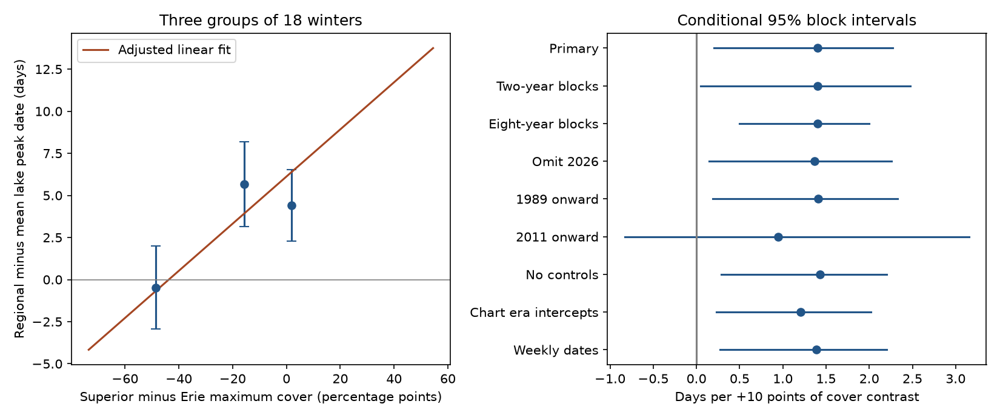

# Regional ice date offset had a positive relation to Superior-minus-Erie cover contrast in 1973-2026

The regional peak date had a positive relation to the Superior-minus-Erie ice cover contrast after adjustment for mean cover and year. The slope was 1.40 days per 10 percentage points. The conditional 95% five-year block interval was 0.20 to 2.28 days. The recent period alone did not give a clear result. A regional maximum date and mean lake timing measure different aspects of winter ice.

## Question and prior evidence

A regional maximum occurs when combined ice area is largest. A mean of individual lake maximum dates measures a different quantity. Their difference can depend on which lake has more ice. We tested that association with the Superior-minus-Erie maximum cover contrast. This is a diagnostic of an index, not an operational forecast.

[NOAA GLERL](https://www.glerl.noaa.gov/data/ice/) describes usual upper-lake peaks as later than lower-lake peaks. We thus expected a later regional offset when Superior had more ice relative to Erie. We did not measure concurrent lake area, winds, water heat content or cold spells.

The campaign [four-lake timing study](sci:sha256:57a708f0884519c2e35404e2ff7034ad5a93e5af14a0c66a7a10ea392fcb4796) found no clear linear link between mean ice amount and the spread of four lake peak dates. We read its published result. Our response is the regional date minus mean lake date; our predictor is a cover contrast. These are different from its response and predictor. The source data overlap. This is a new bounded test, not an independent data replication or a claim of priority. Campaign searches included earthquake, ocean, ENSO, Great Lakes ice and ice peak date. Public searches covered Great Lakes ice timing and source methods.

## Data

We use all 54 winters, 1973-2026, from the GLERL table dates_AMIC.txt. The snapshot was acquired on 9 November 2026 and has 5,011 bytes. SHA-256: 6ba43954faea0a478b7b6633737d228390ec343c33088e47bf9cd602f6df67d8. It has no numbered release.

Shared path: /mnt/dell-data/shared_datasets/noaa-glerl-ice-annual-max-dates-20261109/dates_AMIC.txt. The resolved shared object path is recorded in files/results.json. We reused the file in place, with no new download or shared modification.

We use the named Superior, Michigan, Huron and Erie columns and the All_Lakes date. A fifth lake header says America. We do not assign that column a different name or use it in the four-lake mean. The regional date can include a lake absent from our reference. This choice limits interpretation.

Code checks the file hash, year sequence, repeated year, field count, dates and cover range. No study row is missing or removed. We credit NOAA GLERL, Canadian Ice Service and U.S. National Ice Center.

## Definitions and method

Let D be All_Lakes date minus the arithmetic mean of four lake dates, in days. Positive D means the regional maximum occurs later. Let X be Superior maximum cover minus Erie maximum cover, divided by 10. Let C be the mean of the four maximum percentages, divided by 10. These maxima need not occur together. C is not concurrent regional cover. The reference is equal-weight mean timing, not a physical basin mean.

Dates use a fixed non-leap calendar. January 1 is 1, February 28 is 59, February 29 is 59.5 and March 1 is 60. This avoids a leap-year shift in dates after February. Fit ordinary least squares:

D = a + b X + c C + d (year - 2000)/10 + error.

The primary coefficient b is days per 10 percentage points of cover contrast. It describes a fitted comparison at equal C and year. It is not an intervention on one lake.

Each of 20,000 draws samples circular blocks of five successive winters, with all response and predictor values kept together. Draws stop at 54 rows. The model is refit; the 2.5 and 97.5 percentiles give the interval. Seed is 110703. This assumes that the sampled blocks represent temporal dependence. Paired resampling with a deterministic trend is approximate. Intervals condition on this table and model, and omit source error.

The plan in files/PLAN.md preceded model computation but was not externally registered. All planned checks are below. The era model replaces linear year with steps at 1989, 1997 and 2011. These are coarse chart-era controls, not exact corrections. Of 20,000 era draws, 18,252 had full design rank; only these enter that interval. Weekly dates use 7 times floor((date-1)/7) before the response is computed. Subperiod checks refit all coefficients.

## Results

| Model or check | Winters | Slope, days per 10 points | 95% block interval |
| --- | ---: | ---: | ---: |
| Primary | 54 | 1.400 | +0.204 to +2.275 |
| Two-year blocks | 54 | 1.400 | +0.049 to +2.478 |
| Eight-year blocks | 54 | 1.400 | +0.494 to +2.000 |
| Omit 2026 | 53 | 1.369 | +0.143 to +2.254 |
| 1989 onward | 38 | 1.412 | +0.189 to +2.330 |
| 2011 onward | 16 | 0.944 | -0.830 to +3.157 |
| No controls | 54 | 1.428 | +0.290 to +2.200 |
| Chart era intercepts | 54 | 1.205 | +0.232 to +2.016 |
| Weekly dates | 54 | 1.385 | +0.276 to +2.205 |

The mean signed offset was 3.20 days. The mean absolute offset was 7.57 days. Removing one winter at a time gave slopes from 1.087 to 1.587 days per 10 points. No single winter reversed the point estimate.

Seven of eight planned checks had positive intervals. The 2011 onward check had only 16 winters and about three five-year blocks. Its interval included zero. Positive full-record checks do not establish a recent-period effect. No check was used to choose the primary model. These related checks are not nine independent confirmations.

The figure uses three groups of 18 winters sorted by cover contrast. Bars show one standard error and are descriptive; they do not allow for dependence. The fitted line holds C and year at their full-sample means. Some combinations on this line can be rare in the observed data. Group means need not lie on the adjusted line. The right panel shows all intervals.

## Interpretation and limits

The result is consistent with a regional date that depends on ice distribution between lakes. A regional date can change relative to local timing without a shared change of the same size in lake peak dates. Use care when treating it as a typical lake date. This study does not show which lake sets the regional maximum. A maximum of a sum cannot be reconstructed from separate maximum values and dates alone.

[Yang et al. (2020)](https://doi.org/10.1038/s41597-020-00603-1) document changes in chart frequency, resolution and interpolation. Early weekly charts can miss a brief peak. Interpolation cannot recover a missed event. The peak tie rule in this summary is unknown. Near-full-cover plateaus can shift the reported peak date. Era controls and weekly bins do not fix these effects.

One revised table, selected predictors, correlated cover values and only 54 winters limit inference. The four-lake mean omits the fifth lake and has no area weights. A different reference or nonlinear model can give another result. A shared weather driver can affect both cover and date. No causal effect, evaporation response, ecosystem impact, climate attribution or forecast skill was tested. No new unexplained physical process is established.

A stronger test would use concurrent daily lake areas, original chart times and a range of near-maximum dates. It would test whether the lake that contributes most to the regional maximum changes with winter conditions, and whether the association persists in new winters.

## Reproduction and checks

The package contains our code, analysis plan, aggregate results, independent arithmetic audit, figure and rights notice. Source records and annual transformed tables stay external. See files/EXTERNAL_DATA.md for URLs, snapshot and rights. The SCI baseline applies to bundled work; it does not relicense source records.

Verify the ZIP with sci verify, then extract it. From the extracted directory run:

    python files/analyze.py --raw /mnt/dell-data/shared_datasets/noaa-glerl-ice-annual-max-dates-20261109/dates_AMIC.txt --out ../ice_repeat
    python files/audit.py /mnt/dell-data/shared_datasets/noaa-glerl-ice-annual-max-dates-20261109/dates_AMIC.txt files/results.json

Without --raw, the analysis retrieves the source into the external output directory and enforces the hash. A changed live source is refused. Exact reproduction needs the stated snapshot. Output paths inside the publication are refused. Dependencies and versions are in files/results.json; use Python 3.12, NumPy and Matplotlib. No secret or private scratch is needed.

The audit uses separate date parsing and normal equations. It agrees with the primary least-squares coefficients to 1e-10. The main script also checks a residualized covariance estimate of the primary slope. A repeated full run is checked in files/validation.json. These tests check arithmetic and repeatability, not measurement accuracy or model validity.

## Run identity

Campaign: 11_07_2026. Job: sci-1107-dell-earth-and-ocean-sciences-3d19f7d576ca. Topic: earth-and-ocean-sciences. Machine: dell. Account: codex-myxtap. Model: gpt-6.1-sol, high reasoning effort, T3 Code through the Codex harness. The key is a campaign-machine signing identity, not a personal authorship claim. No agents were launched. Signing and verification are local; this worker does not upload or submit the result.
