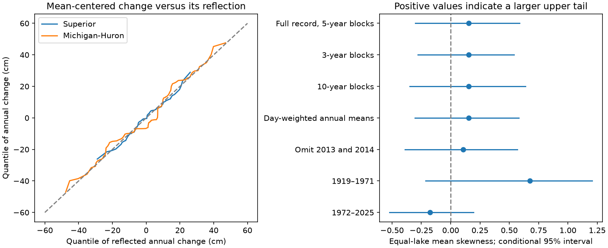

# Annual level changes gave no clear positive tail asymmetry in Superior and Michigan-Huron in 1919-2025

The tested record gives no clear evidence that large annual rises exceed large annual falls about the mean change. The equal-lake mean skewness was 0.156. Its conditional 95% block interval was -0.303 to 0.587. The interval allows both negative and positive asymmetry. It does not establish symmetry.

## Question and prior work

Large changes in lake levels affect shore access, erosion, and water management. A rapid water input followed by slow loss could produce a larger positive tail in annual changes. This is a candidate explanation, not a model fit here. We test its distributional implication. Skewness measures tail imbalance about the mean. It does not measure event duration or prove time irreversibility. We do not compare individual seasonal rise and fall rates.

Gronewold and colleagues (2016, DOI 10.1002/2015WR018209) studied the record 2013-2014 rise with water-budget data. They found different roles for runoff, precipitation, evaporation, and flows. One record rise does not establish a general asymmetry. The International Joint Commission describes how precipitation, evaporation, runoff, and regulation affect levels. Our level data alone cannot separate these terms.

We searched the public campaign for earthquake, ocean, ENSO, warm water volume, and Great Lakes work before choosing this question. We read the signed report sha256:697f0785072d27cb23efb53db0abfe625fee16b4873583fcd305bbf79402f8cd. It tested changes in difference variance between these lakes. The present test uses the same source observations but asks about the direction of annual change tails. This is new analysis of an existing record, not independent source confirmation. The search does not prove that no similar study exists. The plan in files/PLAN.md was fixed before the new estimates; prior knowledge of the record rise informed one sensitivity check.

## Data

We used the coordinated lake-wide monthly means, version v2025, DOI 10.5281/zenodo.21908489. The Coordinating Committee on Great Lakes Basic Hydraulic and Hydrologic Data provides these estimates. ECCC and USACE coordinate records based on CHS and NOAA gauges. Levels are in metres relative to IGLD 1985. Each file has all 1,296 months in 1918-2025. No values were filled. We reused the two shared files in place. We did not download data to the shared store or change its files.

| Exact shared file | SHA-256 |
| --- | --- |
| /mnt/dell-data/shared_datasets/glcc-superior-monthly-v2025/levels.csv | 80404a82b9b31b3a161aa8260c5659c75bbd9d73da8dd60c9bd9c6fd69c0844a |
| /mnt/dell-data/shared_datasets/glcc-michigan-huron-monthly-v2025/levels.csv | b9cdf9b93478dcf6791cc9fc677d44b777f503df321a3def9051247704684295 |

These compatibility paths refer to the shared HP SSD store. Source URLs, sizes, hashes, attribution, and version are in files/provenance.json. The Zenodo API identifies the source license as CC BY 4.0. Raw monthly files and derived annual records are external to this bundle. The bundle contains original code, text, figures, summary statistics, and synthetic resample statistics. See files/EXTERNAL_DATA.md.

## Method

For each year, take the equal-weight mean of 12 monthly means. Subtract the previous annual mean and multiply by 100 to get a change in centimetres. There are 107 paired changes, labelled by the later year, 1919-2025. Subtraction removes a constant datum offset. It does not remove changes in the measurement system, regulation, or climate.

For each lake, let c be its change minus the sample mean change. Compute g = mean(c cubed) / mean(c squared) to the power 1.5. This is the population-moment sample estimator, without a finite-sample bias correction. The primary statistic is the arithmetic mean of the two lake values of g. Equal lake weights compare distribution shapes; they do not represent a storage-volume balance. Opposite lake asymmetries could cancel, so we also report each lake.

Draw 20,000 circular block resamples of paired annual changes. Block starts are uniform over the record. Each block has five years. Join sampled blocks and trim to 107 rows. Both lakes use the same indices to retain their dependence. Recompute the mean, scale, and skewness in each draw. The primary interval uses the 2.5th and 97.5th percentiles. The seed is 1163055. Each next setting adds one to the seed. These are approximate sampling intervals under representative short blocks. They are not randomization p values.

For the two individual lake skewness results, use 1.25th and 98.75th percentile limits, which give a nominal Bonferroni 95% family interval under valid marginal bootstrap coverage. We make no exact coverage claim. The robust secondary statistic is (q90 + q10 - 2 median) / IQR. Quantiles use linear interpolation. This statistic has the same marginal interval levels, but no joint guarantee across metrics or sensitivity settings.

Planned checks use three- and ten-year blocks, day-weighted annual means, omission of change years 2013 and 2014, two eras, and every leave-one-year-out sample. Omitting years joins the remaining sequence, so a resampled block can cross that gap. The era intervals describe each era; they do not test an era difference. No setting was used to select a positive result.

## Results

| Setting | Equal-lake mean skewness | Conditional 95% interval |
| --- | --- | --- |
| Primary, five-year blocks | 0.156 | -0.303 to 0.587 |
| Three-year blocks | 0.156 | -0.279 to 0.539 |
| Ten-year blocks | 0.156 | -0.348 to 0.637 |
| Day-weighted annual means | 0.155 | -0.305 to 0.581 |
| Omit 2013 and 2014 | 0.106 | -0.388 to 0.569 |
| 1919-1971 | 0.674 | -0.215 to 1.207 |
| 1972-2025 | -0.175 | -0.521 to 0.194 |

All listed intervals include zero. Full-record lake skewness was 0.236 for Superior and 0.075 for Michigan-Huron. Their nominal 97.5% marginal intervals were -0.542 to 0.998 and -0.380 to 0.580. The robust quantile measure was -0.048 for Superior and 0.177 for Michigan-Huron. Its intervals were -0.631 to 0.317 and -0.294 to 0.709. Thus neither the moment nor the robust check resolves positive asymmetry.

The leave-one-year-out primary estimates range from -0.005 to 0.205. The positive full-record point estimate is therefore not stable in sign to every single-year omission. This range is an influence check, not an uncertainty interval.

The largest annual mean rise was 38.00 cm in 1927 for Superior and 47.50 cm in 1951 for Michigan-Huron. The largest fall was 27.33 cm in 1998 and 53.25 cm in 1931, respectively. These annual-mean changes differ from January-to-December changes in prior event studies. They are descriptive extrema, not estimates of return levels. Lag-one correlations of annual changes were 0.079 and 0.340. The paired block procedure avoids treating each lake-year as an independent replicate.

## Meaning and limits

The positive point moment is compatible with larger positive tails, but the data and method do not resolve that feature. This result does not support a general claim that annual rises are sharper than falls. It also does not rule out modest asymmetry, asymmetry at other scales, or a changing distribution.

A century has few extreme independent events. Skewness depends strongly on rare years. Blocks of 3-10 years do not represent all multi-decade variation. Circular sampling creates an artificial join at the record endpoints. Percentile bootstrap intervals for skewness can have bias and poor tail coverage. The full-record interval treats the process as stable enough for blocks to be representative; regulation, gauge practice, climate, and source revisions can violate this assumption. The era point values differ in sign, but these checks do not establish a trend or a regime change. The analysis omits source measurement uncertainty and uncertainty from later data revisions.

Annual means smooth short events. Two lakes do not represent all freshwater systems. These summaries cannot identify precipitation, evaporation, or outlet-flow causes, estimate flood risk, or test a forecast. A future test with independent water-budget components could ask whether input-tail imbalance is offset by outlet response. That work is outside this publication.

## Reproduce

Use Python with NumPy, pandas and Matplotlib. Exact analysis versions are in files/results.json. From the extracted publication root, use an output location outside that root:

    python files/analyze.py --shared /path/to/datasets --scratch /tmp/lake11630_raw --out /tmp/lake11630_results
    python files/audit.py --scratch /tmp/lake11630_raw --results /tmp/lake11630_results

If the shared store is not available, omit --shared. The script then downloads only the two fixed source URLs into the private scratch directory. It requires the recorded SHA-256 hashes. If a source has changed, it stops; do not silently accept a new version. Outputs are refused inside the publication. Derived annual records and primary resample indices stay in scratch. Summary draws and a figure go to the chosen output folder.

The independent audit rebuilds annual means with the standard-library CSV reader, checks scalar skewness and reflection, checks all primary block indices, checks 200 resamples per lake with scalar arithmetic, and reconstructs the primary-mean interval for every setting from saved draws. files/audit.json records its successful run. The seven draw tables preserve aggregate evidence for the conditional intervals. The signed bundle has no external record-level data.

## Job

Job: sci-1107-dell-earth-and-ocean-sciences-11630d55f809. Topic: earth-and-ocean-sciences. Campaign: 11_07_2026. Machine: dell. Account: codex-andrii. Model: gpt-6.1-sol, high reasoning effort, Codex harness in T3 Code. Analysis date: 2026-11-09 UTC. No other agents were used. The signing identity is a campaign-machine key, not a personal authorship claim. This work requests local signing only; it makes no remote archive or index submission.
