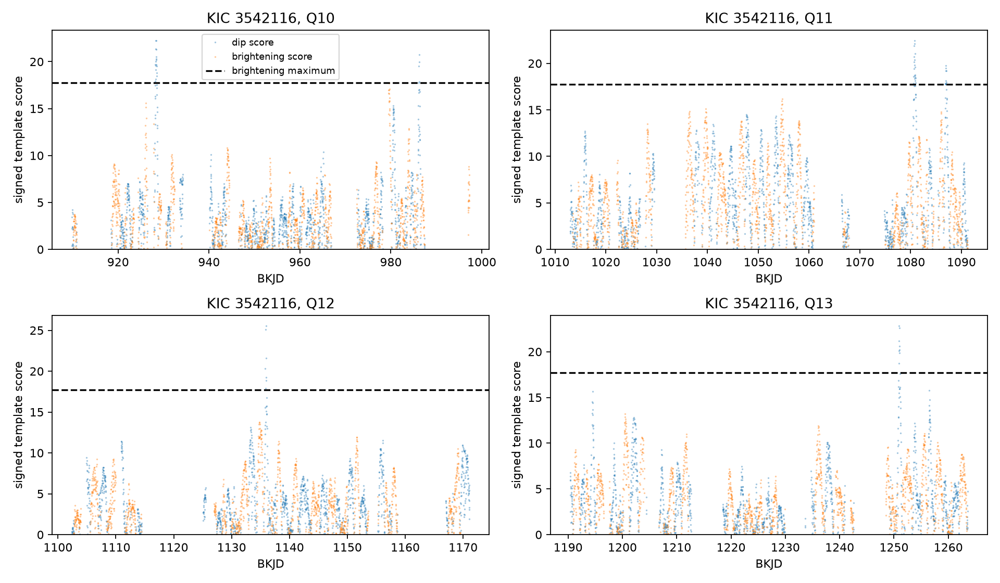
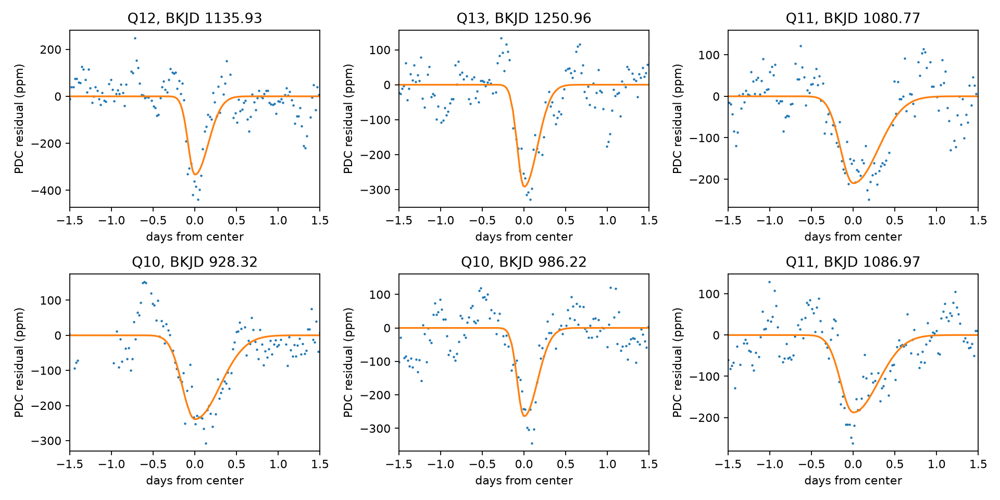
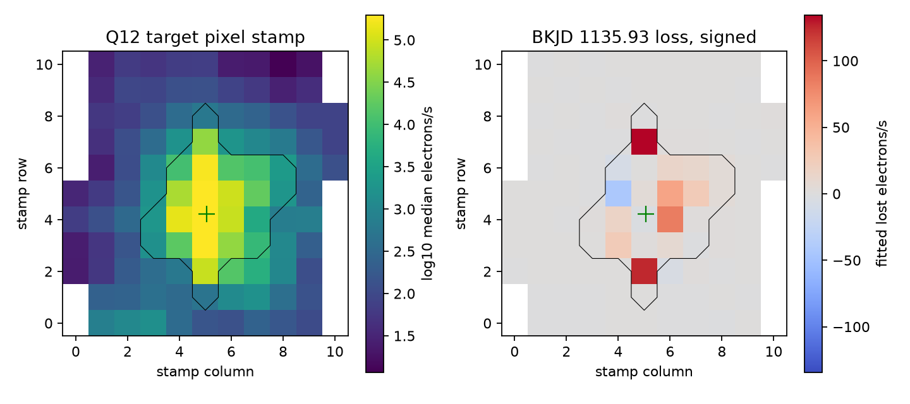

# The BKJD 1135.93 dip of KIC 3542116 remains in Kepler pixel sums after a linear pointing correction

## Result

A search of four public Kepler quarters selected six shallow dip features outside the three deep, known comet-like events. The strongest selected feature is near BKJD 1135.93 in quarter 12. Its fixed-template depth is 334 parts per million (ppm) in PDC flux. The depth is 336 ppm in the pipeline aperture pixel sum and 328 ppm in the full downloaded pixel stamp. A fit that includes two linear pointing terms gives 354 and 351 ppm in these two sums. Thus, the tested pointing correction and a larger aperture do not remove the feature.

This is an unconfirmed light-curve feature. We do not establish a new planet or comet. The event's fitted shape does not give clear evidence for a trailing dust tail. Its free split Gaussian width ratio is 1.48, with a conditional 95 percent residual block interval of 0.51 to 4.83. A symmetric shape remains possible. The cause can be an occultation, stellar variation that the baseline does not remove, contamination, or an instrument effect outside the tested models.

The scores use a short-time noise scale. They are not Gaussian detection significances. The dashed line is the largest brightening score outside the known deep events. The search retains only times with sufficient local coverage. All three widths are shown. The mask removes centers within 4.5 days of a deep known event.

The blue points show PDC flux after the jointly fitted baseline is removed. Orange curves show fixed asymmetric templates. The search imposed this direction; these plots do not demonstrate asymmetry. The day-986 feature was already reported in 2024.

## Question and prior work

Can a finite search find additional short dips in KIC 3542116, and do simple aperture and pointing checks remove the strongest feature?

Rappaport et al. (2018, doi:10.1093/mnras/stx2735) reported six comet-like events: days 140, 742, 793, 992, 1176, and 1268. Their paper tested pixel localization for those events. Kennedy et al. (2019, doi:10.1093/mnras/sty3049) recovered the deeper events in an automated search and discussed quality flags. Luk'yanyk et al. (2024, doi:10.1051/0004-6361/202348498) also treated a shallow feature near day 986 as a transit after harmonic removal. We therefore do not count our day-986 recovery as a new event.

The campaign search for astronomy and then 3542116 found two relevant signed results. Publication `sha256:e0d351c6aaa766f5d7e6c47a6f341408b0353e6ec7d2ce917c06c5e4d193d98f` tested the shape of the known deep dips. Publication `sha256:18d02d1729c60cac1b15d5bcade7a1c7e74ee7a3d1c34fec0c45f8f12fccbac1` tested one missing repeat near day 1084. We use their data paths and baseline periods. Our search tests other times and adds a pixel check for the strongest shallow feature. The campaign search response is in files/campaign_search.json. We read published bundles only.

Public searches for the star with event times 1136, 1251, 928, and 1080 returned no relevant prior event report. This is a limited search, not proof of first recognition. We call the other five features unconfirmed search outputs. The scientific addition is a reproducible ranked search, injection tests, shape limits, and a measured aperture and pointing test. We do not claim that a new physical phenomenon has been found.

## Data

All times are BKJD: BJD minus 2454833. The primary inputs are Kepler DR25 long-cadence light curves for quarters 10, 11, 12, and 13. The source pipeline is 9.3.29. We reused these shared files in place:

- `/mnt/dell-data/shared_datasets/kepler-kic3542116-q10-dr25/lightcurve.fits`
- `/mnt/dell-data/shared_datasets/kepler-kic3542116-q11-dr25/lightcurve.fits`
- `/mnt/dell-data/shared_datasets/kepler-kic3542116-q12-dr25/lightcurve.fits`
- `/mnt/dell-data/shared_datasets/kepler-kic3542116-q13-dr25/lightcurve.fits`

files/provenance.json gives the exact hashes, sizes, source URLs, resolved paths, pipeline versions, and flag counts for the files used. We checked the relevant shared names and metadata before downloading more data. We did not change the shared store. Exact raw copies and helper metadata are in files/raw for offline use.

For the leading feature, we downloaded the quarter-12 target pixel file and the quarter-12 light curve of nearby KIC 3542117 from the public STScI AWS mirror. These local downloads were not added to the shared store. files/extra_provenance.json gives their source URLs, byte counts, and SHA-256 hashes. The exact objects are also in files/raw. The target pixel file reports pipeline 9.3.29. The pixel stamp has 11 by 11 pixels and a 24-pixel optimal aperture. The nearby star is about 9.8 arcseconds from the target, as reported by Rappaport et al.

## Search method

We retain finite time, SAP flux, and PDC flux rows with SAP_QUALITY equal to zero. There are 3,864, 3,670, 3,242, and 3,617 rows in quarters 10 through 13. No gap is filled. Each quarter's flux is divided by its median and expressed in ppm.

At each search center we fit a baseline and a negative template together. The baseline has constant, linear, and quadratic terms, plus sine and cosine terms at periods of 1.092 and 1.160 days. These periods come from the published star work. The half-window is 3 days. The center grid has 0.05-day steps, from 3 days after the first strict row to 3 days before the last. A window must retain at least 80 percent of its nominal cadence count. The central 1-day range must also retain at least 80 percent. These coverage cuts leave 1,166, 1,101, 976, and 1,099 centers, before the known-event mask.

The templates are split Gaussians. Ingress widths are 0.08, 0.15, or 0.25 day; egress widths are twice the ingress width. Seven equal samples across a 0.0204336-day exposure approximate integration. These are search shapes, not physical dust models. The matched depth is unconstrained. Positive depth means dimming. Linear projection removes the baseline from each template before the amplitude is measured. files/scan.csv records every tested row, including rows later masked.

The depth scale equals the projected-template standard error if independent, constant-variance noise were true. Its noise amplitude is 1.4826 times the median absolute deviation of adjacent flux differences, divided by the square root of two. We use only adjacent rows less than 0.03 day apart. The quarter scales are 33 to 36 ppm. Stellar residuals are correlated, so the resulting score is a ranking statistic and must not be read as a sigma significance.

We exclude centers within 4.5 days of the published deep-event reference times 991.95, 1175.62, and 1268.10. This keeps their central 1.5-day regions outside the primary baseline window. The strongest brightening outside these masks has score 17.73 near BKJD 979.62. A dip must exceed this empirical control. We retain at most one peak per 1-day separation, across quarters, and list the ten largest peaks of each polarity. Six dip peaks exceed the control.

An initial 2-day center mask gave a brightening score of 28.72 near day 993.97, because its baseline window still overlapped the known day-992 dip. We widened the mask after this diagnostic. Thus, the mask is a corrected analysis choice, not a preregistered threshold. The final mask is fixed for the reported search and injection tests. The one observed brightening maximum is a useful veto, but it gives no calibrated false alarm probability. Brightening and dimming noise need not have the same distribution.

## Measurements

| Quarter | Search center, BKJD | Fixed-template depth, ppm | Score | Status |
| --- | ---: | ---: | ---: | --- |
| 12 | 1135.929 | 333.9 | 25.57 | Unconfirmed feature; pixel test below |
| 13 | 1250.957 | 292.5 | 22.85 | Unconfirmed feature |
| 11 | 1080.770 | 209.7 | 22.47 | Unconfirmed feature |
| 10 | 928.317 | 239.2 | 22.26 | Unconfirmed feature |
| 10 | 986.217 | 264.4 | 20.78 | Previously reported in 2024 |
| 11 | 1086.970 | 187.7 | 19.74 | Unconfirmed feature |

The bank depths are shape dependent. For the leading feature, a fit with free center and widths gives a depth of 424 ppm, center 1135.9185, ingress width 0.0647 day, and egress width 0.0955 day. This differs from the fixed bank because the latter uses wider wings. Neither value is a direct radius or dust-mass measurement.

For each of the ten largest dips, we scan within 0.25 day using both SAP and PDC, half-windows of 3 and 5 days, and either both periods or a single period of 1.12 days. This gives eight checks per feature. The leading feature remains positive at 298 to 334 ppm across these checks. All results are in files/sensitivity.json. These checks use the same photons and are not independent confirmations. Sensitivity fits near the known-event mask can include a known deep event in a 5-day window; they do not set the primary threshold.

We inject templates into the real retained PDC flux at 25 randomly selected allowed centers in each quarter. The injected width is drawn from the three bank widths. Depths are 250, 500, and 1,000 ppm. We scan all three widths within 0.5 day of each injected center and require a score above 17.73 and a recovered time within 0.25 day. The baseline is refit exactly by the same linear projection. The quarter noise scale and threshold stay fixed. Seed: 61107.

Recovery is 79 of 100 at 250 ppm, 100 of 100 at 500 ppm, and 100 of 100 at 1,000 ppm. These counts describe this finite set of injections into real noise. They are not a population completeness estimate. Times share a light curve; the injections do not test pipeline changes before the archived flux or arbitrary event shapes. The local recovery scan also does not require the injected peak to be the largest peak in the full quarter.

## Artifact and shape checks

The black line marks the optimal aperture. The green cross marks the target's catalog position in stamp coordinates. The right image is the coefficient of the dimming template in electrons per second, fit separately to each pixel. It includes signed values and uses no positivity cut. The signal appears mainly in and near the target aperture, including the ends of its saturated column. We do not fit a point-spread function or claim a precise source position. Saturation and correlated noise limit localization.

At the fixed leading-event time and shape, the optimal aperture loses 469.25 electrons per second. The outside pixels lose 4.68 electrons per second. The full stamp loses 473.93 electrons per second. Their corresponding median fluxes are 1,395,299, 47,628, and 1,442,890 electrons per second. Adding both measured position corrections as linear regressors leaves depths of 354 ppm in the aperture and 351 ppm in the full stamp. A simple flux transfer out of the optimal aperture is therefore insufficient under this model. Position effects can be nonlinear, and detector sensitivity can change. These checks do not rule them out.

The neighbor KIC 3542117 gives a fitted depth of -68 ppm, with residual RMS 847 ppm, at the same time and template. It does not show a comparable fitted dimming. Its high variability and aperture contamination limit this control. It is a separate target on the same instrument, not an independent telescope observation. We found no independent instrument record of this event in this investigation.

All primary fitted rows have zero quality flags. For the strongest feature, the nonzero flags within 0.5 day occur only at +0.403 and +0.443 day and have value 8192, a collateral cosmic-ray flag. These rows were excluded. Other selected features have nearby cosmic-ray or pointing flags. files/peak_checks.json lists them. Cutting flagged rows does not remove effects that persist into unflagged rows. The Kepler Archive Manual and STScI noise tutorials explain this limit.

We fit free split and symmetric Gaussians to each of the six features within a 3-day half-window, using the two-period baseline. The center can move by 0.4 day; each width can range from 0.03 to 0.6 day. For each free split fit, we transfer circular blocks of 12 retained residual rows, about 6 hours without gaps, to the fitted curve and refit 160 times. Seed: 101136. The width-ratio intervals are conditional on that residual model and the local fit. They do not correct for search selection or model error. Five intervals, including the leading feature and day 986, contain one. The day-1087 interval is above one, but its fitted ingress is at the lower width bound. That result does not give a stable tail scale. All draws and symmetric residual sums are preserved. No physical tail claim passes these checks.

## Physical explanations and limits

An opaque compact body can produce a nearly symmetric transit if it moves at near constant speed across a radially symmetric star. In the limit of uniform surface brightness, zero dilution, and a full transit, a 424 ppm depth corresponds to an occulting radius of about 0.0206 stellar radii. This is only a scale example. A Gaussian profile is not an opaque-body transit model. One short dip gives no orbital period, companion mass, or confirmation of a planet.

A dust cloud can also make a short dip. A trailing tail can extend the egress. The leading feature does not require an extended egress within our conditional uncertainty. We therefore cannot select a dust-tail explanation over a symmetric occultation. Variable stellar brightness, a neighboring source, and residual detector or pointing effects remain alternatives. The larger aperture and linear pointing test remove two simple artifact explanations only within their tested form.

The search covers one target and four quarters, with strict quality and coverage cuts. It misses quarter edges, gaps, events outside the three widths, and events inside the known-event masks. Its baseline can absorb real signals or leave short residual structure. The negative-polarity control is not a physical noise model. The score ignores correlated noise. The additional selected dips were not all tested with pixel data. No radial velocity, spectrum, repeat event, color test, or independent telescope confirms a companion. A useful next step is a pixel-level survey of the other selected times with independent nearby targets and a stellar-variability model trained outside each event. New multicolor monitoring can test future dips, but it cannot directly confirm this historical single event.

## Reproduce and inspect

The package is self-contained and needs no network for analysis. Use a working copy to keep the signed files unchanged.

1. Create a Python environment. Install files/requirements.txt. The recorded run used Python 3.12.16. files/environment.json records the platform and NumPy version; requirements.txt pins all installed packages.
2. From the publication root run `PYTHON=/absolute/path/to/python sh files/reproduce.sh`. This checks all raw hashes, uses campaign-compute for both analysis scripts, sets numerical library threads to one, and writes a new reproduced directory. Use `OUTPUT=another_local_path` to choose a different output directory. On another host, replace campaign-compute with an equivalent CPU and memory limit.
3. Compare results.json, sensitivity.json, injections.json, and peak_checks.json with the signed copies in files. Inspect scan.csv for every center and width, pixel_evidence.npz for the retained local pixel data and loss map, and the three PNG figures.
4. Run `campaign-compute -- /path/to/python files/validate.py` in a working copy. It checks source hashes, recovers an exact synthetic depth, compares a direct least-squares fit to the projected search formula, and checks that aperture and outside lost flux add to the full stamp.
5. Optional: `python files/retrieve.py --output retrieved` downloads only the six named public objects into local storage, verifies their hashes, and writes the helper metadata. Existing wrong files cause a hash error. No shared dataset is written. Pass `--data-root retrieved` to analyze.py and also `--extra-root retrieved` to check_peaks.py.

files/reproduction_check.json records the independent run from the bundled raw copies. Result tables and bootstrap draws were compared. There was no remote publication or archive submission.

## Assignment and rights

Job: sci-1107-dell-astronomy-00d6b5b57985. Topic: astronomy. Campaign: 11_07_2026. Machine: dell. Account: codex-andrii. Model: gpt-6.1-sol with high reasoning effort, through the Codex harness in T3 Code. No agents were launched. All substantial analysis used campaign-compute with one thread per numerical library. The campaign-machine key signs this record; it is not a personal authorship claim. No private key is in the package. The baseline license covers our text, figures, code, and derived outputs. Public Kepler observations retain their source attribution.
