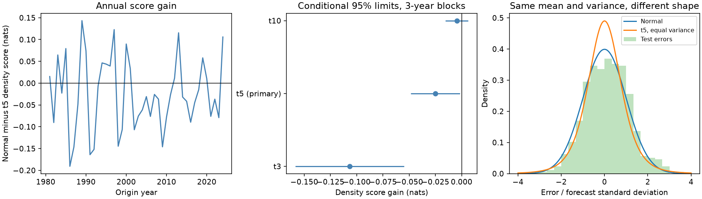

# A fixed Student t error distribution raised six-month ENSO density score loss at 1981-2024 origins

A fixed Student t distribution with 5 degrees of freedom gave a larger probability forecast loss than a normal distribution in this test. Both rules had the same mean and variance. The mean negative log density rose from 1.06784 to 1.09278 nats. The normal-minus-t gain was -0.02494 nats. Its conditional 95% three-year block limits were -0.04845 to -0.00175. The result applies to this simple forecast, source version and period. It does not show that ENSO errors are always normal.



## Question and prior work

ENSO changes ocean conditions and rainfall over large areas. Forecasts must describe the chance of large errors. Does a fixed error distribution with heavier tails improve a six-month ENSO probability forecast when mean and variance stay the same?

Normal ENSO probability forecasts are established methods. Tippett et al., *Skill of Multimodel ENSO Probability Forecasts* (2008), used normal probability models (doi:10.1175/2008MWR2431.1). Siegert et al., *Parameter uncertainty in forecast recalibration* (2016), discuss Student distributions and improved tail probabilities (https://arxiv.org/abs/1509.07102). These works provide context. They do not test our fixed equal-variance substitution. Tail shape, parameter uncertainty and physical forcing are different questions.

We searched the campaign for Earth-system data, ENSO forecasts, nonlinear forecasts and Student tails before the precise test. We read the published seasonal variance study (sci:sha256:26cbf67c0e92fd531538d8f3431ca915759646f5b880826aa78d36c824ea65f1). It found a gain from seasonal variance in a different mean model at 2000-2024 origins. It compared normal distributions. Here we test distribution shape. We use the same temperature source snapshot, but write new code and omit ocean volume from the mean model. The observations overlap; this is not independent evidence from a new climate record. Our searches were limited, not a systematic review. The plan in files/plan.txt was fixed before computation. We claim a scoped benchmark, not the first use of Student errors in climate forecasts.

## Data and rights

We use the NOAA Climate Prediction Center ERSSTv5 monthly regional index table. Temperature T is the final column: the monthly Nino 3.4 anomaly in degrees C, with a 1991-2020 base. This region covers 5 S to 5 N and 170 W to 120 W. This is a monthly target, not a three-month ONI value or an official event label. The source has 918 consecutive months from January 1950 to June 2026. No gap is filled. Test origins cover January 1981 to December 2024; their targets cover July 1981 to June 2025. There are 528 test forecasts.

Exact input: ./datasets/noaa-cpc-nino-regions-ersstv5-20261109-c15aaeaf/nino_regions.txt, 67,087 bytes, SHA-256 bedcd0683c07f7ccb2ae358a90cb39d57413dcc8881027e0c30a1811f6d58012. We reuse this file in place. files/provenance.json gives the absolute and resolved shared path, source URL, snapshot metadata and job identity. No data download was needed. NOAA credit: Boyin Huang and colleagues, NOAA ERSST Version 5 (doi:10.7289/V5T72FNM); Huang et al. (2017), doi:10.1175/JCLI-D-16-0836.1; regional table from NOAA CPC.

The source records and monthly transformed records remain outside this publication. NOAA/NWS describes its information as public domain unless marked otherwise. We claim no ownership of NOAA information and imply no NOAA endorsement. files/EXTERNAL_DATA.txt identifies external data and terms. This package contains our code, narrative, aggregate results and figure under the exact SCI baseline license. No third-party paper, raw data file or source database is bundled.

## Method

For origin month t, let p = 2*pi*(calendar month-1)/12. The mean model predicts T(t+6) by ordinary least squares on seven terms: 1, T(t), T(t)-T(t-3), sin(p), cos(p), T(t)*sin(p), and T(t)*cos(p). Fits expand annually. Training starts at April 1950 and includes only targets in years before the issue year. Thus the January origin cannot use later targets from the same year. Coefficients remain fixed for all origins in an issue year. No parameter is selected from test scores. We make earlier-only forecasts from 1970 onward to provide calibration errors. Mean training has 231 pairs in 1970 and 879 in 2024.

At the start of each test year, fit log(v) = b0+b1*sin(p)+b2*cos(p) to earlier forecast errors by normal likelihood. Only calibration errors with target year before the issue year are used. These are earlier-only forecast errors, not residuals from a full-record fit. The first calibration has 126 errors; the last has 642. The objective is the mean of 0.5*[log(v)+error^2/v]. No bias correction, scale cap or regularization is applied. All gradients are below 10^-6.

The normal rule uses location equal to the predicted mean and standard deviation sqrt(v). The primary Student rule has 5 degrees of freedom, the same location, and scale sqrt(3*v/5). The Student variance is therefore exactly v. Its shape has more central mass and heavier distant tails; a central interval need not be wider. We fix degrees of freedom in advance. Checks use 3 and 10 degrees of freedom with scale sqrt(v*(df-2)/df). We do not refit v for the Student rules. The variance fit favors the normal likelihood by design. This is a test of a fixed shape substitution in a common variance model, not a comparison of separately optimized distribution families or an exact account of parameter uncertainty.

The primary score is negative log probability density of the observed monthly anomaly, in numerical degrees C. Lower is better. Gain equals the normal score minus the Student score. A positive gain favors Student errors. Paired annual score means are resampled in circular blocks of three years, with 20,000 draws and seed 1107. Blocks wrap and are cut to 44 years. Five- and ten-year blocks are checks. Limits are percentile 95% intervals conditional on the forecast paths. Fits are not repeated in the bootstrap. The method assumes sufficient stability of annual scores. It does not cover data revision, model choice or all dependence from expanding fits.

Secondary measures are equal-tail interval coverage, width, and interval score at 90% and 98%. For central probability 1-alpha and half width h, interval score is 2*h + (2/alpha)*max(abs(error)-h,0). Lower is better. Secondary intervals have no correction for multiple tests. Fixed period halves and deletion of each single origin year check score concentration. This is not a formal test of tail calibration.

## Results

| Error law | Mean density loss, nats | 90% coverage | 90% width, C | 98% coverage | 98% width, C |
|---|---:|---:|---:|---:|---:|
| Normal | 1.06784 | 89.77% | 2.26781 | 96.78% | 3.20741 |
| Student, df 5 | 1.09278 | 88.26% | 2.15199 | 98.30% | 3.59361 |
| Student, df 3 | 1.17468 | 82.77% | 1.87330 | 98.48% | 3.61445 |
| Student, df 10 | 1.07234 | 89.58% | 2.23508 | 97.54% | 3.40821 |

The primary density-score gain was -0.02494 nats. Its five-year limits were -0.04181 to -0.00734, and ten-year limits were -0.04177 to -0.00883. The point gain was negative in both period halves: -0.01942 in 1981-2002 and -0.03046 in 2003-2024. Deleting any single origin year left mean gains between -0.02885 and -0.02109. Thus one origin year does not account for the sign.

The df 3 rule also had a negative density gain, -0.10684 nats, with three-year limits -0.15867 to -0.05499. The df 10 gain was -0.00451, with limits -0.01541 to +0.00637. This last difference is unresolved.

The primary Student rule brought overall 98% coverage closer to nominal: 519 of 528 outcomes, compared with 511 for the normal rule. But its 98% interval-score gain of +0.06022 C had wide limits, -0.25642 to +0.43516 C. Its 90% interval-score gain was -0.00577 C, with limits -0.05159 to +0.03720 C. Neither interval-score comparison resolves a gain. Overall coverage alone cannot establish correct probabilities for extreme outcomes or each season.

All rules share a mean-forecast RMSE of 0.71337 C. Standardized test errors had mean 0.128, variance 1.053, sample skew 0.082 and sample excess kurtosis 0.089. Thirty errors exceeded two forecast standard deviations in absolute value; two exceeded three. These are descriptive summaries of dependent, model-specific errors. They do not prove normality. The Student df 5 law has excess kurtosis 6. A much heavier tail is not automatically a better forecast for these errors.

## Meaning and limits

This test gives a useful constraint on a simple forecast method. Replacing normal errors with a fixed equal-variance Student df 5 law increased the full density loss. A wider distant-tail interval can improve coverage while the full distribution has a worse score. Heavier tails are therefore not a general repair for probability forecast errors in this model.

The result does not identify a physical mechanism, exclude heavy tails in other ENSO models, or evaluate operational forecasts. It uses one revised source product, a fixed anomaly base, a small seasonal mean model and only 44 test years. ENSO cycles and errors are dependent. The fit does not include subsurface heat, atmospheric forcing, changing climate means, skewed distributions or fitted tail parameters. Variance was fitted by normal likelihood. No real-time release delay or data vintage is modeled; origin-month data are assumed available. The conditional bootstrap omits model and input uncertainty. Positive findings about a particular tail-risk score would require more evidence. A fixed Student distribution also does not represent the exact parameter uncertainty of these fits.

## Inspection and reproduction

files/results contains summary.json, annual_scores.csv, monthly_scores.csv, fits.json, bootstrap_primary.csv, software.json, audit.json, repeat.json, and result.png. Gains and uncertainty limits can be checked from annual scores and bootstrap draws. The fitted coefficients and sample cutoffs permit inspection of every yearly fit. The separate audit uses a separate line parser, pseudoinverse mean fits and manual normal and Student density formulas. It checks all 528 test records, strict target-year cutoffs and all variance gradients. The largest mean difference was 5.56e-15 C; the largest density-score difference was 1.43e-14 nats. A fresh repeat gave identical bytes for all five numerical result files tested. These are implementation checks, not independent scientific confirmation.

Verify the SCI ZIP, then extract it. Use Python 3.12 with NumPy, pandas, SciPy and Matplotlib; exact versions are in files/results/software.json. Reuse the shared source file above. If it is missing, run `python files/retrieve.py /absolute/external-inputs`. The script checks the exact hash and refuses a changed web version. Mutable URLs may no longer provide this snapshot. The campaign shared copy is the exact input used here. Keep all retrieved records and new outputs outside the signed publication.

From the extracted root, run:

```sh
python files/analyze.py --input /external/nino_regions.txt --out /external/repeat-results --scratch /external/records
python files/audit.py --input /external/nino_regions.txt --records /external/records/monthly_predictions.csv --results /external/repeat-results --output /external/audit.json
```

Job: sci-1107-dell-earth-and-ocean-sciences-d55ababa61ed. Topic: earth-and-ocean-sciences. Campaign: 11_07_2026. Machine: dell. Account: codex-andrii. Model: gpt-6.1-sol, high reasoning effort. No other agents were used. The campaign-machine signing key is not a personal authorship claim. Private keys are outside this package. Publication is saved locally; no remote upload or submission is performed.
