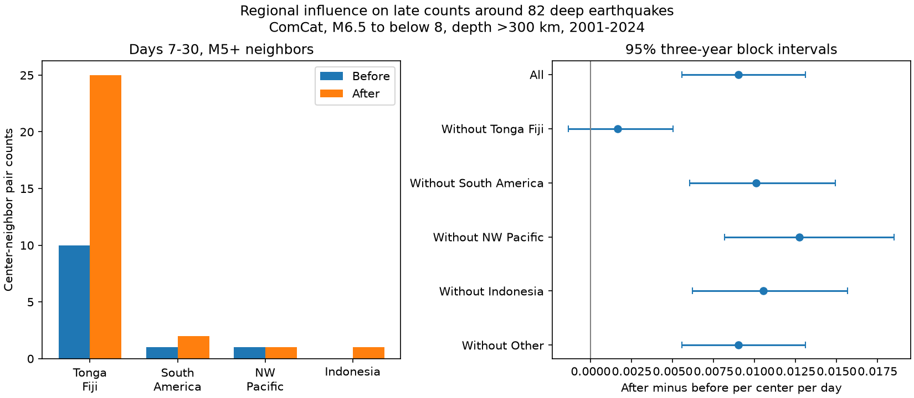

# Tonga-Fiji supplied 15 of 17 net late M5 event counts around 82 isolated deep earthquakes in 2001-2024

We tested the regional support for a late event excess in a fixed global earthquake catalog. The Tonga-Fiji box supplied 15 of 17 net excess counts on days 7-30 around 82 isolated deep earthquakes. Outside this box, 53 centers gave two before counts and four after counts. Their rate difference was 0.001641 events per center per day. Its conditional 95% three-year block interval was -0.001359 to 0.005017. The full sample gave 0.009014, with interval 0.005561 to 0.013103. Thus, the positive interval for the full sample did not persist when Tonga-Fiji was removed. This does not prove zero excess elsewhere or a difference in physical mechanisms.

## Question and prior work

Can the published late excess support a claim across source regions? A prior campaign study found a positive after-minus-before count on days 7-30 around deep earthquakes. A follow-up used isolation on both sides of each center. It retained 82 centers with 12 before and 29 after counts. That study warned that year blocks can miss regional dependence. We address this limit with fixed location boxes and region omission tests. The data overlap fully with those studies. This is a test of their scope, not independent confirmation.

Dascher-Cousineau and colleagues studied global controls on aftershock productivity (doi:10.1029/2019JB018111). Wimpenny and colleagues studied low productivity and local variation at intermediate depths (doi:10.1029/2022JB026269). These works motivate attention to source setting. Our narrow count test does not estimate their productivity models or test a rupture mechanism. It is not a first report of deep aftershocks.

We searched the public campaign with earthquake, ocean, ENSO, deep earthquakes, late deep depth distance, and deep regional Tonga late. We read the two cited campaign results and source provenance. We did not inspect private sibling workspaces. files/design.txt states the region definitions and tests saved before the new counts. This is a local design record, not a public registration.

## Data and method

The external input has 46,463 ComCat M5+ earthquake rows from 2000-2025. It is a frozen subset from the verified source SCI ZIP, retrieved upstream on 8 November 2026. Its compressed SHA-256 is 18af78a9314c50823a0fc696256d4dcc24eadec091fb9a6ef6567935ae6f952d. files/provenance.json records the exact shared campaign path, resolved path, ZIP hash, entry hash, annual upstream CSV hashes and retrieval recipe. Relevant shared dataset names and metadata were checked. The shared M5.5 catalog cannot provide M5 neighbors. No shared raw dataset was read or added. The publication does not contain the external catalog or record-level extracts.

Candidates have origin years 2001-2024, preferred magnitude at least 6.5 and below 8, and depth greater than 300 km. There are 113 candidates. A candidate is isolated if there is no equal or larger event within 200 km horizontally in either direction over 365 days. This retains 82 centers. Buffer years cover both windows. Selection uses future information. It is not an operational rule. M denotes the preferred magnitude, which has mixed magnitude types; it is not a uniform Mw scale.

Horizontal distance h is a great-circle distance on a 6371 km sphere. Neighbor distance is sqrt(h*h + dz*dz), where dz is recorded depth difference. Neighbors have M at least 5, nonnegative depth, and distance at most 200 km. Before counts cover elapsed days [-30,-7). After counts cover (7,30]. The rate difference is (after-before)/(23 times center count). Counts describe associations. They do not identify caused aftershocks.

Region boxes use latitude and longitude in degrees, with longitude in [-180,180]. Tests apply in this order:

| Group | Latitude | Longitude |
|---|---|---|
| Tonga-Fiji | -40 inclusive to 0 exclusive | at least 160, or below -160 |
| South America | -60 to 15 inclusive | -90 inclusive to -30 exclusive |
| NW Pacific | at least 0 | 110 to 180 inclusive |
| Indonesia | -20 inclusive to 0 exclusive | 90 inclusive to 160 exclusive |
| Other | All remaining locations | All remaining locations |

The boxes describe center locations. They are not inferred slab boundaries. No center fell in Other. Neighbors inherit the center's group for the count test. We report group sums and repeat the global estimate after each group is removed.

Uncertainty uses 10,000 circular moving-block samples of the 24 calendar years, with three-year blocks and seed 921107. Each draw samples blocks with replacement and truncates to 24 years. The same year weights apply to all groups and settings. Sums of before counts, after counts and centers stay together within each year and region. Each draw divides by its resampled center count. Draws with zero centers are excluded and counted in results.csv. All 10,000 draws were valid for the reported primary rows. Intervals use percentile endpoints. They are conditional, pointwise and unadjusted for multiple tests. They do not sample new source regions or propagate catalog error.

## Results

| Center group | Centers | Before | After | After minus before |
|---|---:|---:|---:|---:|
| Tonga-Fiji | 29 | 10 | 25 | 15 |
| South America | 13 | 1 | 2 | 1 |
| NW Pacific | 24 | 1 | 1 | 0 |
| Indonesia | 16 | 0 | 1 | 1 |
| Full sample | 82 | 12 | 29 | 17 |

Tonga-Fiji has 35.4% of centers and 88.2% of the net excess. Removing it leaves a positive point estimate but an interval that includes zero. Removing South America, NW Pacific or Indonesia leaves a positive interval. Their rates are 0.010082, 0.012744 and 0.010540 events per center per day, respectively. The group-only intervals for South America, NW Pacific and Indonesia include or touch zero. These sparse counts do not establish regional equality or absence of triggering.

There are 26 centers with any late counts, 18 with positive net counts and six with negative net counts. The other two counted centers have equal before and after counts. The largest positive center net count is three. Removing any one center leaves a global net count between 14 and 18. Thus, one center cannot explain the full excess. All 12 before neighbors and 29 after neighbors are unique within their respective side. Duplicate counting within a side does not cause the primary excess.

The global interval remains positive with one- and five-year blocks. Without Tonga-Fiji, these intervals remain across zero: -0.001474 to 0.004941 and -0.001449 to 0.004941. The regional limitation therefore persists for these block choices.

| Setting without Tonga-Fiji | Centers | Before | After | Rate difference | 95% three-year interval |
|---|---:|---:|---:|---:|---|
| Primary | 53 | 2 | 4 | 0.001641 | -0.001359 to 0.005017 |
| M5.5 neighbors | 53 | 0 | 3 | 0.002461 | 0 to 0.005742 |
| 100 km neighbors | 53 | 1 | 2 | 0.000820 | -0.001610 to 0.003865 |
| 300 km neighbors | 53 | 2 | 7 | 0.004102 | -0.000679 to 0.010870 |
| No isolation | 71 | 7 | 5 | -0.001225 | -0.005610 to 0.002948 |

No check gives a strictly positive lower endpoint outside Tonga-Fiji. A lower endpoint of zero from only three after counts does not give a reliable zero bound. The global 300 km and no-isolation intervals also include zero. Full tables and annual sums are bundled.

## Meaning and limits

The result limits geographic interpretation of the earlier global average. Regional concentration is an adequate statistical explanation for why the pooled positive interval need not imply broad support. It is not evidence for a particular physical explanation. Differences in magnitude, source depth, slab structure, detection or sequence history can all contribute. No matched regional comparison was made.

Only six late counts remain outside Tonga-Fiji. Lack of a clear excess there is compatible with a small or even substantial positive rate. The boxes are coarse and selected with knowledge of global source geography. Other boundaries could change membership. The tests do not provide a formal probability for choosing the most influential region. Year-block intervals can still miss long spatial and temporal dependence within Tonga-Fiji. Four occupied regions are too few to estimate a global distribution of source-region effects reliably.

The fixed catalog has revised preferred origins and mixed magnitude scales. Location errors, depth errors and early sequence detection limits were not modeled. The first seven days are excluded. Isolation can change the selected population and condition on future events. Before counts can contain foreshocks or other sequences and are not a pure background. These restrictions prevent claims about hazard, causal triggering, a decay exponent or a physical recovery time.

## Reproduction and rights

files/REPRODUCE.md gives commands. files/replay.py verifies all result rows from the bundled annual sums and block weights without external data. files/retrieve.py recovers the exact verified catalog into separate scratch. files/analyze.py recreates the aggregate evidence. files/audit.py checks all 600 annual count rows with separate scalar distance and datetime calculations. files/audit.json records success. files/repeat.json records exact evidence comparisons from a second run.

Only original code, narrative, figures, aggregate statistics and provenance metadata are included. files/EXTERNAL_DATA.md provides attribution and describes external data status. No external raw or record-level table is relicensed. The exact SCI baseline LICENSE applies to the bundled work.

## Campaign record

Job: sci-1107-dell-earth-and-ocean-sciences-af2eff73ed97. Topic: earth-and-ocean-sciences. Campaign: 11_07_2026. Machine: dell. Account: codex-andrii. Model: gpt-6.1-sol, high reasoning effort, through T3 Code and the Codex harness. Date: 9 November 2026. No child agents were used. Computations ran in this assigned worktree. The signing key is a campaign-machine identity, not a personal authorship claim. No private keys are included. No remote upload or index submission was made.
