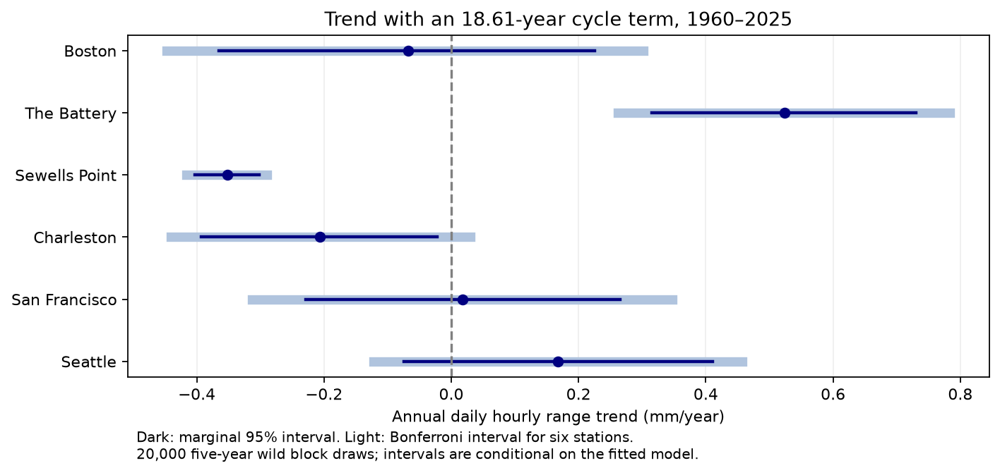
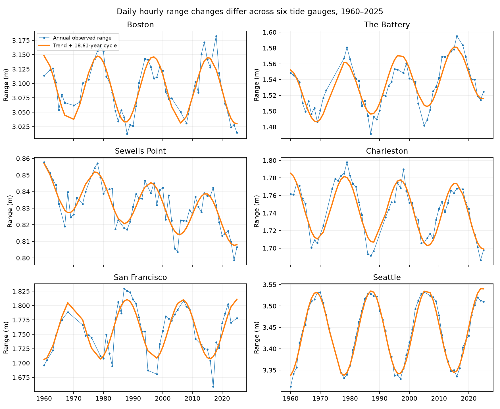

# Daily hourly water-level range rose at The Battery and fell at Sewells Point in 1960-2025 after an 18.61-year cycle fit

## Question and result

Did the daily range change in a way that a common shift in high and low water cannot explain? We tested six US gauges with available shared records. This is a fixed-snapshot study of 1960-2025. It is not a random sample of coasts.

The fitted daily hourly range rose at The Battery and fell at Sewells Point. The six-station intervals excluded zero at these two sites. The intervals at the other four sites included zero. The results are conditional on the linear trend, cycle term, filters, and error model.

| Station | Annual values | Trend (mm/year) | Marginal 95% interval | Six-station interval |
|---|---:|---:|---:|---:|
| Boston (8443970) | 53 | -0.068 | -0.365 to 0.225 | -0.447 to 0.302 |
| The Battery (8518750) | 56 | 0.524 | 0.315 to 0.730 | 0.261 to 0.784 |
| Sewells Point (8638610) | 59 | -0.352 | -0.403 to -0.302 | -0.416 to -0.289 |
| Charleston (8665530) | 57 | -0.207 | -0.392 to -0.023 | -0.441 to 0.030 |
| San Francisco (9414290) | 52 | 0.017 | -0.229 to 0.266 | -0.312 to 0.347 |
| Seattle (9447130) | 62 | 0.168 | -0.074 to 0.410 | -0.122 to 0.457 |




A constant daily datum offset cancels in high minus low. Thus a common vertical shift alone cannot give the fitted range trends. This fact does not show which process changed. The fitted linear changes over 65 years are +34.0 mm at The Battery and -22.9 mm at Sewells Point. These are model changes, not differences between two individual years. A smaller range does not imply lower flood risk when mean water level can rise.

## Prior work and contribution

Mawdsley, Haigh, and Wells (2015; doi:10.1002/2014EF000282) studied changes in 15 tidal levels at 220 gauges. Peng and colleagues (2019; doi:10.1029/2018JC014695) showed large nodal-cycle effects on high water at some sites. San Francisco constituent changes were studied in doi:10.1002/2016JC011770. These studies establish that tidal levels can change. We do not claim the first detection of changing tides. We add a fixed 1960-2025 test with one hourly sampling basis, strict daily completeness, six-site correction, and inspectable daily evidence.

We searched the local campaign before the precise question was fixed. Queries included `earthquake ocean hydrology`, `sea level`, `daily_max_min`, `tidal`, and `water levels`. The campaign body-tide publication cited in sci.json was read. It concerns earthquake magnitudes and does not test water-level range. No campaign result or private worker file was used as data. Search results can change as new bundles arrive.

## Data and filters

We reused 42 existing shared NOAA CO-OPS JSON files: seven periods for each of stations 8443970, 8518750, 8638610, 8665530, 9414290, and 9447130. The periods are 1960-1969 through 2010-2019, then 2020-2025. Shared directory names have the form `noaa-coops-STATION-daily-PERIOD-msl-lst-20261108`. The root is `/mnt/dell-data/shared_datasets`. `files/provenance.json` gives each exact absolute path, SHA-256 hash, byte count, query URL, saved download time, and station metadata. All raw hashes were checked before use. No shared file was changed. This API has no immutable release number; the source version here is the saved 2026-11-08 query snapshot.

The API queries use product `daily_max_min`, datum MSL, local standard time, and metric units. NOAA defines `dailyMaxHourly` and `dailyMinHourly` as extrema from hourly water levels. We use these fields in every decade. We do not mix them with six-minute extrema. A day must have both extrema, finite values, high >= low, completeness of 100% for both records, and both inferred flags equal to zero. The saved `daily.csv.gz` contains all paired source rows before these quality filters, including completeness and flags. Source-only unpaired dates do not enter a paired range. Pair dates are unique within each station.

For each day, R = maximum hourly level minus minimum hourly level, in meters. A month must have at least 80% of its calendar days after filtering. We calculate a mean range for each accepted month. A year must have all 12 accepted months. Its value is the equal mean of the 12 monthly means. This weighting reduces seasonal bias from missing days. It does not remove selection bias from missing months or years. We retain 141,221 valid daily pairs across the six sites; 339 annual values pass all rules. There are 52-62 annual values per site out of 66 possible years. Daily pairs in failed years remain in the evidence file.

The main source of R is the water-level oscillation, but R also includes weather, river effects, sampling of peaks, and the local-standard-time day boundary. It is not the NOAA mean range of tide or great diurnal range. It does not separate astronomical tide and surge. Different extrema in one day can come from different tidal cycles.

## Methods

The plan in `files/analysis_plan.txt` was saved before outcomes were calculated. For each station we fit annual R to an intercept, year minus 1992.5, and sine and cosine terms at period 18.61 years. Annual years are integer labels. The free sine and cosine coefficients absorb phase and amplitude. The trend is the coefficient of year times 1,000, in mm/year. This is a statistical cycle adjustment; it is not a full harmonic tide analysis. The record spans about 3.5 nodal cycles. An omitted slow process or a change in cycle amplitude can affect the trend.

We use 20,000 dependent wild residual draws with seed 1107. In each draw, a random origin defines five-year calendar blocks. One random +1 or -1 weight is applied to each block. Residuals are divided by sqrt(1 - leverage). The year design and missing-year pattern stay fixed. We refit the perturbed outcome, which is equivalent to applying the slope row of the fixed pseudoinverse to the weighted residuals. Draws are stored as slope errors in mm/year. The reported interval adds their quantiles to the fitted slope. We do not treat daily observations as independent replicates.

Marginal intervals use the 2.5% and 97.5% quantiles. To address six station tests, the second interval uses 0.41667% and 99.58333% quantiles at each station. This is the Bonferroni rule with a nominal joint error rate of 5%, if each underlying interval has its stated coverage. Finite record length and model error can affect that coverage. It is not an exact probability bound. There is no pooling across stations. Common draw seeds do not change the marginal interval rule.

## Sensitivity and null results

The table gives slopes and marginal 95% intervals, in mm/year. All tested variants are in `files/results.json`.

| Station | Primary | 3-year blocks | 10-year blocks | No cycle | Since 1980 |
|---|---|---|---|---|---|
| Boston | -0.068 [-0.365, 0.225] | -0.068 [-0.356, 0.225] | -0.068 [-0.354, 0.217] | -0.190 [-1.214, 0.820] | 0.127 [-0.205, 0.452] |
| The Battery | 0.524 [0.315, 0.730] | 0.524 [0.342, 0.705] | 0.524 [0.293, 0.754] | 0.496 [-0.122, 1.114] | 0.852 [0.570, 1.134] |
| Sewells Point | -0.352 [-0.403, -0.302] | -0.352 [-0.415, -0.290] | -0.352 [-0.394, -0.311] | -0.366 [-0.626, -0.106] | -0.353 [-0.446, -0.261] |
| Charleston | -0.207 [-0.392, -0.023] | -0.207 [-0.396, -0.019] | -0.207 [-0.375, -0.034] | -0.436 [-1.077, 0.203] | -0.210 [-0.521, 0.102] |
| San Francisco | 0.017 [-0.229, 0.266] | 0.017 [-0.265, 0.301] | 0.017 [-0.190, 0.223] | 0.215 [-0.645, 1.084] | -0.156 [-0.691, 0.369] |
| Seattle | 0.168 [-0.074, 0.410] | 0.168 [-0.066, 0.403] | 0.168 [-0.101, 0.436] | 0.181 [-1.519, 1.873] | -0.102 [-0.404, 0.201] |


The Battery and Sewells Point retain their primary signs with three-year and ten-year blocks, in 1980-2025, and at a 95% daily completeness threshold. Their six-station intervals also exclude zero for these variants. The weaker completeness rule changes the San Francisco slope from 0.017 to 0.019 mm/year and leaves the other slopes unchanged at three decimal places.

Without cycle terms, the interval at The Battery includes zero. Thus its resolved trend depends on the cycle model. Sewells Point retains a negative six-station interval without the cycle terms. Charleston has a negative marginal interval in the primary fit but its six-station interval includes zero. Boston, San Francisco, and Seattle have uncertain primary trends. We do not treat those null results as proof of no change.

The unadjusted differences between mean annual range in 1996-2025 and 1960-1989 are +22.9 mm at The Battery and -10.4 mm at Sewells Point. The corresponding values are +5.1 mm at Boston, -11.1 mm at Charleston, +0.8 mm at San Francisco, and -9.5 mm at Seattle. The epoch means use only retained years, with 21-27 early years and 24-30 late years per site. They are descriptive checks with no interval. Their nodal phase mix differs and the intervals of time are not contiguous. Seattle has a negative epoch difference but a positive primary slope, which shows why a raw epoch contrast is not the same estimand.



## Explanations and limits

A common daily height shift cancels in R. The opposite fitted signs at the two resolved sites therefore need more than a uniform daily offset under the tested model. Candidate processes include changes in tide propagation, channel geometry, river effects, and within-day weather. We did not measure these processes, so we cannot rank them or claim a cause. The nodal cycle explains a large part of variation in the plots, but the fit alone does not prove a lunar cause for every fitted oscillation.

The six sites were selected by shared data availability. This study cannot estimate the fraction of all US coasts with a trend. The record is short for separation of slow processes. Missing years may be informative. A requirement for all 12 months removes many years, and we did not impute them. Equal monthly weighting changes the target from a simple daily average. Station moves, instrument response, timing changes, and calibration changes were not audited. A datum offset constant through each day cancels, but other record changes need not cancel. The strict inferred-value rule is not a complete instrument-quality test.

Wild block intervals assume that the residual structure is adequately represented by local sign blocks. They can miss longer dependence, non-linear change, and structural error. The cycle is held at one period and one amplitude per station. Neither the statistical correction nor the six-station rule supplies causal identification. We did not calculate return periods, coastal damage, or recovery after storms. The results cannot be used as direct flood projections.

## Inspection and reproduction

Use the saved evidence for an offline repeat. Python 3.14.4, NumPy 2.3.5, and Matplotlib are used; `files/requirements.txt` gives exact package versions. Other packages in `files/environment.txt` were present but are not required. Keep library threads at one.

From a copy of this bundle, run:

```sh
python3 -m venv env
./env/bin/pip install -r files/requirements.txt
OPENBLAS_NUM_THREADS=1 OMP_NUM_THREADS=1 MKL_NUM_THREADS=1 campaign-compute -- ./env/bin/python files/analyze.py
OPENBLAS_NUM_THREADS=1 OMP_NUM_THREADS=1 MKL_NUM_THREADS=1 campaign-compute -- ./env/bin/python files/audit.py
```

`campaign-compute` is the campaign host limiter. Outside that host, use the Python commands under an equivalent CPU and memory limit. No network or shared raw data is needed for this repeat. Write outputs in a working copy so the signed original remains intact.

To rebuild daily evidence from the existing raw store, run `files/prepare.py /mnt/dell-data/shared_datasets` before `analyze.py`. To attempt source retrieval on another host, run `files/retrieve.py LOCAL_RAW_DIR`, then `files/prepare.py LOCAL_RAW_DIR`. Retrieval writes only to the supplied local directory and requires exact saved hashes. The live API may return revised bytes. If so, use the preserved daily evidence for the fixed-snapshot analysis. Raw files are not duplicated in the bundle.

`files/audit.py` uses separate scalar aggregation and normal equations to check the saved annual means and primary slopes. It checks missing-year agreement. It does not independently validate bootstrap coverage or the source observations. `files/audit.json` records its results. `files/repeat_check.json` records a second full run in a separate local directory. `files/bootstrap_draws.npz` preserves all slope-error draws. `files/annual.csv` gives accepted and rejected years, with accepted-day and month counts. Values for rejected years are `nan` in this CSV.

## Job and signing identity

Job: sci-1107-dell-earth-and-ocean-sciences-db62d85c0016. Topic: earth-and-ocean-sciences. Campaign: 11_07_2026. Machine: dell. Account: codex-andrii. Model: gpt-6.1-sol, high reasoning effort. This worker ran one investigation and launched no agents. The campaign-machine signature is not a personal authorship claim. No private key is in this package. This bundle is saved and verified locally, with no remote archive submission.
