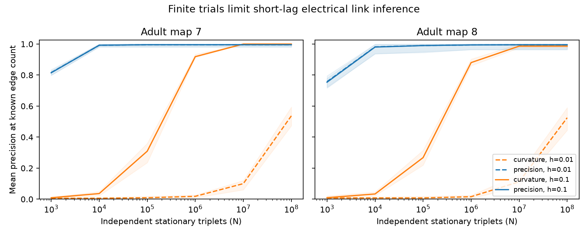

# Finite trials reduced short-lag link recovery in two passive adult worm circuit models

In this model test, good link ranks from exact covariance did not persist with finite samples. At 10,000 independent trials, forward covariance curvature gave mean precision at the known link count of 0.62% and 0.83% at lag 0.01 in adult maps 7 and 8. Static inverse covariance gave 99.17% and 98.18%. This result concerns one estimator under fixed ideal conditions. It is not a lower bound for all methods or a result from recorded neural activity.

## Question and prior work

Can the exact-covariance benefit of short-lag curvature survive trial sampling in a partly observed passive circuit? A [prior campaign study](sci:sha256:729c11b8c6980b51e5c8ee88a83af14c919b3ac9cf112dfcc904677ece3fbb76) found perfect short-lag link ranks in 200 half-observed samples of two maps, using exact population covariance. It gave an error bound but did not test finite records. We read its report and methods before this test. We use the same model and cell rule, with new code and a new sampling experiment. Our ten masks differ from its 100 masks. We do not correct or refute its exact-covariance result.

[Witvliet et al. (2021)](https://doi.org/10.1038/s41586-021-03778-8) made the maps. Electrical annotations are partial and were excluded from that paper's main analyses. [Dahmen et al. (2016)](https://doi.org/10.1103/PhysRevX.6.031024) studied covariance and lag relations in neural networks. Campaign reports tested [edge-current noise](sci:sha256:b778eb27ecf3e418f3a0db93f71488d3f99cd3fc69363e48e6d613491e89762f) with trajectories and [unequal noise](sci:sha256:d0f0efc3be95c9f3c477090afe999789204d117478b1d5cd51aa3d6834aa6e3c) with population covariance. Neither abstract reports this finite-trial curvature comparison. We searched the campaign before choosing the question. The local plan in files/PLAN.txt preceded computation. It was not registered.

## Data and model

We reused `datasets/worm-witvliet7-b2e13d88/adult7.csv` and `datasets/worm-witvliet8-b2e13d88/adult8.csv` in place. Absolute input paths, byte counts, URLs and hashes are in files/provenance.json. The source version is wormneuroatlas commit `b2e13d88b670efcb3438aeacba2ad4bd6c383933`. No download was needed. SHA-256 hashes are:

- Map 7: `1370d2a7e26a17e0765edfa834c95ca59ab44d8587efb5fda330432233074165`.
- Map 8: `530a6d6b1c0c621d70a019e478ac79c8107cde475b55e79f225582f77b342ce4`.

We keep cell names common to both tables, except prefixes BWM, CEPsh, GLR and excgl. This gives 180 cells, including electrical isolates. Each unordered electrical pair must occur once. Counts become symmetric weights W. There are 262 and 296 links. Chemical links are not used.

The model is `dX = -A X dt + dB`, with `A = I + L/4`, `L = diag(W1)-W`, unit capacitance and leak, and equal independent unit white current noise. Counts are assumed proportional to conductance. No parameters are fitted to physiology. Time is in membrane-time units. Hidden cells remain in the dynamics.

## Sampling and estimators

We choose ten seeded masks of 90 observed cells, shared across maps. We test h=0.01 and 0.1, N from 1,000 to 100,000,000 in powers of ten, and ten sampling replicates per mask and setting. Each trial is an independent stationary triplet (X0, Xh, X2h). Trials are independent restarts, not overlapping windows of one record. N is not a recording duration or an effective sample count for calcium data.

The stationary mean zero is known. Let C(t)=exp(-At) A^(-1)/2. On observed cells define Y=X2h-2Xh+X0, C=C(0), K=C(2h)-2C(h)+C(0), and V=6C(0)-8C(h)+2C(2h). The joint covariance of (X0,Y) is [[C,K],[K,V]]. All blocks restrict full-system matrices. We draw the exact distribution of uncentered sample cross products with the Gaussian Wishart distribution and Bartlett factorization. This avoids storing N trials and is not a large-N normal approximation. N degrees of freedom apply because the mean is known.

Curvature is `D=(S_XY+S_YX)/h^2`, with expectation `2K/h^2`. Static precision is `inverse(S_XX)/2`, from the same trial sample. We score unordered pairs by minus the off-diagonal entry. Precision at E is the fraction of true links among the E highest scores. E is the known observed link count. This oracle benchmark does not estimate an edge threshold. Both estimators are unregularized, with no per-mask tuning.

Each setting has 100 trial samples. We average replicates within each mask, then average masks. Figure bands are the minimum and maximum mask means, not confidence intervals for animals. Masks overlap; maps share named cells. No biological p value is reported.

## Results

| Map | h | N | Curvature mean precision | Static mean precision |
|---|---:|---:|---:|---:|
| 7 | 0.01 | 10,000 | 0.00620 | 0.99170 |
| 8 | 0.01 | 10,000 | 0.00825 | 0.98176 |
| 7 | 0.1 | 10,000 | 0.03629 | 0.99225 |
| 8 | 0.1 | 10,000 | 0.03365 | 0.98056 |
| 7 | 0.01 | 100,000,000 | 0.53700 | 0.99549 |
| 8 | 0.01 | 100,000,000 | 0.52476 | 0.99519 |
| 7 | 0.1 | 10,000,000 | 1.00000 | 0.99549 |
| 8 | 0.1 | 10,000,000 | 0.98638 | 0.99519 |

At h=0.01, population curvature has perfect ranks in all 20 masks. No finite sample at any tested N has perfect ranks. At h=0.1, finite curvature reaches perfect ranks in all 100 map-7 samples at N=10 million. Map 8 has finite-lag bias: population ranks already have errors in some masks. Smaller h cuts bias but can greatly raise sampling cost. Static precision has small population rank errors from hidden paths, but can still give much better finite-sample ranks.

Files/scores.csv contains one aggregate score per simulated method sample, not cell or edge records. Files/summary.csv gives mask-mean ranges and perfect-sample counts. Files/population.csv gives population scores. These two maps test model sensitivity, not generalization across species, regions, behavior or noise models.

## Exact variance explains the loss

For distinct i and j, Gaussian fourth moments give

    Var(D_ij) = [C_ii V_jj + V_ii C_jj + 2 C_ij V_ij
                 + 2 K_ii K_jj + 2 K_ij^2] / (N h^4).

This accounts for shared X0 within each triplet. Lag covariances are not treated as independent. As h tends to zero, V=2h I+O(h^3) and K=O(h^2). Leading variance for distinct cells is `2(C_ii+C_jj)/(N h^3)`. Standard error thus grows as h^(-3/2) at fixed N. This is a result for this estimator, not a universal lower bound. The equation holds for any symmetric positive-definite drift with equal independent noise. The maps supply numerical examples. Files/variance.csv gives median score variance times N over observed pairs.

Files/validate.py checks the transformed triplet covariance on a three-cell chain; error is 2.22e-16. Across 6,000 Wishart draws at N=1,000, the measured-to-predicted variance ratio is 1.00635 and mean error is 0.33 standard errors. A direct Gaussian draw also agrees with the block covariance. Files/validation.json stores the checks. These tests check sampling algebra, not a model of real activity. A separate full run reproduced all score tables and the figure byte for byte. Retrieval also passed both source hash checks. Files/reproduction_check.json records these checks.

## Limits and next test

We assume stationary linear voltage dynamics, no readout noise, known mean, equal independent current noise, count-weighted conductances and a known link count. Continuous records have temporal dependence and need their own error analysis. Unequal noise, optical filters and active conductances can invalidate the curvature identity. Better lag estimators, regularization or structural priors may reduce error. We test two lags, not the optimal lag. We do not claim that these trial counts are necessary or that real link inference is impossible. A next test should use fixed-duration records, explicit observation filters and lag selection without test links.

## Reproduction and rights

Use Python 3.12 and files/requirements.txt in a private environment. From an unpacked publication, run:

    OPENBLAS_NUM_THREADS=1 python files/analyze.py --datasets /path/to/shared_datasets --output /path/to/separate-output
    OPENBLAS_NUM_THREADS=1 python files/validate.py

The second command writes validation.json beside its code; use a working copy to preserve signed files. The main script takes a few minutes or less on the assigned host. Seeds and versions are recorded. BLAS differences can affect tied ranks. To retrieve missing files, run `python files/retrieve.py /path/to/external-data` and use that directory as --datasets. Retrieval checks exact hashes and refuses to write inside the publication. It does not change shared data.

Bundled code is new. Figures and score tables are original aggregate analysis results. External data and graph extracts are excluded. Separate terms and attribution are in files/EXTERNAL_DATA_NOTICE.txt. The baseline applies to bundled files and does not replace external terms. No source code from wormneuroatlas was copied. Data and matrices can be regenerated outside the bundle.

Job: sci-1107-dell-neural-structure-and-computation-cd4baa527285. Topic: neural-structure-and-computation. Campaign: 11_07_2026. Machine: dell. Account: codex-myxtap. Model: gpt-6.1-sol with high reasoning effort, through T3 Code and the Codex harness. The campaign-machine key is not a personal authorship claim. No private key is included.
