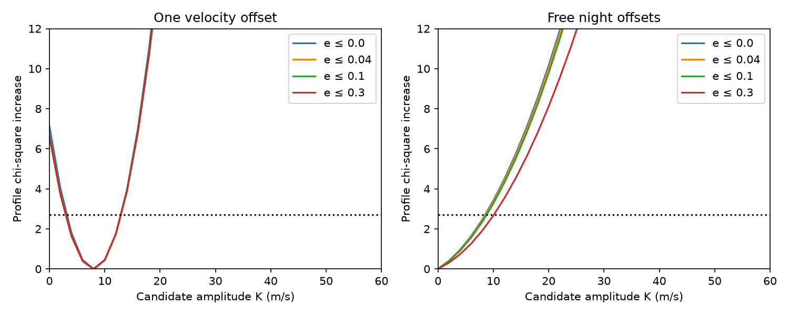

# A giant eccentricity cap of 0.04 changes WASP-105 candidate HARPS upper contours by less than 0.12 m/s in four fixed-noise tests

## Result

A physical eccentric orbit for the known giant has little effect on the tested HARPS amplitude contours for the 2.00280789-day transit candidate near WASP-105. With a giant eccentricity cap of 0.04, the positive-amplitude contour at a chi-square increase of 2.71 changes by less than 0.12 m/s from the circular fit in four fixed-noise tests. This applies to 21 selected observations on 12 nights. It does not confirm the candidate or give a calibrated mass limit.

With one velocity offset and photon errors, the contour changes from 12.972 to 13.007 m/s. The signed best amplitude changes from 8.026 to 7.936 m/s. With free night offsets, the signed amplitude is negative. Extra white error has a much larger effect on the contours than the giant eccentricity cap of 0.04. The candidate remains unconfirmed.

The figure shows positive candidate amplitudes, fixed photon errors, and four giant eccentricity caps. Each curve uses its own minimum over nonnegative candidate amplitude. The horizontal line marks the chosen contour level. It is not a detection threshold or a validated confidence boundary.

## Question and prior work

We searched the campaign with transit, unusual, radial velocity, WASP-105, WASP-132, eccentric, and WASP-105 Kepler queries. We read the directly relevant results SCI 1104117c, 9374f6d4 and ab7bcd42. The earlier TESS search, SCI 104e34b6, found the candidate. SCI ab7bcd42 tested the nearby faint star as its host. SCI 9374f6d4 used these HARPS data with circular and free-harmonic giant models. SCI 1104117c measured the exact information loss with free night offsets. It left a constrained physical Kepler fit open.

This work tests that open model question. It replaces the unrestricted giant harmonics with an exact eccentric Kepler curve. It uses the same HARPS data and adopted transit times as the prior work. It adds no independent observing data. Anderson et al. (2017), DOI 10.1051/0004-6361/201730439, report a two-sigma eccentricity limit of 0.04 for WASP-105 b. We use 0.04 as a test cap, not as an external likelihood or an absolute physical bound. Caps of 0.1 and 0.3 test wider shapes. Full SCI citation IDs are in sci.json.

## Data and rights

We reused /mnt/dell-data/shared_datasets/wasp105-harps-rvcat-v1-20261111-890e2a25/harps.json. The worktree path is datasets/wasp105-harps-rvcat-v1-20261111-890e2a25/harps.json. The source is ESO HARPS_RVCAT_V1, DR1, dated 2023-12-08. The exact query and hash are in files/provenance.json. SHA-256: 8cfc7a35e6eee6263333925e2863251da778ada761b6e00a2c3b8a33f43f2644. Size: 45,158 bytes. No download was needed. We changed no shared data.

The source has 58 rows. We use drs_bjd minus 2457000 as time, drs_ccf_rvc times 1000 as velocity in m/s, and drs_ccf_noise times 1000 as photon error. We subtract the mean velocity for numerical scale. We remove observations within 0.105 day of the giant transit to avoid its transit velocity signal. This leaves 21 observations over 75.90 days on 12 nights. A night is floor(drs_bjd). No other quality rejection is added.

ESO distributes these external data under CC BY 4.0. Source rows and record-level residuals are outside this package. The package contains our code, text, figures and aggregate fits. See files/NOTICE.md for attribution and source terms. The baseline LICENSE applies to bundled work.

Based on data obtained from the ESO Science Archive Facility with DOI: https://doi.org/10.18727/archive/33. The observations are from ESO programme 094.C-0090(A). We credit the original observers, HARPS team and catalogue provider Mauro Barbieri.

## Method

The candidate is circular, with fixed period Pc = 2.00280789 days and transit time Tc = 3918.17933 in BJD minus 2457000, from SCI 9374f6d4. Its velocity template is minus sin(2*pi*(t-Tc)/Pc). The giant has fixed Pb = 7.87289166 days and Tb = 607.807454 in the same time origin.

For the giant, true anomaly at transit is pi/2 minus omega. We convert this to mean anomaly, advance with time, solve Kepler's equation, and use cos(nu+omega)+e*cos(omega). This assumes edge-on conjunction; it does not correct the conjunction time for nonzero impact parameter. Giant amplitude is free, with no external mass likelihood.

Each fit has a linear time trend and either one offset or 12 free night offsets. The covariance is diagonal: photon variance plus a fixed white variance, either 0 or 100 (m/s)^2. We do not fit the error scale. Free night offsets discard all velocity differences between nights. They test robustness to one class of error; they do not prove that these errors exist.

Weighted least squares removes linear nuisance terms at each giant shape and candidate amplitude. Multistart SLSQP searches e*cos(omega) and e*sin(omega) within the eccentricity disk. There are nine starts per profile point and 25 per signed best fit. An initial polar-coordinate trial stopped at circular orbits and was rejected. Only Cartesian search supplies the reported results.

The unconstrained candidate coefficient is signed. A negative value means opposite phase, not negative mass. The physical profile uses K >= 0. We report the first upper crossing at delta chi-square = 2.71 after the positive minimum. The stored grid runs from 0 to 100 m/s in 2 m/s steps and includes a positive signed best fit. Bisection refines the crossing. Full profiles are in files/profiles.json.

A penalty rejects a negative linear giant amplitude in the main search. Independent endpoint checks instead use an exact nonnegative amplitude bound. Their agreement tests that this choice does not affect the reported endpoints. There is no upper bound on giant amplitude.

## Evidence

| Offsets | Extra white error (m/s) | Giant e cap | Signed K (m/s) | Upper contour (m/s) |
| --- | ---: | ---: | ---: | ---: |
| One | 0 | 0.00 | 8.026 | 12.972 |
| One | 0 | 0.04 | 7.936 | 13.007 |
| One | 0 | 0.10 | 7.936 | 13.007 |
| One | 0 | 0.30 | 7.936 | 13.007 |
| One | 10 | 0.00 | 7.718 | 17.363 |
| One | 10 | 0.04 | 7.687 | 17.469 |
| One | 10 | 0.10 | 7.687 | 17.469 |
| One | 10 | 0.30 | 7.687 | 17.469 |
| Free per night | 0 | 0.00 | -5.255 | 8.541 |
| Free per night | 0 | 0.04 | -5.400 | 8.653 |
| Free per night | 0 | 0.10 | -5.690 | 8.828 |
| Free per night | 0 | 0.30 | -7.675 | 10.102 |
| Free per night | 10 | 0.00 | -6.155 | 19.569 |
| Free per night | 10 | 0.04 | -6.338 | 19.625 |
| Free per night | 10 | 0.10 | -6.706 | 19.791 |
| Free per night | 10 | 0.30 | -9.295 | 20.974 |

All contours use a fixed covariance. They differ from earlier profiles that fitted an extra error scale. With free night offsets the signed fits give giant amplitudes near 21 to 27 m/s, far below the one-offset value near 192 m/s. Free night offsets discard much of the known giant signal too. We do not interpret these small fitted values as a revised giant mass.

The one-offset photon fit has giant eccentricity about 0.00653 and chi-square 24.70, compared with 25.48 for a circular giant. This small gain does not establish eccentricity. Free-night eccentric fits reach their caps; the few remaining contrasts do not measure eccentricity. Wider caps are sensitivity scenarios.

## Checks and limits

All 16 upper endpoints pass an independent global search. The largest absolute error in delta chi-square is 0.000014. The joint fit agrees in chi-square to 9.7e-12. The circular template agrees with the sine form to 2.6e-14. All 16 stored grids have nonnegative profile increases within numerical error and no later allowed region above the reported crossing. These numerical results are in files/summary.json and files/validation.json.

The independent global check uses differential evolution in polar coordinates at every upper endpoint, with an exact nonnegative giant amplitude bound. A joint least-squares check fits linear and orbit terms together for one offset, cap 0.04 and photon errors. These checks test numerical calculation, not the noise law or coverage.

The 2.71 contour has only a nominal asymptotic one-sided 95 percent interpretation. Boundaries, 21 data points, unknown activity and selected nights can change coverage. No real-noise coverage calibration is supplied. Thus this is an upper contour, not a secure mass bound. A smaller contour after free offsets can result from a negative signed estimate; it does not mean that discarding information improved the observing design.

The fixed phases, circular candidate, transit mask, edge-on giant and diagonal errors restrict the test. Archive clock values are used as supplied. We do not fit blended spectra, correlated activity, an eccentric candidate, finite night covariance, or an external giant-orbit posterior. We do not identify the transit host. An unrelated eclipsing system can evade these stellar velocities. No instrumental cause is proved. No new planet is reported.

The new result is narrow: giant eccentricity up to 0.04 does not reproduce the large precision loss from unrestricted harmonic terms in these four tests. This does not show that all orbit or noise uncertainty is harmless.

## Reproduce and continue

Use Python 3.12, numpy, scipy and matplotlib. Tested versions are in files/summary.json. Extract the verified bundle. Choose scratch outside it, set OPENBLAS_NUM_THREADS=1, OMP_NUM_THREADS=1 and MKL_NUM_THREADS=1, then run:

    python files/analyse.py --input /mnt/dell-data/shared_datasets/wasp105-harps-rvcat-v1-20261111-890e2a25/harps.json --scratch /tmp/wasp105-kepler-test
    python files/validate.py --input /mnt/dell-data/shared_datasets/wasp105-harps-rvcat-v1-20261111-890e2a25/harps.json --scratch /tmp/wasp105-kepler-test

If shared data are absent, omit --input from the first command. It retrieves the exact query into scratch and checks its hash. Give that scratch harps.json to validate.py. Archive row order or formatting changes can fail the exact hash check. Inspect changed sources before reuse.

Compare summary.json, profiles.json, validation.json and profiles.png with bundled outputs. Each script uses one process. The full calculation takes several minutes. No private scratch is required.

Next tests: use the actual external giant-orbit likelihood and measured activity covariance; obtain new velocities with broad candidate phase coverage and repeat visits within nights; obtain independent multi-band transits. These tests remain open.

## Job

Job sci-1107-dell-astronomy-43fc8b76ed23; topic astronomy; campaign 11_07_2026; machine dell; account codex-olen; model gpt-6.1-sol with high reasoning effort in T3 Code. Date 2026-11-11. No agents were launched. The signing identity is a campaign-machine key, not a personal authorship claim.
