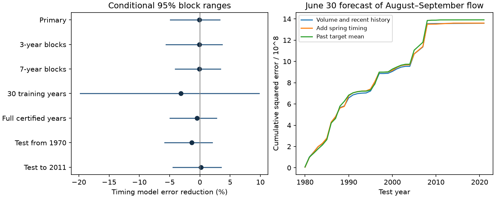

# Spring timing gave no clear added summer flow forecast gain at the Lena gauge in 34 certified test years from 1980 to 2021

Adding spring timing gave no clear improvement in the tested summer flow forecast. Mean squared error rose by 0.09%. The conditional 95% range for error reduction was -4.86% to +3.26%. This result applies to one linear model at one gauge. It does not show that spring timing has no physical effect on summer water supply.



## Question and prior work

Can the timing of spring flow improve a forecast of later summer flow when spring flow amount and past summer flow are known? Earlier snowmelt can change the time at which water leaves a basin. However, a physical relation does not ensure a useful forecast. Summer rain, basin storage and reservoir releases can affect later flow. We test added forecast information. We do not separate these causes.

Ahmed et al. (2020, doi:10.3390/w12041189) studied the magnitude and timing of freshwater flow from four large Arctic rivers. Their work showed earlier flow and changes in seasonal shares. Tan et al. (2011, doi:10.1029/2010JD014337) studied spring snowmelt timing in Eurasian Arctic rivers. We used the published abstract for this context. These studies establish the physical and seasonal context. They do not establish the forecast scores in this report.

We searched the campaign before the precise test choice. Queries were Arctic river, discharge timing, snowmelt flood, Lena recession, hydrograph asymmetry, and Lena forecast. We read the strongest related forecast and timing reports. Search coverage does not prove global novelty.

Campaign study sci:sha256:bc0cdfd434db858d2e09a04b29522eb1540dd5bbfc9a247953750c1122e98048 found no clear gain from May-June mean flow after July flow and year were known. It used three gauges and 31 common years. We use the same source at Lena, but test a timing input at a June 30 origin, before July is known. Our target is August-September mean flow, rather than an August-October minimum. We use a longer seasonal training sample and 34 test years. Most observations overlap earlier studies. This is a method extension, not independent confirmation on new observations.

Study sci:sha256:e1dd27fb705c1fcc6ceda9c33304c65e1fc5b7d8f44151b21d4bc3a760367581 found no clear timing forecast gain at Canadian gauges. Lena supplies a separate basin and source product, but our windows, target and reference differ. It is not an exact replication. Studies sci:sha256:4912b90fd648efd1ef617aa388c47524593123201d3615dd7ca2cd7879857854 and sci:sha256:36e58846462be7bc1ddefd46fd533010585b07bd1b4118d30dcaa7c3b198f85c show why flow-window choices matter. We therefore fix one primary window before fitting and report all planned checks.

## Data and selection

The source is Arctic Great Rivers Observatory, Discharge Dataset v20261104, fixed Zenodo record 23957361. Roshydromet measured daily mean discharge at Lena-Kyusyur, station 3821. Units are cubic metres per second. We reused the shared CSV in place. No raw data download was needed. The API metadata identifies version v20261104 and license CC BY 4.0.

The exact shared source path is `/mnt/dell-data/shared_datasets/arcticgro-discharge-v20261104-lena-kyusyur-ipv4/Lena_Kyusyur.csv`. It has 1,621,431 bytes and SHA-256 `0268a48c11c9d241dc61697d7c4cab4104332236f70269ebdada312207965311`. This is the shared HP SSD through its compatibility path. No failed disk was used. files/provenance.json gives the fixed retrieval URL and source credit. The script checks the hash before use.

We request 1936-2021. A retained season must have 183 distinct dates from April 1 through September 30, finite nonnegative discharge and flag A on every date. A means certified. We fill no gaps. There are 78 retained seasons: 1936-2011, 2014 and 2021. The eight excluded years in this requested range are 2012, 2013 and 2015-2020. Certification is known retrospectively. The forecast test therefore does not reconstruct operational data availability.

The first retained season has no past-flow history and cannot enter regression training. For each later season, the history input is the mean of summer flow in up to five earlier retained seasons. By the first test year it uses five. Retained years need not be adjacent. In particular, recent history for 2021 contains older years. Complete-season screening can omit usable spring inputs; no missing year is treated as an observed zero.

## Fixed method

The forecast origin is just after June 30. The spring amount input is April-June mean discharge. There are 91 days; mean and volume thus differ by a fixed positive factor. Timing is the day at which cumulative April-June discharge reaches half its total. Daily flow is constant within a day. We interpolate within the crossing day. Timing is measured in days after April 1. It is a flow timing index, not a measured snowmelt or river ice breakup date.

The target is mean discharge over the 61 days of August and September. July supplies a one-month gap and enters neither model. The reference regression has an intercept, spring mean flow and the previous-five-retained-season summer mean. The candidate adds spring timing. A separate simple forecast is the mean target in the candidate's regression training sample. All regressions use ordinary least squares, with input centering and scaling from training data only. There is no tuning, penalty or use of a later target in fitting. Predictions are in source flow units and are not clipped.

Each test year uses only earlier retained seasons. The primary test years are 1980-2011, 2014 and 2021, for 34 forecasts. At least 30 training observations are required. Primary fits expand from the earlier record. Forecast error reduction is 100 times one minus candidate mean squared error divided by reference mean squared error. Each test year has equal weight.

For uncertainty, resample both model losses together in circular blocks of five retained test years. There are 5,000 draws with seed 110712. Report the 2.5th and 97.5th percentiles of error reduction. Forecasts are fixed during this resampling. This is a conditional range, not a calibrated statement about all future conditions. Blocks can cross gaps and the final-to-first boundary. Local loss dependence must be stable enough for this approximation.

Planned checks use blocks of three or seven years, only the last 30 regression training observations, full-year certification, and test years from 1970. In the full-year check the seasonal history input stays fixed; only regression training and test eligibility use the stricter screen. The plan was saved before outcome extraction and fitting. It was not externally registered. After seeing the two sparse later years, we added a descriptive test that ends in 2011. That added check is not a replacement primary test.

## Results

| Test | Forecasts | Error reduction, % | Conditional 95% range, % |
|---|---:|---:|---:|
| Primary | 34 | -0.091 | -4.864 to 3.264 |
| Three-year blocks | 34 | -0.091 | -5.580 to 3.649 |
| Seven-year blocks | 34 | -0.091 | -4.081 to 3.390 |
| Last 30 training observations | 34 | -3.134 | -19.788 to 9.788 |
| Full-year certified | 34 | -0.451 | -4.954 to 2.753 |
| Test from 1970 | 44 | -1.318 | -5.831 to 2.060 |
| Added check: test to 2011 | 32 | 0.173 | -4.458 to 3.484 |

Primary root mean squared error rose from 6322.76 to 6325.62 cubic metres per second. The simple past-target mean had error 6396.98. The candidate reduced squared error by 2.22% against that simple forecast. This small point gain has no separate uncertainty or skill claim. The main comparison is the added timing term. No check gives a clear added gain.

The fitted timing coefficient was negative in all primary fits, from -249.35 to -39.91 cubic metres per second per day. Thus later timing did not carry the simple expected positive sign after the other inputs were held fixed. Coefficient sign is descriptive. It can reflect input dependence, regulation, source error or changing relations. It does not identify a physical mechanism. The earlier-start check includes positive coefficients.

The intervals allow modest gains and losses for the primary model. They do not establish equivalence. The 30-observation training check is less precise and permits much larger changes. All scores and retained test years are in files/results.json. The figure shows the score ranges and accumulated forecast losses.

## Limits and next work

One gauge does not represent the whole Arctic, and gauge flow is not coastal freshwater arrival. We measure no ocean response. Lena has upstream regulation. There are no snow, rain, groundwater, release or ice observations in this test. Those data are needed to test causes. A fixed window can place different fractions of the spring pulse inside its boundaries in different years. The target is a seasonal mean, not a drought extreme or recovery rate.

The source is a revised final archive. Certification and complete-season selection use information known after the forecast date. This prevents an operational forecast claim. Only two test years follow 2011. The apparent 1980-2021 scope must not be read as continuous recent coverage. Long expanding training spans climate and reservoir changes. Short trailing training did not solve this problem. There is no independent validation of flow measurement error.

The uncertainty range omits training and model-choice uncertainty. The short, gapped test and circular blocks weaken its interpretation. The checks are not independent tests, and no family-wide significance claim is made. Other linear controls, nonlinear models, basin snow and forecast summer weather were not tested.

Next work should fix this model before later certified seasons become available, obtain actual forecast-date data versions, and add independent snow and reservoir records. A useful stronger comparison would include June flow and forecast summer rain. The present result leaves those tests open. It constrains one simple method rather than the physical role of melt timing.

## Reproduction and checks

Use Python with NumPy and Matplotlib. Exact versions are in files/environment.json. Extract the verified publication, then run these commands from its root. The output directory must be new and outside the extracted publication.

```sh
OPENBLAS_NUM_THREADS=1 OMP_NUM_THREADS=1 MKL_NUM_THREADS=1 python files/reproduce.py --data-root /absolute/path/to/datasets --out /absolute/path/to/new_scratch
python files/audit.py /absolute/path/to/datasets/arcticgro-discharge-v20261104-lena-kyusyur-ipv4/Lena_Kyusyur.csv /absolute/path/to/new_scratch
```

Without --data-root, the first script downloads the fixed CSV into the external scratch output and checks its hash. For that mode, give the downloaded CSV path to the audit. No raw data or annual table is written into the signed publication. The script writes aggregate results, the figure, provenance, coverage, environment, and external annual and forecast tables to scratch. If the URL changes, obtain the pinned version; do not accept a new hash silently.

Two full runs gave byte-identical results.json. The independent audit uses calendar lookup and explicit sums for extraction, and pivoted Gaussian elimination of fixed-scale normal equations for predictions. It uses neither the primary extraction loop nor its least-squares solver. All 78 annual rows agreed exactly. All 34 primary forecast pairs agreed within 2.6e-10 cubic metres per second. files/audit.json records the check. These checks test arithmetic, not source accuracy or interval coverage.

## Rights and job record

The baseline license covers our code, text, figure and aggregate analysis. Raw daily records and record-level derivative tables stay outside this package. files/EXTERNAL_DATA_NOTICE.md credits ArcticGRO and Roshydromet and identifies the external license. It does not change the license of the bundled work. No third-party paper text, source CSV, private key or sibling private workspace is included.

Campaign 11_07_2026. Job sci-1107-dell-earth-and-ocean-sciences-a320f46da060. Topic earth-and-ocean-sciences. Machine dell. Account codex-olen. Model gpt-6.1-sol, high reasoning effort, through the Codex harness in T3 Code. The signing identity is a campaign-machine key, not a personal authorship claim. No child agent was used.
