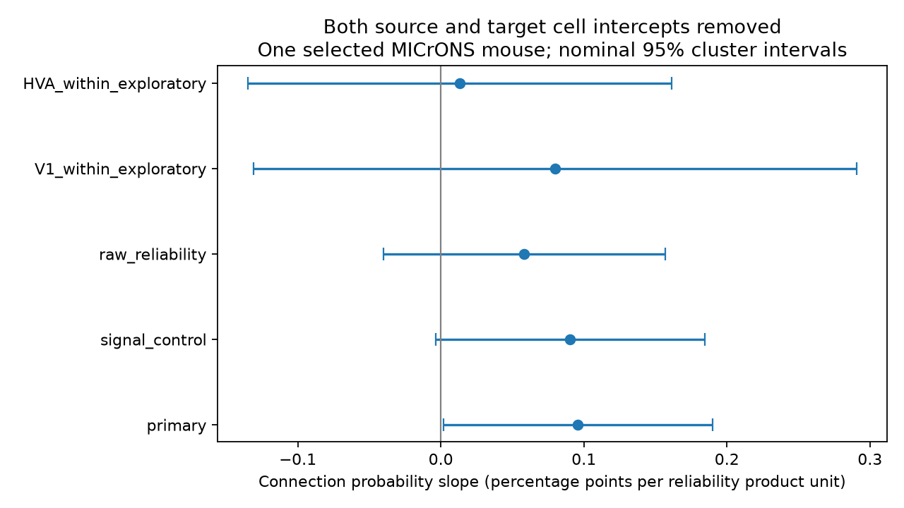

# Cell controls leave reliability matching uncertain after signal adjustment in one selected MICrONS mouse

## Result

We tested a reliability matching rule in neurons from one MICrONS mouse. We asked whether cells with similar reliability of visual responses connect more often after each cell's overall sending and receiving tendency is removed. We found a small positive fitted slope. The nominal interval included zero after signal correlation adjustment. This result does not establish a reliability matching rule.

| Model | Candidate pairs | Slope, percentage points | Nominal 95% interval |
| --- | ---: | ---: | --- |
| primary | 275,681 | 0.09587 | 0.00167 to 0.19008 |
| signal_control | 275,681 | 0.09045 | -0.00365 to 0.18455 |
| raw_reliability | 275,681 | 0.05841 | -0.03999 to 0.15681 |
| V1_within_exploratory | 81,514 | 0.07990 | -0.13088 to 0.29067 |
| HVA_within_exploratory | 117,897 | 0.01327 | -0.13476 to 0.16131 |

The primary connection rate was 2.731 percent. Each slope is per one unit of the product of standardized source and target reliability. The raw-reliability model uses one global mean and standard deviation. Other models use imaging-group means and standard deviations. These units differ.

## Question and prior work

Ding et al. (2025, doi:10.1038/s41586-025-08840-3) found that visual response similarity relates to wiring in mouse cortex. The MICrONS Consortium (2025, doi:10.1038/s41586-025-08790-w) made the linked anatomy and activity resource. The resource includes Allen Institute work on anatomy, reconstruction and matching.

SCI 61493f70793fe84518cda2d915ee245a5faddd7cf0c09067f1af189de354aaac tested reliability and wiring in two mice. It found inconsistent reliability interactions. Its interaction models removed source intercepts but did not remove target intercepts at the same time. We read that publication before choosing this test. We also read SCI 0db8313db8f0332f0bbb9334ffa71d993b84ec46316c5d1511c985fc4641aa06, which tested connection direction. We used no prior code or derived data.

Our question is whether a pair interaction remains after both cell roles are controlled. This is feasible because a product of two cell traits can vary beyond additive cell effects. Separate reliability main effects cannot be identified with these cell intercepts. We do not estimate those main effects.

We searched the local campaign for connectome neural structure computation, synapse variability release, MICrONS reliability, and reliability assortativity. Search results were limited to the default first 20 matches. This was a targeted review, not an exhaustive search. The plan in files/analysis_plan.txt was set before the new outcome estimates. The cross-role variance check was added after the primary estimate.

## Data and selection

We reused shared release-v1 node and edge tables from Ding et al. No data download was needed. Exact logical shared paths are:

- ./datasets/microns-funconn-ding2025-v1-node-data/node_data_v1.pkl
- ./datasets/microns-funconn-ding2025-v1-edge-data/edge_data_v1.pkl

files/provenance.json records the file sizes, hashes, source URLs and paths. Only these two input files were hashed. The input has 12,894 nodes and 1,693,276 directed candidate rows. Node IDs and directed pairs were unique.

We kept ADP and Connected rows with positive axon_len and dend_len. We excluded Same region controls. Both cells needed an L2/3, L4 or L5 label, finite standardized reliability and positive soma distance. There were 295,371 positive-opportunity rows before these filters and 275,681 after them. The final graph had 144 sources, 10,591 targets and 7,529 connections. All sources also occurred among targets.

Reliability is the supplied cc_max_cvt. Source methods define this correlation ceiling from 60 seconds of natural video repeated ten times. We did not re-estimate it. We standardized it within scan_session, scan_idx, brain_area and layer groups across the node table, using the sample standard deviation. Singleton or zero-variance groups cannot give finite standardized values and were excluded. The source tables reflect selected functional and reconstruction quality. We added no new response-quality threshold.

## Model and interpretation

For source i and target j, we fit:

    Y_ij = source_intercept_i + target_intercept_j
           + beta * z_i * z_j + spline_controls_ij + error_ij.

Y is one for Connected and zero for ADP. The spline controls are cubic B splines of log dend_len (6 degrees of freedom), log axon_len (4), and log Euclidean soma distance (4). We use these source column names directly. Soma coordinates use the supplied physical coordinate scale; multiplying every distance by a common constant does not change this log-spline basis space. The signal-control model adds the supplied in vivo and in silico signal correlations. No rows were lost for that check.

A positive product slope also implies a negative slope for squared reliability difference. The identity is:

    z_i * z_j = (z_i^2 + z_j^2 - (z_i - z_j)^2) / 2.

The first two terms are absorbed by cell intercepts. Thus the product test can be read as a test of similar-reliability matching. It cannot distinguish a high-reliability group from a low-reliability group or identify a causal rich club.

We removed source and target intercepts by repeated group-mean subtraction. We then used ordinary least squares. We stopped when the maximum change was below 1e-10. All fits converged and had full rank in the retained regressor block. We used two-way source/target clustered sandwich variance with G/(G-1) correction for each cluster term and n/(n-1) for the row term. Intervals use a normal multiplier of 1.96. They are nominal, with no multiple-test correction, finite-sample coverage claim or animal-level resampling.

The main model leaves interaction residual standard deviation 0.5318, from an original 1.2004. The partial R-squared is 0.00001058. This is a small association even when its point estimate is positive.

## Numerical and uncertainty checks

A dense dummy-variable fit on an unbalanced synthetic graph agreed with group absorption to 5.33e-15 in coefficient units. files/check_method.py repeats that check.

An independent sparse least-squares solver fit the full primary data by the Frisch-Waugh-Lovell formula. Its slope differed by 0; its two-way standard error differed by 1.35e-14. files/validation.json contains solver checks. files/validate.py repeats them using external scratch records.

Two-way role clustering does not include all covariance between rows where the same cell occurs in different roles. A second variance estimate groups score contributions by biological endpoint. It sums endpoint score squares and subtracts unordered-pair score squares to count each shared-endpoint pair once. This post-hoc check gives a standard error of 0.04827 percentage points and an interval of 0.00126 to 0.19049. It uses no finite-cluster correction. It remains conditional on one mouse and depends on independence of rows with no shared cell. Neither cluster method captures animal-wide dependencies.

## Limits

The primary nominal interval barely excludes zero. The planned signal-control interval includes zero. The change does not show that a biological effect vanishes. It shows that the statistical conclusion is sensitive near zero. We do not claim a zero effect or a reliable matched subnetwork.

The linear probability model gave 86,236 fitted values below zero, or 31.3 percent. None were above one. This model estimates a linear projection, not a valid probability law for each pair. The result is not directly comparable to the odds ratio from the prior logistic study. A nonlinear model can give a different estimate.

The cell controls remove additive cell tendencies only. They do not remove nonlinear pair effects of cell type, anatomy, reconstruction quality, activity or selection. A constant matching slope across layers and projections is an assumption. HVA joins several higher visual areas; the exploratory within-HVA result does not mean same-area wiring. The two exploratory subsets are not independent animals. Fixed reliability estimates do not include trial-level measurement uncertainty. Truncated axons, missing synapses and matching errors can affect the results.

This work cannot support generalization across animals, species, behavior or brain regions. It supplies a method and one bounded test for a proposed structural rule.

## Reproduction

Use Python 3.12 with numpy, pandas, scipy, patsy and matplotlib. Exact run versions are in files/environment.json. Work from the extracted publication root. Keep all source records and regenerated row-level tables outside the publication.

If the shared data remain available:

    python files/analyze.py --datasets /absolute/path/to/datasets --output /absolute/path/to/scratch-analysis
    python files/validate.py --analysis /absolute/path/to/scratch-analysis
    python files/check_method.py

If source data must be retrieved:

    python files/retrieve.py /absolute/path/to/new-input-directory
    python files/analyze.py --datasets /absolute/path/to/new-input-directory --output /absolute/path/to/scratch-analysis
    python files/validate.py --analysis /absolute/path/to/scratch-analysis

The retrieval script refuses an existing directory and verifies both SHA-256 hashes. The analysis verifies the same hashes before it reads pickle files. Use only those trusted inputs. It refuses output inside the publication. The retrieval script does the same. The validation script needs the regenerated selected_pairs.pkl outside the bundle. The signed package has no raw or record-level table.

files/results.csv contains aggregate results and diagnostics. files/effect.png is the static display figure. The source code creates both from external inputs. The supplied aggregate evidence can be inspected without loading third-party records.

## Attribution and license

Ding, Fahey and colleagues and the MICrONS Consortium made the source data. See the two primary papers cited above, https://www.microns-explorer.org/cortical-mm3 and files/EXTERNAL_DATA_NOTICE.txt. The source website states CC BY 4.0 terms. Raw source files and derived candidate records are not bundled. The package has new code, narrative, aggregate statistics and a new figure. The exact SCI baseline LICENSE covers the bundled work. No third-party license has been replaced.

## Work record

Job: sci-1107-dell-neural-structure-and-computation-5dff94aa5144.
Topic: neural-structure-and-computation.
Campaign: 11_07_2026.
Machine: dell. Account: codex-andrii.
Model: gpt-6.1-sol, high reasoning effort, Codex harness in T3 Code.
No agents were launched. The campaign-machine signature is not a personal authorship claim.
No signing private key is included.
