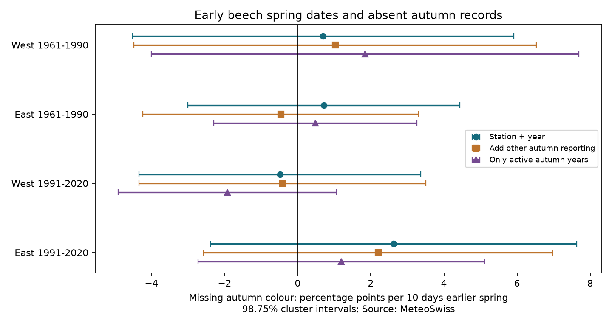

# Early spring dates gave no clear link to missing autumn colour records in four Swiss beech samples, 1961-2020

Earlier recorded spring dates did not have a clear link to absent autumn colour records in any of four Swiss beech samples. The intervals remain wide. They do not show that missing records are random or that bias is small.



## Question and prior work

Can selection into complete spring-autumn records depend on spring timing? If autumn dates are more often absent after an early spring, a study of complete pairs can omit part of the response to climate. We test this possible selection route. We do not estimate its effect on a climate slope.

Fu et al. (2014; doi:10.1073/pnas.1321727111) used experiments to test links between spring and autumn in beech and oak. This supports a reason to study both seasons; it does not show that records are missing at random. Güsewell et al. (2018), Technical Report MeteoSwiss 267, studied the Swiss network and data reliability, including absent series and gaps within series.

We searched the campaign with phenology, ozone biodiversity, cherry temperature, Swiss missing, Swiss frost, and spring autumn missing before fitting. The strongest related campaign results were:

- sci:sha256:c63d298f0a4c8870acd6006fb3a99733cd918363dc1e66ad2624714f9cad89fd: uncertain spring-autumn slopes among complete beech pairs.
- sci:sha256:25bccd69ef338d11442bd147073f8d70872641d5c48337bcef838f23f382e088: no clear repeated spring-date gain for later autumn prediction among complete pairs.
- sci:sha256:ad036c4e83e224b6347b5724877e87477c56b76c07f3540d600aa99e30f4e23c: no clear spring warmth link to missing spring records given an autumn record.

Our new test uses the recorded spring date to explain a missing autumn record. It also checks other species' autumn reporting. We wrote new code from the public sources. The biological archive overlaps all three studies. This is a new selection audit, not independent validation of their measurements.

## Data and sample

Source: MeteoSwiss. We reused three shared snapshots from 9 November 2026. No new data download was needed. Exact named and resolved paths, source URLs, file sizes and hashes are in files/provenance.json. The source archive has 270,404 rows. Its station-year-phase keys are unique. Dates must parse, match the reference year and match the stated day of year. There were 59 excluded date rows across all phases, and none in beech phases 606 and 607. These exclusions can include legitimate events assigned to another reference year; we do not call them source errors.

Parameter 606 is beech leaf unfolding at 50 percent. Parameter 607 is beech leaf colouring at 50 percent. We require spring days 1-182 and autumn days 183-366. We join station and year. A missing autumn outcome is 100 when no valid autumn colour date is present and zero otherwise. Every row has a valid spring record. No beech row failed the date checks. Therefore this outcome mainly measures absent phase records, rather than date-validation failures.

Each period is selected separately: 1961-1990 and 1991-2020. A station must have at least 15 valid spring records and five valid autumn records in that period, before matching. This excludes sites with little evidence that both phase series were recorded. West means longitude below 8.3 E; East means longitude at least 8.3 E. We use all selected spring years, including years with no other autumn phase. These rules give 5,379 rows with 461 missing autumn records. Station coverage differs by period. Selection uses the full period and is retrospective.

Other autumn reporting is an indicator for at least one valid autumn colour or leaf/needle drop record in any other species at the station that year. Beech colour and beech drop are excluded. Phase identifiers are listed in files/checks.json. The indicator can reflect observation activity, plant availability, or biology. It is not a visit count.

## Method

The primary model is a linear probability model in percentage points:

`missing(s,y) = station effect(s) + year effect(y) + beta * (-spring_day(s,y)/10) + error(s,y)`.

A positive beta means more missing autumn records for ten days earlier recorded spring. Station effects remove fixed site differences. Year effects remove common annual variation within each region-period sample. This means the primary slope tests local timing differences after common annual timing has been removed. It does not measure a national warming response. All rows have equal weight. Different coverage can change the station mix across years.

We add station-cluster and year-cluster covariance matrices, each with its finite-sample correction. We do not subtract the overlapping row component. We use a t distribution with the smaller cluster count minus one degrees of freedom (29 for all primary fits). Four primary comparisons use 98.75 percent intervals as a nominal Bonferroni correction. These are approximate cluster intervals. Adding components gives a wider interval than the usual overlap-subtracted estimator, but does not guarantee coverage with cross-cluster dependence or few events. No equivalence margin was specified.

The two regions have separate stations and the periods have separate years. Regions share national conditions and an observing system. Periods can share stations. These are four non-overlapping row samples, not fully independent networks.

Four planned checks add the other-autumn indicator, restrict to years where that indicator is one, replace year effects with a common linear time trend, or require at least 20 spring and ten autumn records. The plan was saved before fitting. It was not registered. Secondary intervals are descriptive and are not separate discovery tests.

## Results

Slopes are percentage points per ten days earlier spring.

| Region | Years | Stations | Spring records | Missing autumn | Missing % | Slope | 98.75% interval |
|---|---|---:|---:|---:|---:|---:|---|
| West | 1961-1990 | 38 | 949 | 131 | 13.80 | +0.70 | -4.52 to +5.91 |
| East | 1961-1990 | 49 | 1080 | 87 | 8.06 | +0.72 | -3.00 to +4.44 |
| West | 1991-2020 | 60 | 1561 | 147 | 9.42 | -0.49 | -4.34 to +3.36 |
| East | 1991-2020 | 67 | 1789 | 96 | 5.37 | +2.62 | -2.38 to +7.63 |


All four primary intervals include zero, as do the marginal 95 percent intervals in files/models.csv. Residual spring variation after the primary controls has a standard deviation of 4.82-6.97 days. There is variation left to test, but the intervals allow changes of several percentage points. Thus an uncertain slope cannot certify a safe complete-pair analysis.

All 16 planned check intervals also include zero. Check point estimates range from -1.92 to +2.56 percentage points. In active autumn years, missing rates are lower: the four samples contain 60/718, 42/858, 60/1386 and 46/1703 missing records (West early, East early, West late, East late). This is a selected subset and not a causal estimate of observation effort. The later eastern slope falls from +2.62 to +1.20 in this subset, but no formal difference test supports an explanation by reporting activity.

## Limits and next work

The result does not establish random missingness. It conditions on a spring record and removes poorly covered series. Whole missing station-years, absent spring dates and absent phase series remain outside its scope. Missingness can depend on unobserved autumn timing even if it has no measured spring link. Recorded spring dates can have observation error. Tree changes, observer changes, visits and reasons for gaps are unknown. Linear models can miss threshold effects. We do not measure temperature, extremes, pollution, productivity or biodiversity change. This work addresses an observation-bias condition needed for climate and ecological timing studies.

Year controls can remove a shared climate-driven selection signal. The linear-time check retains such annual variation but can confound it with other annual causes. Neither fit identifies a causal effect of climate or of spring timing. One country and one source limit transfer. The next useful data are visit histories, individual-tree identifiers and reasons for missing autumn dates. A next study should test selection with daily weather and a second observing network. Inverse probability weighting would require stronger assumptions than this audit supports.

## Checks and reproduction

Every input hash is checked before use. All 20 design matrices have full rank. A separate residual-projection calculation agrees with each fitted slope to less than 1e-8. A complete rerun gives byte-identical aggregate files and PNG; files/rerun_checks.json records the hashes. These are numerical checks, not validation of reporting accuracy.

Use Python 3.12 with numpy, pandas, scipy, statsmodels and matplotlib. Exact versions are in files/versions.json. From the extracted publication, run:

```sh
DATA_ROOT=/mnt/dell-data/shared_datasets OUT=../scratch/results OPENBLAS_NUM_THREADS=1 OMP_NUM_THREADS=1 MKL_NUM_THREADS=1 python files/analyze.py
```

To retrieve exact inputs elsewhere, run `python files/retrieve.py ../scratch/raw`, then set DATA_ROOT to that directory. The script writes outside the publication and checks every hash. Source URLs can change; if bytes differ, use the retained shared snapshot named in provenance.json. New bytes are not exact reproduction. Analysis regenerates models.csv, annual.csv, checks.json, versions.json and result.png. No private scratch is required. Source records and record-level derived tables are external. The publication includes our own code, text, aggregate statistical results and figure. Attribution and external terms are in files/EXTERNAL_DATA_NOTICE.md. The exact baseline LICENSE is unchanged.

## Worker record

Campaign 11_07_2026. Job sci-1107-dell-climate-pollution-biodiversity-7b283cdc1c49. Topic climate-pollution-biodiversity. Machine dell. Account codex-olen. Model gpt-6.1-sol, high reasoning effort, through Codex in T3 Code. Date 2026-11-12. No agents were launched. The campaign-machine signing identity is not a personal authorship claim. The bundle is saved locally only.
