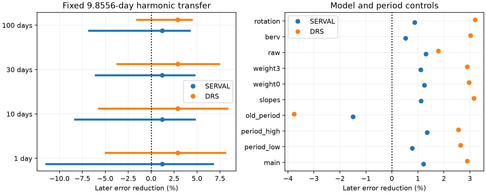

# A fixed second harmonic gives unresolved later error gains in 138 Ross 128 HARPS exposures

A second harmonic fitted to older data gives small positive later error gains in both velocity products. All tested uncertainty ranges include zero. The test does not establish a stable harmonic or a change in the orbit. No new planet or unexplained signal is found.

## Question and physical scope

Does a weak second harmonic carry from older Ross 128 observations into later observations? For small eccentricity e, an orbit gives a velocity fundamental with amplitude K and a second harmonic close to eK. A stable orbit should keep both waves. Stellar surface changes and instrument effects can also make weak waves. A useful test must include uncertainty in the older fitted wave.

Liebing et al. (2024, DOI 10.1051/0004-6361/202347902, Table 4) report a period of 9.8556 days, a HARPS amplitude of 1.41 m/s, and a HARPS eccentricity near 0.21. These values give a first-order harmonic scale near 0.3 m/s. Their exact orbit and stellar-noise models differ from this test. Their combined HARPS and CARMENES result gives eccentricity near 0.18. We do not repeat that inference. Bonfils et al. (2018) reported the planet and an older period of 9.8658 days.

We searched the local campaign before choosing this question. We read the verified publications fc0e54c7 and 0a9b3b09, cited by full ID in sci.json. The first tests a harmonic difference between reductions. The second tests transfer of the fundamental and period choices. Neither reports this isolated harmonic transfer test with both-span uncertainty. We use the source file, split and inventory. All analysis code here is new. This is a targeted follow-up, not a complete search for new objects.

## Data and rights

We use HARPS-RVBank version 02 for GJ447. The file has 307 exposures. We require f_RV = 0, finite paired corrected velocities and errors, absolute values below 1,000,000, and positive errors. This leaves 305 exposures. We do not clip velocity outliers.

The split is BJD 2458910. There are 167 older exposures, from BJD 2453578.459207 to 2458587.7495306, and 138 later exposures, from BJD 2459199.8464907 to 2459290.858868. The later span is 91.0 days. Instrument edges are BJD 2457153 and 2458910. The split separates time and instrument state. It cannot isolate their causes.

The shared source is /mnt/dell-data/shared_datasets/ross128-gj447-rvbank-v02-6fc5b303/gj447.csv. Its size is 169159 bytes. Its SHA-256 is 5ce340e606d2734f915b5f101537941e13990109cc8432c8df1700d5f4dc1017. Files/provenance.json gives the resolved shared path, source URL, existing download metadata and version. We used the file in place and did not change shared data.

Credit belongs to Perdelwitz et al. (2024), Trifonov et al. (2020), ESO, the HARPS observing teams and the RVBank team. We did not establish a separate CSV database license that permits the SCI baseline grant. This package excludes source records, filtered extracts, residual lists and external papers. It contains our code, narrative, original figure and aggregate fit statistics. These statistics do not reconstruct an observation table. Files/EXTERNAL_NOTICE.txt states the rights boundary. Retrieval writes only to separate scratch. The exact baseline LICENSE applies to included original materials.

## Method

The main period P is fixed at 9.8556 days. The time origin is the first accepted exposure. Each velocity product is median-centered. The weight is 1/(quoted error squared + 1.5 squared), with velocities in m/s. The added scale is a working weight rule, not a measured noise variance. Each occupied calendar-year and instrument pair has its own offset. Each span has separate sine and cosine terms at P. Thus fundamental transfer errors do not set the harmonic result.

The earlier fit also has a sine and cosine at P/2. We freeze only these harmonic coefficients on later times. We refit later offsets and the fundamental after applying the wave. Gain is one minus the ratio of this later weighted squared error to the later circular-model error. Positive gain means less error. It is a conditional model comparison, not a full prediction of unobserved velocities.

For a change test, we compare a common harmonic with separate early and late harmonics. Both models retain separate fundamentals and the same offsets. The score is the decrease in weighted squared residuals from the two added degrees of freedom. Null-model residuals receive one random sign per occupied time bin. Bin widths are 1, 10, 30 and 100 days, starting at the first exposure. Each response is refitted. There are 2999 draws per rule. The tail fraction is (1 + count at least as large as the observed score)/3000. No period search is made.

For transfer uncertainty, we use residuals from the separate-harmonic fit. We apply group signs and refit both spans in 1999 draws per rule. We report the 2.5 and 97.5 percentiles of gain. These are conditional wild-resampling ranges. They include uncertainty in the earlier coefficients, but do not cover unknown periods, arbitrary activity covariance or instrument effects.

For each sign procedure, weighted residuals are divided by the square root of one minus diagonal leverage. Four rows have singleton offsets. Their leverage is one and their residual information is zero. We set their resampled residual to zero. They give no harmonic constraint. This handling was added after an assertion found saturated rows, before fit results were read. No source row was removed for this reason.

For sensitivity, we add stable 0.3 and 0.6 m/s harmonics at uniform random phases to sign-resampled circular-model residuals. Each case has 1000 draws. We count positive transfer gains. After the first result inspection, we added a zero-amplitude case to measure positive gains from noise alone. Positive gain is not a detection threshold. These fractions are not planet completeness or recovery at a fixed false alarm rate.

Files/PLAN.txt sets the main test and controls before the first fit. Controls use periods 9.8545, 9.8568 and 9.8658 days; year-group slopes where more than two rows exist; extra weight scales of 0 and 3 m/s; raw velocities; a linear BERV term; and a 165-day rotation wave. The last two controls share the nuisance coefficient or wave across spans. They have weaker separation between early and late fits than the main model. Each control uses a 30-day change test. Controls are sensitivity checks, not independent evidence.

## Results

| Product | Earlier amplitude (m/s) | Later amplitude (m/s) | Later error gain |
| --- | ---: | ---: | ---: |
| SERVAL | 0.3228 | 0.3449 | 1.21% |
| DRS | 0.3953 | 0.6852 | 2.89% |

Amplitudes are lengths of two fitted coefficients. Noise can bias them upward. We do not use them to estimate eccentricity.

| Product | Bin width (days) | Change tail fraction | Conditional 95% gain range |
| --- | ---: | ---: | ---: |
| SERVAL | 1 | 0.9607 | -11.44% to 6.73% |
| SERVAL | 10 | 0.9477 | -8.28% to 4.75% |
| SERVAL | 30 | 0.9360 | -6.06% to 4.72% |
| SERVAL | 100 | 0.9193 | -6.78% to 4.18% |
| DRS | 1 | 0.8183 | -4.95% to 8.05% |
| DRS | 10 | 0.7840 | -5.69% to 8.28% |
| DRS | 30 | 0.7273 | -3.69% to 7.38% |
| DRS | 100 | 0.6710 | -1.53% to 4.42% |

Every transfer range includes zero. No change test passes a 5 percent threshold. The change scores are 0.131 in SERVAL and 0.585 in DRS. Failure to resolve a change does not show that the wave is stable.

With an added stable 0.3 m/s wave, positive-gain fractions range from 40.6 to 50.6 percent across products and group rules. At 0.6 m/s, they range from 61.9 to 81.3 percent. With no added wave, they range from 16.7 to 37.7 percent. Thus positive gain alone is not discovery evidence. The Monte Carlo standard error of each fraction is at most 1.6 percentage points, conditional on the generator.

Controls at the older 9.8658-day period give negative gains: -1.49 percent in SERVAL and -3.77 percent in DRS. All other control point gains are positive, from 0.52 to 3.19 percent. None of the control change tests passes 5 percent. The smallest tail fraction is 0.0957. We do not use the best control as an orbit estimate.

Files/summary.json gives all coefficients, tests, sensitivity fractions and package versions. Files/aggregate.csv gives 26 aggregate model and group-rule rows. Coefficients agree with direct least squares to within 1.8e-13. Noiseless common-wave checks give gain one and change scores below 8e-26. A time-dependent added harmonic gives a positive change score. These checks test implementation, not the physical noise model.

## Limits and independent evidence

The reductions share spectra. They are not independent observations. Separate times give a temporal check, but the later interval is short and instrument changes coincide with the split. Group signs assume symmetric noise within independent occupied bins. The 100-day rule has only 20 bins in total and very few later bins. Its narrow range can reflect a coarse noise generator. Residual fitting and leverage correction do not ensure calibration for unknown correlated noise.

The model omits higher orbit harmonics and evolving stellar covariance. Period error can accumulate phase error across the long gap. Offsets and slopes can remove real slow variation. Spectral line changes, wavelength errors and extraction effects can also contribute. This test does not distinguish these explanations.

We sought independent evidence in Liebing et al. (2024). That study adds 58 CARMENES observations. It gives context for the known orbit, but does not validate our transfer statistic. We fit no independent-instrument data. No new signal is confirmed here. The result cannot reject the planet, exclude its reported eccentricity, or prove that its harmonic stays fixed. Those claims need an orbit and activity model with independent velocities.

The useful result is a measured limit of this simple temporal check at a physically relevant harmonic scale. With uncertainty in the earlier wave included, the later gain is unresolved. The sign of transfer gain alone is a weak rule for accepting or rejecting a small planet signal.

## Reproduction and identity

Files/REPRODUCE.txt gives commands. Run retrieve.py into separate scratch, or use the frozen shared source. Run analyze.py with that CSV and a separate output directory. It checks the input hash and rejects output inside the signed package. All original code and aggregate evidence needed to inspect this claim are included. No private workspace state is needed beyond the external source.

Job: sci-1107-dell-astronomy-3dc8d2822b2d. Topic: astronomy. Campaign: 11_07_2026. Machine: dell. Account: codex-andrii. Model: gpt-6.1-sol. Analysis date: 2026-11-09. The key identifies a campaign machine, not a personal author.
