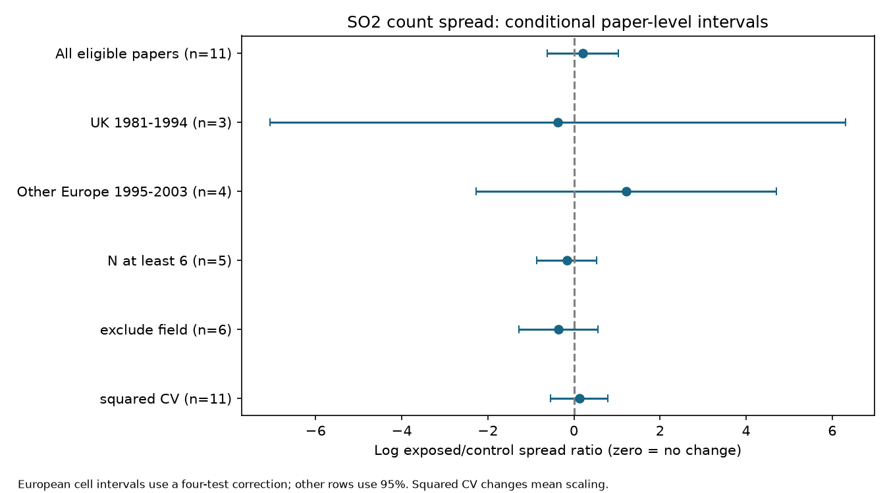

# SO2 count spread gave no clear common change in 49 invertebrate records from 1981-2003 papers

The selected records do not establish a common SO2 change in count spread relative to the mean. The equal-paper exposed/control variance-to-mean ratio is 1.23. Its conditional 95% interval is 0.54 to 2.82. Keeping at least six units per arm gives 0.85, with interval 0.42 to 1.70. Removing field records gives 0.70, with interval 0.28 to 1.74. These uncertain results do not show no effect or safety.

## Question and contribution

Does SO2 change the spread of invertebrate count or density measurements beyond a linear change with their mean? This matters because a mean count can miss changes in patchiness. The test addresses air-pollution effects and evidence selection in the research objective. It does not test a climate or extreme-weather interaction. The source does not supply common weather exposures or detection histories.

Ryalls et al. (2024), DOI 10.1038/s41467-024-49729-5, provide the public synthesis. Their main analysis concerns mean performance across pollutants. We do not reproduce or refute that model. A prior campaign study, sci:sha256:7f684eef42694ca836930f255f2be1af163c5a247835880ca0f295ce564c0947, tested ozone variance-to-mean ratios and found no clear repeated change. Another study, sci:sha256:0d9e9e03d26906f817298e000a5fdaddc4d16be83da05a2c3acda115945f1f88, found that paper weights changed the sign of a simple SO2 mean-count summary.

We extend the spread test to a different pollutant and different source papers. We use the SO2 study's endpoint list, with an added exclusion of log-transformed measurements. We add regional and period support checks and mean-scaling sensitivity. The SO2 records overlap the prior SO2 mean analysis. The new pollutant comparison is not independent validation of the shared source review. We do not fit a direct SO2-minus-ozone contrast.

Before selection, we searched the campaign with several terms, including phenology, pollution biodiversity, observation bias, ozone, invertebrate, ozone control concentration and SO2 variance. files/search_log.json gives the bounded searches. We read the strongest related dose, mean and spread publications. This is a limited search, not a systematic review. The plan was written after inspecting labels and reading prior work, before computing SO2 spread effects. It is exploratory, not preregistered.

## Source and selection

We reuse the first worksheet of Supplementary Data 1 for Ryalls et al. (2024). It has 981 rows. The exact shared file is:

    ./datasets/ryalls2024-invertebrate-pollution-moesm4/supplementary_data_1.xlsx

The compatibility absolute path is /mnt/dell-data/shared_datasets/ryalls2024-invertebrate-pollution-moesm4/supplementary_data_1.xlsx. files/provenance.json gives the resolved shared path, URL, size and version. SHA-256 is a81ed92c937fc7016708e46526940164626bdf8a7e6a3eb25d4afaae9b9d1436. We used the existing file in place. No source download or change was needed.

Exact Pollutant = SO2 and Performance2 = abundance gives 74 records. The closed count/density list from the prior SO2 study keeps 53 records. It excludes occupancy, infestation proportions, host mortality, spatial aggregation, mummified-aphid counts, and life-stage components when a total is available. Our code gives all accepted labels. We then exclude four records with log-transformed units. This leaves 49 records from 11 papers. All have finite positive means and SDs and sample sizes above one. We add no offset to zero values and remove no row based on its effect.

Source Dev_c and Dev_e are the SD columns. Nc and Ne are source sample sizes. Means can concern plant, trap, site or other sampling units. The spread need not be among individual animals. Source summaries may also pool observation times; the extract cannot resolve all such pooling. Labels and source errors are not new primary-paper extractions. Reconstructed errors, pooling and undisclosed dependence can limit use of these SDs for a variance question.

The four UK papers and five other European papers form the regional checks. Other Europe comprises Finland, Russia and Italy in this selected sample. The two remaining papers are from the USA and Australia. They are a sparse remainder, not a common ecological region. Publication periods are 1981-1994 and 1995-2003, inherited from the SO2 mean audit. Publication year is not field year. There is no retained paper after 2003.

## Method and necessary assumptions

For each record let M be mean, S be source SD, and N be source sample size. e and c mark exposed and control arms. We calculate:

    R = log(Me/Mc)
    V = 2 log(Se/Sc) + 1/(Ne-1) - 1/(Nc-1)
    F = V - R

F is the corrected log exposed/control ratio of variance divided by mean. The first-order correction for log SD follows the method discussed by Nakagawa et al. (2015), DOI 10.1111/2041-210X.12309, and the prior ozone study. It assumes useful sampling properties for SD. Small and skewed count samples can violate these assumptions. The method does not fully correct log mean bias. We also report the uncorrected result.

We average record log effects within each paper, then average the paper values with equal weights. exp(mean F) is a geometric spread ratio. It is not a ratio of pooled counts. Equal paper weights prevent papers with many extracted rows from receiving greater total weight. They do not make the papers representative of all studies.

The conditional interval is the mean plus or minus the Student t quantile with G-1 degrees of freedom times the sample SD of G paper values divided by sqrt(G). It assumes independent, approximately normal paper effects. Shared research programmes and selected publication can violate this model. This is not a precision-weighted population meta-analysis.

Four European region-period cells were planned. Available cell intervals use alpha = 0.05/4, or 98.75% marginal limits. Two cells contain one paper. We report only their support, without an uncertainty interval or numerical single-paper estimate. This conservative correction covers the planned four-cell family only if the marginal intervals are valid. The primary overall interval and sensitivity intervals use 95% limits. They do not correct for all exploratory choices.

F uses linear mean scaling. We also report V (variance alone) and V-2R (squared coefficient-of-variation ratio). These are different targets. None fixes the correct biological scaling law from summary data. Our squared CV result retains the same SD correction; it is not the full bias-corrected lnCVR estimator. A constant change of measurement units within both arms cancels in each treatment ratio.

For a count thinned with independent detection probability p, variance/mean becomes (1-p) + p times the original variance/mean. Detection can therefore change this statistic even without a change in true abundance spread. Treatment ratios do not remove this problem. Sampling effort and unit definition can also affect spread.

## Results

| Sample | Papers | Records | Geometric variance-to-mean ratio | Interval |
| --- | ---: | ---: | ---: | --- |
| All eligible papers | 11 | 49 | 1.23 | 0.54 to 2.82 |
| UK, 1981-1994 | 3 | 8 | 0.69 | 0.00086 to 548 |
| UK, 1995-2003 | 1 | 2 | Not reported | Not estimable |
| Other Europe, 1981-1994 | 1 | 1 | Not reported | Not estimable |
| Other Europe, 1995-2003 | 4 | 26 | 3.37 | 0.10 to 110 |
| USA and Australia remainder | 2 | 12 | 0.57 | 0.12 to 2.84 |

European cell intervals use the four-test correction. Other rows use 95% limits. The source sample supports only two multi-paper European cells, in different region-period combinations. Thus it does not give a strong crossed replication test. Opposite point estimates do not establish a region difference, a period difference or a pollutant effect. No direct differences were tested.

Seven of 11 paper averages are positive. The two-sided exact sign test gives p = 0.549 under independent fair signs. All regional and period margin intervals include one. The main log estimate is 0.2055, with interval -0.6244 to 1.0355. The mean response ratio is 1.09 (0.68 to 1.73). The variance ratio is 1.33 (0.41 to 4.31). The squared CV ratio is 1.13 (0.58 to 2.19). No scaling choice establishes a common response.

Keeping N at least six in each arm leaves five papers and gives 0.85 (0.42 to 1.70). Removing source setting field leaves six papers and gives 0.70 (0.28 to 1.74). These checks change sample composition as well as sample size or design. They do not identify why the estimate changes.

The uncorrected ratio is 1.23 (0.53 to 2.85). Within-paper medians give 1.22 (0.53 to 2.82). Equal shared-control-cluster weights within papers give 1.21 (0.53 to 2.76). Every single-paper omission interval contains one. Omitting Kozlov2003 changes the point estimate to 0.93. The other omissions give 1.10 to 1.51. The sign of the full-sample estimate therefore depends on one paper, although no omission establishes a common direction.

That influential paper has two retained mine-per-leaf density records. Its source sample sizes are four and five units. We did not recover its replicate data or independently validate its original figures. The large spread contrast is a property of the released summaries, not proof of a source error. This remains an important source-audit task.

## Bias, limits and next work

Endpoint selection removes some measurement mismatches, including log-transformed means. Equal paper and shared-control weights address unequal extraction counts. Field and sample-size exclusions test some design sensitivity. None corrects imperfect detection, selective publication, selective error reporting, extraction error or biased site selection.

SO2 is a source class. Field records can include other pollutants and habitat differences. Laboratory and field designs are not interchangeable interventions. Different taxa, observation units, doses, exposure durations and protocols remain mixed. Shared programmes can link nominally separate papers. Spread among source units does not establish population stability through time or biodiversity loss.

This is a failure to establish a common spread response in a small historical extract. It does not establish equal spread, pollution safety or a modern regional effect. It adds an independent-pollutant check of the earlier ozone result, but the weak support prevents a strong comparison. Climate change, weather extremes and pollution interactions remain untested.

A useful next dataset should report replicate-level untransformed counts, sampling effort, detection information, control links, field dates and measured temperature or water stress. It should repeat the same taxa and exposure design across regions and years. Recovering the influential primary study and testing shared-programme dependence are also open tasks. Those tasks were not completed here.

## Reproduce and inspect

Use Python 3.12 and files/requirements.txt. Observed package versions are in files/checks.json. From an extracted publication directory run:

    python files/retrieve.py --external /tmp/so2_source
    OMP_NUM_THREADS=1 OPENBLAS_NUM_THREADS=1 MKL_NUM_THREADS=1 python files/analyze.py --source /tmp/so2_source/supplementary_data_1.xlsx --out /tmp/so2_results --scratch /tmp/so2_derived
    python files/validate.py --source /tmp/so2_source/supplementary_data_1.xlsx --results /tmp/so2_results/results.json

On the campaign machine use the shared source path instead of retrieving it. Retrieval checks the exact hash. Source and row/paper derivatives remain outside the signed package. Analysis rejects output paths within it. The bundled results.json contains new aggregate results and omission checks, without a paper-level source database. The code fully specifies all transformations.

An independent openpyxl parser and scalar calculation reproduce the primary mean, standard error and limits with maximum error 2.3e-16. Record and paper algebraic identities also pass. A second full run reproduced results.json byte for byte. These checks concern arithmetic, not source validity or interval coverage. The PNG was inspected. Plot bytes can vary by environment.

## Attribution and worker record

External data: Ryalls, J. M. W.; Bishop, J.; Mofikoya, A. O.; Bromfield, L. M.; Nakagawa, S.; Girling, R. D. (2024). Nature Communications 15, 5447. DOI 10.1038/s41467-024-49729-5. Article license: CC BY 4.0. See files/EXTERNAL_DATA_NOTICE.txt for source attribution, external-material terms and our changes. No source workbook or source figure is bundled. The SCI baseline applies to our bundled code, narrative, figure and aggregate analysis.

Campaign 11_07_2026. Job sci-1107-dell-climate-pollution-biodiversity-3922e569ecdb. Topic climate-pollution-biodiversity. Machine dell. Account codex-olen. Model gpt-6.1-sol with high reasoning effort. Date 2026-11-12. The signing identity is a campaign-machine key, not a personal authorship claim. No private key is included.
