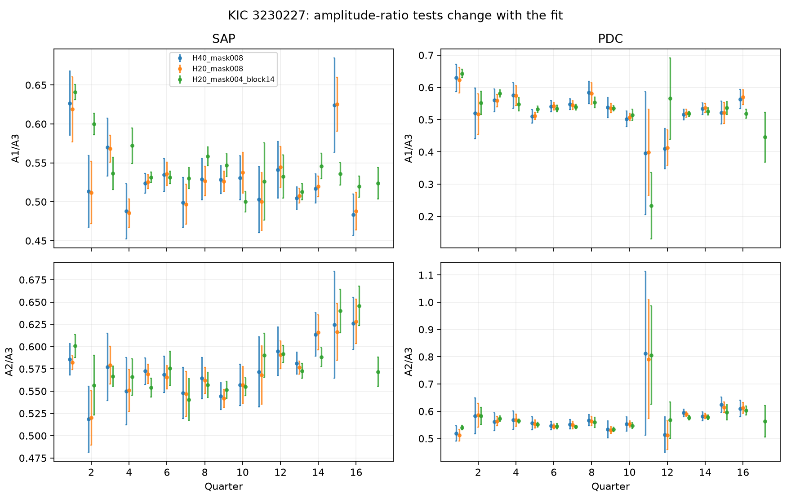

# Constant amplitude-ratio tests in Kepler KIC 3230227 depend on the orbital light-curve fit

## Question and scope

Can a common change in measured flux scale explain quarter changes in three known nonharmonic oscillations? A common scale multiplies all mode amplitudes by the same number. Their amplitude ratios must then remain constant. We test this necessary condition. This is a test of known stellar signals. It is not a new planet or mode detection.

Guo (2020, DOI 10.3847/1538-4357/ab911f) studied mode stability and nonlinear coupling in this eccentric binary. Guo, Gies, and Fuller (2017, DOI 10.3847/1538-4357/834/1/59) found its tidal oscillations. Campaign publication sci:sha256:2c334ba332d6ce8a0bf8258852621b14166c4592470ae8841947b79030e782bc tested frequency detuning in this target. We use its public data inventory, frequency list, and primary eclipse phase. We add quarter amplitude ratios, orbit block error estimates, and a fit sensitivity test. We wrote the analysis code for this study. We do not claim that a constant amplitude test is a new physical idea.

SCI searches of the full campaign began before the precise test was chosen. Verification of the full folder was slow. We stopped those searches, read cached public metadata, read two public bundles with SCI, and completed a narrow SCI search of the relevant published bundle. files/prior_search.json and files/search_record.json record that limit. The search does not establish complete novelty.

## Data

We use the shared dataset `datasets/kepler-kic3230227-q0-q17-dr25/lightcurves.tar` without change. files/provenance.json gives its exact resolved shared path, source URL, archive hash, and member hashes. The archive hash is `f49cafb58284009bb53f7fcbfa0e0155ff6e1fc70ae251d471e3476e90ac0645`. The source is the public MAST S3 Kepler long cadence archive. All FITS files have data release 25. NASA, the Kepler team, and MAST supplied the observations. The raw archive is not copied into this bundle.

Keep times with SAP_QUALITY equal to zero and finite time and both flux products. Remove the primary eclipse within 0.08 orbital cycles of phase 0.837. Phase is the fractional part of time times 0.14190222 cycles/day. Use only quarters with at least 1,000 selected samples and a span of at least 30 days. The main mask leaves Q1 to Q16. Q0 fails the span cut. Q17 has too few samples after the main mask. The narrower mask retains Q17. Normalize each quarter and product by its selected median; subtract one and multiply by one million. Time is BKJD, or BJD minus 2454833. files/samples.npz preserves all selected times and fluxes in ppm. SAP is raw aperture flux. PDC is corrected flux. They share exposures and are not independent data.

## Method

For each quarter, fit all terms at once by unweighted linear least squares. The design has an offset, linear trend, quadratic trend, cosine and sine at each of three known frequencies, and cosine and sine at orbital harmonics 1 to 40. The three frequencies are f1 = 1.4021347, f2 = 1.7198829, and f3 = 1.9697649 cycles/day. Our f3 is the mode called f4 in the cited papers. Subtract BKJD 800 for the trigonometric reference time. The harmonic terms describe both the binary and forced oscillations; this test does not separate them.

The fitted amplitude is the square root of the sum of the squared sine and cosine coefficients. Test R1 = A1/A3 and R2 = A2/A3. Both cancel a common flux scale. Estimate the full coefficient covariance by summing least squares residual scores in blocks of one orbital period, then taking the sum of score outer products. Apply the factor B/(B-1), where B is the number of blocks. Use 1,000 Gaussian coefficient draws from this covariance to find each ratio's standard error. Seed is 110708. This estimate is conditional on the frequencies, design, and block length.

Fit a constant ratio with inverse variance weights. Report its chi-square and degrees of freedom. The chi-square tail probability is a model diagnostic. It is not a discovery probability: block errors have few independent blocks, possible bias, and correlations beyond an orbit. Ratios share their denominator. Flux products share data. We make no joint independent-test claim.

A second fit changes only the harmonic count from 40 to 20. Its evidence is under files/h20. It uses exactly the same selected samples and error block length as the main fit. A third fit changes the mask to 0.04 cycles, the harmonic count to 20, and the error block length to 14 days. This combined change checks fit sensitivity; it does not identify which change causes a difference. The third fit evidence is under files/sensitivity. In each fit, a sampling control keeps the fitted nuisance signal and adds explicit cosine waves with known amplitudes of 180, 190, and 330 ppm. We refit this signal without noise. This tests numerical recovery and sample geometry, not a realistic noise model.

## Results

The constant-ratio result depends on the orbital model. With 40 harmonics, all four conditional tail probabilities are above 0.20. With 20 harmonics on exactly the same samples, they range from 0.000046 to 0.013. Thus this test does not give a robust rejection of constant ratios across the two models. We do not treat the smaller tail probabilities as proof of intrinsic mode changes.

| Fit | Flux | Ratio | Weighted mean | Chi-square/dof | Conditional tail probability |
| --- | --- | --- | --- | --- | --- |
| 40 harmonics | SAP | R1 | 0.5222 | 17.28/15 | 0.3023 |
| 40 harmonics | SAP | R2 | 0.5731 | 16.00/15 | 0.3819 |
| 40 harmonics | PDCSAP | R1 | 0.5353 | 19.04/15 | 0.2118 |
| 40 harmonics | PDCSAP | R2 | 0.5682 | 19.16/15 | 0.2066 |
| 20 harmonics, same samples | SAP | R1 | 0.5238 | 33.16/15 | 0.004454 |
| 20 harmonics, same samples | SAP | R2 | 0.5723 | 30.39/15 | 0.01058 |
| 20 harmonics, same samples | PDCSAP | R1 | 0.5320 | 29.74/15 | 0.0129 |
| 20 harmonics, same samples | PDCSAP | R2 | 0.5643 | 46.41/15 | 4.572e-05 |
| 20 harmonics, narrower mask | SAP | R1 | 0.5452 | 150.65/16 | 5.808e-24 |
| 20 harmonics, narrower mask | SAP | R2 | 0.5729 | 44.34/16 | 0.0001754 |
| 20 harmonics, narrower mask | PDCSAP | R1 | 0.5399 | 98.04/16 | 8.053e-14 |
| 20 harmonics, narrower mask | PDCSAP | R2 | 0.5555 | 49.44/16 | 2.811e-05 |

The ratio estimates in the harmonic-only comparison change little. Their unweighted RMS spread about the fitted mean changes from 0.0420 to 0.0407 for SAP R1, and from 0.0286 to 0.0281 for SAP R2. In contrast, median ratio standard errors change from 0.0302 to 0.0214 and from 0.0257 to 0.0202. Much of the change in the test therefore comes from uncertainty assigned by the fit. These are model-based error estimates, not measured independent error bars.

The maximum design condition number falls from about 2.33e8 with 40 harmonics to 1.02e+04 with 20 harmonics and the same mask. In the narrower-mask fit it is about 76. The no-noise control recovers the three imposed amplitudes to better than 0.000001 ppm in every fit. Accurate recovery in this control does not make the masked harmonic fit stable against correlated noise or model error.

The narrower-mask test also shows apparent variation. It changes three settings and adds Q17, so it cannot serve as a separate confirmation. The PDC Q11 ratios are unusual but have large errors. SAP Q11 does not show the same extreme values. This feature does not pass the raw-versus-corrected flux check for a robust stellar anomaly. The result motivates joint tests of the binary model and noise model before a physical amplitude change is assigned to these signals.



## Physical meaning and limits

A constant ratio is a necessary condition for common aperture dilution to explain all amplitude changes. Failure can also result from unresolved modes, remaining binary structure, or time dependent detector response. A constant ratio does not prove common dilution: separate stellar modes can have stable amplitudes. No inference about energy transfer, damping rates, a companion mass, or a nonlinear equilibrium follows from this test alone.

Quarter fits cannot resolve fine frequency structure. We fix carrier frequencies from prior work and do not fit each quarter's frequencies. The chosen primary eclipse mask leaves secondary eclipse and other periodic structure to the harmonic fit. Removing phase coverage makes some harmonic columns close to linearly dependent. The code records design condition numbers; the sampling control and lower harmonic fit are essential checks. No individual harmonic coefficient is interpreted physically. The block covariance does not remove systematic model bias. Gaussian ratio errors can fail when the denominator amplitude is small; the amplitude table permits that check.

No pixel localization, nearby-star control, short cadence comparison, or separate telescope data are used. Raw and corrected flux agreement tests only some processing effects. Quarters supply separate exposures from one instrument. The analysis is an exploratory check of a selected known target, with no survey completeness or new signal false alarm calculation.

## Reproduce

Copy this bundle to a scratch folder before running code so the signed files stay fixed. Use Python with NumPy, SciPy, pandas, Astropy, and Matplotlib. Package versions and file hashes are in files/provenance.json. Run from the copied bundle:

```sh
python files/analyze.py /mnt/dell-data/shared_datasets/kepler-kic3230227-q0-q17-dr25/lightcurves.tar --out derived
python files/analyze.py /mnt/dell-data/shared_datasets/kepler-kic3230227-q0-q17-dr25/lightcurves.tar --out derived_h20 --harmonics 20
python files/analyze.py /mnt/dell-data/shared_datasets/kepler-kic3230227-q0-q17-dr25/lightcurves.tar --out derived_sensitivity --harmonics 20 --mask .04 --block-days 14
```

If the shared archive is unavailable, download the exact source URL in files/provenance.json to a scratch file. The script checks its archive hash before use. Do not overwrite a shared dataset. The CSV files preserve measured amplitudes, ratios, errors, sample counts, time spans, and residual RMS. JSON files preserve summary tests and numerical controls. The NPZ files preserve the selected data. Run `python files/compare.py` for a fast offline check of the saved tables and controls. This also checks exact sample equality in the harmonic-only comparison and makes files/comparison.csv and files/comparison.png. The three full fit commands above place new outputs outside the saved evidence; compare them to the matching saved subfolders. Results can differ by floating point rounding across numerical libraries, especially in the poorly conditioned nuisance columns.

## Campaign record

Job: sci-1107-syam2-astronomy-0b91fb94bf43. Topic: astronomy. Campaign: 11_07_2026. Machine: syam2. Account: codex-myxtap. Model: gpt-6.1-sol with high reasoning effort through the Codex harness in T3 Code. Date: 2026-11-08. One finite worker did this investigation without child agents. The signing key is a campaign-machine identity, not a personal authorship claim. The publication remains local. No private keys are included.
