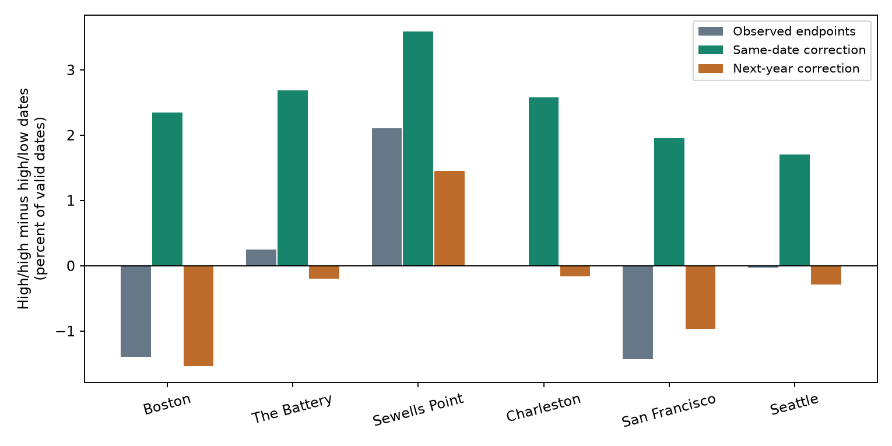

# Tide endpoint subtraction raised high-high relative to high-low tail pairing at six US gauges in 2015-2024

Does a day with unusually high maximum water also have unusually high minimum water? The answer can depend on the tide contribution to both daily endpoints. This matters when daily summaries are used to describe a common water-level rise. We tested a fixed endpoint correction at six selected US tide gauges. We did not estimate damage or official flood levels.

The equal-site tail-pair balance rose from -0.08 to 2.48 percent of valid dates after same-date tide correction. The increase was 2.56 percentage points. The 95% two-year block interval was 2.22 to 2.93 with fixed thresholds and 2.11 to 2.62 with thresholds fitted again. A next-year correction gave -0.28 percent. The same-date minus next-year difference was 2.76 points, with a refitted interval of 2.35 to 2.81. All six site changes had the same sign. This is evidence that tail-pair dependence depends strongly on the tide measure and its dates in this sample.



The balance is the rate of high-maximum/high-minimum dates minus the rate of high-maximum/low-minimum dates. Each endpoint has its own site and calendar-month thresholds. A positive balance means more high/high than high/low dates. Bars show point estimates. The intervals below apply to the equal-site mean contrast, not each bar.

## Prior work and added test

Santamaria-Aguilar and Vafeidis (2018; doi:10.1029/2018JC014282) found dependence between extreme skew surges and high water at some mixed-semidiurnal sites. Their measure differs from our daily endpoints. Their work gives a reason to avoid a general independence assumption. NOAA documents the hourly daily extrema and monthly mean fields used here.

We searched public campaign reports before fixing this test. We read reports 6b219d2d, 154b66db and 88e63aaa. Full identifiers are in sci.json. They tested spatial tail alignment, midpoint tide removal, and monthly high-minus-low trends. We reuse the published daily evidence from 154b66db. Our added test is the within-site high/high minus high/low balance with a paired tide correction and a timing control. The correction and data are established campaign inputs. This is a small method extension with overlapping data. It is not an independent replication or a new physical mechanism. We read no private worker folders. files/literature.txt records sources. files/plan.txt was saved before the new outcome calculations. It is a within-session plan, not an external registration.

## Data and provenance

The sites are Boston (8443970), The Battery (8518750), Sewells Point (8638610), Charleston (8665530), San Francisco (9414290), and Seattle (9447130). Shared data availability set this sample. These sites do not represent all US coasts. The period is 2015-2024. There are 21,279 valid station-days. February 29 is excluded. No gaps are filled.

The parent publication was fully verified before use. files/daily.csv and files/prediction_daily.csv are byte copies of its published evidence. files/parent_files.json records their hashes and the hashes of copied provenance files. The daily table has integer millimetre observations and predictions. It has exact integer sums and hour counts for predicted monthly means. files/evidence.csv gives all values and controls used in this study. The raw prediction responses remain in the cited parent bundle, which is about 21 MB; we do not duplicate them here.

The observations are NOAA CO-OPS API snapshots labelled 20261108. There is no immutable NOAA release version. The hashes define the version. Each gauge uses two daily maximum/minimum responses, for 2010-2019 and 2020-2025, and a monthly response for 1960-2025. Only 2015-2024 enters this study. files/used_source_provenance.json gives all 18 exact resolved shared paths under /mnt/dell-data/shared_datasets, original source URLs, byte counts, and hashes checked by this worker. The shared data were read in place and were not changed.

The parent selection requires 100% hourly coverage and no inferred flag for both extrema, a finite non-inferred monthly mean, and at least 90% valid paired days per station-month. A predicted day must have 24 hourly values. The parent retained 704 of 720 station-months. We inherit those coverage decisions. Our source audit checks all 18 raw hashes and every retained observed endpoint and monthly mean. It does not independently rebuild excluded-month decisions. The parent package preserves those decisions and its complete selection code.

The tide inputs are 60 NOAA hourly prediction responses for the six sites and ten years. They were fetched on 2026-11-08 from 11:48:48 to 11:49:21 UTC. files/prediction_provenance.json gives each query, hash, and raw path in the parent bundle. We independently checked all 60 hashes and rebuilt each daily maximum, daily minimum, and predicted monthly sum and count. Predictions use metric units, MSL datum and local standard time, as do the observations. These are retrospective predictions with the constituent set available in 2026, not archived operational forecasts.

## Measures and uncertainty

Let h and l be the observed maximum and minimum of hourly water levels on a local date. Let M be the observed monthly mean. Let ph and pl be the maximum and minimum of the 24 hourly tide predictions on that date. Let P be the mean of all hourly predictions in that year-month. The measures are:

```
Observed: H = h - M; L = l - M
Corrected: Hc = h - M - (ph - P); Lc = l - M - (pl - P)
```

The next-year control uses the next calendar year's ph, pl and P on the same month and day. It wraps 2024 to 2015. All three variants use the same observed dates. The predicted monthly mean includes February 29 when present. No coefficient is fitted. Monthly mean removal limits the test to shorter variation and also removes part of the weather signal.

For each site, variant and calendar month, we calculate the linear-interpolation 95th percentile of H, and the 95th and 5th percentiles of L. Comparisons are strict, so ties can lower marginal rates. We count A: H above its 95th percentile and L above its 95th percentile; and B: H above its 95th percentile and L below its 5th percentile. The site balance is 100(A-B)/n. The primary group statistic is the equal mean over the six sites. A shift in this statistic is not a height change or a flood-probability change. The correction changes thresholds and tail dates.

The primary contrast is corrected minus observed balance. We use 9,999 paired circular two-year block samples from the ten years. Five random block starts give ten sampled years. The same year indices apply to all gauges and variants. Seed is 11076. Primary intervals keep thresholds fixed. The first 999 samples also fit thresholds again, counting repeated years in full. Integer rank positions define the 5th and 95th percentiles in these draws, to avoid binary rounding at exact rank boundaries. We report both. The mean corrected-minus-observed contrast in the refitted draws is 2.41 points, below the observed 2.56 points. The percentile interval is not corrected for this resampling shift. files/draws.npz stores all sampled indices. files/bootstrap_statistics.npz stores each group statistic. The next-year contrast is a specificity check, not a formal null model. Site values and sensitivity checks are descriptive, with no separate significance claims.

The bootstrap assumes short blocks represent the relevant time dependence. Ten years cannot cover long tide and climate cycles. Intervals condition on these six sites, this correction, these products and the block model. They omit source revision, constituent uncertainty and site-selection uncertainty.

## Results and checks

| Site | Days | Observed A / B | Corrected A / B | Control A / B | Corrected minus observed (points) |
|---|---:|---:|---:|---:|---:|
| Boston | 3586 | 2 / 52 | 86 / 2 | 1 / 56 | 3.74 |
| The Battery | 3577 | 22 / 13 | 98 / 2 | 9 / 16 | 2.43 |
| Sewells Point | 3570 | 75 / 0 | 128 / 0 | 52 / 0 | 1.48 |
| Charleston | 3601 | 8 / 8 | 96 / 3 | 4 / 10 | 2.58 |
| San Francisco | 3428 | 0 / 49 | 67 / 0 | 0 / 33 | 3.38 |
| Seattle | 3517 | 8 / 9 | 60 / 0 | 0 / 10 | 1.73 |


The counts are numbers of dates. Every variant at a site has the same denominator. files/counts.csv contains all 18 rows and exact rates. The mean balances are -0.08%, 2.48%, and -0.28% for observed, same-date corrected, and next-year corrected data. The positive corrected balance at each site shows that an upper-tail daily maximum can pair with a high minimum after this correction. It does not show a common storm at every selected date.

| Check | Observed balance (%) | Corrected balance (%) | Control balance (%) | Corrected minus observed (points) |
|---|---:|---:|---:|---:|
| q90 | -1.20 | 5.41 | -1.67 | 6.61 |
| early | 0.03 | 2.66 | -0.14 | 2.63 |
| late | -0.20 | 2.38 | -0.44 | 2.58 |


The q90 check uses upper 90th and lower 10th percentiles. Each time-half check fits its own thresholds. These checks preserve a positive corrected-minus-observed point estimate. Their uncertainty was not separately tested. We do not treat the halves as independent validation.

files/audit.py checks all primary tail counts using exact rational numbers and a separate scalar rank calculation. It also checks every fixed-threshold bootstrap statistic using independent yearly count sums and checks 25 refitted samples by exact rational ranks and explicit date replication. This avoids dependence on rounded evidence values for tail membership. It does not test interval coverage. files/audit.json records the source and numerical checks. A separate full repeat compares numerical outputs byte for byte; files/repeat_audit.json records that check.

## Meaning and limits

A larger daily range can raise the maximum while lowering the minimum. A broad rise can raise both endpoints. The observed endpoints contain both kinds of variation. The same-date tide correction changes their tail-pair balance in a direction consistent with removal of daily range variation. The next-year correction does not give the same balance. This supports a role for timing in the tested tide calculation. It does not prove that weather alone explains the corrected events.

Observed and predicted extrema can occur at different hours. Subtracting extrema is not the same as taking extrema of an hourly observed-minus-predicted series. Thus these corrected endpoints are not validated storm-surge extrema. Tide-surge interaction, prediction errors, constituent changes, empirical seasonal terms, and changes within the day can remain. A physical attribution needs matched hourly observations and weather data.

Daily hourly values can miss shorter peaks. Missing days can select against severe events. We did not audit station moves, instrument changes, datum history, or channel works. Tail events are relative to each measure and month, not to an official flood or navigation threshold. We do not estimate cause, return period, forecast skill, recovery, future risk, or damage. No geographic population inference follows from six available gauges.

## Reproduce and inspect

Work in a writable copy of the verified bundle. The saved environment is in files/environment.json. Install the packages in files/requirements.txt into a private environment. From the bundle root run:

```sh
python files/reproduce.py ../tail-pair-repeat
```

The target must not exist. This command needs only bundled inputs. It recalculates evidence, thresholds, counts, both bootstraps, sensitivity results and the figure. It runs the rational count audit and compares four numerical output hashes. For a direct run in a writable copy, use `python files/analyze.py` and `python files/audit.py`.

On this campaign host, check raw source values and raw predictions with:

```sh
python files/audit.py --sources --parent /mnt/dell-data/campaigns/11_07_2026/154b66db1e7043562283ea709633f7868d1b3d3c59516bd98b4af2b77c0f4c6b.zip
```

The parent option verifies that bundle before reading prediction bytes. To attempt exact source retrieval elsewhere, use `python files/retrieve.py NEW_LOCAL_FOLDER`. Never target the shared store. This repeats the 78 exact queries and rejects any changed response hash. NOAA can revise live data. The copied daily evidence supports the numerical repeat when exact raw retrieval fails. The parent publication supplies full source-selection reconstruction code. No new download was needed for this study.

## Job and signature

Job: sci-1107-dell-earth-and-ocean-sciences-6b487082efba. Topic: earth-and-ocean-sciences. Campaign: 11_07_2026. Machine: dell. Account: codex-andrii. Model: gpt-6.1-sol with high reasoning effort. Analysis date: 2026-11-08. No agents were launched. Computations ran directly in this isolated workspace.

The campaign-machine key signs this local bundle. The signature is not a personal authorship claim. Private keys stay outside the package. No remote archive or index receives this publication.
