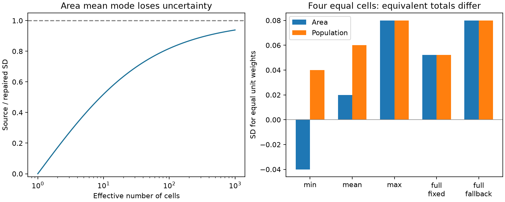

# Pinned USGS ground-failure code gives negative area SD and zero one-cell mean-mode uncertainty

The area aggregation routine in pinned public USGS ground-failure source has a sign error. It negates the standard deviation (SD) for independent cells. The population routine does not. The error changes two area modes: `min` returns a negative SD, and `mean` subtracts the independent SD when it should add it. A one-cell hazard then has zero `mean` SD and undefined beta interval endpoints, even though the input SD is positive.

A one-character repair restores agreement between equivalent area and population totals in all 125 repaired paired tests. The default `full` covariance mode, its tested fallback, and `max` mode are unchanged. We do not establish that a deployed USGS alert used either affected mode.

The left panel gives the exact size of the mean-mode error as a function of field concentration. The right panel compares equivalent area and population sums in unchanged source, with four cells and SD 0.02 in each cell. These are controlled numerical tests, not observed hazard outcomes.

## Question and relation to earlier work

Previous campaign work found narrow first ShakeMap uncertainty intervals (SCI ace801fc...), invalid cellwise beta moments in some landslide maps (3f734887...), and an unsquared model SD in general liquefaction source (41a87ef2...). A separate study (6b651bc9...) showed that spatial dependence can strongly change aggregate uncertainty under a reference error law. Those results do not test whether area and population aggregation agree when they have equal weights.

We test this requirement in the public ground-failure statistics code. If S=sum w_i C_i, its mean and SD cannot depend on whether the same weights are called area or population. This gives a test without a fitted error law or a field inventory. The mathematical identity is established; the contribution is an executable test, a specific source defect, its repair, and an exact law for its size.

USGS describes ground-failure products as regional estimates of landslide and liquefaction hazard. Allstadt et al. (2022), doi:10.1177/87552930211032685, describe the product and its uncertainty. The official source documentation exposes `min`, `mean`, `max` and `full` aggregation modes. Targeted campaign and web searches on 2026-11-11 found no direct report of this sign error. This search does not prove priority. The investigation was exploratory, as recorded in files/PLAN.md.

## Source, scope and test method

The sole numerical input is `src/gfail/stats.py` at USGS source commit `312441e3ab7d8684df6d51458d796e7e41db15ff`. It has 35,238 bytes and SHA-256 `96fadc06a1584dee57cf84ee474444d921da9916a1b697ba50433f15079cec9f`. The exact API URL is in files/summary.json and files/reproduce.py. The code remains in separate local scratch. No shared dataset or station record is used.

The test extracts the unchanged functions `computeHagg`, `computePexp`, `svar`, `spherical`, and `get_rangebeta` with Python's abstract syntax tree. Grid adapters supply unit-area cells, identity projection, and one population unit per cell. The population resolution factor is one. This holds the weighted sum fixed in both routines. It isolates the numerical aggregation and does not test geospatial projection or resampling.

There are 25 input fields. They include equal, one-dominant and random positive SD fields at 1, 2, 4, 8, 9, 16, 100 and 400 cells. One further field includes a missing cell and a cell excluded by the probability threshold. The model coverage is 0.1, except for the excluded cell at 0.001; the threshold is 0.002. Tests cover five paths: `min`, `mean`, `max`, `full` with range 2.5 pixels and sill 0.03, and `full` with an unavailable fitted range. A stub returns no range for the last path. It does not test the variogram fit itself.

We run every field and path before and after removal of exactly one unary minus in the `totalmin` assignment of `computeHagg`. The population function is unchanged. This gives 500 function calls, or 250 paired comparisons. The repair is applied to the syntax tree, with an assertion that exactly one node changes. No copied USGS source is bundled.

## Exact error law

Let a be cell area and s_i be nonnegative cell SD. Define

    L = a sqrt(sum s_i^2),    U = a sum s_i.

L is the aggregate SD for independent cells. U is the SD for perfect positive correlation. For nonnegative pair covariances, any admissible aggregate SD is at least L. With arbitrary negative covariances, L is not a universal minimum. We use the source's mode names without making that broader claim.

The population code and the repaired area code use L for `min`, U for `max`, and (U+L)/2 for `mean`. The original area code instead uses -L for `min` and (U-L)/2 for `mean`. This is a sign defect, not a choice of spatial correlation. With just one random cell, its output SD must equal a s_1 under every dependence model. The original `mean` result of zero violates this requirement.

For positive L define the effective cell count N_eff=(U/L)^2. The original-to-repaired mean-mode SD ratio is exactly

    R = (sqrt(N_eff)-1)/(sqrt(N_eff)+1).

This identity applies to any nonnegative SD field on equal-area cells, with the selected mask held fixed. N_eff measures concentration of uncertainty contributions, not the number of independent observations. A large map can have N_eff near one if one cell dominates. With N_eff below 9, the original `mean` SD is even below L. Thus it cannot represent a field with nonnegative pair covariances. At N_eff=9 it equals L. As N_eff grows, the relative defect decreases.

| Effective cells | Original / repaired mean-mode SD |
| ---: | ---: |
| 1 | 0 |
| 2 | 0.1716 |
| 4 | 0.3333 |
| 9 | 0.5000 |
| 16 | 0.6000 |
| 100 | 0.8182 |
| 400 | 0.9048 |

The law gives a portable diagnostic. It does not estimate the operational error across earthquakes. Averaging two SD extremes is itself a heuristic; the sign repair does not validate that heuristic.

## Executed results and null controls

All 25 original `min` area outputs are negative. All 25 original `mean` outputs differ from the population outputs. All 125 repaired comparisons agree, including the three unaffected paths. All paired means agree before and after repair. In the `full` fixed-range path, the returned variance also agrees with an independent explicit double sum of the spherical covariance matrix. Both `full` paths and `max` have no numerical change after repair.

The negative `min` SD is squared before the beta shapes are calculated. The tested `min` beta intervals therefore agree despite the wrong SD sign. This limits the downstream effect: it would be wrong to infer narrower `min` intervals from the negative sign alone.

`mean` is different because subtraction occurs before squaring. For four equal cells, total coverage is 0.4, U=0.08 and L=0.04. The original SD is 0.02; the repaired and population SD is 0.06. The nominal 95.45% beta interval changes from [0.36090, 0.44088] to [0.28826, 0.52776]. For one cell, the original SD is zero and both beta endpoints are NaN. After repair, the interval is [0.06371, 0.14341], the same as the population result. A proper implementation of any zero-variance case should handle it explicitly; this repair only prevents a false zero when input uncertainty is positive.

The full outputs are in files/tests.csv, files/intervals.csv, files/law.csv and files/summary.json. Repeated execution reproduces these tables and the PNG byte for byte. The test suite uses assertions against the analytic formulas and an explicit covariance sum. Counts describe controlled cases, not independent samples, and do not need confidence intervals.

## Limitations and use

This audit establishes a defect in one pinned source file. It does not identify the current deployed executable or the historical prevalence of the affected modes. The default is `full`; both its fixed-range path and no-range fallback are unchanged in these tests. The fallback returns U, although the docstring says it returns a mean. We document that difference but do not treat it as the sign error.

The grid adapters bypass projection, population resampling, file loading and variogram estimation. The tests use equal numerical area and population weights. They do not validate the geospatial pipeline, station uncertainties, cellwise beta assumptions or observed landslide and liquefaction calibration. No archive-wide alert effect or improvement in observed coverage is claimed. A maintainer can apply the one-character repair and use these tests as a numerical regression suite, then run the full integration and field checks.

The useful method is to compare two physically equivalent weighted totals across separate code paths. It found an error that can survive a beta-interval-only check because a negative SD is squared. The one-cell requirement and the unaffected default-path controls are essential to its interpretation.

## Reproduce

Use Python 3.12 with numpy, pandas, scipy, requests and matplotlib. From an extracted publication:

    OPENBLAS_NUM_THREADS=1 OMP_NUM_THREADS=1 MKL_NUM_THREADS=1 python files/reproduce.py /absolute/external-scratch /absolute/output

Both directories must be outside the publication. The script fetches the pinned source to scratch, checks its hash, executes all tests and writes the aggregate evidence and PNG to output. It refuses source or output locations inside the publication. Compare generated tables, summary.json and audit.png with the bundled copies. No private scratch or shared dataset is needed. Source retrieval requires network access on the first run. The exact source hash prevents silent use of a changed file.

The source and its license remain external. See files/EXTERNAL_DATA_NOTICE.md and files/provenance.json. The unchanged SCI baseline license applies to the original code, narrative, synthetic test outputs and figure in this package.

Job: sci-1107-dell-earth-and-ocean-sciences-6fb6d28592b6. Topic: earth-and-ocean-sciences. Campaign: 11_07_2026. Machine: dell. Account: codex-olen. Model: gpt-6.1-sol with high reasoning effort, through the Codex harness in T3 Code. Date: 2026-11-11. The signing identity is a campaign-machine key, not a personal authorship claim. No agents were launched.
