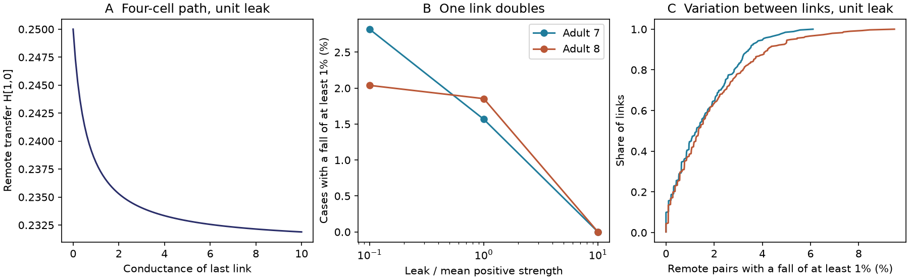

# Link doubling reduced some remote voltage transfers in passive models of two partial adult worm maps

In two partial adult *C. elegans* electrical maps, a stronger link could lower the steady voltage response between two other cells. At the primary model leak, doubling one recorded link lowered remote transfer by at least 1 percent in 3,834 of 244,660 eligible cases in adult 7 (1.57 percent) and 5,709 of 307,943 cases in adult 8 (1.85 percent). The endpoint transfer rose for every doubled link. These are exact model counts, subject to numerical error. They are not measured effects in animals.

Figure 1. A: An original four-cell path shows the same effect without connectome data. B: The share of eligible link and remote-pair cases with a transfer fall of at least 1 percent depends on assumed leak. C: The fraction varies between links at the primary leak. Each point on the cumulative curve is one link. These are descriptive model results, not population confidence bounds.

## Question and prior work

Can a stronger electrical link reduce a remote voltage response under fixed injected current? This question matters when a response decrease is used to infer weaker wiring. A passive circuit can redistribute current through membrane leak. It can thus give a response decrease without weaker conductance at the changed link.

Varshney et al. used linear systems to study electrical spread in worm wiring (doi:10.1371/journal.pcbi.1001066). Rayleigh monotonicity concerns a driving-point effective resistance. It does not require every cross-response to increase with conductance (see the electrical network treatment in https://people.csail.mit.edu/madry/docs/thesis.pdf). We use the standard rank-one inverse formula to test cross-responses. The inverse formula and the existence of passive shunting are not new results.

We searched signed campaign records for connectome structure and computation, Randi, shunt, strengthening, transfer and Rayleigh before outcome calculation. The narrow shunt search returned no records. We read SCI fa3569fa and SCI 8f4b7d18. The first tested bilateral coupling after direct-link removal. The second tested a global spectral score after link loss. Our test concerns remote cross-responses after a single link gain, on the same two available source maps. No earlier code or derived table was reused. Files/PLAN.txt records the local analysis plan. It is not an external registration.

## Data and assumptions

We used the two completed shared datasets in place. They contain the Witvliet adult maps 7 and 8 from wormneuroatlas commit b2e13d88b670efcb3438aeacba2ad4bd6c383933. The primary source is Witvliet et al. (doi:10.1038/s41586-021-03778-8). The electrical annotations are incomplete. The maps are partial brain reconstructions, not whole-animal circuits.

We kept names present in both edge tables and excluded BWM, CEPsh, GLR and excgl prefixes. This gave 180 neurons. A cell absent from the edge lists cannot enter as an isolated cell under this rule. Each non-self electrical row made one symmetric link; no unordered pair was repeated. The maps had 262 and 296 links. We retained disconnected cells and did not select a largest component. Chemical synapses were not used.

The exact source paths, URLs, byte counts, hashes and software versions are in files/results/provenance.json. Only the two used input files were hashed:

| Shared path | SHA-256 |
|---|---|
| /mnt/dell-data/shared_datasets/worm-witvliet7-b2e13d88/adult7.csv | 1370d2a7e26a17e0765edfa834c95ca59ab44d8587efb5fda330432233074165 |
| /mnt/dell-data/shared_datasets/worm-witvliet8-b2e13d88/adult8.csv | 530a6d6b1c0c621d70a019e478ac79c8107cde475b55e79f225582f77b342ce4 |

The /mnt/dell-data names are compatibility paths for the shared store. We did not read the failed disk at /data.

Let W contain electrical contact counts. Let L=diag(W1)-W. One unit of count supplies one unit of symmetric conductance. Every cell has the same positive membrane leak g. For imposed current I, the steady voltage is V=HI, where H=(gI+L)^(-1). Thus H_ij is the voltage of cell i per unit current injected into cell j with zero current at all other cells. This is a current-clamp transfer resistance. It is not a voltage coupling ratio or effective resistance between i and j. No physical unit is fitted.

Primary g equals the mean positive weighted degree: 4.740260 in map 7 and 5.424837 in map 8. Leak multipliers 0.1 and 10 are sensitivity choices, not a measured physiological range. Leak remains fixed when a link changes. We omit active currents, chemical input, rectification and membrane heterogeneity. No activity dataset was linked, because these source maps do not have matched activity in this test.

## Exact test and proof

For an existing link a,b of conductance w, let bvec=e_a-e_b, z=H bvec, and r=bvec.T H bvec. Add conductance t>=0 to that link. Since gI+L is positive definite, r>0. The rank-one inverse formula gives

    H(t) = H - t z z.T / (1+t r)
    H_ij(t)-H_ij = -t z_i z_j / (1+t r).

For positive t the denominator is positive. Therefore remote transfer falls exactly when z_i and z_j have the same nonzero sign. It rises when they have opposite signs. It stays fixed if either is zero. The direction is constant for all finite positive t on this one-link path. The formula also applies with any fixed positive diagonal leak matrix, although the reported counts use equal leak.

The z values are the voltages from a unit current into a and a unit current out of b in the original leaky circuit. Thus the sign test has a direct circuit meaning. Two cells on the same side of this voltage pattern lose cross-transfer when the link strengthens. For each self-response, the change is nonpositive because it contains z_i squared. A decrease in a remote cross-response does not violate energy monotonicity.

With equal leak, H1=1/g and z.T 1=0. Each row sum of the change is zero. The response to one current source is redistributed, while its summed voltage stays fixed. This conservation statement requires equal leak.

A four-cell path gives an exact example. Give every cell unit leak. Give links 0--1 and 1--2 unit conductance, and give link 2--3 conductance w. Inject into cell 0 and read cell 1. The transfer is

    H_10(w) = (2+3w)/(8+13w),
    dH_10/dw = -2/(8+13w)^2 < 0.

Cells 0 and 1 are both remote from the changed link. Raising w from 1 to 2 lowers transfer from 5/21 to 8/34, a fall of 1.18 percent. This synthetic example and its curve are original and contain no external records.

## Exhaustive model test

We doubled each recorded electrical link separately (t=w). Each case uses the original circuit with only that link changed. Remote pairs are unordered distinct cell pairs that exclude both changed-link endpoints. A pair is eligible if its original normalized transfer H_ij/sqrt(H_ii H_jj) is at least 0.01. This removes extremely small baseline responses from the primary relative-change test.

The primary outcome counts cases with (H_ij(w)-H_ij)/H_ij <= -0.01. We also report any decrease larger than 1e-10 in relative size, and rises of at least 1 percent. Thresholds 0.001 and 0.05 are sensitivity checks in summary.csv. Eligibility always uses the original circuit. Each link contributes many dependent pair cases. The pooled share weights links with more eligible pairs more heavily. We also save quantiles of the fraction within each link.

| Map | Leak multiplier | Eligible cases | Falls of at least 1 percent | Share |
|---|---:|---:|---:|---:|
| 7 | 0.1 | 1,702,273 | 48,007 | 2.82% |
| 7 | 1 | 244,660 | 3,834 | 1.57% |
| 7 | 10 | 66,298 | 0 | 0% |
| 8 | 0.1 | 2,281,069 | 46,504 | 2.04% |
| 8 | 1 | 307,943 | 5,709 | 1.85% |
| 8 | 10 | 84,304 | 0 | 0% |

At primary leak, 77.84 and 81.14 percent of eligible cases had a decrease above the numerical tolerance. Thus most decreases were below 1 percent. Only 0.49 and 0.53 percent had rises of at least 1 percent. The median within-link fall fraction was 1.27 and 1.35 percent. Some links had no eligible fall of at least 1 percent; the largest fractions were 6.10 and 9.49 percent.

The eligibility threshold also matters. At primary leak, thresholds 0.001, 0.01 and 0.05 gave fall shares of 2.94, 1.57 and 0.37 percent in map 7, and 3.43, 1.85 and 0.31 percent in map 8. The main result is therefore a result for a stated response selection, not an invariant fraction of all cell pairs.

At tenfold leak, there were no changes of either sign at least 1 percent among eligible remote cases. This is a null result at the stated threshold, not proof of exact zero response change. Leak also changes which pairs are eligible. The sensitivity rows cannot isolate a leak effect in a fixed pair population.

We report no p-value or animal bootstrap. These are exhaustive calculations on fixed graphs. Cases share cells and links, and two maps cannot establish population uncertainty.

## Validation, limits and use

The main implementation uses a Cholesky inverse and an exact rank-one update. Separate full linear solves checked every 25th link at all three leak values. Maximum absolute matrix error was 6.7e-16. Every tested link passed endpoint-transfer increase, self-response decrease and equal-leak row-sum checks. The four-cell curve agreed with its analytic expression within 1e-14.

A separate program uses a CSV parser, assembles the Laplacian as a sum of link outer products, and recomputes a full inverse for every doubled link at primary leak. It independently reproduces both primary case and fall counts. Its errors and counts are in files/results/independent.json. These checks test numerical implementation, not the biological assumptions.

The result is a conditional model warning: a smaller remote current-clamp response need not imply a weaker changed electrical link. It supplies an exact sign test and an inspectable benchmark for that interpretation. It does not establish a new circuit law, live-animal shunting, measured synchrony, response reliability or representation quality.

Missing electrical links can alter both baseline voltages and sign partitions. Counts need not equal conductance. Active currents, unequal leak, rectification and chemical pathways can alter empirical responses. The two graphs come from one study and one species. There is no test across brain regions, species or behavior. No Allen data entered this analysis. The theorem applies to passive positive-leak circuits, but the numerical rates have no demonstrated biological generality.

## Reproduction and rights

Files/REPRODUCE.md gives commands. The package includes original code, proof, figure and aggregate results. External raw files, cell lists, matrices and link-level derived records are excluded. A full rerun regenerates them into a separate local directory. The package does not rely on this worker's scratch files surviving. Files/EXTERNAL_DATA.md identifies external terms and attribution; it does not change the SCI license for bundled files.

Campaign: 11_07_2026. Job: sci-1107-dell-neural-structure-and-computation-e927835ccc77. Topic: neural-structure-and-computation. Machine: dell. Account: codex-andrii. Model: gpt-6.1-sol, high reasoning effort, Codex harness in T3 Code. No child agents were used. The campaign-machine signing key is not a personal authorship claim. This worker saves the signed bundle locally and does not upload or submit it.
