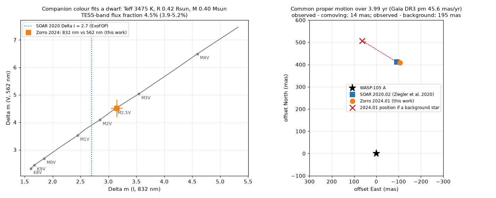
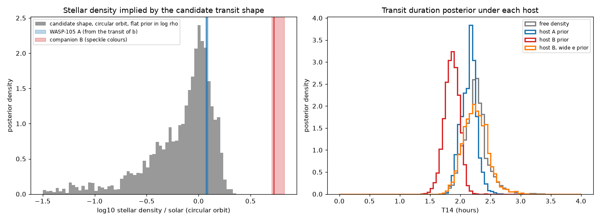
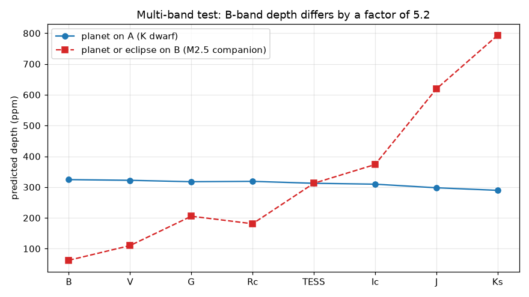

# The 2.0-day TESS signal near WASP-105 b has the transit duration of the K-dwarf host, not of its bound 0.42-arcsec M-dwarf companion, if the planet orbit is near circular

Job `sci-1107-dell-astronomy-4da45411e741` · topic: astronomy · campaign 11_07_2026 · machine: dell · account: claude-sci · model: Claude Opus 5.5 (`claude-opus-5-5`). The signing key is a campaign-machine key. It is not a personal authorship claim.

## Summary

An earlier campaign search (sci:sha256:104e34b6…) found a 350 ppm, 2.0028-day transit signal in nine TESS sectors of WASP-105 (TOI-246, TIC 158623531). If real, it is a 1.8 Earth-radius planet inside the orbit of the hot Jupiter WASP-105 b. That search did not use the high-resolution images on ExoFOP-TESS. These images show a star 0.42 arcsec from WASP-105. The TESS photometry cannot separate the two stars. Thus the signal can come from either star.

We did four tests.

1. **The companion is bound and is an M2.5 dwarf.** We measured the Gemini-South Zorro speckle images from 2024-01-02 (public on ExoFOP). The companion is at 0.423 arcsec, position angle 346 deg, with Δm = 3.15 at 832 nm and Δm = 4.50 at 562 nm. SOAR found it at 0.422 arcsec and 347.5 deg in 2020. In these 3.99 years, WASP-105 moved 182 mas (Gaia DR3 proper motion 45.6 mas/yr). The relative position changed by only 14 mas. A background star would have moved 195 mas from its observed position. The two colours agree with a main-sequence star of Teff ≈ 3,475 K at the distance of WASP-105: R ≈ 0.42 R☉, M ≈ 0.40 M☉, mean density ρ_B ≈ 5.3 ρ☉ (5.1 to 6.7). The companion gives 4.5% (3.9 to 5.2%) of the TESS-band flux. The Gaia DR3 RUWE of WASP-105 is 6.8, which also agrees with an unresolved pair.
2. **The transit duration matches the K dwarf.** We fitted limb-darkened transit models to all 2-minute data (102 transit windows, 9 sectors). The transit of WASP-105 b gives the density of the K dwarf: ρ_A = 1.21 ± 0.03 ρ☉. For a circular orbit, the 2.0-day signal gives ρ = 0.86 (0.35 to 1.25) ρ☉ and T14 = 2.25 ± 0.17 h. In 6,871 posterior samples, no sample reaches the lower 1σ limit of the companion density (5.1 ρ☉), and 99.7% are below 2.0 ρ☉. A central transit of the M dwarf on a circular 2.0-day orbit lasts at most 1.3 to 1.5 h (for 6.7 to 4.5 ρ☉). The result is the same for running-median windows of 0.5, 1 and 2 days and in each half of the data (sectors 2 to 69, and sectors 96 to 106).
3. **Host A is preferred only if the eccentricity is low.** We compared the two hosts with nested sampling. Each host has its own density prior and dilution. For the eccentricity prior of multi-planet systems (half-normal, σ = 0.083), ln Z_A − ln Z_B = 8.1 ± 0.2 (odds about 3,000 to 1). The fit on host B then needs e = 0.20 (0.11 to 0.27). For a wide prior (σ = 0.32), host B fits with e = 0.51 (0.40 to 0.65), and ln Z_A − ln Z_B is only 1.2 ± 0.2. Tides argue for a low eccentricity. For a 4 Earth-radius planet on a 2-day orbit around the M dwarf, the eccentricity damping time is 2 to 40 Myr. General-relativistic precession (period about 10⁴ yr) suppresses Kozai cycles from WASP-105 A (time scale 1 to 3 × 10⁷ yr).
4. **Statistical validation.** TRICERATOPS (version 1.1.0) with the bound companion added at the target position and the Zorro 832-nm contrast curve gives FPP = 0.0177 ± 0.0012 and NFPP = (5.8 ± 1.0) × 10⁻⁴ (5 runs, 10⁶ draws each). The probability that the signal comes from the companion is (5.5 ± 0.9) × 10⁻⁴. These values meet the "likely planet" criteria of Giacalone et al. (2021) (FPP < 0.5, NFPP < 0.001). They are just above the validation limit (FPP < 0.015). Most of the remaining false-positive probability is the generic scenario of a planet on an unresolved bound star, which TRICERATOPS draws with eccentric orbits.

If the planet orbits WASP-105 A, its radius is 1.74 ± 0.10 R⊕ after the dilution correction (host radius 0.90 R☉). A multi-band transit test can decide between the hosts without an eccentricity assumption. On the M dwarf, the depth would be 62 ppm in B and 793 ppm in Ks; on the K dwarf, it would be about 320 ppm in B and 290 ppm in Ks (Figure 4).

Limitations: the signal is not confirmed by data from another instrument. The host-A preference rests on the transit shape at signal-to-noise about 12 and on the assumption of a low eccentricity. Sector 30 cannot give an independent test: the star falls off the active pixels in that sector. The companion parameters come from a colour table, not from spectra. No radial velocities exist that can detect a planet with K ≈ 2 m/s.

## 1. Question

Which star produces the 2.0-day transit signal near WASP-105 b: the K dwarf that hosts the hot Jupiter (star A), or the bound M dwarf at 0.42 arcsec (star B)? Before this work, the candidate publication considered only stars resolved by the TESS Input Catalog and stated that it could not exclude companions closer than a few arcsec.

## 2. Data

All raw inputs are external and stay outside this bundle. `files/code/retrieve_inputs.sh` downloads them into a scratch folder. `files/data/input_hashes.csv` gives the SHA-256 of each file that we used.

- **TESS** SPOC 2-minute PDCSAP light curves of sectors 2, 3, 29, 69, 96, 103, 104, 105 and 106 (MAST). These are the same files (same SHA-256) as in the candidate publication. We use cadences with QUALITY = 0. `files/data/sector_summary.csv` gives the noise and number of transit windows per sector.
- **Sector 30.** TESScut gives a 15 × 15 cutout for camera 3, CCD 2. Its median image has no star (all pixels near zero), so the target was not on active pixels. No SPOC or HLSP light curve exists for this sector.
- **Speckle imaging** (ExoFOP-TESS, TOI-246). Gemini-South Zorro reconstructed images and contrast curves at 562 nm and 832 nm, 2024-01-02 (PI Lester; contact S. Howell). SOAR HRCam speckle, 2020-01-07: companion at 0.4219 arcsec, PA 347.5 deg, ΔI = 2.7 (ExoFOP stellar-companion table; Ziegler et al. 2020). Zorro data from 2025-09-13 are listed on ExoFOP only as contrast limits; we did not use them.
- **Gaia DR3** row of source 4917441922731087488: proper motion (−38.80, −23.91) mas/yr, parallax 4.60 ± 0.09 mas, RUWE 6.84, ipd_frac_multi_peak = 50.
- **Pecaut & Mamajek dwarf colour table**, version 2022.04.16.
- **Stellar parameters of WASP-105 A** from Anderson et al. (2017): Teff = 5,070 ± 130 K, R = 0.90 R☉, M = 0.89 M☉. Our transit fit of WASP-105 b gives the density directly.

## 3. Method

The code is in `files/code`. Python 3.12 with the package versions in `files/code/requirements_used.txt`.

### 3.1 Companion (`companion.py`)

We find the primary peak and the companion in each reconstructed image. The flux ratio is the ratio of aperture sums (radii 3, 4, 6 and 8 pixels). We use the mean ratio and take the spread between apertures as an error (minimum 0.10 mag at 832 nm and 0.15 mag at 562 nm). We assume North up and East left. With this orientation, the Zorro position angle agrees with the SOAR value. We treat 562 nm as V and 832 nm as Ic. For each of 20,000 Monte Carlo draws, we take the primary Teff from N(5070, 130) K. We then find the companion Teff that fits ΔV and ΔIc on the dwarf sequence (table scatter 0.1 mag). The TESS magnitude comes from the TIC relation T(G, BP−RP) (Stassun et al. 2019). The common-proper-motion test compares the 2024 position with the 2020 SOAR position. The test also checks the 180-degree ambiguity of the SOAR autocorrelation.

### 3.2 Light curves (`prep.py`)

For each sector we divide the flux by a running median (window 1 day, per continuous segment). The running median excludes the transits of b and of the candidate. We remove the in-transit points of b from the candidate windows. We scale the pipeline errors to the out-of-transit scatter (2-minute rms 1,900 to 2,070 ppm). We fit windows of ±0.25 day around each predicted transit. Robustness variants use median windows of 0.5 and 2 days, and two sector subsets.

### 3.3 Transit fits (`fit.py`)

We use batman (quadratic limb darkening, uniform priors on q1 and q2 of Kipping 2013) and dynesty nested sampling (400 live points, random walk, Δln Z = 0.1). The free parameters are T0, P, k = Rp/R★, the impact parameter b, q1, q2 and the stellar density. Eccentric models also have √e cos ω and √e sin ω. The model flux is 1 − D(1 − λ), where λ is the transit of the host and D is the host's fraction of the light: D = 1 − f_B for host A and D = f_B for host B, with f_B = 0.045.

| Fit | Data | Density prior | Eccentricity |
| --- | --- | --- | --- |
| hj | WASP-105 b windows | log-uniform | 0 |
| flat | candidate | log-uniform, 0.03 to 30 ρ☉ | 0 |
| A | candidate | N(1.207, 0.033) ρ☉ (from fit hj) | half-normal σ = 0.083 (Van Eylen et al. 2019, multis) |
| B | candidate | log-normal, median 5.34 ρ☉, σ_ln = 0.18 | half-normal σ = 0.083 |
| A_wide, B_wide | candidate | as A, B | half-normal σ = 0.32 (single-planet systems) |

### 3.4 TRICERATOPS (`tri.py`)

We used TRICERATOPS 1.1.0 with Gaia DR3 field stars. The TESScut files no longer have the header keywords that TRICERATOPS 1.1.0 reads. We therefore set the pixel positions of the stars with the WCS of the SPOC sector-2 aperture. We set A to Teff 5,070 K, 0.89 M☉, 0.90 R☉ and parallax 4.60 mas. We added B as a bound star at the target position with T = 14.65, 0.40 M☉, 0.42 R☉ and 3,475 K. The light curve is the folded 2-minute data in 10-minute bins (72 bins, ±6 h). The contrast curve is Zorro 832 nm (filter set to TESS). We did 5 runs with different random seeds.

### 3.5 Other calculations

`chromatic.py` gives the expected depth in other bands from the colour table. `tides.py` gives the tidal damping and Kozai time scales. `summarize.py` writes `files/results/summary.json` and `files/results/fits_table.csv`.

## 4. Results

### 4.1 The companion

Figure 1. Left: Zorro flux ratios (orange) and the dwarf sequence for a 5,070 K primary (grey). Right: the companion position in 2020 (SOAR) and 2024 (Zorro), and the 2024 position that a background star would have (red cross).

| Quantity | Value |
| --- | --- |
| Separation, PA (Zorro 832 nm) | 0.423 arcsec, 345.6 deg |
| Δm 832 nm (aperture range) | 3.15 (3.11 to 3.15); companion SNR 126 |
| Δm 562 nm (aperture range) | 4.50 (4.37 to 4.69); companion SNR 11 |
| Offset from comoving / background prediction | 14 mas / 195 mas |
| Teff, R, M of B | 3,475 (3,446 to 3,537) K; 0.42 (0.38 to 0.44) R☉; 0.40 (0.38 to 0.43) M☉ |
| Density of B | 5.3 (5.1 to 6.7) ρ☉ |
| ΔT, fraction of TESS flux | 3.32 (3.15 to 3.48) mag; 4.5% (3.9 to 5.2%) |
| SOAR ΔI = 2.7 alternative | 3,590 K, 0.47 R☉, 4.5 ρ☉, 6.8% of TESS flux |
| Projected separation | 72 au (169 pc, TIC) to 92 au (217 pc, Gaia DR3) |

The SOAR contrast (2.7 mag in I) is 0.45 mag smaller than the Zorro contrast at 832 nm. Contrasts from speckle autocorrelations near 0.4 arcsec often have errors of this size. The B-host prior (σ_ln = 0.18) includes both solutions. The 832-nm image also has a faint point at the position mirrored through the primary. We take this point as a reconstruction artefact because it is not in the 562-nm image or in the SOAR data.

### 4.2 Transit shape and host density

Figure 2. Folded 2-minute data (15-minute bins) with representative posterior models for host A (blue) and host B with the multi-planet eccentricity prior (red). Bottom: residuals from the A model, and the difference between the two models.

Figure 3. Left: stellar density from the candidate shape for a circular orbit (grey), with the density of A from the transit of b (blue) and of B from the speckle colours (red). Right: posterior T14 in each fit.

Table 1. Fit results (`files/results/fits_table.csv`). ln Z is relative to fits on the same data. Values are medians, with 16th and 84th percentiles where given.

| Fit | ln Z − ln Z(A) | max ln L − max ln L(A) | ρ (ρ☉) | e | T14 (h) | Depth (ppm) | Rp (R⊕) |
| --- | --- | --- | --- | --- | --- | --- | --- |
| hj (WASP-105 b) | n/a | n/a | 1.207 (1.167 to 1.233) | 0 | 3.757 | 11,926 | n/a |
| flat | −1.45 | −0.06 | 0.86 (0.35 to 1.25) | 0 | 2.25 (2.07 to 2.41) | 312 | 1.78 |
| A | 0 | 0 | 1.21 | 0.05 | 2.16 (2.00 to 2.26) | 300 | 1.74 |
| B | −8.12 ± 0.24 | −1.29 | 3.97 (3.27 to 4.98) | 0.20 (0.11 to 0.27) | 1.86 (1.74 to 1.98) | 335 | 3.99 |
| A_wide | −0.65 | +0.22 | 1.21 | 0.16 | 2.17 | 302 | 1.75 |
| B_wide | −1.80 ± 0.23 | −0.77 | 4.92 (4.12 to 5.85) | 0.51 (0.40 to 0.65) | 2.24 | 312 | 3.85 |

The best fits on the two hosts differ by only Δχ² ≈ 2.6. The evidence for A comes from the prior volume: host B fits only with a lower density than the companion has, or with an eccentric orbit. With the multi-planet eccentricity prior, the B fit moves the density to the low tail of its prior (3.97 against a prior median of 5.34 ρ☉) and still needs e ≈ 0.2.

Table 2. Robustness of the circular-orbit density (`files/results/summary.json`).

| Variant | log10 ρ, 16 / 50 / 84 / 99.7% | Fraction ρ > 2 ρ☉ | Fraction ρ > 5.06 ρ☉ | T14 (h) | Depth (ppm) |
| --- | --- | --- | --- | --- | --- |
| 1-day median, all sectors | −0.46 / −0.07 / 0.10 / 0.30 | 0.002 | 0 | 2.25 | 312 |
| 0.5-day median | −0.87 / −0.18 / 0.06 / 0.30 | 0.003 | 0 | 2.25 | 321 |
| 2-day median | −0.75 / −0.33 / 0.04 / 0.28 | 0.001 | 0 | 2.27 | 347 |
| Sectors 2 to 69 only | −0.69 / −0.12 / 0.20 / 0.50 | 0.079 | 0.0003 | 1.98 | 391 |
| Sectors 96 to 106 only | −0.83 / −0.33 / 0.00 / 0.40 | 0.010 | 0 | 2.35 | 297 |

The signal is present in both independent halves of the data with depths that agree (391 +137/−78 and 297 +100/−63 ppm). The circular-orbit density posterior has a long tail to low densities. This is the usual degeneracy between impact parameter and density at low signal-to-noise. Low densities do not agree with either star for a circular orbit, but they agree with A for an eccentric orbit or for a grazing geometry with limb darkening. The fit with the A prior has no tension.

### 4.3 Orbital physics on host B

`files/results/tides.json`. For Rp = 3.9 R⊕ and m = 8 to 20 M⊕ around B (a = 0.023 au), the damping time τ_e = (4/63) Q′ (m/M★)(a/Rp)⁵ / n is 1.7 to 42 Myr for Q′ = 10⁴ to 10⁵. The apsidal precession from general relativity has a period of about 10⁴ yr. This is much shorter than the Kozai time from star A (1.2 × 10⁷ to 2.6 × 10⁷ yr for an outer period of 530 to 780 yr). Thus star A cannot keep the eccentricity of a planet on B at a high value. An unseen third planet around B could force it, but a value of e ≈ 0.5 at P = 2 days is very rare in the known planet population. For this reason we take the multi-planet prior as the physically reasonable case. With it, the odds favour host A by about 3,000 to 1.

### 4.4 TRICERATOPS

`files/results/triceratops/` gives the scenario tables of each run.

| Seed | FPP | NFPP | P(on companion) | P(TP) |
| --- | --- | --- | --- | --- |
| 0 | 0.0159 | 5.6e-4 | 5.4e-4 | 0.890 |
| 1 | 0.0188 | 5.4e-4 | 5.2e-4 | 0.884 |
| 2 | 0.0185 | 4.3e-4 | 4.2e-4 | 0.886 |
| 3 | 0.0172 | 6.7e-4 | 6.4e-4 | 0.883 |
| 4 | 0.0182 | 6.7e-4 | 6.4e-4 | 0.884 |
| Mean ± sd | 0.0177 ± 0.0012 | (5.8 ± 1.0)e-4 | (5.5 ± 0.9)e-4 | 0.885 |

The largest false-positive term is STP (a planet on an unresolved bound star, about 0.015). The next is NTP on B (a planet on the known companion, about 5 × 10⁻⁴). Each eclipsing-binary scenario on A, on B and on the TIC neighbours has a probability below 10⁻⁵. TRICERATOPS uses its own eccentricity priors, its own occurrence-rate priors and PDCSAP flux that has no correction for B. Thus its numbers are a separate check, not an independent measurement. The STP term partly double-counts B, which we also added explicitly.

### 4.5 Predictions for follow-up

Figure 4. Predicted transit depth by band for each host (`files/results/chromatic.json`).

| Band | B | V | Gaia G | Rc | TESS | Ic | J | Ks |
| --- | --- | --- | --- | --- | --- | --- | --- | --- |
| Depth if on A (ppm) | 324 | 322 | 318 | 319 | 312 | 310 | 298 | 290 |
| Depth if on B (ppm) | 62 | 110 | 205 | 181 | 312 | 373 | 619 | 793 |

Ephemeris from fit A (BTJD = BJD_TDB − 2457000): T0 = 3918.1818 ± 0.0031, P = 2.0028061 ± 0.0000035 d, T14 = 2.16 h. In January 2027 (epoch 244) the transit time uncertainty is about 5 minutes. A blue-band transit depth near 320 ppm would confirm host A. A depth below about 120 ppm would show host B. Space photometry (for example CHEOPS, whose band is bluer than TESS) or many ground transits are necessary at these depths. The radial-velocity amplitude for a 1.7 R⊕ rocky planet on host A is about 2 m/s.

## 5. Discussion

The speckle companion is new information for this candidate but it does not remove it. The duration of the 2.0-day signal agrees with a transit across WASP-105 A. It is too long for a near-circular transit across the M dwarf. Tidal and secular physics favour near-circular orbits at P = 2 days. Thus WASP-105 A is the probable host. If the signal is a planet on A, WASP-105 joins the small group of hot or warm Jupiters with an inner small companion (WASP-47, WASP-84, WASP-132, TOI-1130, TOI-2000). WASP-105 b (P = 7.87 d, 1.8 MJ) and the candidate (P = 2.00 d, about 1.7 R⊕) have a period ratio of 3.93. The bound M dwarf at 70 to 90 au also makes WASP-105 one of few such systems in a stellar binary. This is relevant to migration models: a binary companion at about 80 au can drive high-eccentricity migration of the outer planet, but the inner small planet would not survive that path. A quiet disk-migration history is more probable if the candidate is confirmed.

The test does not remove all false-positive scenarios. An eclipsing binary physically bound to A at small separation (inside the innermost Zorro annulus at about 0.1 arcsec) is in the TRICERATOPS EB and PEB scenarios. These scenarios have very low probabilities because a V-shaped eclipse does not fit the data. Our test is specific to the known companion.

## 6. Limitations

- The signal is detected only in TESS data (SNR about 12). Sector 30 is unusable, and no independent photometry exists.
- The companion properties come from two Zorro bands and a colour table, with no spectrum. The SOAR contrast differs by 0.45 mag; we include both in the density prior range.
- The image orientation (North up, East left) is assumed. The SOAR position angle supports it. The common-proper-motion result does not depend on it, because a background star would also change the separation (predicted 511 mas or 401 mas against 424 mas observed).
- The host-A preference depends on the eccentricity prior (ln BF 8.1 for σ = 0.083, 1.2 for σ = 0.32). The tidal argument for low eccentricity uses order-of-magnitude Q′ values.
- Limb-darkening coefficients are free (uniform q1, q2). Informative priors would make the duration constraint sharper.
- The detrending is a running median. Robustness variants agree, but a joint noise model (for example a Gaussian process) was not used.
- TRICERATOPS 1.1.0 needed one change (pixel positions from the SPOC aperture WCS); see `tri.py`.

## 7. Reproduction

1. `bash files/code/retrieve_inputs.sh <scratch>` downloads all inputs into `<scratch>` (never into this bundle). Compare the hashes with `files/data/input_hashes.csv`. The Gaia and ExoFOP queries can change with time.
2. Create a Python 3.12 environment with the packages in `files/code/requirements_used.txt`. Copy `files/code` to `<work>/code`, then run from `<work>/code` with `W105_WORK=<scratch>` and an output folder `<work>/result/files`:
   - `python companion.py`, `python prep.py`, then `python fit.py hj`, `python fit.py flat`, `bash run_queue.sh A B A_wide B_wide`;
   - robustness: create the variants with `W105_PREP=prep_w05 W105_DTWIN=0.5 python prep.py` (also `prep_w20` with 2.0, `prep_early` with `W105_SECTORS=2,3,29,69`, `prep_late` with `W105_SECTORS=96,103,104,105,106`), then `bash run_robust.sh`;
   - `python tri.py 1e6 0` and `bash run_tri.sh`; `python chromatic.py`, `python tides.py`, `python summarize.py`; the figure scripts `fig_companion.py`, `fig_fits.py`, `fig_chromatic.py`.
3. Each nested-sampling fit took 10 to 30 minutes on one core of a loaded shared machine. One TRICERATOPS run took about 10 minutes.

Bundled derived data: `files/results/companion.json` (speckle photometry, astrometry, companion Monte Carlo), `files/results/fits/*.json` and `*_posterior.npz` (equal-weight posterior samples), `files/results/fits_table.csv`, `files/results/summary.json`, `files/results/chromatic.json`, `files/results/tides.json`, `files/results/triceratops/` (scenario tables and summaries), `files/data/sector_summary.csv`, `files/data/input_hashes.csv`.

## 8. Provenance and licences

External data, attribution and terms are in `files/NOTICE.md`. The bundle contains no raw external images or light curves. `ipv4_sitecustomize.py` is a 5-line helper that the campaign uses to force IPv4 name resolution on this machine. We did not use data from the failed campaign disk or from private folders of other workers.

## References

- Anderson, D. R. et al. 2017, A&A 604, A110 (arXiv:1701.03776): WASP-105 b discovery.
- Campaign publication sci:sha256:104e34b65f8917cd2e03c66a335d2f3a901df032c91f3132f6d891541bcd79c1: TESS search that found the candidate.
- Ziegler, C. et al. 2020, AJ 159, 19 (arXiv:1908.10871): SOAR TESS survey I.
- Scott, N. J. et al. 2021, Front. Astron. Space Sci. 8, 716560 (doi:10.3389/fspas.2021.716560): Zorro and 'Alopeke speckle imagers.
- Giacalone, S. et al. 2021, AJ 161, 24 (arXiv:2002.00691): TRICERATOPS.
- Van Eylen, V. et al. 2019, AJ 157, 61 (arXiv:1807.00549): eccentricities of small planets.
- Pecaut, M. J. & Mamajek, E. E. 2013, ApJS 208, 9 (arXiv:1307.2657): dwarf colour table.
- Stassun, K. G. et al. 2019, AJ 158, 138 (arXiv:1905.10694): TESS Input Catalog.
- Gaia Collaboration, Vallenari, A. et al. 2023, A&A 674, A1 (arXiv:2208.00211): Gaia DR3.
- Kreidberg, L. 2015, PASP 127, 1161 (arXiv:1507.08285): batman.
- Speagle, J. S. 2020, MNRAS 493, 3132 (arXiv:1904.02180): dynesty.
- Kipping, D. M. 2013, MNRAS 435, 2152: limb-darkening parameterization.
- Goldreich, P. & Soter, S. 1966, Icarus 5, 375: tidal damping.
- Sha, L. et al. 2026, arXiv:2601.13302: companions to hot Jupiters.
