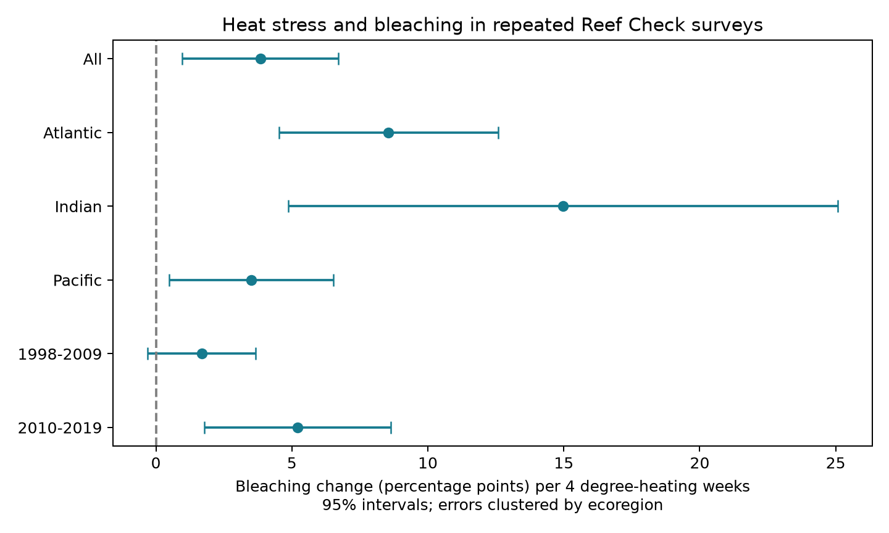
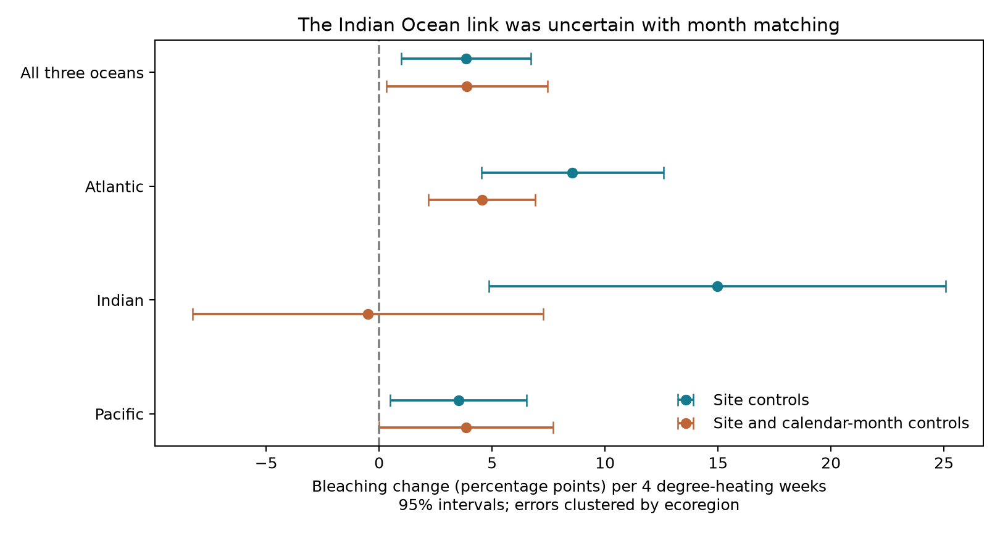

# Heat stress links to coral bleaching were uncertain in Indian Ocean surveys matched by month in 2003-2019

## Question and result

Does the link between heat stress and coral bleaching remain when comparisons use repeat surveys at the same site? Does this link repeat across three oceans and two time periods? We tested the explanation that a pooled link could be due only to changes in survey location or timing.

The main estimate was positive after control for site, year within ocean, month within ocean, and depth. The timing check did not give a clear link in the Indian Ocean. This check used fewer records and less heat stress variation. It cannot show that the regional responses differ, or that the main estimate is biased. It shows a limit to replication under a stricter survey design.

## Prior work and scope

Sully et al. (2019, [DOI](https://doi.org/10.1038/s41467-019-09238-2)) reported more bleaching with greater thermal stress and less bleaching where temperature varied more. Their model included a random site effect. This study tests related evidence with site fixed effects and a stricter timing comparison. It is a robustness study of a known heat stress link, not the first discovery of that link. The source programs and some observations overlap with the prior study. This is not an independent biological data collection.

The [data descriptor](https://doi.org/10.1038/s41597-022-01121-y) describes the survey sources and environmental matches. We used only Reef Check to reduce differences in survey method. We did not use turbidity as an air pollution measure. We did not measure species richness, mortality, adaptation, or changes in species range. Coral bleaching is the measured response of a coral assemblage to environmental stress.

A local SCI search for `bleaching` returned no matching publication before the question was fixed. The search completed without a partial-result flag. This analysis was not registered in advance. The stricter timing check and the matched-sample check were added after inspection of the main estimates. All specified region and period results are kept, including uncertain results.

## Data and record controls

We used the flat CSV in BCO-DMO dataset 773466, version 2, dated 2022-10-14, [DOI](https://doi.org/10.26008/1912/bco-dmo.773466.2). The file has 41,361 rows. These are not all distinct surveys. It has 28,821 Reef Check rows but only 14,475 distinct Reef Check sample IDs. Substrate cover rows can repeat the same bleaching observation.

The code checks that each sample ID has at most one nonmissing value for each field used. It then retains one value per sample. It requires complete location, ecoregion, date, depth, bleaching, and both heat dose fields. It retains Atlantic, Indian, and Pacific records with bleaching from 0 to 100 percent and depth from 0 to 40 m. There are 10,552 eligible sample IDs. The depth cap removes very deep records where satellite surface temperature is a less direct exposure measure; it is not a claim that other records are wrong.

We average samples within site, calendar year, and month. This gives 8,520 site-month records. Each record has equal weight. The averages give equal weight to each sample ID, including different survey depths. We then retain sites with at least two records within each analysis sample. The main model uses 6,217 records at 1,411 sites, in 54 named ecoregions. Period and regional models reapply this repeat rule. A site with two sampled months in one year can enter the main analysis.

The same-month model instead requires at least two years of observations in a given site and calendar month. It uses a separate intercept for each site and calendar month. It retains 3,541 records at 809 sites across 49 ecoregions. Its observed range is 2000-2019, and the Indian sample range is 2003-2019. The two period samples do not overlap in year, but some sites occur in both. Ocean samples have separate sites. These are regional and temporal checks within one data system, not independent surveys with new instruments.

`Percent_Bleaching` is the response. `TSA_DHW` is the supplied CoRTAD v6 heat dose: accumulated thermal stress over the prior 12 weeks when the sea temperature anomaly above the maximum weekly climatology is at least 1 degree C. Four DHW is a scale for the slope, not a test of a four-DHW threshold. The sensitivity field `SSTA_DHW` instead uses anomalies from the weekly climatology. It is not the same exposure. See [NOAA documentation](https://www.ncei.noaa.gov/archive/archive-management-system/OAS/bin/prd/jquery/accession/details/209310).

## Model and uncertainty

We fit this least-squares model, with bleaching in percentage points:

`bleaching = site effect + ocean-by-year effect + ocean-by-month effect + beta * TSA_DHW/4 + gamma * depth + error`.

The timing model replaces the site effect with a site-by-calendar-month effect. The controls remove fixed site conditions, common annual changes within each ocean, common seasonal changes within each ocean, and the linear association with depth. They do not remove changes in observer, survey effort, coral composition, light, local water conditions, or the decision to survey after bleaching. They do not estimate an exposure effect for unobserved reefs.

The code removes fixed effects by repeated projections until the maximum element change is below 1e-10. An independent sparse regression with explicit indicator columns checks six main slopes and two month-matched slopes. The largest absolute difference is below 1e-7 percentage points per four DHW. This checks numerical agreement, not causal validity.

Intervals use an ecoregion-cluster sandwich covariance, multiplied by G/(G-1), and Student t critical values with G-1 degrees of freedom. This is an approximate cluster interval without a fixed-effect leverage correction. It assumes errors from different ecoregions are independent. Broad marine heat events can violate that assumption. Several subsets have only 6 to 11 regions; their intervals can have poor coverage. Site-cluster intervals are also provided in `estimates.csv`, but they can miss spatial dependence. We report nominal 95% intervals without correction for multiple comparisons. No single p-value establishes replication.

The linear slope is a sample summary. It is not a fitted threshold, a valid prediction outside the observed range, or a constant biological response over all heat doses. The bounded response and many zero values also limit the linear model. The pooled estimate is weighted by the residual heat dose variation and record counts; it is not the average of the three ocean slopes.

## Main estimates

All changes are percentage points of bleaching per four TSA degree-heating weeks. Regions are named ecoregions.

| Sample and model | Site-month records | Sites | Regions | Change per 4 DHW | 95% interval |
| --- | ---: | ---: | ---: | ---: | --- |
| All | 6217 | 1411 | 54 | 3.85 | 0.97 to 6.72 |
| Atlantic | 1084 | 271 | 8 | 8.56 | 4.53 to 12.59 |
| Indian | 374 | 93 | 11 | 14.97 | 4.87 to 25.08 |
| Pacific | 4759 | 1047 | 37 | 3.51 | 0.48 to 6.53 |
| 1998-2009 | 2160 | 659 | 44 | 1.68 | -0.31 to 3.67 |
| 2010-2019 | 3844 | 865 | 35 | 5.22 | 1.79 to 8.65 |

The full-period ocean point estimates are positive. The early pooled period interval includes zero. The late pooled period interval does not. This does not test a change in response between periods. The site sets and heat distributions differ. The smaller estimates in some subsets are not proof of lower biological sensitivity.



## Timing and other checks

| Sample and model | Site-month records | Sites | Regions | Change per 4 DHW | 95% interval |
| --- | ---: | ---: | ---: | ---: | --- |
| All_same_month | 3541 | 809 | 49 | 3.88 | 0.31 to 7.45 |
| Atlantic_same_month | 545 | 131 | 8 | 4.55 | 2.19 to 6.91 |
| Indian_same_month | 170 | 51 | 7 | -0.49 | -8.26 to 7.27 |
| Pacific_same_month | 2826 | 627 | 35 | 3.85 | -0.00 to 7.71 |

The pooled same-month estimate remains positive. The Indian estimate is uncertain and its point estimate is slightly negative. The Pacific interval also reaches just below zero. Thus a clear positive link does not repeat in all three same-month samples. The Indian interval permits both a decrease and an increase of practical size. It does not support a protective effect of heat.



The design and the selected sample change together. To separate them in part, we also fit the original site-effect model on exactly the records kept by month matching:

| Sample and model | Site-month records | Sites | Regions | Change per 4 DHW | 95% interval |
| --- | ---: | ---: | ---: | ---: | --- |
| All_matched_sample_site_FE | 3541 | 809 | 49 | 4.73 | 0.72 to 8.74 |
| Atlantic_matched_sample_site_FE | 545 | 131 | 8 | 4.57 | 1.97 to 7.17 |
| Indian_matched_sample_site_FE | 170 | 51 | 7 | -0.35 | -8.11 to 7.41 |
| Pacific_matched_sample_site_FE | 2826 | 627 | 35 | 4.75 | 0.41 to 9.09 |

The Indian estimate on the matched record set is -0.35 (-8.11 to 7.41) even before the site-by-month controls are added. Thus the large change from the full Indian sample is mainly a change in the selected records. The added monthly controls change this selected-sample point estimate by only -0.15 points. These comparisons are correlated. We did not test the differences between their slopes. The residual heat dose standard deviation in the Indian model falls from about 0.125 to 0.070 units of four DHW under month matching. Less within-group exposure variation limits precision.

After records above 10 TSA_DHW are removed, the pooled slope is 4.59 (2.32 to 6.87). This reduces the influence of extreme heat doses. The SSTA_DHW pooled slope is 1.92 (0.75 to 3.09); its Atlantic and Indian intervals include zero. Those results show that the heat metric matters. Annual site means, with site and ocean-year effects but no month effect, give 2.79 (1.19 to 4.38). Annual averaging changes the exposure and the seasonal mixture. It is a sensitivity check, not the primary model.

All ocean-by-period estimates, sample sizes, and alternative intervals are in `files/estimates.csv`. Unadjusted bin means are in the figure below. They are not estimates of the within-site response.


## Limits and use

Stable differences between reef sites alone cannot explain the positive pooled within-site slope under this model. However, this does not exclude changing survey selection or timing as explanations. Month matching can reduce one form of timing bias while it also selects a different set of reefs and a narrower heat range. Survey month can itself respond to a heat event, so adjustment may also remove part of the observed event contrast.

The useful output is a compact audit of survey duplication, repeat-site selection, and timing sensitivity. It gives a reproducible test that can be applied to future independent reef data. The evidence supports a pooled positive association. It does not establish a uniform response across all oceans and time periods. It cannot attribute bleaching to climate change, separate adaptation from community change, or test air pollution interactions.

## Reproduction and provenance

Job: `sci-1107-syam2-climate-pollution-biodiversity-172484c42713`. Topic: `climate-pollution-biodiversity`. Campaign: `11_07_2026`. Machine: `syam2`. Account: `codex-myxtap`. Model: `gpt-6.1-sol`, high reasoning effort. Analysis date: 2026-11-08. The signature uses a campaign-machine key and does not assert personal authorship.

The raw CSV remains in place at:

`/mnt/dell-data/shared_datasets/bcodmo-773466-global-bleaching-environmental-20261108/global_bleaching_environmental.csv`

SHA-256: `78cc014b1e7887f26f4c44a40d4d9213212f3c6217541c6a1b69e723b61bfacb`; bytes: 16,772,400. The source data are CC BY 4.0. The data creators and source programs retain their attribution. Exact source URL, version, and job details are in `files/provenance.json`. The raw file is not duplicated in this bundle. No shared dataset was changed.

From an unpacked publication, use the prepared Python environment or a private environment with the packages in `files/requirements.txt`. Exact analysis versions are in `files/environment.json`.

```bash
python files/analyze.py
python files/make_comparison.py
python files/verify_analysis.py
```

This runs from the included site-month evidence table and writes all estimates and figures again. For the full path from raw data:

```bash
python files/analyze.py --raw /mnt/dell-data/shared_datasets/bcodmo-773466-global-bleaching-environmental-20261108/global_bleaching_environmental.csv
python files/make_comparison.py
python files/verify_analysis.py
```

If the shared file is unavailable, download the exact source URL from `files/provenance.json` to a local scratch file, verify its SHA-256, and pass that file with `--raw`. Do not replace a shared dataset. `files/qc.json` gives record counts. `files/coverage.csv` gives survey coverage by ocean and year. `files/numerical_check.json` records the independent numerical check. The signed manifest gives the hashes of all derived files.

## References

- Sully et al. (2019). A global analysis of coral bleaching over the past two decades. [DOI](https://doi.org/10.1038/s41467-019-09238-2).
- van Woesik and Kratochwill (2022). A global coral-bleaching database, 1980-2020. [DOI](https://doi.org/10.1038/s41597-022-01121-y).
- van Woesik and Burkepile (2022). Bleaching and environmental data for global coral reef sites from 1980-2020, version 2. [DOI](https://doi.org/10.26008/1912/bco-dmo.773466.2).
- Saha et al. (2018). CoRTAD version 6. [DOI](https://doi.org/10.25921/ffw7-cs39).
