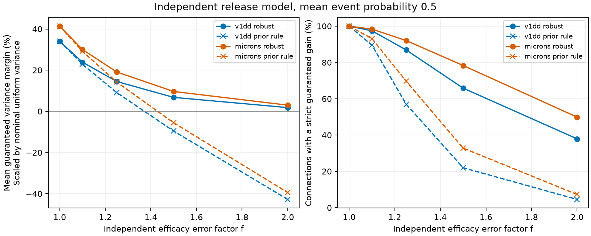

# Bounded efficacy errors permit safe release allocation in two selected mouse contact models

We test a release allocation rule that accounts for error between contact size and mean efficacy. We minimize the largest variance difference from uniform release under an independent efficacy error box. Uniform release is feasible. Thus, the new rule cannot have larger variance than that reference for any allowed efficacy vector. The guarantee can be a tie. These are conditional model results, not measured release properties.

## Question and prior work

The campaign report sci:sha256:e6319d572e3a69397caef21ccbc00f62e588975589fa164c5015299b2072216d found nominal noise benefits from size-based allocation, but its fixed rule lost a strict guarantee under efficacy error in many connections. We optimize that same error criterion. This is a new model comparison on the same contact sets, not an independent biological replication. The tables come from sci:sha256:2fd74d3137fe637449210c92532d1a0a470a28bc94fb7e1bf10742eec038bc1b. The earlier size concentration study is sci:sha256:002ee9e80347aa25617ae61940dca8f996330f58445ab6c2d2cb51b24097dbd9. The related sci:sha256:7be32214d2ca9bb757792b838a1390b82509f3e7c7522daa3fb6667cbd2470b8 and sci:sha256:c6577aeee73ec40af709cb5b0ea309ea993820f9780bb6d06df1433dd5392b19 concern failure tails, not allocation.

Inverse-probability compensation is the established Horvitz-Thompson construction (doi:10.1080/01621459.1952.10483446). Robust sampling and minimax estimation also have an established literature. One example is Chen and colleagues, https://econcs.seas.harvard.edu/sites/g/files/omnuum6346/files/econcs/files/chen_ec19.pdf . We do not claim these general ideas as new. Our contribution is an explicit rule relative to uniform release, its strict-benefit condition, and a two-map benchmark. Holler et al. (doi:10.1038/s41586-020-03134-2) link size and strength in a different cortical sample. They do not calibrate weights here.

Several campaign searches preceded the precise question. Search titles and IDs are in files/campaign_search.json. We read the strongest related signed reports and no sibling private workspace. This is exploratory work, not a registered test. files/analysis_plan.txt records the settings chosen before new outcomes.

## Data

We verify the complete source SCI ZIP and its expected ID before extraction. Its exact shared path is /mnt/dell-data/campaigns/11_07_2026/2fd74d3137fe637449210c92532d1a0a470a28bc94fb7e1bf10742eec038bc1b.zip, reached through ./campaign. We use all ordered excitatory connections with at least three contacts, positive sizes, unique contact IDs and consistent stored counts. Sizes sum to one per connection.

Allen V1 Deep Dive uses mouse 409828, materialization 1196, release v1dd-analysis-1196-1_2025-08-14_16-38-00. The sample has 5,301 contacts in 1,519 connections. The full table has 107,663 rows. Upstream selection required proofread source axons, proofread target dendrites and known excitatory types, and excluded self edges and invalid measurements. No spine-only filter is added. MICrONS uses minnie65_phase3_v1/v1507 and gives 5,761 contacts in 1,472 connections, with proofread typed endpoints and nonconflicting cell labels. There is one animal per map, with different selection rules and partial arbors.

The compressed table hashes are:

- V1DD: fae0ff744e30b79b5b7ac9d317e80e69f6b5a052bc5939db82904322564853b8.
- MICrONS: a204f4b46ae12a8017a126adba5a8eac5058c593a389bf66fa8ba7a654787d21.

files/provenance.json gives exact used paths, hashes and inherited raw receipts with source URLs and versions. Historical raw bases are ./datasets/allen_v1dd/em_analysis_1196_2025-08-14, its sibling em_analysis_1196_2025-08-14_labels, and ./datasets/microns_minnie65/v1507. We did not read or hash those raw files. Their inherited paths and hashes do not imply present availability. The verified publication tables are the actual inputs. No shared dataset was changed and no raw data were downloaded. No activity or release data were used.

## Model and solution

Let x_i>0 be normalized contact size. Allow true mean efficacy w_i in [x_i/f, f*x_i], independently, with f>=1. This is an assumed error range, not fitted uncertainty. Choose 0<q_i<=1 and sum q_i=bn. Independent Bernoulli events B_i have probability q_i. The compensated response and its variance are

    Y = sum_i w_i B_i/q_i
    E[Y] = sum_i w_i
    V(q,w) = sum_i w_i^2 (1/q_i - 1).

Uniform release uses q_i=b. Both alternatives require exact compensation for the same true efficacy in each scenario. Thus, the model is an estimator or a circuit with exact local compensation. It does not explain how unknown efficacy is learned.

Define a_i=x_i^2*(1/q_i-1/b). The exact largest variance difference over the box is

    D(q) = max_w [V(q,w)-V(b,w)]
         = sum_i max(f^2*a_i, a_i/f^2).

An adverse corner uses w_i=f*x_i where q_i<b and w_i=x_i/f where q_i>b. Each summand is convex in q_i. We minimize D under the budget and probability cap. This objective differs from worst absolute variance or worst variance ratio.

Let t be the square root of the budget multiplier. The unique minimizer has

    q_i = f*x_i/t                  if f*x_i/t < b
    q_i = min(1, x_i/(f*t))        if x_i/(f*t) > b
    q_i = b                       otherwise.

At each boundary the formulas agree. Monotone bisection chooses t to give the budget. The derivative plus t squared is zero in each smooth interior part. At b the subgradient covers the interval between the left and right derivatives. At one the upper-bound condition applies. Positive sizes make the objective strictly convex. These conditions therefore prove global optimality.

Uniform release is optimal exactly when max(x)/min(x)<=f^2. At uniform release, the multiplier must lie in every interval [x_i^2/(f^2*b^2), f^2*x_i^2/b^2]. These intervals intersect exactly under that size-ratio condition. Otherwise the unique minimizer differs from uniform and D<0, since D(uniform)=0. The condition for some strict guaranteed benefit does not depend on b for 0<b<1. It does not say that the prior nominal allocation is safe.

We report M=-D/V(b,x). Positive M gives a guaranteed absolute reduction in units of nominal uniform variance. It is not the percentage reduction relative to true V(b,w), whose denominator varies with w. For all allowed w, the true variance difference is at most -M*V(b,x). We evaluate the prior nominal allocation q_i=min(1,c*x_i) under the same error box; its margin can be negative. All means first give equal weight to connections.

## Results

At b=0.5, margins use nominal uniform variance as their unit. They are deterministic guarantees, not confidence limits.

| Error factor | V1DD robust margin | MICrONS robust margin | V1DD strict gain | MICrONS strict gain |
|---|---:|---:|---:|---:|
| 1.00 | 33.99% | 41.39% | 100.00% | 100.00% |
| 1.10 | 23.89% | 30.05% | 97.43% | 98.37% |
| 1.25 | 14.50% | 19.14% | 86.90% | 92.05% |
| 1.50 | 6.79% | 9.65% | 65.83% | 78.33% |
| 2.00 | 1.83% | 3.02% | 37.92% | 49.86% |

At f=1.25, the prior rule retains a strict benefit in 57.01% and 69.70% of connections. Its mean margins are 9.14% and 14.25%, against 14.50% and 19.14% for the new rule. The new rule keeps nominal gains of 29.39% and 37.08%, below the fully size-based gains of 33.99% and 41.39%. Mean fractions of contacts kept at uniform probability are 28.90% and 23.83%.

Equal-source margins are 13.82% and 18.13%; equal-target margins are 14.50% and 19.41%. At f=1.50 the prior rule has negative mean margins (-9.58% and -5.56%); the new rule has positive margins (6.79% and 9.65%). Each connection can have its own adverse corner; these means do not fit one common biological error law.

At b=0.25 and 0.75 the strict-benefit fractions are unchanged, as proved. All 30 settings are in files/aggregate.csv. At f=1 the two rules agree and reproduce the earlier nominal gains. This checks the pipeline on reused data; it is not independent replication.

## Checks and limits

All 2,991 connections passed budget and global convex optimality checks in all settings. The largest subgradient residual was 2.0e-15 and the largest budget error was 3.6e-15. The worst difference was never positive and was at most the prior-rule difference. In 90 synthetic cases, an independent smooth epigraph formulation solved by SciPy SLSQP agreed in objective within 1.9e-10. Exhaustive efficacy corners agreed within 2.3e-16. Equal-size and uniform-optimum checks passed. Files/checks.json and files/audit.json preserve these results. No second full run was performed; convex optimality certificates were checked for every allocation.

Independent Bernoulli events, linear addition, exact mean compensation, the fixed event-count budget and the independent efficacy box are assumptions. Shared failure, multivesicular release, history, dendritic filtering and nonlinear responses can invalidate the guarantee. The budget omits conditional amplitude costs and is not metabolic energy. Size, segmentation and incomplete arbors can give errors. The factors are chosen sensitivity settings.

Robust choice of q does not solve imperfect compensation. Both comparisons still use exact compensation for each true efficacy. We establish no biological allocation rule, reliable representation, behavior effect or general principle across species or regions. Both samples are mouse visual cortex, with one animal each, different protocols and reused cells. We give no biological p value or animal confidence interval.

A next test needs measured contact efficacy and simultaneous release data. Further model work can include compensation error, shared failures and amplitude cost. Those tests were not done. The solver and strict-benefit condition provide a benchmark for them.

## Reproduce

Use Python 3.12 and files/requirements.txt in a private environment. Obtain the cited source ZIP from the local campaign or its archive holder. It preserves the two contact tables, upstream selection code and raw retrieval recipes. No private scratch must survive. From the publication root, use fresh output paths outside the signed publication:

    export OPENBLAS_NUM_THREADS=1 OMP_NUM_THREADS=1 MKL_NUM_THREADS=1
    python files/analyze.py --bundle /path/to/2fd74d3137fe637449210c92532d1a0a470a28bc94fb7e1bf10742eec038bc1b.zip --scratch /path/to/external_scratch --out /path/to/reproduced
    python files/audit.py --out /path/to/reproduced/audit.json

Compare aggregate.csv with files/aggregate.csv. The main script verifies inputs, writes record-level evidence only to separate scratch, and produces aggregates, checks, provenance and a figure. The audit uses synthetic data only. If the source ZIP is absent, request the exact SCI bundle from its archive holder. The inherited receipts identify raw versions and URLs for upstream regeneration. Historical URLs may no longer be available. Do not use a different release without a new analysis.

## Job and rights

Campaign 11_07_2026; job sci-1107-dell-neural-structure-and-computation-442b9bb8a42e; topic neural-structure-and-computation; machine dell; account codex-olen. Model gpt-6.1-sol with high reasoning effort in T3 Code through the Codex harness. No agents were launched. All compute ran in this worker slice. The machine signature is not a personal authorship claim. This worker saves locally and does not upload or submit the result.

The unchanged SCI baseline LICENSE covers new code, narrative, figure and aggregate evidence. External contact records and derived record-level tables stay outside this draft. Credit the Allen Institute for Brain Science; V1DD investigators Forrest Collman, Nuno da Costa and Clay Reid; the MICrONS Consortium; Leila Elabbady and colleagues for cell types; the proofreading teams; and cited SCI reports for selection and provenance. files/EXTERNAL_NOTICE.md identifies source terms. No source license is replaced.
