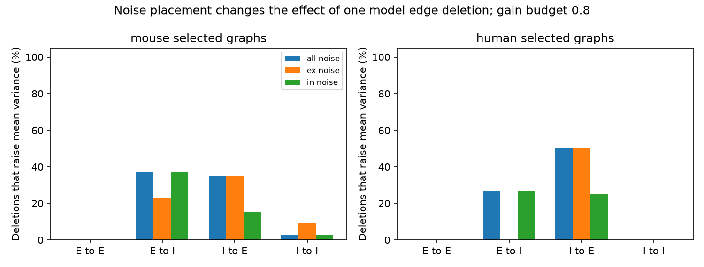
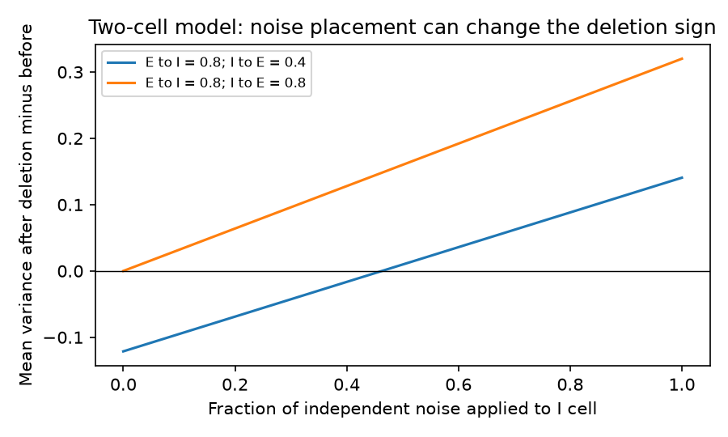

# Noise placement changes edge deletion effects in linear models of selected Allen slice graphs

## Result

A connection sign did not specify the effect of its removal on mean noise variance. In equal-weight linear models of selected Allen slice graphs, removal of an excitatory-to-inhibitory connection increased mean variance in 42 of 113 tested mouse edges and four of 15 human edges. Each of these edges had a reverse inhibitory connection. These counts held at all three tested gain budgets under independent noise at all cells.

At gain budget 0.8, noise applied only to excitatory cells reduced these counts to 26 and zero. Seven mouse edges and two human edges changed from an increase to a decrease. Nine mouse edges and two human edges changed from an increase to no change within tolerance. Thus, an effect inferred from wiring can depend on the assumed noise source. This result concerns model variance. It is not a measured change in neural reliability, a synapse removal experiment, or a species comparison.

The bars show the fraction of edges for which deletion increased mean model variance. E means excitatory. I means inhibitory. The noise input has the same total power in all three conditions. The graphs, edge weights, and gain remain fixed when noise placement changes. The human sample is small.

## Question and prior work

Can an excitatory edge reduce noise variance, and does its role depend on noise placement? This matters when a circuit model is used to rank connections for noise control. Mean variance alone does not measure information or decoding accuracy. A signal model and a readout would be needed for those outcomes.

Campagnola, Seeman and colleagues supplied the Allen cortical slice measurements (Science, 2022; doi:10.1126/science.abj5861). Hennequin, Vogels and Gerstner studied noise and transient amplification in signed linear neural networks (2012; doi:10.1103/PhysRevE.86.011909). Moore and Chaudhuri studied the use of noise covariance to guide pruning (NeurIPS 2020; doi:10.48550/arXiv.2011.07334). These works establish that network paths matter. We do not claim a new general mechanism of noise suppression.

Before the test, we searched the signed campaign for connectome, transient, and edge removal noise. SCI 0eda2fff supplied the selected graphs and tested transient growth. SCI e10c3aa2 tested stationary variance under fixed graph summaries and spectra. We read both. Our added test removes each detected edge in the observed graphs and changes noise placement. It does not enumerate alternate graphs. Search results can be broad because terms match main text as well as titles. The question and three gain budgets were chosen before the first calculation. The exact two-cell explanation and the paired sign-change summary were added after the first results. This was an exploratory study, not a registered test.

## External data and selection

We verified SCI publication sha256:0eda2fff1f10190b6a1720016e81f95b57cc7068bb6e709f33c4700e082e1187 and used its files/source/graphs.csv. The file has 60,938 bytes and SHA-256 2ca0e3900ac5253c4fc86a56b7ac059d9c591dc7f2cd61313b5bbe38c5daa31e. Its exact shared ZIP path is in files/provenance.json. No sibling private workspace was read. We did not use or download the raw database in this study.

The inherited cohort has 247 mouse visual cortex graphs and 17 human temporal cortex graphs. Each graph has four to six cells, with both cell classes present. Labels come from cell_class_nonsynaptic. All directed pairs have explicit chemical connection calls and positive soma distances no greater than 500 micrometres. The source selection keeps the largest eligible recording per inferred donor, with the smallest experiment ID as the tie rule. Mouse donor names use the six-digit specimen number; human names use the first three dot-separated components. These are inferred donor labels. Null calls were not treated as negative calls. The source publications describe the full extraction.

There are 338 detected edges in mouse graphs and 37 in human graphs. Only 133 mouse graphs and 15 human graphs have a detected edge. Empty graphs remain in the cohort description but contribute no deletion tests. We link cell class and edges by their exact within-recording index. There is no link to in vivo activity and no cross-animal activity match. A negative slice connection call does not establish absence of a connection in an intact brain.

## Model and methods

Let A[i,j] equal one for a detected output from cell i to cell j. There are no self edges. Define B[j,i] as A[i,j] times +1 for an excitatory source or -1 for an inhibitory source. All nonzero edge magnitudes equal one. The model is

    dx = M x dt + sqrt(2 Q) dW
    M = -I + g B
    g = c / max(1, maximum detected output degree)

The gain budget c is 0.2, 0.5, or 0.8. The main comparison uses 0.8. The budgets are assumptions, not fitted parameters. Time is in units of a common cell decay time. W has independent components. Q is diagonal. In the all-cell condition Q = I. In each class-only condition Q gives every cell of that class n / n_class and gives other cells zero. Thus trace(Q) = n in all conditions. We compare equal total input noise power. This does not make baseline variance equal.

The stationary covariance C solves

    M C + C M.T = -2 Q.

The outcome is trace(C)/n. An isolated cell has variance one in the all-cell noise condition. We delete one edge by setting its entry in M to zero. We do not change g, leak, noise, other weights, or cell labels. The difference is the variance after deletion minus the variance before deletion. A difference greater than 1e-9 is an increase. A difference less than -1e-9 is a decrease. The remaining values are numerical ties. The largest percentage change uses the original variance as its denominator.

These models have a stability guarantee. The absolute column sum of gB is at most c. Deleting an edge cannot increase that bound. Therefore every eigenvalue of gB before or after deletion has magnitude at most c, and the largest real part of an eigenvalue of M is at most -1+c. All models are stable for c < 1. Their excitatory-only parts are also stable under this bound. These results do not require or test an inhibition-stabilized regime.

## Aggregate evidence

At c = 0.8, the increase counts are:

| Edge class | Mouse: all noise | Mouse: E noise | Mouse: I noise | Human: all noise | Human: E noise | Human: I noise |
| --- | ---: | ---: | ---: | ---: | ---: | ---: |
| E to E | 0/25 | 0/25 | 0/25 | 0/12 | 0/12 | 0/12 |
| E to I | 42/113 | 26/113 | 42/113 | 4/15 | 0/15 | 4/15 |
| I to E | 44/125 | 44/125 | 19/125 | 4/8 | 4/8 | 2/8 |
| I to I | 2/75 | 7/75 | 2/75 | 0/2 | 0/2 | 0/2 |

For E-to-I removal with all-cell noise, the largest increase at c = 0.8 was 8.25% in mouse and 6.40% in human. The increases occurred in 32 mouse graphs and four human graphs. The E-to-I sample had 42 reciprocal edges in mouse and four in human. Thus every reciprocal E-to-I edge increased variance under all-cell noise in this selected equal-weight test. No other E-to-I edge did. This is an observed finite-sample pattern, not a general theorem for larger circuits.

At c = 0.2 and 0.5 the all-cell E-to-I increase counts were unchanged. The largest increases were 0.50% and 3.125% in mouse, and 0.40% and 2.50% in human. Complete counts, including decreases, ties, and graph counts, are in files/evidence/summary.csv. Edge counts are descriptive and dependent within graphs. We do not compute a population p-value or a confidence interval from them. The difference between species is not tested; brain region and species differ together.

## Exact two-cell explanation

Consider one E cell and one I cell, with positive weights a for E to I and b for I to E. Let p and q be the independent noise powers at E and I:

    M = [[-1, -b], [a, -1]],     Q = diag(p,q).

The system is stable for a,b > 0: its eigenvalues are -1 plus or minus i sqrt(ab). The mean variance is

    T = [a^2 p + ab(p+q) + b^2 q + 2(p+q)] / [4(1+ab)].

On removal of the E-to-I edge, the variance difference is

    Delta = a [b p + b(1+b^2) q - a p] / [4(1+ab)].

This formula gives an exact condition for an increase. When a = b, Delta = a^2 q / 4. Under equal independent noise the full equal-weight reciprocal pair rotates fluctuations without changing total variance. Removal leaves a feedforward path that adds variance. With noise only at E, equal weights give zero total variance change in the two-cell model. Other paths in larger graphs can alter this result.

For unequal weights, the same fixed circuit can have opposite deletion effects under different noise inputs. For a = 0.8 and b = 0.4, removal decreases variance if q = 0 and p > 0, but increases it if p = q > 0. With p+q = 2, the sign changes when q/(p+q) passes 0.462963. This synthetic example was chosen to explain the noise dependence; it is not a fitted Allen circuit.

## Checks and limits

We solved 3,375 edge deletion conditions: 375 edges, three budgets, and three noise inputs. Every covariance was checked by its Lyapunov residual and eigenvalues. Each deleted covariance was also solved by a separate dense Kronecker linear system. The largest entry difference was 1.78e-14. The largest deleted-system spectral abscissa was -0.2. A symbolic solution checked the two-cell formula. Direct integration of matrix exponentials checked eight synthetic covariance cases; the largest solver difference was 5.28e-15. A fresh run reproduced the aggregate CSV and paired summary byte for byte. These checks test the calculations, not the biological assumptions.

Equal weights, common decay times, and independent white noise are strong assumptions. The analysis omits delays, conductances, firing thresholds, plasticity, missing cells, and external feedback. Noise in real circuits can be correlated and state dependent. A deletion may change the operating point or cause compensation, which this model holds fixed. The selected slice graphs are small and sparse. Cut axons, detection errors, class uncertainty, and inferred donors limit interpretation. We did not check the raw database again. No recorded activity, stimulus code, behavior, or decoding outcome is analyzed. The two cohorts give model examples across selected cortical samples; they do not establish a general biological law.

The useful result is a warning for model interpretation: the sign of a connection and the wiring alone need not specify its effect on noise. A study that ranks edges by noise control should state the noise covariance and check more than one plausible source.

## Reproduction

Use a copy of the publication and Python 3.12 with files/requirements.txt. Keep all regenerated outputs and external records outside the signed folder. Run from the publication root:

    python files/retrieve.py --bundle /PATH/TO/0eda2fff1f10190b6a1720016e81f95b57cc7068bb6e709f33c4700e082e1187.zip --scratch /ABS/SCRATCH/input
    python files/analyze.py --graphs /ABS/SCRATCH/input/graphs.csv --out /ABS/SCRATCH/evidence --scratch /ABS/SCRATCH/records
    python files/check_theory.py --figure /ABS/SCRATCH/evidence/theory.png

Compare summary.csv and paired_summary.json with files/evidence. The checker prints the values in theory_check.json. Figures can differ in bytes across plotting versions. The analysis writes edge_results.csv into external scratch, not into the publication. No randomness is used. No server or agent is required.

The shared source bundle path, member path, hashes, upstream database version and URL are in files/provenance.json. This source SCI ZIP is the exact input used here and remains in the shared campaign. If the raw database is needed, use the URL and hash in that file. Retrieve it into local scratch, or use campaign-dataset with a new dataset name. Then run the attributed files/rebuild_graphs.py with --db pointing to that file and --out pointing to separate scratch. This rebuilds graph selection and also runs the earlier motif analysis. The resulting graphs.csv must match the input hash above. The prior raw path may no longer exist after the disk failure. We did not access it.

## Rights and job record

Allen external records and record-level derived tables are excluded from this publication. See files/EXTERNAL_DATA_NOTICE.txt. The baseline license covers the original code, narrative, figures, aggregate research results, and attributed reused code. It does not replace external data terms. Credit the Allen Institute for Brain Science, Campagnola, Seeman and colleagues, and the cited SCI cohort publications. No ownership of their source data is claimed.

Job: sci-1107-dell-neural-structure-and-computation-de94e349d43e. Topic: neural-structure-and-computation. Campaign: 11_07_2026. Machine: dell. Account: codex-andrii. Model: gpt-6.1-sol with high reasoning effort in T3 Code. No agents were launched. The campaign-machine signature is not a personal authorship claim. The bundle is saved locally; this worker does not upload or submit it.
