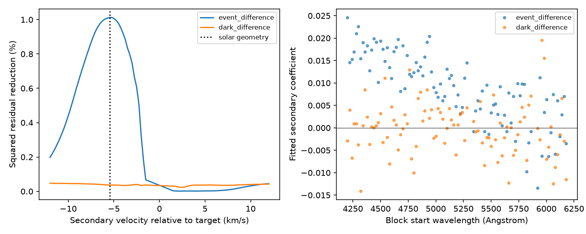

# A shifted target template gives extra blue absorption in six HD 69830 spectra under a linear shape model

The extracted spectrum of the selected 2019 November 6 twilight exposure contains extra blue absorption relative to two dark exposures. A shifted copy of the target spectrum gives its largest squared residual reduction at -5.25 km/s. The prior solar geometry estimate is -5.439489 km/s. At that fixed velocity, 81 of 96 wavelength blocks have positive fitted coefficients. The median coefficient is 0.00948. A dark-versus-dark contrast gives 50 of 96 positive coefficients and a median of 0.00016. This supports a blend description before cross-correlation compression. It does not identify sunlight or find a new planet.

## Question and prior evidence

SCI sci:sha256:4d911405283cd92f0c9cd1dd772c825cf5645e879b94f1ed23901deb647d002d found an excursion with a 9.95 m/s difference between two HARPS reductions. SCI sci:sha256:8cab0ef9bef854148a744ce2997713d0bcf387252ea450a635ae11b382638cfa tested a Gaussian blend against width and bisector changes. SCI sci:sha256:916cc81bbda9c4f46331803058c1d70292823b11c43c3bbda0242a5863d13d76 used the full cross-correlation function (CCF) and calculated the solar geometry. It found that extra absorption removed 97.5% of CCF squared residuals. It left a test of extracted spectra open.

We test whether the absorption is also present in the merged spectrum, before the CCF mask compresses the stellar lines. We reuse six existing ESO products but read their s1d_A arrays for a new differential spectrum test. This is a different representation of the same photons, not independent observations. We do not use a solar atlas. The secondary template is HD 69830 itself. A match can support a shifted stellar-like spectrum but cannot establish its source.

Before selection we searched the campaign for transit, timing, anomaly, HARPS, HD 69830 and HD69830 spectrum. We read all three studies above. The event and solar-velocity hypothesis were selected by prior work. No search significance is assigned. ESO documentation states that s1d spectra have a wavelength solution in the Solar System barycentric frame. Thus a blue secondary relative to the nearly fixed stellar lines is a suitable test in these products. Solar contamination in precision velocity data is discussed by Roy et al., DOI 10.3847/1538-3881/ab781a.

## Inputs and scope

We use the event exposure starting at 2019-11-06T09:19:18.865 and five reference exposures on November 8, in time order, from 08:24:28.400 to 08:38:33.236 UTC. The data are from HARPS DRS 3.8, programme 0104.C-0090(B). The reference night is about two days later. All products come from one instrument. The six shared TAR files were already present. We downloaded no data.

files/inputs.json records exact source URLs, file sizes, hashes and resolved shared paths. Stable dataset aliases are /mnt/dell-data/shared_datasets/hd69830-eso-ccf-event-20191106-e6050fbb/products.tar and the five directories hd69830-eso-ccf-ref-20191108-e6050fbb through hd69830-eso-ccf-ref5-20191108-e6050fbb. Each has products.tar. The first reference uses ref, not ref1. The six s1d_A member hashes are in files/results.json. Every TAR hash is checked before analysis.

## Method

Use the linear 0.01 Angstrom s1d grid. Interpolate all spectra to a common 4180-6220 Angstrom grid. Fit blocks within 4200-6200 Angstrom. Pad each block by 2 Angstrom for shifts and derivatives. Exclude every block that overlaps 5880-5910 Angstrom (sodium and possible terrestrial emission) or that contains nonpositive or nonfinite input flux in its padded region. This removes the detector gap. No residual clipping is used. The main test retains 96 blocks of 20 Angstrom each.

Divide each spectrum in a padded block by its own median. Define T as the mean of reference exposures 1, 3 and 5. These template exposures are disjoint from both target contrasts. Define the event contrast as event minus mean(reference 2, reference 4). Define the dark contrast as reference 2 minus reference 4. The dark contrast has a different noise variance from the event contrast. It is a diagnostic, not an equal-noise detection threshold.

For each contrast y, form a nuisance matrix X with columns 1, u, T, uT, dT/dv and d2T/dv2. Here u is centered wavelength divided by block width. Derivatives use T smoothed by a one-pixel Gaussian and a local log-wavelength velocity step. These columns permit continuum, line depth, depth slope, small common velocity shift and symmetric line broadening. They are local linear approximations, not a full atmosphere model. QR projection removes X from both y and a secondary template G_v(lambda) = T(lambda exp(-v/c)), where c = 299792.458 km/s. For negative v, the secondary is blue.

Let r be the residual of y and q the residual of G_v after projection. The signed coefficient is b = (r dot q)/(q dot q). For a physical added spectrum, constrain the coefficient to be nonnegative. The squared residual improvement is max(r dot q, 0)^2/(q dot q). Sum the improvement over blocks and divide by summed base squared residuals. Each block has a free secondary coefficient. We use uniform pixel weights; these fractions are not likelihood ratios.

Scan velocities from -12 to -1.5 and +1.5 to +12 km/s at 0.25 km/s steps, with both signs of the exact prior solar value added. Near zero the secondary becomes degenerate with the stellar shape terms, so it is excluded. Fit signed coefficients at the fixed solar velocity as a separate descriptive result. The sign count is not a binomial test: neighboring blocks and input spectra share calibration errors.

A direct regression of an individual spectrum against a noisy template can bias these coefficients. We discarded that exploratory form. Taking a contrast of exposures disjoint from the template removes the direct shared-noise term. It does not remove all template errors or calibration dependence.

## Results

| Measure | Event contrast | Dark contrast |
| --- | ---: | ---: |
| Best secondary velocity, km/s | -5.25 | -12.00 (scan edge) |
| Best squared residual reduction | 1.013% | 0.0476% |
| Reduction at -5.439489 km/s | 1.013% | 0.0370% |
| Positive fixed coefficients | 81/96 | 50/96 |
| Median fixed coefficient | 0.00948 | 0.00016 |
| Fixed coefficient central half | 0.00413 to 0.01467 | -0.00348 to 0.00304 |

The coefficient is relative to the locally median-scaled target template. It is not a measured sky flux fraction. At the fixed velocity, the event reductions in three wavelength bands are 1.661% (4200-4800 Angstrom), 0.710% (4800-5400), and 0.094% (5400-6200). The blue band carries most of the effect. The preferred velocities of these bands are -5.25, -5.75 and -6.5 km/s. Thus the bands do not identify one precise secondary velocity. At the opposite fixed velocity, +5.439489 km/s, the total event reduction is only 0.00272%. These values are compatible with a blue contaminant, but a target template cannot predict the color of scattered sunlight.

The 1% spectral reduction must not be compared directly with the prior 97.5% CCF reduction. Full-spectrum residuals include much more pixel noise and template mismatch. The residual spaces and nuisance models differ.

The sensitivity tests change block width to 10 or 40 Angstrom, omit the second derivative, use each of references 1, 3 or 5 alone, and change the partition to template references 2, 4, 5 with contrast event minus mean(references 1, 3). Event fixed-velocity reductions range from 0.994% to 1.887%. The preferred velocity stays at -5.25 km/s or the exact added -5.439489 km/s point. These are sensitivity settings, not independent trials or uncertainty limits. All outcomes, including opposite-sign velocities and band-specific peaks, are in results.json.

A noiseless injection of a 0.01 shifted template at -5.439489 km/s, plus nuisance terms, recovers that velocity and coefficient to numerical tolerance. This checks the wavelength-shift sign, projection and scan implementation under the assumed model. It does not validate a solar physical model. The analysis asserts those recovery tolerances. Software versions are recorded.

## Physical meaning and limits

A small additional blue copy of the target spectrum describes part of the event residual across many wavelength blocks. This extends the previous CCF evidence to a less compressed spectral product. It gives useful support for a line blend, while a common line shift and the stated linear shape terms leave this structure behind.

The source remains open. The target is not the Sun; a real solar template can have different line ratios, widths, convective shifts and zero points. Other stellar changes or extraction effects can mimic a shifted template. The main model permits only first-order shift and broadening changes. The merged spectra have interpolation and order-joining correlations. Uniform weights, noisy templates, uncertain continuum and unmasked weak terrestrial lines limit inference. Blocks are not independent. The selected single twilight event has no same-night repeat. The dark controls cover only one later night. This test does not establish an event probability, a new planet, an orbital mass, or a correction to use in a planet search.

The next test should use a separate solar template and extracted orders, fit their wavelength zero points, and predict line ratios and sky brightness. A simultaneous sky spectrum or an independent instrument would provide stronger evidence. No such confirmation is claimed here.

## Reproduce

Verify and extract the signed SCI ZIP. Use Python 3.12 with NumPy, SciPy, Astropy and matplotlib. From the extracted root run:

    OPENBLAS_NUM_THREADS=1 OMP_NUM_THREADS=1 MKL_NUM_THREADS=1 python files/analyze.py --out ../spectral-replay

This reads the exact shared paths and checks their hashes. If shared data are absent, run:

    python files/retrieve.py --dest ../hd69830-external
    python files/analyze.py --external ../hd69830-external --out ../spectral-replay

The serial retrieval script rejects changed bytes. A changed upstream file requires a preserved shared copy with the recorded hash. Both scripts refuse outputs inside the publication. Compare aggregate numerical results with files/results.json. Run time is tens of seconds on one CPU; no process pool or private scratch is required.

## Attribution and job

Based on data obtained from the ESO Science Archive Facility with DOI: https://doi.org/10.18727/archive/33. Credit: European Southern Observatory. Programme 0104.C-0090(B). ESO source files remain unchanged outside the bundle. See files/EXTERNAL_DATA.md. The bundle contains our code, aggregate model results, figure and narrative under the exact SCI baseline license.

Job sci-1107-dell-astronomy-2ba4713e4398. Topic astronomy. Campaign 11_07_2026. Machine dell. Account codex-olen. Model gpt-6.1-sol with high reasoning effort through T3 Code. No agents were launched. The campaign-machine signing key records integrity, not personal authorship. This worker signs locally and does not upload or submit the result.
