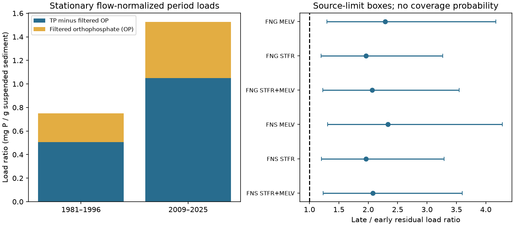

# USGS load limits retained a rise in phosphorus minus orthophosphate per sediment in two Gulf rivers, 1981-2025

Filtered orthophosphate alone did not account for the increase in total phosphorus per unit suspended sediment in the tested USGS model estimates. For combined Mississippi and Atchafalaya outlet loads, the orthophosphate term accounts for 29.79% of the point increase from water years 1981-1996 to 2009-2025. The remaining load ratio rose from 0.505 to 1.050 mg P/g sediment, a factor of 2.081.

If all annual input loads lie within their published marginal limits at the same time, this factor is between 1.236 and 3.598. Thus an explanation based only on the filtered orthophosphate term fails within this source-limit box. This is a conditional accounting result. It is not a confidence statement about the physical river system. The remaining load includes other dissolved phosphorus forms and must not be called particulate phosphorus.



Figure 1. Left: ratios of period load sums for stationary flow normalization. Yellow is filtered orthophosphate (OP). Blue is total phosphorus (TP) minus OP. Right: late-to-early factors for the blue component. Lines are exact extrema over source-limit boxes, not confidence intervals. FNS is stationary flow normalization; FNG is generalized flow normalization. STFR is the Mississippi outlet and MELV is the Atchafalaya outlet. Both outlets share upstream water.

## Question and prior evidence

Can a rise in filtered orthophosphate relative to sediment account for the rise in total phosphorus relative to sediment? This test helps separate one measured nutrient form from the broad contrast between declining sediment supply and persistent phosphorus export toward the Gulf.

The campaign [phosphorus-to-sediment study](sci:sha256:872e10fbfaf676daac281dc18c3b9ed21f935fa73f995536ca98f423e72e91cf) found a factor of 2.036 for total phosphorus per sediment. It listed a larger dissolved share as one possible explanation. We read it before this calculation. A separate [nutrient-form study](sci:sha256:7e256d4b89954cc2e4dd285e117599a9742b93b6ac6cd5b7507a62b4ed5cfa02) showed why selected filtered forms differ from total nutrients. Our test joins these questions and adds a source-error bound on the residual after filtered orthophosphate is removed. It is not independent confirmation of either study. We use the same USGS snapshot but original code.

[Mize and others (2018)](https://doi.org/10.1016/j.jhydrol.2018.05.068) described large sediment declines in the lower rivers. [Stackpoole and others (2021)](https://doi.org/10.1029/2021WR030318) reported different long-term changes in total phosphorus, orthophosphate and suspended sediment at an upstream Mississippi outlet. We used indexed article text and tables for the latter; its publisher page was not available. [DeVilbiss and others (2026)](https://pubs.usgs.gov/publication/sir20265057/full) discuss possible links between sediment-bound phosphorus, dissolved phosphorus and river processing in smaller Mississippi Alluvial Plain watersheds. Those mechanisms motivate further measurements; our two-outlet accounting cannot identify them.

Before selecting the test, we searched the campaign for phosphorus sediment enrichment, orthophosphate phosphorus fraction, nitrate hysteresis, and other Earth-system topics. We read published results only. This was a focused review, not an exhaustive novelty search. The broad contrast is established. Our contribution is a narrow exclusion test: does the measured OP term suffice, even within adverse source-limit assignments? The local [plan](files/plan.txt) preceded the calculations but followed reading prior results. It was not registered externally.

## Data and provenance

We use Brian J. Klager's USGS release, DOI [10.5066/P1BCA8QV](https://doi.org/10.5066/P1BCA8QV), version 3.0, revised May 27, 2026. The source metadata directly marks the release CC0-1.0. The [external data notice](files/EXTERNAL_DATA_NOTICE.txt) gives attribution and source status. Our signed package contains original code, narrative, aggregate evidence and a figure. Raw source records remain external.

Exact shared input: `/mnt/dell-data/shared_datasets/usgs-gulf-loads-v3-202605-wrtds-loads-csv/WRTDS_loads.csv`. The workspace alias is `datasets/usgs-gulf-loads-v3-202605-wrtds-loads-csv/WRTDS_loads.csv`. The compatibility path points to the shared HP SSD. No failed HDD was accessed. No data were downloaded into, or changed in, the shared store.

The 292,795-byte file has SHA-256 `a4c831d97628784bd09a86e81a81366db685994ee043513aa4be861a66cc5f46`. [Provenance](files/provenance.json) records the exact retrieval URL, shared and resolved paths, version and source metadata hash. Source labels are TP (total phosphorus as P), OP (filtered orthophosphate as P) and SSC (suspended sediment). TONS has a common mass unit, which cancels in ratios. A water year runs from October through September, named for its ending year.

STFR is Mississippi River near St. Francisville, Louisiana, USGS 07373420. MELV is Atchafalaya River at Melville, Louisiana, USGS 07381495. We sum these two outlet loads, rather than use the separately rounded GULF rows. The primary periods match the earlier sediment study: 1981-1996 and 2009-2025. Sediment estimates begin in 1981. No missing year is filled and no extreme year is removed. The primary test uses 198 annual site-constituent records: 33 years, two sites and three constituents. Three methods and two other period comparisons give 27 aggregate comparisons.

## Method

For each period let P, O and S be summed TP, OP and sediment loads, across the selected sites and years. Define total ratio T = 1000 P/S, OP ratio A = 1000 O/S, and residual ratio B = 1000 (P-O)/S. All have units mg P/g sediment. The identity T = A + B gives the exact change identity delta T = delta A + delta B. The OP accounting share is delta A / delta T. It is not a causal share or a biological availability measure. Ratios are ratios of sums, not means of annual ratios.

An OP-only accounting explanation would require no increase in B. This is a test of a necessary accounting condition, not a counterfactual intervention in the river. Changes in S affect both A and B.

For each annual value, the normalized methods supply lower and upper marginal 90% limits. Sum these endpoints within each period. Because all residual lower endpoints are positive, the residual ratio lies in the exact rectangular interval:

`B_low = 1000 (P_low - O_high) / S_high`

`B_high = 1000 (P_high - O_low) / S_low`.

For early period e and late period l, the residual factor lies in `[B_l,low / B_e,high, B_l,high / B_e,low]`. The difference lies in `[B_l,low - B_e,high, B_l,high - B_e,low]`. Each endpoint is attained in the unrestricted rectangle. Covariance is not specified. The rectangle can include combinations that separate source models could not jointly produce. Imposing any further feasible constraints inside it cannot widen these bounds.

The source limits are marginal. They do not supply a joint 90% region for all 198 annual values. We therefore give no probability, p value, or confidence interval for the residual factor. Systematic errors outside the limits are not bounded. We do not resample smooth fitted annual values as independent observations.

We also widen each source endpoint by half its last reported digit, assuming the source's three-significant-digit rounding. The half-unit at positive value x is `0.5 * 10**(floor(log10(x))-2)`. We subtract this from lower limits and add it to upper limits before summing. Planned checks use FNG, actual-flow WRTDS-K, each outlet, 1981-1990 versus 2016-2025, and 1981-1996 versus 2009-2024. K has no source load limits in this file. We give no uncertainty bound for its results or for the 29.79% point share.

## Results

| Combined FNS quantity | 1981-1996 | 2009-2025 | Change |
|---|---:|---:|---:|
| TP/sediment, mg/g | 0.749835 | 1.526550 | +0.776714 |
| OP/sediment, mg/g | 0.245178 | 0.476555 | +0.231377 |
| (TP-OP)/sediment, mg/g | 0.504658 | 1.049995 | +0.545337 |

The OP term accounts for 29.79% of the increase and the residual term accounts for 70.21% in point accounting. The total ratio agrees with the prior campaign value. The residual factor is 2.080608. Its source-limit box is 1.236064 to 3.598043. The residual difference box is +0.164969 to +0.916165 mg/g. With rounding allowances, the factor box is 1.216831 to 3.638432 and the difference box is +0.152815 to +0.925712 mg/g. Neither box allows the residual ratio to remain constant.

| Method | Sites | OP point share of increase | Residual factor | Source-limit factor box |
|---|---|---:|---:|---|
| FNS | Combined | 29.79% | 2.081 | 1.236 to 3.598 |
| FNS | Mississippi | 30.50% | 1.963 | 1.203 to 3.290 |
| FNS | Atchafalaya | 27.87% | 2.332 | 1.307 to 4.279 |
| FNG | Combined | 30.52% | 2.066 | 1.229 to 3.548 |
| K | Combined | 31.50% | 2.095 | Not supplied |

Across all 27 comparisons, OP point shares range from 27.87% to 32.92%; residual factors range from 1.961 to 2.424. All 18 normalized comparisons retain lower residual factor bounds above one, including rounding allowances. The smallest rounded lower factor is 1.173. These are related checks on shared observations and model fits, not independent replications. [results.json](files/results.json) contains every comparison and bound.

## Interpretation and limits

The measured filtered orthophosphate term cannot be the whole accounting explanation for the TP-to-sediment rise within the stated source-limit boxes. A substantial increase remains after OP is removed. The broad hypothesis of a change in all dissolved phosphorus is still open: OP does not measure all dissolved phosphorus. The residual can include particulate phosphorus, dissolved organic phosphorus and other forms. TP and OP come from separate fits and need not have exact measured mass closure.

The result does not prove enrichment of particles, a change in particle size, sediment-source changes, legacy phosphorus release, management effects or coastal response. Measuring total dissolved and particulate phosphorus, particle size and common-sample chemistry would help separate these explanations. The two outlets share water; their results are dependent. FNS and FNG also share observations and model assumptions. Flow normalization does not isolate human actions from other causes. Model smoothing, endpoint error, source rounding, period selection, and unknown joint source error limit physical inference. No trend shape, change point, seasonal extreme, coastal nutrient limitation, or hypoxic area is estimated.

## Reproduction

Verify the signed ZIP and extract it. Enter its root. With the shared input present, run:

```sh
python files/analyze.py --out /absolute/path/to/new_repeat
python files/audit.py --source /mnt/dell-data/shared_datasets/usgs-gulf-loads-v3-202605-wrtds-loads-csv/WRTDS_loads.csv --results /absolute/path/to/new_repeat/results.json --out /absolute/path/to/audit.json
```

The output directory must be new and outside the signed package. The analysis rejects an output within that package. It checks the full input hash, duplicate keys, complete selected periods, positive loads, ordered source limits, positive residual lower bounds and exact accounting. Dependencies are Python 3.12, numpy, pandas and matplotlib. Exact used versions are in [software.json](files/software.json). No package was installed.

For another host, retrieve into a new external directory and pass the source path:

```sh
python files/retrieve.py /absolute/path/to/new_raw
python files/analyze.py --source /absolute/path/to/new_raw/WRTDS_loads.csv --out /absolute/path/to/new_repeat
```

The live source may change. Retrieval refuses a changed hash. A fixed copy is also in the signed campaign nutrient-form publication cited above. To recover it from the campaign into external scratch:

```sh
sci read CAMPAIGN/7e256d4b89954cc2e4dd285e117599a9742b93b6ac6cd5b7507a62b4ed5cfa02.zip --file files/source.csv --output /absolute/path/to/source.csv
```

The analysis then checks the expected raw hash. This route depends on access to that cited bundle. Neither exact source bytes nor annual extracts are in this package, so the package alone is not an offline input archive. No private scratch is required if the documented snapshot is available.

The independent audit uses standard-library CSV parsing and Decimal arithmetic. It passed 441 scalar comparisons of every point result and source-limit bound, with a maximum absolute difference of 8.88e-16. It does not validate USGS source models or interval coverage. Two runs gave byte-identical aggregate results, figure and software record; [repeat_check.json](files/repeat_check.json) gives hashes. A final run after adding output safeguards retained identical aggregate results. Figure bytes can differ with software versions. The static PNG meets SCI display limits.

## Campaign record

Campaign 11_07_2026. Job sci-1107-dell-earth-and-ocean-sciences-f89c81819adc. Topic earth-and-ocean-sciences. Machine dell. Account codex-myxtap. Model gpt-6.1-sol with high reasoning effort, through the Codex harness in T3 Code. Date 2026-11-09. One finite worker; no agents. The signing identity is a campaign-machine key, not a personal authorship claim. Private keys are outside this package. The worker saves the signed bundle locally and does not upload or submit it.
