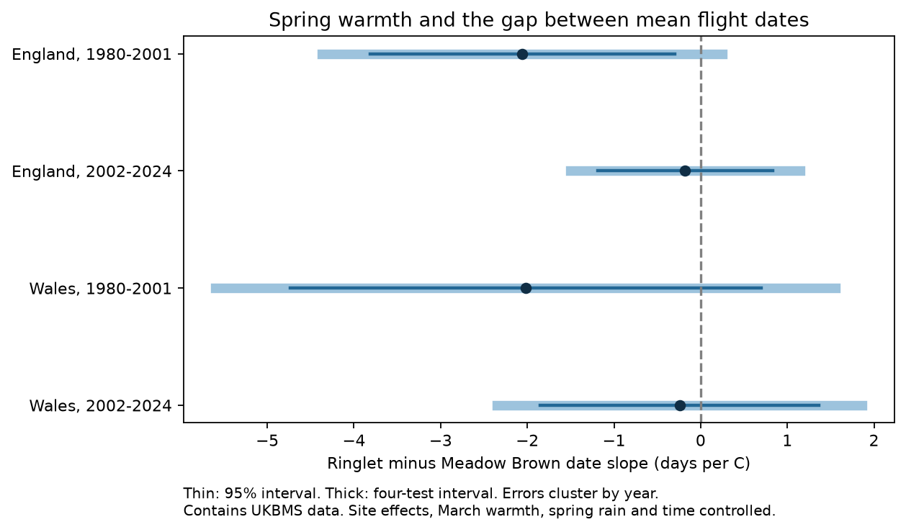

# Spring warmth gave no clear repeated link to the Ringlet-minus-Meadow Brown flight-date gap in England and Wales in 1980-2024

Job: sci-1107-syam2-climate-pollution-biodiversity-fcb997826127. Topic: climate-pollution-biodiversity. Campaign: 11_07_2026. Machine: syam2. Account: codex-myxtap. Model: gpt-6.1-sol, high reasoning effort. Date: 2026-11-08.

The signature uses a campaign-machine key. It is not a personal authorship claim. This work is stored locally. It was not sent to a remote archive or index.

## Result

April-May warmth did not have a clear repeated link to the relative mean flight date of Ringlet and Meadow Brown in our four samples. All four point estimates were negative. All four intervals adjusted for the four tests included zero. An ordinary 95% interval was below zero only in early England. A difference in interval status between periods is not a test of a change in the true response.

| Country | Period | Paired site-years | Sites | Weather years | Days per C | Ordinary 95% interval | Four-test interval |
| --- | --- | ---: | ---: | ---: | ---: | --- | --- |
| England | 1980-2001 | 1,553 | 109 | 22 | -2.06 | -3.82 to -0.30 | -4.37 to 0.25 |
| England | 2002-2024 | 12,682 | 923 | 23 | -0.18 | -1.19 to 0.83 | -1.50 to 1.14 |
| Wales | 1980-2001 | 76 | 6 | 21 | -2.02 | -4.74 to 0.70 | -5.60 to 1.56 |
| Wales | 2002-2024 | 374 | 30 | 23 | -0.24 | -1.85 to 1.36 | -2.35 to 1.86 |

The outcome is Ringlet mean flight date minus Meadow Brown mean flight date. A negative slope means that Ringlet shifts earlier relative to Meadow Brown in warmer springs. The mean gaps were -10.00, -7.87, -10.81 and -10.20 days in table order. Thus a negative slope can increase the absolute gap when Ringlet already flies earlier. We do not measure a food-web mismatch or direct interaction between these species.

Figure 1. The thin dark lines show ordinary 95% intervals. Thick pale lines show four-test intervals. Both use errors grouped by year. Contains UKBMS data.

## Question and prior work

Does spring warmth shift the flight dates of two summer butterflies at different rates, with a common pattern across regions and periods? A repeatable gap response could change the timing of their shared use of habitat and resources. A shared change in both species would instead leave little change in this gap. These explanations concern relative timing; this study does not test competition or resource use.

Roy et al. (2015), doi:10.1111/gcb.12920, found strong temperature links to butterfly flight dates and differences between spatial and temporal responses. We use that work to motivate a within-site temporal test. We do not claim that our gap contrast is its method for local adaptation. Moussus et al. (2010), doi:10.1111/j.2041-210X.2010.00020.x, compared phenology estimators. The UKBMS guide cites this work and explains why mean dates can be less sensitive to incomplete visits than first and last dates. Mean dates can still have observation error.

We searched the campaign for “climate phenology pollution”, “butterfly”, “flight phenology” and “Ringlet flight”. We read the published study sha256:5f2045b111e1212a48e68475614b4f1adba86886ee7c5701e2715fe5b0c1eb47. It tested repeatability of rain slopes for abundance indices. Published studies also tested relative Ringlet growth and prior rain. Our question concerns paired site-level mean flight dates and spring warmth. The weather source overlaps earlier work, so this is not independent validation of it.

We wrote files/design.md before fitting the models. It is a local analysis plan, not an external registration. We selected two species, two regions, two periods and one spring window. We did not search other species pairs or windows after seeing results. A later data audit added the stated date validity filter. No primary record changed from that filter.

## Data

Botham, M.S.; Middlebrook, I.; Heywood, J.; Harrower, C.A.; Milborrow, J.; Roy, D.B. (2025). United Kingdom Butterfly Monitoring Scheme: phenology 2024. NERC EDS Environmental Information Data Centre. doi:10.5285/b9d237fc-5a79-4449-bcee-34c52d87608f.

Botham and the same coauthors (2025). United Kingdom Butterfly Monitoring Scheme: site location data 2024. NERC EDS Environmental Information Data Centre. doi:10.5285/d7256b49-f2e3-4ae7-907d-af729610c768.

The source ZIPs contain historical records, despite the 2024 release name. We use Ringlet (Aphantopus hyperantus) and Meadow Brown (Maniola jurtina). Phenology records come from standard transects with weekly counts. The source guide excludes sparse wider countryside surveys from phenology calculation. Sites are chosen by recorders. The source mean flight date is a count-weighted mean day within the April-September season. Source dates start with April 1 as day 1. Only differences enter the main model, so a constant date offset cancels.

We parse CSV files with Windows-1252 text encoding. We remove 98 exactly repeated full rows from the complete biological table. None concerns our two species. We require unique site-species-year keys. We join country by site number and require both species in the same year. Two paired records had a mean or peak date of -6, outside the stated survey season. We exclude any pair with a mean or peak date outside 1-183. Neither excluded pair met the primary count filter. This filter affects only the broad count sensitivity sample. We do not assign a biological meaning to the -6 value. The original values remain in the raw ZIP.

The Met Office weather files give monthly country means from HadUK-Grid land station data. We take the simple average of April and May mean temperatures, March mean temperature and total April-May rain. Rain is scaled per 100 mm. These are national seasonal proxies, not site measurements or daily extremes. The files were updated on 2026-11-01. The common use of monthly means does not measure climate-change causation.

Exact paths, source URLs, file sizes, download times and SHA-256 hashes for the six used files are in files/sources.json. Shared paths start at /mnt/dell-data/shared_datasets. The biological data are in ukbms-phenology-2024-eidc-20261108 and ukbms-site-locations-2024-eidc-20261108. Weather is in metoffice-{england,wales}-{tmean,rainfall}-monthly-20261108. We read shared data without changing it. Complete byte-exact source snapshots are also in files/raw. To retrieve a missing source snapshot, use its source_url and filename from files/sources.json, then check its SHA-256. The sources can change online; retain the bundled snapshots for exact replay.

## Method

The primary filter requires a peak count of at least five for each species and at least eight paired years per site within the fitted period. We apply this filter separately in each country-period. The 14,702 paired site-years are not 14,702 independent weather replicates. Each country-year shares one weather value. Early Wales has only 21 of the 22 possible years.

We fit this ordinary least squares model separately in each sample:

    gap(site, year) = site_intercept + beta * April_May_temperature
                     + gamma * March_temperature + delta * April_May_rain
                     + eta * linear_year + error.

Time is in decades. We remove site means from outcomes and predictors before fitting. This is equal-weight least squares over the selected site-years. Sites with more qualifying years have more influence. Site effects remove stable site differences. They do not remove habitat or observer changes over time. All four primary matrices have rank four after the site transformation. Country-year temperature standard deviations are 0.74-0.90 C.

The uncertainty calculation sums score vectors within each year. It uses the cluster sandwich covariance, with G/(G-1) times (N-1)/(N-K) correction. G is the number of weather years, N is paired site-years, and K is site count plus predictor count. Intervals use a t distribution with G-1 degrees of freedom. Four-test intervals use tail probability 0.05/8. This Bonferroni choice allows dependence across the four tests if the marginal intervals have their intended coverage. With 21-23 clusters, that coverage is approximate. The primary covariance allows arbitrary same-year errors but assumes no remaining correlation across years. We check lag-two Bartlett covariance of annual score sums as a sensitivity test. This cannot establish that all time dependence is removed.

Separate countries have disjoint sites, and periods have disjoint years. They share weather systems, species and source methods. Sites can appear in both periods. These tests are not fully independent experiments. We do not combine their p-values. We do not fit a causal model or attribute changes to global warming.

## Observation checks and explanation tests

files/results.csv reports all 36 fits. Primary gap slopes changed little after adding log peak-count ratio and mean log peak count: -2.02, -0.11, -1.74 and -0.17 days per C in table order. These counts are crude abundance and detection proxies. They can also be biological mediators. A count adjustment is not a complete bias correction.

Peak count thresholds of one and ten gave gap slopes from -2.02 to -2.01 in early England, -0.24 to -0.16 in later England, -2.76 to -2.60 in early Wales, and -0.93 to +0.01 in later Wales. Different thresholds change the sites as well as detection support. The primary early Wales estimate was -2.02, outside that threshold pair range. The later Wales sign is therefore sensitive to record selection. A quadratic trend and lag-two score covariance also left no clear common response. The peak-date gap did not have an ordinary interval below zero in any sample. This weakens a claim that the primary mean-date contrast measures a stable emergence gap.

Separate species mean-date models give negative Ringlet slopes in all four samples, from -4.52 to -2.68 days per C. Meadow Brown estimates are also negative, from -3.08 to -1.57. These are descriptive fits on the same primary sample. The difference in the two slopes exactly equals the gap slope. Thus the small later gap estimate is compatible with both species shifting earlier at similar rates. These models do not distinguish development from changes in adult activity or detection. They are not extra confirmatory tests.

Leaving out one weather year at a time gives primary gap-slope ranges of -2.66 to -1.41, -0.66 to +0.20, -2.48 to -0.77 and -0.88 to +0.40 in table order. These are influence ranges, not confidence intervals. All omission values are in files/leave_year_out.csv. The fixed selected sample is used for each omission; we do not reselect sites.

## Limits

The absence of a clear repeated gap slope does not prove a zero effect or a change in species sensitivity. The early Wales sample is small and not nationally representative. Changing site composition can affect comparisons between periods. Country averages miss local and life-stage temperatures. The assumed linear spring window can miss nonlinear development and summer conditions. Trend adjustment cannot remove all unmeasured annual causes.

Pairing can cancel only shared additive date errors. Species have different flight lengths and detection. Peak count is not visit effort. Missing weekly visits, survey weather, volunteer selection, local management and species identification can affect dates. We do not have visit-level counts to model these processes. The date estimate can depend on both true abundance timing and activity during surveys. We did not test air pollution, heat extremes, species distributions, fitness or biodiversity loss. Nothing here shows that climate change is harmless.

## Reproduction and checks

Extract the verified SCI ZIP. From its root run:

    python files/analyze.py --raw files/raw --output replay
    python files/validate.py

No network, API key or signing key is needed. The analysis takes about one minute on this host. Compare replay/panel.csv, results.csv, primary_sample.csv and leave_year_out.csv with files of the same name under files. They are byte-identical in the recorded environment. The code also writes the figure and date audit. files/environment.json gives package versions. The validation uses a separate Statsmodels fit for primary slopes and cluster errors, tests the species-slope identity and checks all six raw source hashes. The main analysis also checks each slope with a residual regression calculation. The original source ZIPs preserve the method guides.

## Rights

Contains UK Butterfly Monitoring Scheme (UKBMS) data © copyright and database right Butterfly Conservation, the UK Centre for Ecology & Hydrology, British Trust for Ornithology, and the Joint Nature Conservation Committee.

The UKBMS sources retain their Open Government Licence with the UKBMS attribution requirement. The weather sources retain Met Office source terms and attribution. These source rights are not replaced by the SCI baseline licence for original text, figures and code. Raw archive members retain their source notices. Roy et al. (2015) and Moussus et al. (2010) are cited above; no paper text is reproduced.
