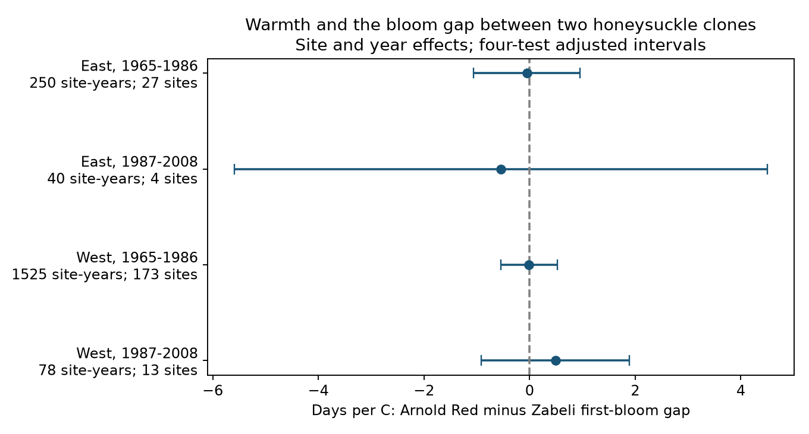

# Spring warmth gave no clear bloom-gap link in paired US honeysuckle records from 1968 to 2005

We tested whether spring warmth changed the time between first bloom in two honeysuckle clones at the same site. The four region and period estimates had mixed signs. All four adjusted uncertainty intervals included zero. Later records were sparse. The data do not show that the gap was stable, and they cannot rule out important changes.

## Question and prior work

Different responses to warmth can change the timing of events between taxa. This can matter for seasonal food supply. A difference between first-bloom dates is a limited measure of timing. It is not the duration of flowering, flower abundance, pollinator activity, or overlap between plants and pollinators.

Rosemartin et al. (2015; doi:10.1038/sdata.2015.38) describe the US lilac and honeysuckle archive. Zohner et al. (2018; https://pmc.ncbi.nlm.nih.gov/articles/PMC6231771/) studied changes in timing among individuals of the same species. That study motivates care about the level of comparison. Here we compare two taxa at the same site. We do not test the same hypothesis or the same network. Work on differences in temperature response also shows why changes in event dates need not imply changes in the gap (doi:10.1111/nph.18361).

We searched the local campaign for phenology, pollution, ozone, and lilac. We read SCI publication a25494dd25de9765891868574ff46d20757fd95f4a06bb7c603baa4a3460baf8. It tested the gap between leaf and bloom for individual plants. We use its public input panel, but test a new outcome: the signed gap between first bloom in Arnold Red honeysuckle and Zabeli honeysuckle at the same site. These are two cloned cultivars. This fixes the taxon comparison across regions. It also avoids a comparison of regional averages from different sets of sites.

## Data and selection

The source is the USA-NPN observation workbook v13, with field definitions v14, and NOAA PSL GHCN CAMS monthly temperature version 3.01. The fixed temperature snapshot extends through October 2026. Exact shared paths, URLs, sizes, and SHA-256 values are in files/provenance.json. The raw files stay in the shared data store. The source SCI bundle is cited with a uses relation. The included source_panel.csv is its exact published panel before its five-year plant filter.

That panel includes legacy programs 7 and 8, years 1965-2008, sites at 24-50 N and 66-125 W, and unique paired first-leaf and first-bloom records. Both event days must be 1-250, with bloom 0-120 days after leaf. Records with ambiguous duplicate phase dates are removed. These inherited rules mean that a bloom record must also have a leaf record. They can select unusual plants or years. We did not relax these rules after looking at results.

Species_ID 20 is Lonicera tatarica 'Arnold Red'. Species_ID 1198 is Lonicera korolkowii 'Zabeli'. For each site and taxon we choose the individual with the most retained years over the full source period. A tie goes to the smaller Individual_ID. This uses record length, not event date. We then pair the selected individuals within each site and year. We obtain 2,684 paired site-years before the next filter. Each site needs five paired years within a region-period sample. This gives 1,893 site-years for the four main fits. We retain the same plant IDs within each site over time, but the archive cannot confirm that no plant replacement occurred under an existing ID.

West means longitude below -100 degrees. East means all remaining sites. The planned periods are 1965-1986 and 1987-2008. Actual support is shorter, as shown below. The four samples have separate rows. They do not have independent weather. Three eastern sites and 13 western sites occur in both periods.

## Method

The outcome is Arnold Red first-bloom day minus Zabeli first-bloom day. A negative gap means Arnold Red bloomed first. The predictor is the equal-weight mean of February and March temperature in C at the nearest 0.5-degree grid cell. We fit a separate linear model in each sample:

`bloom gap = site effect + year effect + beta * temperature + error`.

A negative beta means that Arnold Red moved earlier relative to Zabeli in warmer conditions. It does not by itself mean that the dates became closer. We therefore also test the absolute gap as a secondary outcome.

Site effects remove fixed differences between plant pairs and sites. Year effects remove influences shared across the region in a year. Thus the estimate uses local departures from shared annual weather. It does not estimate the full response to a regional warming trend. Within-model temperature standard deviations are about 0.91-1.06 C. We do not adjust for either bloom date, since both are parts of the outcome.

We remove effects by alternating projections. An independent sparse fit with explicit site and year indicators checks each main coefficient. The largest difference is less than 0.000000001 days per C. A second full analysis run checks that outputs are repeatable.

Uncertainty uses the sum of state-cluster and year-cluster score covariance matrices, with a common finite-sample multiplier `(N-1)/(N-K) * C/(C-1)`. K counts the slope and absorbed effects; C is the smaller number of states and years. We use a t reference with C-1 degrees of freedom. The four primary intervals each have nominal 98.75% coverage, for a Bonferroni family target of 95%. These intervals are approximate, especially with four state clusters in the later East.

The design file was written before outcome fits. The first implementation stopped because the usual state-plus-year-minus-intersection covariance was nonpositive in a sparse fit. We changed all fits to omit the intersection subtraction before inspecting coefficient results. This gives a variance at least as large as that formula for these one-slope fits. It does not guarantee correct coverage under arbitrary dependence. This implementation change is recorded in files/design.txt.

The replication rule requires the same coefficient sign and all four adjusted intervals to exclude zero. Secondary checks use absolute gap, March temperature, no year effects, site trends, or removal of flagged event dates. The source flags use date consistency, individual outliers, and multiple onset reports. Some flag rules use climate context, so the main test retains flagged records. Each secondary set uses the same four-test interval rule separately; it is not one joint confidence set across all checks.

## Results

| Region | Actual years | Paired site-years | Sites | States | Days per C | Adjusted interval |
| --- | --- | ---: | ---: | ---: | ---: | --- |
| East, early | 1971-1986 | 250 | 27 | 11 | -0.053 | -1.056 to +0.950 |
| East, late | 1987-2005 | 40 | 4 | 4 | -0.544 | -5.588 to +4.499 |
| West, early | 1968-1986 | 1,525 | 173 | 13 | -0.012 | -0.549 to +0.525 |
| West, late | 1987-1994 | 78 | 13 | 8 | +0.489 | -0.917 to +1.895 |

No interval excludes zero, and the signs differ. The replication rule fails. The early western interval is the narrowest. Later eastern data permit changes of several days per C in either direction. We did not run an equivalence test or a formal test of equality between samples.

The absolute-gap slopes range from -0.194 to +0.366 days per C. Their four adjusted intervals all include zero. Thus the data also give no clear repeated change in how far apart these first-bloom dates were. March temperature, omission of year effects, site trends, and removal of flagged records each leave all four signed-gap intervals crossing zero. All 24 fitted models are in files/results.csv. These checks reuse observations and are not independent tests.

## Limits and meaning

The result is a conditional weather association in selected garden shrubs. It is not evidence that climate change has no effect on ecological timing. It does not test air pollution, extremes, frost, species distributions, native community diversity, or causal effects of human-caused warming.

Pairing taxa at a site removes changes in the mix of sites from the gap in each year. Fixing individual IDs reduces changes in plant composition. Neither step removes observer changes, visit frequency, date error, plant age, local management, or taxon-specific missing records. Same-site reports need not come from the same observer. The five-year rule and the choice of a long-record plant select for persistence in the archive. This is not a probability sample of US vegetation.

The late West has no retained years after 1994. The late East has only four sites. These data cannot support a broad claim about recent decades. Monthly gridded temperature can hide daily heat, frost and winter chilling. February-March temperature can overlap very early bloom dates, so it is not always a forecast exposure. Year effects can remove confounding but also remove a real shared response. No causal effect follows from this model.

A useful next test would keep the same taxa and sites, record visit intervals and plant replacements, and use daily weather to separate chilling, forcing, and frost. It would need stronger later-period coverage before it could test whether a response persisted over time.

## Reproduction and provenance

See files/REPRODUCE.md for offline model and raw-input commands. The package contains the input panel, paired panel, code, complete result table, numerical check, source hashes, and figure. The source-panel builder is included unchanged from the cited SCI publication. Raw data keep their source terms. The baseline license applies to this publication's text, derived evidence, figures, and code as applicable.

Campaign 11_07_2026. Job sci-1107-dell-climate-pollution-biodiversity-b7e072584548. Topic climate-pollution-biodiversity. Machine dell. Account codex-andrii. Model gpt-6.1-sol, high reasoning effort, through T3 Code and the Codex harness. Analysis date 2026-11-08 UTC. The campaign-machine key is not a personal authorship claim. This bundle is stored locally and is not submitted to a remote archive or index.
