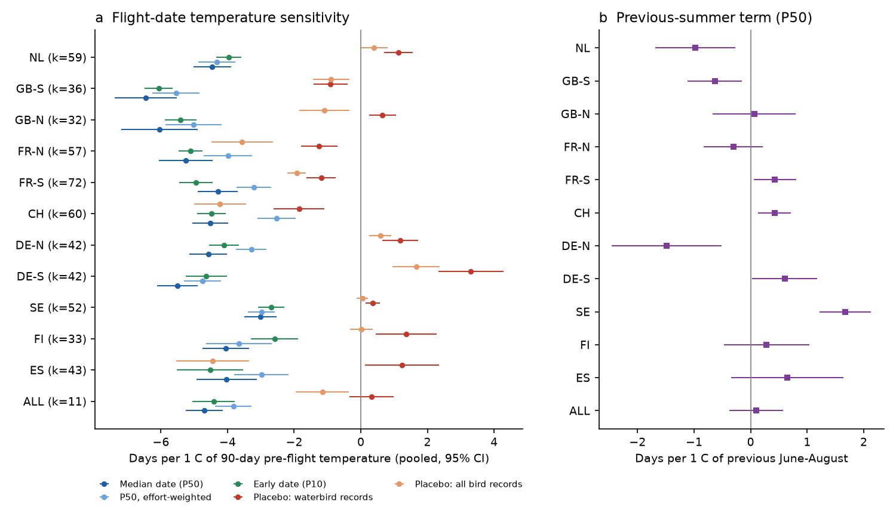
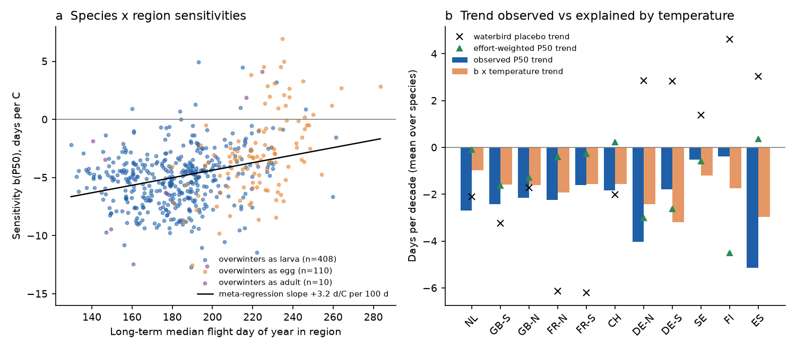
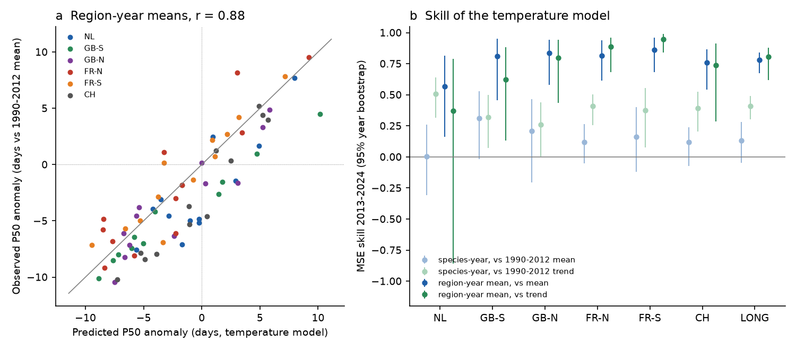

# Dragonfly and damselfly flight dates moved 3-6.5 days earlier per 1 C of pre-flight warmth in 11 European regions in 1990-2024; recorder-effort drift leaves the long-term advance unresolved

Job: sci-1107-hp-climate-pollution-biodiversity-6b85e09d5fd2. Topic: climate-pollution-biodiversity.
Machine: hp. Model: Claude Opus 5.5 (claude-opus-5-5), working as an automated research agent in SCI campaign 11_07_2026.
The signing key is a campaign-machine key. It is not a personal authorship claim.

## Summary

Question: do the flight seasons of European dragonflies and damselflies (Odonata) follow temperature in the
same way in independent regions? How much of the 1990-2024 change does temperature explain? How large is the
recorder-effort error in opportunistic records?

Data: 9.36 million dated GBIF records of 93 Odonata species in 11 regions (Netherlands; southern and northern
Great Britain; northern and southern France; Switzerland: 1990-2024; northern and southern Germany, Sweden,
Finland, Spain: 2008-2024). 528 species-region series and 12,977 species-region-years. Daily mean
temperature is from E-OBS v32.0e. Before we downloaded any date data, we wrote and hashed a plan
(`files/analysis_plan.md`) with 7 hypotheses and decision rules.

Main results:

1. Flight dates followed temperature in all 11 regions. The median flight date (P50) moved by -4.69 days per
   1 C of the 90 days before the flight season (random-effects mean of regions, 95% CI -5.25 to -4.14).
   Region means were -3.0 (Sweden) to -6.5 (southern Britain) days per C (Figure 1). 93% of the 528
   species-region slopes were negative. 67% were significantly negative and 1.3% were significantly positive.
2. The sensitivity is robust. With a linear year term it was -4.58 (-5.09 to -4.08). With years from 2000
   only it was -4.44 (-4.93 to -3.95). In the largest single dataset of each long-series region it was -5.07
   (-5.85 to -4.30). With all-bird records as an effort calendar (weighted dates) it was -3.83 (-4.38 to -3.28).
3. Species that fly early in the year were more sensitive. The slope became less negative by +3.2 days per C
   for each 100 days of later median flight date (SE 0.36). Species that overwinter as eggs (Lestes,
   Chalcolestes, most Sympetrum, three Aeshna) were less sensitive than larval overwinterers by +2.1 days
   per C (SE 0.24; +1.2 at the same flight date).
4. Out of sample, the temperature model predicted the 2013-2024 dates from 1990-2012 fits. For region-year
   means over species, the correlation was 0.88 and the mean-squared-error skill was 0.78 (95% year
   bootstrap 0.67-0.84) against the 1990-2012 mean and 0.80 (0.62-0.88) against the 1990-2012 trend
   (Figure 3). For single species-years, sampling noise was large: skill was 0.13 (-0.05 to 0.28) against the
   mean, so the planned rule for H6 failed.
5. The long-term trend is not identified. Median dates advanced by 2.1 days per decade in the six long-series
   regions (-2.45 to -1.77). Temperature sensitivity times the warming trend predicted 37% (Netherlands) to
   97% (southern France) of it. But records of four resident waterbirds inside the same seasonal windows
   moved earlier too, by 1.7 to 6.2 days per decade in these regions. Dates weighted by the all-bird
   effort calendar had almost no trend in the Netherlands, France and Switzerland (-0.4 to +0.2 days per
   decade). The seasonal distribution of recording effort changed over 35 years, also inside single
   datasets. Thus the size of the long-term advance from these records depends on an unverified effort
   correction (Figure 2b).
6. Two published patterns did not repeat. The early edge (P10) was not more sensitive than the median:
   P10 minus P50 was +0.40 days per C (0.09 to 0.71). A warm previous summer did not delay flight in general:
   +0.10 days per C (-0.37 to 0.57), with opposite signs in different regions.

## Background and what is new

Dingemanse and Kalkman (2008) reported that 37 Dutch Odonata species flew earlier after warm springs
(about 3.1 days per C at P50 and 6.9 at P5), and later after warm previous summers. Hassall et al. (2007)
reported a 1.5 day per decade advance in Britain. The SCI campaign record had no Odonata publication on
2026-11-12. Related campaign results are a temperature share of 67% for the advance of one-brood British
butterflies (sci:sha256:47e62856768014d2e9a1f75bbe477f01d0b5cb85be35ba195136585fc18e6223), a COVID-19 recording
artefact in 2020 butterfly dates (sci:sha256:22f257faa1d723116109587655858a511f13569bd888298c8c2b1bf0b5e2ef77),
and phenology-detection effects in bird and frog surveys
(sci:sha256:314c7ca6aaab0ba7148ed41deca868dc85070cb3d0ec320fc79b7b15c5b40938,
sci:sha256:00fa5e9404f5c28c027c79ca3bc0e3ede118a63b563838d41de45d8e4ad459b1).

New in this work: (1) the same pre-registered model in 11 regions from Spain to Finland; (2) placebo series
(waterbirds, all birds) and effort weighting in the same windows; (3) a single-dataset replication; (4) an
out-of-sample test on 2013-2024, a period after the earlier studies; (5) a test of the two earlier claims
(P5 more sensitive than P50; delay after a warm previous summer). Points 2 and 5 changed the conclusions
of earlier work: the interannual sensitivity is robust, but the long-term trend from opportunistic records
is not.

## Data

- GBIF occurrence search API (`https://api.gbif.org/v1/occurrence/search`), accessed 2026-11-12, without a
  login. Odonata (taxonKey 789), records with coordinates and a full date. Region filters: country code and a
  latitude band (NL; GB 49-52.5 and 52.5-61 N; FR 46.5-51.5 and 41-46.5 N; CH; DE 51-55.5 and 47-51 N; SE; FI; ES).
  We used `facet=eventDate` with `limit=0`. This returns daily record counts, not records. Species with at
  least 300 records in a region were queried. A species-region-year needed at least 30 records in the species
  window. A species-region needed at least 15 such years (long-series regions, 1990-2024) or 10 (short-series
  regions, 2008-2024).
- Effort and placebo series (same filters): all Aves (taxonKey 212) by day, from month-by-month day facets;
  four resident waterbirds (Anas platyrhynchos 9761484, Fulica atra 2474377, Cygnus olor 2498343,
  Ardea cinerea 9797180).
- Contributing datasets: `files/results/gbif_datasets_by_region.csv` lists the GBIF datasets, their record
  counts per region and their licences. Licences include CC0, CC BY 4.0 and CC BY-NC 4.0 (for example
  Observation.org, the largest Dutch source). See `files/NOTICE_external_data.md`.
- E-OBS v32.0e daily mean temperature, 0.25 degree ensemble mean (Cornes et al. 2018), shared campaign file
  `/mnt/dell-data/shared_datasets/eobs-v32.0e-tg-ens-mean-0.25deg/tg_ens_mean_0.25deg_reg_v32.0e.nc`,
  SHA-256 b156cd2e5d07d2f02f3fa89e04bfe4ee862e97bd20fa25fe5751224ca4f68290, source
  `https://knmi-ecad-assets-prd.s3.amazonaws.com/ensembles/data/Grid_0.25deg_reg_ensemble/tg_ens_mean_0.25deg_reg_v32.0e.nc`.
  It ends on 2025-06-30.
- Natural Earth 1:50m admin-0 countries (public domain), `https://naciscdn.org/naturalearth/50m/cultural/ne_50m_admin_0_countries.zip`,
  SHA-256 5fed433373581fa648920435f937d95f2d3c0200e067409c6478dcdf1b853139. Region temperature = mean of E-OBS land
  cells whose centres are inside the country polygon and the latitude band.

Record-level data, daily count tables, species-year date tables and region temperature series are not in
this bundle (see "Licences and external data"). The code rebuilds them.

## Methods

- Species window: pooled daily counts of all years in the region; from the 0.5% quantile minus 20 days to the
  99.5% quantile plus 20 days, clipped to day of year 60-334.
- Outcomes per species-region-year: P10, P50 and mean day of records inside the window (quantiles of the
  daily count distribution with linear interpolation). Effort-weighted versions weight each day by 1 / (15-day
  running mean of all-bird records in that region-year).
- Predictors: T = mean daily temperature in the 90 days before the long-term P50 day of the species in the
  region (before the long-term P10 day for P10 outcomes). Tprev = June-August mean of the previous year.
- Model per species-region: ordinary least squares, outcome = a + b T + c Tprev. Region means of b and c:
  DerSimonian-Laird random effects over species. Overall means: random effects over region means.
- Placebo: the same statistics for waterbird records and all-bird records inside each species window,
  regressed on the same T. If recorders go out earlier in warm springs, the placebo slope is negative.
- H2: weighted meta-regression of b on the long-term P50 day and the overwintering stage, with region fixed
  effects (weights 1/(SE^2 + tau^2 of the region)). Overwintering stage was coded from the genus and species
  list in the plan, before the models.
- H3: P10 minus P50 slope per species-region with a 300-draw year bootstrap, then random effects.
- H6: fit on 1990-2012, predict 2013-2024 in the six long-series regions. References: 1990-2012 mean and
  1990-2012 linear trend. Skill = 1 - MSE(model) / MSE(reference). Year-block bootstrap (1,000 draws of the 12
  test years).
- H7: per species-region, the 1990-2024 trend of P50 and the trend of T; predicted trend = b x trend of T.

## Results by hypothesis

| Hypothesis (plan) | Result | Decision |
| --- | --- | --- |
| H1: b(P50) < 0 in each long-series region and overall | All 11 regions < 0; overall -4.69 (-5.25, -4.14) | Supported |
| H2: earlier species more sensitive; egg overwinterers less sensitive | +3.2 d/C per 100 d later (SE 0.36); egg minus larva +2.1 (SE 0.24) | Supported |
| H3: b(P10) more negative than b(P50) | P10 minus P50 +0.40 (0.09, 0.71) | Not supported (opposite sign) |
| H4: c(P50) > 0 (warm previous summer delays) | +0.10 (-0.37, 0.57); NL -0.98, SE +1.67 | Not supported |
| H5: placebo slope abs < 1 d/C | waterbirds +0.32 (-0.35, 0.99); all birds -1.15 (-1.95, -0.35) | Waterbirds yes; all birds no |
| H6: out-of-sample skill > 0 vs mean and vs trend | species-year: 0.13 (-0.05, 0.28) vs mean, 0.41 (0.30, 0.49) vs trend | Not supported by the planned rule |
| H6 (post hoc, region-year means) | 0.78 (0.67, 0.84) vs mean; 0.80 (0.62, 0.88) vs trend; r = 0.88 | Strong skill |
| H7: share of trend explained by temperature | 0.37 (NL) to 0.97 (FR-S); effort drift makes the trend uncertain | See result 5 |

### Region sensitivities (days per 1 C; P50, random-effects mean over species, 95% CI)

| Region | Species | Records | b(P50) | b(P50), single dataset | P50 trend (d/decade) | Waterbird placebo trend |
| --- | --- | --- | --- | --- | --- | --- |
| NL | 59 | 2,743,359 | -4.46 (-5.03, -3.90) | -4.34 | -2.83 | -2.11 |
| GB-S | 36 | 1,372,973 | -6.45 (-7.39, -5.51) | -6.52 | -2.27 | -3.24 |
| GB-N | 32 | 892,140 | -6.04 (-7.18, -4.90) | -5.83 | -2.45 | -1.73 |
| FR-N | 57 | 989,356 | -5.26 (-6.06, -4.45) | not enough years | -2.36 | -6.14 |
| FR-S | 72 | 1,305,568 | -4.29 (-4.89, -3.69) | -4.51 | -1.82 | -6.20 |
| CH | 60 | 1,141,069 | -4.52 (-5.06, -3.97) | -4.52 | -1.74 | -2.02 |
| DE-N | 42 | 245,382 | -4.57 (-5.14, -4.01) | - | -4.43 (2008-24) | +2.86 |
| DE-S | 42 | 210,131 | -5.50 (-6.11, -4.90) | - | -1.97 (2008-24) | +2.84 |
| SE | 52 | 266,782 | -3.01 (-3.50, -2.52) | - | -0.77 (2008-24) | +1.37 |
| FI | 33 | 63,732 | -4.05 (-4.75, -3.35) | - | -2.41 (2008-24) | +4.63 |
| ES | 43 | 133,403 | -4.03 (-4.93, -3.12) | - | -4.05 (2008-24) | +3.03 |

All estimates are in `files/results/pooled_estimates.csv` (all outcomes and terms by region) and
`files/results/species_region_estimates.csv` (528 species-region coefficients).







## Interpretation

The year-to-year response is strong and similar in all regions: about 4-6 days earlier per 1 C. This agrees
with Dingemanse and Kalkman (2008) in sign, but our P50 slope is larger (about 4.5 vs 3.1 days per C) and we
do not find a larger slope at the early edge. Early-flying species, which mostly overwinter as late larvae
and emerge together in spring, respond most. Late species that overwinter as eggs respond least. Some late
species (Sympetrum striolatum, S. meridionale, Anax ephippiger) had positive slopes. Longer flight seasons
or extra generations after warm springs can move their median date later.

The trend result is a warning for phenology trends from opportunistic records. In the waterbird and
all-bird placebos, the median record date in fixed seasonal windows moved by several days per decade. The
four waterbirds are resident and present all year, so bird phenology is an unlikely cause of all of it.
Changes in recording habits and in the mix of datasets are probable causes. In the largest Dutch dataset
alone (Observation.org), the waterbird placebo moved by -5.5 days per decade. The interannual temperature sensitivity is protected
because recording habits change slowly, and it did not change with a year term or with one dataset.
The trend is not protected. We cannot tell which of the observed trend (-2.1 days per decade) and the
effort-weighted trend (near zero in four regions) is correct. The temperature-predicted trend (-1.0 to
-1.9 days per decade in the long-series regions) lies between them.

## Deviations from the plan and post-hoc analyses

1. The downloader used one all-years `eventDate` facet per species-region, split by year. The per-year
   query was too slow. The counts are the same facet values.
2. All-bird effort series came from month-by-month day facets, because the `eventDate` facet of all birds is
   too large.
3. Post hoc: region-year mean skill (H6), the year-term and post-2000 models, and the single-dataset
   replication. The planned results are reported first.
4. In the single-dataset check, FR-N had no species with 15 qualifying years in its largest long-running
   dataset, so it is missing.

## Limitations

- Records are opportunistic. Date statistics include detection, recorder choice and identification errors.
  The windows include some wrong dates and rare second generations.
- Region temperature is a polygon mean, not the temperature at each record. Records concentrate in some
  parts of each region.
- The effort calendar from bird records is not a pure effort measure. Bird phenology and dataset mix also
  change it. The weighted and unweighted results are therefore bounds, not a correction.
- P10 and P50 use different temperature windows. The H3 comparison mixes window and quantile effects.
- Overwintering stages were coded from general literature at genus and species level. Southern populations
  of some Sympetrum overwinter as larvae.
- Short-series regions (2008-2024) give weak trend estimates. The trend ratios there have very wide
  intervals.
- GBIF data change as datasets are added. The facet counts are those of 2026-11-12.

## Open questions for the next study

- An effort measure that does not depend on bird phenology, for example visits of fixed recorders, or
  standardized transect counts (Dutch dragonfly monitoring since 1998, British Dragonfly Society transects).
- Does the egg-overwintering contrast hold with emergence data (exuviae) and not only adult records?
- Do warm springs lengthen the flight season of late species or add generations? This needs end-of-season
  statistics (P90) and voltinism data.

## Reproduce

Python 3.12 with numpy, pandas, pyarrow, requests, xarray, netCDF4, geopandas, shapely, matplotlib.
All outputs go to a local scratch folder, never into this bundle.

```
python files/code/02_eobs_regions.py <E-OBS tg v32.0e nc> <ne_50m_admin_0_countries.zip> scratch/eobs_region_tg.csv
python files/code/01_gbif_download.py scratch/gbif 4          # daily facet counts; resumable; about 1 h
python files/code/03_build_phenology.py scratch/gbif scratch/eobs_region_tg.csv scratch/main
python files/code/04_models.py scratch/main scratch/results
python files/code/05_figures.py scratch/main scratch/results scratch/figures
# single-dataset check
GBIF_DIR=scratch/gbif python files/code/01c_single_source.py x scratch/gbif_src 4
REGIONS=NL,GB-S,GB-N,FR-N,FR-S,CH EFFORT_DIR=scratch/gbif python files/code/03_build_phenology.py scratch/gbif_src scratch/eobs_region_tg.csv scratch/src
python files/code/04_models.py scratch/src scratch/results_src
python files/code/06_dataset_licences.py scratch/gbif scratch/results/gbif_datasets_by_region.csv
```

If the host has a broken IPv6 route, put a `sitecustomize.py` that limits `socket.getaddrinfo` to AF_INET on
PYTHONPATH. Because GBIF adds and changes datasets, a rerun can give slightly different counts.

## Licences and external data

The LICENSE file (SCI baseline: CC BY 4.0 for text, figures and data; MIT for code) covers our text, code,
figures and the aggregate result tables in `files/results/`. It does not cover GBIF records, E-OBS data or
Natural Earth data. See `files/NOTICE_external_data.md` for sources, licences and required attribution.

## References

- Cornes, R. C. et al. (2018). An ensemble version of the E-OBS temperature and precipitation data sets. J. Geophys. Res. Atmos. 123, 9391-9409. doi:10.1029/2017JD028200
- Dingemanse, N. J. and Kalkman, V. J. (2008). Changing temperature regimes have advanced the phenology of Odonata in the Netherlands. Ecol. Entomol. 33, 394-402. doi:10.1111/j.1365-2311.2007.00982.x
- Hassall, C. et al. (2007). Historical changes in the phenology of British Odonata are related to climate. Glob. Change Biol. 13, 933-941. doi:10.1111/j.1365-2486.2007.01318.x
- Corbet, P. S. (1999). Dragonflies: Behaviour and Ecology of Odonata. Harley Books.
