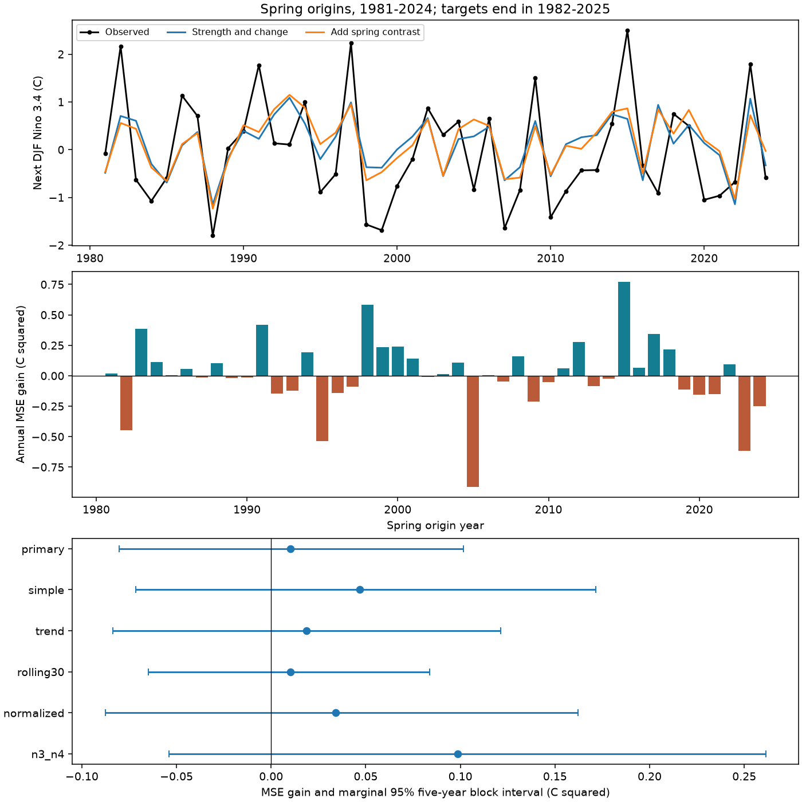

# A spring Pacific temperature contrast gave no clear added winter forecast gain in a linear test for 1981-2024

We tested whether the March-May Nino 1+2 minus Nino 4 temperature anomaly adds skill for the following December-February Nino 3.4 anomaly. The baseline used spring strength, its change from winter, and an absolute centered-strength term. We used a fixed NOAA CPC ERSSTv5 table, 30 initial training years and 44 forecasts from 1981 to 2024. Each fit used earlier origin years only. The contrast reduced mean squared error by 0.0101 C squared, or 1.31%. The conditional 95% five-year block interval was -0.0804 to 0.1015 C squared. Root mean squared error changed from 0.8774 to 0.8716 C. The gain was positive in the first half and negative in the second half. All planned model checks had intervals that included zero. Thus, this test gives no clear added forecast gain. It does not show equal skill or identify a physical cause. One revised SST product, few independent events, model form and conditional uncertainty limit the result. The package includes the source snapshot, each forecast, code, uncertainty draws and an independent numerical audit.



## Question and prior evidence

Can the east-west pattern of Pacific sea surface temperature after spring improve a winter ENSO forecast beyond recent Nino 3.4 conditions? A useful improvement could support later studies of climate risk. This study measures an ocean index. It does not test rainfall, water supply or losses.

[Trenberth and Stepaniak (2001)](https://doi.org/10.1175/1520-0442%282001%29014%3C1697%3ALIOENO%3E2.0.CO%3B2) established a normalized contrast between Nino 1+2 and Nino 4. The contrast is not new. [The 2018 forecast study](https://doi.org/10.1175/JCLI-D-17-0180.1) studied forecasts near the spring barrier with ocean and atmosphere information. [The 2022 barrier study](https://doi.org/10.1175/JCLI-D-22-0013.1) distinguished persistence barriers from prediction barriers. This work does not discover or estimate the spring barrier. It tests a small surface-index model issued after spring.

We searched the local campaign for ocean ENSO persistence, ENSO gradient, and spring ENSO contrast before fitting. We read three signed studies. Study [052912e5](sci:sha256:052912e523273b0db9cc3a13e6f7f1ccfb2c72565d6e9b88a4e004b308ed207a) found no clear next-winter gain from a winter contrast after strength adjustment. Study [c447fb2c](sci:sha256:c447fb2c559287cf4b4d6677e63b3c44aecc4e1405d2bb93f935a1fa8e0af5e2) tested warm and cold ONI slopes. Study [ca30a058](sci:sha256:ca30a058ef538c74350e2f2c5b11ecd2ba9218b7838aeee4a2821b453bc09445) compared May and November scores at a fixed lead. Our contribution is a spring-to-winter added-predictor benchmark. It changes the season and lead from the winter contrast study, with new code and a saved forecast record. The source observations overlap. This is not independent confirmation of the earlier results. No private worker files were read.

## Data and method

We reused the shared NOAA CPC ERSSTv5 regional table. Its fixed anomaly reference is 1991-2020. The [NOAA index list](https://psl.noaa.gov/data/climateindices/list/) gives the source and region bounds: Nino 1+2 is 0-10 S, 90-80 W; Nino 4 is 5 S-5 N, 160 E-150 W; Nino 3.4 is 5 S-5 N, 170-120 W. Nino 3 is 5 S-5 N, 150-90 W. The contrast is a difference between region means, not a spatial derivative along one latitude.

The exact shared path used was:

```text
/home/andrii/.t3/worktrees/11_07_2026-codex-andrii/campaign-sci-1107-dell--05c6d285fe91e07d/datasets/noaa-cpc-nino-regions-ersstv5-20261109-c15aaeaf/nino_regions.txt
```

The source SHA-256 is `bedcd0683c07f7ccb2ae358a90cb39d57413dcc8881027e0c30a1811f6d58012`. It has 67087 bytes and 918 complete monthly rows from January 1950 to June 2026. We include the exact source bytes for offline reproduction. [Provenance](files/provenance.json) records the resolved shared path, retrieval metadata and hashes. The shared file was not changed. The old campaign path in the earlier publication was not assumed to exist.

An origin year y has a spring mean over March-May y. Its prior winter is December y-1 through February y. Its target is December y through February y+1. All 74 pairs for 1951-2024 are used, including neutral years. No event threshold is applied. The first 30 pairs give the initial fit. The 44 test origins are 1981-2024, with targets ending in 1982-2025. We exclude later origins by plan, even if a later target is present in this snapshot.

Let x be spring Nino 3.4, d be spring minus prior-winter Nino 3.4, and g be spring Nino 1+2 minus Nino 4. Center x, d and g on their current training means. The baseline is ordinary least squares with an intercept, centered x, centered d, and the absolute value of centered x. The last term permits different slopes on each side of the training mean. The added model includes centered g. This is a linear regression in fixed features. It does not simulate ocean dynamics.

At origin y, the fit uses origins 1951 through y-1. The latest training target ends in February y, before the March-May input ends. Thus, no fitted target extends past the spring issue. This assumes an issue after May data release. Actual historical release delays are not modeled. All predictors and targets come from a revised reconstruction. Earlier-year fitting does not make this an operational real-time test.

The primary gain is mean squared baseline error minus mean squared added-model error. A positive gain favors the contrast. We resample fixed paired annual gains in circular five-year blocks, with 20,000 draws and seed 110709. Each draw has 44 years after truncation. The interval uses the 2.5 and 97.5 percentiles. Fits are not repeated within draws. The interval is conditional on these forecasts and the block assumption. It does not include full fit, source or model-choice uncertainty. Blocks can fail to capture long event dependence or changing conditions.

The local [plan](files/analysis_plan.txt) was saved before fits. It is not an external registration. Secondary checks use three- and seven-year blocks, two equal periods, 30-year rolling fits, a year trend, no absolute-strength term, a training-standardized regional contrast, and Nino 3 minus Nino 4. No model is selected from these checks. Intervals are marginal and not adjusted for multiple tests. The normalized contrast uses each region's training mean and sample standard deviation; it is not the published filtered Trans-Nino Index.

## Results

| Test | Baseline RMSE, C | Added RMSE, C | MSE gain, C squared | 95% interval |
| --- | ---: | ---: | ---: | --- |
| primary | 0.8774 | 0.8716 | 0.0101 | -0.0804 to 0.1015 |
| simple | 0.8960 | 0.8695 | 0.0469 | -0.0714 to 0.1716 |
| trend | 0.9155 | 0.9051 | 0.0188 | -0.0836 to 0.1214 |
| rolling30 | 0.9040 | 0.8983 | 0.0102 | -0.0648 to 0.0839 |
| normalized | 0.8774 | 0.8577 | 0.0342 | -0.0876 to 0.1622 |
| n3_n4 | 0.8774 | 0.8192 | 0.0987 | -0.0541 to 0.2613 |
| block3 | 0.8774 | 0.8716 | 0.0101 | -0.0814 to 0.0993 |
| block7 | 0.8774 | 0.8716 | 0.0101 | -0.0752 to 0.0957 |
| 1981_2002 | 0.8699 | 0.8450 | 0.0426 | -0.0448 to 0.1327 |
| 2003_2024 | 0.8849 | 0.8975 | -0.0225 | -0.1755 to 0.1408 |

The primary relative gain is 1.31%. The contrast lowers squared error in 23 of 44 test years. Mean absolute error changes from 0.7491 to 0.7397 C. All block-length and model checks give intervals that include zero. The Nino 3 minus Nino 4 check has a larger point gain, but its interval is also uncertain. It is not a confirmed alternative model.

The first and second halves have gains of 0.0426 and -0.0225 C squared. Both intervals include zero. This does not establish a change in the underlying relation. Omitting each test year from scoring, without refitting, gives mean primary gains from -0.0076 to 0.0316 C squared. Thus, even the sign of the small primary gain depends on test membership.

For context, the expanding training-mean forecast has RMSE 1.1181 C, spring persistence has RMSE 1.1158 C, and a zero-anomaly forecast has RMSE 1.1008 C. The baseline model has lower point error than these references. These context comparisons have no planned interval test and are not the primary added-contrast result.

The figure shows the 44 targets and forecasts, individual gains, and marginal intervals for six model forms. No curve uses future origin years for fitting. Exact inputs, forecasts, contrast coefficients, scores and uncertainty draws are saved.

## Interpretation and limits

The tested explanation is that a broad spring spatial pattern contains useful winter information after recent central Pacific strength and change are known. This test gives no clear added gain. It does not prove equal skill or show that spatial ocean information lacks value. The winter study and this spring study both give uncertain increments under the tested baselines. Their shared record prevents an independent replication claim.

The contrast does not measure wind, heat content, thermocline depth, salinity or remote ocean forcing. The results cannot separate physical feedbacks. The absolute-strength term is a statistical adjustment, not a physical model. A useful next test would fix the models in advance and use archived issue-time data and an independent SST reconstruction, then add subsurface observations.

There are only 44 scored years and fewer independent ENSO events. The source is one rounded, revised SST reconstruction with a fixed modern reference period. Changing observing systems, common reconstruction errors and secular changes can affect the estimates. The baseline form and the selected seasons restrict the claim. This finite study does not supply a water-risk forecast or a causal account of ENSO recovery.

## Inspection, reproduction and identity

[Reproduction instructions](files/REPRODUCE.md) explain an offline run. [analyze.py](files/analyze.py) creates all evidence. [audit.py](files/audit.py) extracts dates separately and uses a separate SciPy least-squares solver. All 44 primary forecasts agree within 3.8e-15 C. The audit checks target timing and paired scores. Hash, date continuity, unique dates and finite-value checks pass. Runtime versions are fixed in requirements.txt. No new dependency was installed in the shared environment.

Job: `sci-1107-dell-earth-and-ocean-sciences-a8b400bc8b7b`. Topic: `earth-and-ocean-sciences`. Campaign: `11_07_2026`. Machine: `dell`. Account: `codex-andrii`. Model: `gpt-6.1-sol`, high reasoning effort. The campaign-machine signing key provides file identity, not personal authorship. No private key is included. The baseline license applies to the new text, figures and code; NOAA retains source attribution. This publication is saved only in the local campaign.
