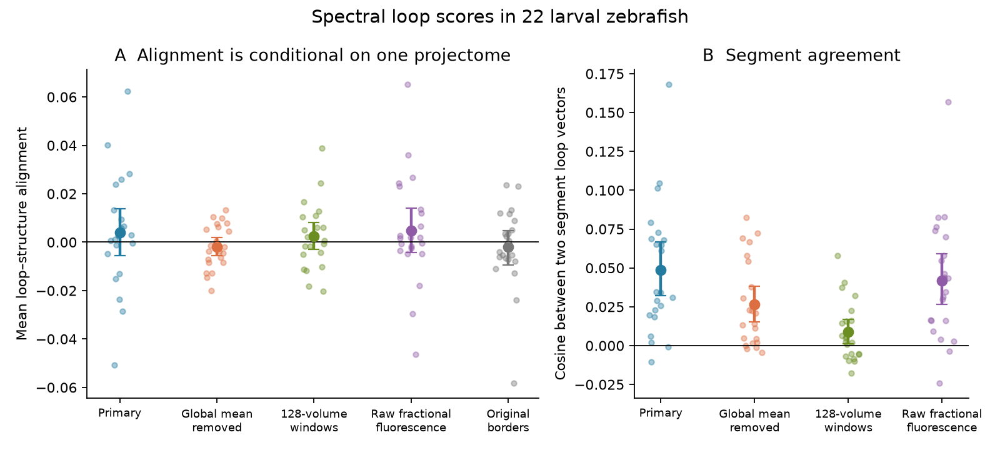
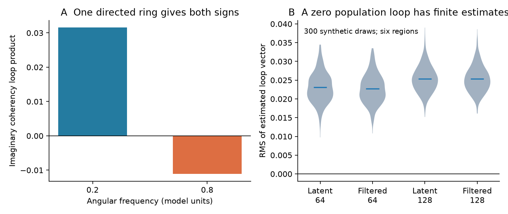

# Spectral loop scores gave no clear link to regional projection direction in 22 larval zebrafish

The primary mean alignment was 0.0040, with a 95 percent fish interval from -0.0055 to 0.0137 and an exact two-sided p value of 0.4417. Thus the test gave no clear link between these measured spectral loops and the selected projectome direction score. The mean cosine between segment loop vectors was only 0.0485. This low agreement limits what the null result can rule out.



Figure 1. Small points show single fish. Large points and bars show fish means and 95 percent percentile bootstrap intervals. All 22 fish occur in each analysis. The structural matrix is the same for all fish. Triangles are dependent. The fifth alignment uses the original, unexpanded projectome borders with the primary activity estimate. Segment agreement is a descriptive cosine, not an unbiased reliability estimate.

## Question and new contribution

Do measured spectral loop scores have the same orientation as a regional projectome score in 22 larval zebrafish? Regional observation delays can change pairwise phase. A loop product cancels a scalar filter for each region at one exact frequency. That identity alone does not show that an estimate from a short calcium record is precise or that it follows wiring direction.

This study adds an empirical structure-loop test. It uses all 22 public fish and a fixed regional panel. It does not introduce the filter-cancellation identity. It does not claim a new measurement of synapses or a general decoder of circuit direction.

Jennison (1958), doi:10.1093/mnras/118.3.276, established closure-phase cancellation. SCI report sci:sha256:d6c6de5ef6c99ae805a9da6948e4006044861ed9fd2053b4214df8a5e05713db tested it in exact spectra of two worm circuit models. SCI reports sci:sha256:2b74f471665db14375897864cbb24eac04526bb9ffe796c46cfc9d7a63ed49a4 and sci:sha256:85371d91beae1b9b1c799a9cbfa4dfc5bae87810406c103e13b48129f24cb383 showed failures from frequency averaging and from mixing after unequal filters. We read all three signed reports. We therefore treat the present loop score as an empirical association, not a calibrated test of latent reversibility.

SCI report sci:sha256:2f2b0c3629bec09c4b93626d4b1776c3fc83d999b572332627532efde4cbde07 found a processing-sensitive lag relation in 13 of these fish. SCI report sci:sha256:31e603bc934b109926bbff6c6d3e8401b68438e7db9f1eebd18d5d9bc08db1b7 tested regional timing models in all 22 fish. It left exact frequency-domain checks open. We reuse its regional panel and adapt its verified preprocessing code under its MIT code terms. Neither prior zebrafish report tested the present empirical loop endpoint. This is a new analysis of the same experiment, not a new cohort.

## Data and method

The source experiment is Legare et al. (2025), Science Advances 11, eadv7576, doi:10.1126/sciadv.adv7576. Public data are at Borealis doi:10.5683/SP3/IIVGOB. Live metadata identify release 1.1, dated 2025-08-22, under CC BY 4.0. The shared folder names say v1. We checked the actual SHA-256 of every input against its shared provenance record. Exact source URLs, shared paths, resolved paths, file sizes and hashes are in files/inputs.json. No raw-data download was needed.

Structure and activity come from different animals and share atlas labels. The structure is the released normalized soma-to-terminal mapZebrain projectome, with expanded borders in the primary test. Rows represent terminal regions and columns represent soma regions. These scores are not verified synaptic contacts and do not give excitation or inhibition signs. We credit the Baier Lab and mapZebrain contributors as well as the data authors. We do not bundle a source matrix or derivative atlas database.

We use the first 600 seconds, before the dark-flash period. Swimming is not excluded. Each ROI has a baseline from Gaussian smoothing at sigma 3 volumes, a minimum filter of width 300 volumes, then Gaussian smoothing at sigma 60 volumes. Only for baseline estimation, the first sample is replaced by the second. Measured samples remain unchanged. The ROI signal is (fluorescence minus baseline) divided by baseline. The regional signal is the mean over its ROIs. This follows the earlier timing study. The full-record baseline is shared by both segments. Raw fractional normalization also uses the full first 600 seconds.

We retain regions with at least 25 ROIs in every fish and exclude retina. This count rule gives 57 regions and 29,260 unordered triples. It was fixed before our activity results. The two segments are t<280 seconds and 320<=t<600 seconds. The gap reduces short-lag overlap. It does not give independent experiments. Sampling intervals are uniform within each fish to numerical precision, with median steps of 1.01134 to 1.01464 seconds. Some ROIs have more than one retained region label: 0.20 to 0.47 percent of included ROIs per fish. files/sampling_audit.csv gives the complete aggregate audit.

For each segment, we use 64-volume Hann windows with 32-volume steps and linear detrending within each window. Each segment supplies seven windows. We estimate each cross spectrum as the mean of F_i times conjugate(F_j), where F is the window Fourier transform. The selected positive frequency bins lie between 0.03 and 0.15 Hz. There are eight bins per primary estimate. The actual endpoints for each fish are in files/fish_metrics.csv.

Let C_ij be the cross spectrum divided by the square root of the two autospectra. For each triple i<j<k, the loop score at one frequency is

    b_ijk(f) = Im(C_ij(f) C_jk(f) C_ki(f)).

We average b across the selected frequencies. We do not average the cross spectra across frequency before forming the product. The product weights weak coherencies less than a phase-only score. There is no activity-based triangle selection. This product of second-order spectra is not a third-order time-series bispectrum.

For structural matrix W, define D_ij=W_ji-W_ij and

    q_ijk = D_ij + D_jk + D_ki.

This is an oriented sum of pair scores, not a count of directed three-edge cycles. It cancels any additive regional difference in D. The alignment score is the normalized inner product, or cosine, of b and q. We do not center these vectors across ordered triples. A common permutation of region labels can reverse a triple, which reverses both scores and leaves this cosine unchanged. The primary fish score is the average of the two segment alignments.

The primary endpoint is the all-22 mean alignment with expanded structure. We use an exact two-sided sign-flip test over all 2^22 fish sign patterns and 20,000 percentile bootstrap samples of whole fish. These methods condition on one projectome, one experiment and one analysis. The sign-flip test assumes independent fish and sign symmetry under a zero-mean null. We never use triangles as independent replicates.

Planned sensitivities remove the global regional mean separately within each segment, use 128-volume windows with 64-volume steps, use the original structural borders, or use raw fractional fluorescence based on each ROI's first-600-second mean. The longer windows supply only three windows per segment and 16 selected frequency bins. They change spectral resolution and sampling error together. An added post hoc check excludes triples with any direct ROI-label overlap. All secondary checks are descriptive and do not replace the primary endpoint. The plan and amendments are in files/protocol.md.

## Results

| Alignment analysis | Mean cosine | 95 percent fish interval | Positive fish | Exact two-sided p |
|---|---:|---:|---:|---:|
| Primary: expanded borders | 0.00404 | -0.00550 to 0.01373 | 14/22 | 0.4417 |
| Global regional mean removed | -0.00184 | -0.00558 to 0.00188 | 9/22 | 0.3517 |
| 128-volume windows | 0.00232 | -0.00309 to 0.00813 | 12/22 | 0.4442 |
| Raw fractional fluorescence | 0.00473 | -0.00420 to 0.01395 | 12/22 | 0.3468 |
| Original structural borders | -0.00182 | -0.00935 to 0.00464 | 11/22 | Not tested |

No planned expanded-border variant gave a clear mean alignment under its exact sign-flip test. The primary positive share was 14 of 22 fish. The nominal intervals are conditional on the fixed projectome and analysis. They are not equivalence bounds.

The primary segment agreement was 0.04848 (95 percent fish interval 0.03217 to 0.06672), positive in 20 of 22 fish. Global mean removal gave 0.02646 (0.01546 to 0.03827). Longer windows gave 0.00864 (0.00113 to 0.01691), and raw fractional fluorescence gave 0.04192 (0.02649 to 0.05894). These small positive means describe limited pattern agreement. They do not identify its neural or measurement source. The 128-volume estimate has fewer windows and cannot isolate a frequency-resolution effect.

The primary loop RMS was 0.02027 (0.01952 to 0.02098). This is an estimator magnitude, not evidence against a zero latent population loop. The control below shows why a nonzero finite-record RMS is not sufficient.

The post hoc overlap exclusion retained a mean of 99.209 percent of all triples per fish. Its mean alignment was 0.00412 (-0.00540 to 0.01374), with exact p=0.4295. Segment agreement was 0.04797 (0.03161 to 0.06630). This check did not resolve a hidden positive alignment from directly duplicated ROI labels. It does not remove other sources of mixing.

The global-mean-removed activity with the unexpanded structural matrix gave a nominal mean alignment of -0.00407, with interval -0.00790 to -0.00036. This secondary combination has no multiplicity adjustment or exact primary test. It does not establish reverse neural transmission. All 16 summary rows, including this combination, are preserved in files/summary.json. No secondary outcome replaces the primary endpoint.


## Controls and interpretation

The filter cancellation and independent numerical checks passed. The maximum difference under arbitrary nonzero diagonal complex filters was 2.78e-17. Region reordering changed alignment by 2.78e-17. Independent scipy.signal.csd estimates reproduced the loop products to within 6.94e-17. Spectral conjugation reversed the imaginary loop exactly. A real spectrum and a rank-one spectrum gave zero imaginary loops to numerical precision. These are numerical checks, not validation of neural direction in the fish.

A control changed an initial expectation. A three-cell autoregressive ring had weights 0.2 from cell 0 to 1, 1 to 2, and 2 to 0, with self-memory 0.5 and independent equal noise. Its imaginary coherency loop product was 0.03155 at angular frequency 0.2 and -0.01110 at 0.8. Its structural orientation stayed 0.6. The first control assertion wrongly expected a positive value at 0.8. We corrected that assertion and preserved both values before inspecting group fish results. This amendment is in the plan. It shows why signed loop agreement is a tested score relation rather than a general circuit-direction law.

A second control used six instantaneous mixtures of independent Gaussian AR(1) sources, followed by separate scalar AR filters and delays. The population latent process was reversible. Its filtered population loop product stayed real, with maximum absolute imaginary value 1.47e-16. We then used the same finite-window estimator on 300 synthetic records. Mean estimated loop RMS was 0.02308 without filters and 0.02276 with filters at 64-volume windows. At 128-volume windows the means were 0.02538 and 0.02532. The 5th to 95th draw ranges are in files/validation.json. They are not confidence intervals over animals. Nonzero finite estimates can occur with a zero population loop. This six-region control is not fitted to the 57-region fish data and cannot estimate their artifact fraction or provide their null distribution.



Figure 2. A: the same directed ring gives opposite imaginary loop signs at two frequencies. Frequencies have model units. B: 300 synthetic draws from a real population spectrum give nonzero estimated RMS values. The exact population value is zero. The simulations illustrate estimator limits; they are not a matched null model for the fish.

At one exact population frequency, a nonzero scalar filter per region cancels from the normalized loop product. Finite-window spectral leakage does not obey that cancellation in general. The nonlinear baseline operation is outside the proof. Each measured region also mixes many cells with different indicators, acquisition times and neural responses. Even correct frequency-wise product formation cannot undo that mixing. Nonzero loop size or stable loops therefore do not by themselves establish latent neural irreversibility, causal transfer, thermodynamic dissipation or the direction of synaptic influence.

## Limits and next tests

There are 22 larvae from one experiment, a slow nuclear calcium indicator, short segments and one cross-animal atlas projectome. Region labels and structural borders are uncertain. Structure sampling, transmission signs and delays are not measured in these fish. Fish bootstrap intervals do not include those uncertainties. The global-mean variant can remove neural shared drive as well as nuisance variation. Some ROIs have shared labels. The overlap exclusion removes direct duplicate samples in a triple but cannot remove optical mixing or shared biological drive.

The finite-record control does not show that the observed fish score is noise. Conversely, an empirical association would not identify synaptic cause. A null alignment result does not rule out all structural contributions to dynamics. The chosen structural curl need not follow the loop sign of every neural model, as the ring control shows. Weak segment agreement can attenuate alignment. No power threshold, equivalence bound or general absence claim is justified by these data.

A useful next study should estimate source-cell timing and filters before regional averaging, use longer independent records to assess loop precision, and test a second acquisition setup. A model-based structural predictor should include dynamics, drive and observation mixing rather than equate an oriented terminal sum with a spectral loop sign. Any future test of latent reversibility also needs a finite-window null model and calibrated observation errors. These questions remain open.

## Inspect and reproduce

The exact baseline LICENSE is unchanged. It covers the included code, text, figures and non-reconstructive aggregate evidence. It does not relicense external data. Source attribution and terms are in files/EXTERNAL_DATA.md. The package includes no raw signals, atlas extract, regional projectome, measured spectral matrix or triangle database. Source-derived arrays remain external and can be regenerated.

Inspect the statistical evidence without the external data:

```sh
OPENBLAS_NUM_THREADS=1 OMP_NUM_THREADS=1 MKL_NUM_THREADS=1 python files/inspect_results.py
python files/plot.py --results files --output /tmp/zeb-loop-figures
OPENBLAS_NUM_THREADS=1 OMP_NUM_THREADS=1 MKL_NUM_THREADS=1 python files/validate.py --output /tmp/zeb-loop-controls
```

Recompute with the shared files, writing to separate scratch:

```sh
bash files/reproduce.sh /mnt/dell-data/shared_datasets /tmp/zeb-loop-reproduction
```

If shared data are absent, retrieve the exact external files first:

```sh
python files/retrieve.py --output /tmp/zeb-loop-external
bash files/reproduce.sh /tmp/zeb-loop-external /tmp/zeb-loop-reproduction
```

Fresh retrieval needs about 14 GB. The shared paths now use HP SSD under historical compatibility names. No failed HDD file at /data was read. Exact Python package versions are in files/environment.json. files/REPRODUCE.md gives details. The serial workflow uses one numerical process with one thread per library. The original execution used at most two processes to prepare the same caches. No private workspace, service, account token, signing key or unpublished sibling result is needed.

## Research record

Job: sci-1107-hp-neural-structure-and-computation-1bc654e24e0d. Topic: neural-structure-and-computation. Campaign: 11_07_2026. Machine: hp. Account: codex-olen. Model: gpt-6.1-sol, high reasoning effort. Analysis date: 2026-11-11, America/Los_Angeles. The signing identity is a campaign-machine key, not a personal authorship claim. This investigation used no subagents and changed no shared dataset.
