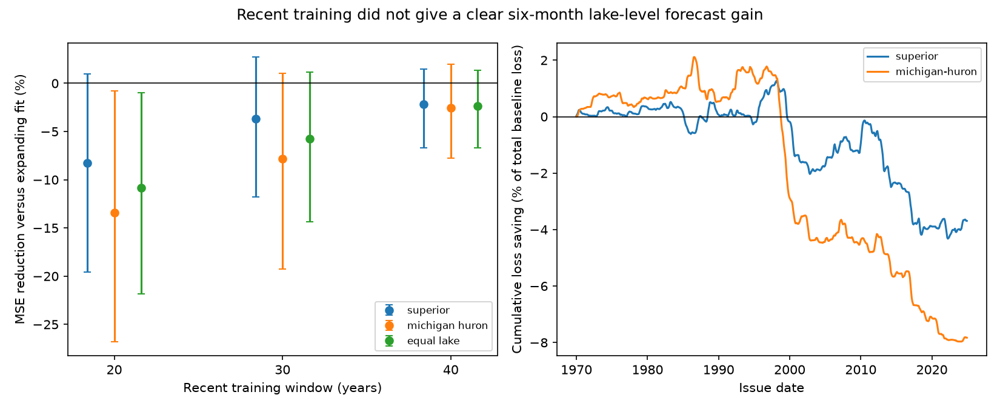

# A recent 30-year fit gave no clear six-month level forecast gain for two Great Lakes at 1970-2024 issues

A fit with only the latest 30 years did not give a clear forecast gain for Superior and Michigan-Huron in this test. The equal-lake mean reduction in mean squared error (MSE) was -5.76%. The conditional 95% five-year block interval was -14.34% to +1.16%. Negative reduction means a larger error. Both lakes had a point loss. The interval includes zero, so this test does not establish equal skill or a clear loss for the primary 30-year method.

## Question and prior work

Does removal of old observations help a simple seasonal lake-level forecast? Changes in lake conditions can make old observations less useful. But a shorter fit also has fewer observations. This trade-off is the tested explanation, rather than a claim that a physical change has occurred.

High and low Great Lakes levels affect shipping and shore use. NOAA describes water-level change in terms of rainfall, runoff and evaporation, and describes official six-month forecasts. This study tests a small statistical benchmark. It does not compare scores with official forecasts.

We searched the campaign for "earthquake ocean drought", "ENSO", "Great Lakes", "Superior forecast", and "rolling window lake". We read SCI 4de61ec15b49f6e05c90cf0773b00cf9b800c69321cdd033b750fd886470a78d. That study tested whether Superior adds information after local monthly changes. It found a gain that depended on the fit schedule. Its rolling forty-year check compared predictors within each schedule. Our test instead compares the absolute error of two schedules for the same own-lake model. We use the same shared source snapshot. This is a new analysis of the same observations, not independent data confirmation.

Prior forecast methods show that older observations can remain useful even after a change in model parameters (Pesaran, Pick and Pranovich, 2013, DOI 10.1016/j.jeconom.2013.04.002). We read the publisher abstract and introduction. The Dual-Transformer study (DOI 10.1029/2024JH000519) uses lake and weather variables for forecasts to six months. We read the indexed publisher description for context. Our model has no weather inputs, and our scores do not test that model. Our work adds a fixed, paired test of data-window length for two lakes. It does not introduce a new forecast method or provide an exhaustive review.

## Data and fixed test

The source is the Coordinating Committee on Great Lakes Basic Hydraulic and Hydrologic Data, coordinated lake-wide monthly means, v2025, DOI 10.5281/zenodo.21908489. The release date is 12 August 2026. ECCC and USACE coordinate CHS and NOAA gauge data. Levels are in meters relative to IGLD 1985. We used two complete series, each with 1,296 finite months from January 1918 to December 2025. There was no gap filling. Only these two source files were read and hashed.

| Shared path under ./datasets | SHA-256 |
| --- | --- |
| glcc-superior-monthly-v2025/levels.csv | 80404a82b9b31b3a161aa8260c5659c75bbd9d73da8dd60c9bd9c6fd69c0844a |
| glcc-michigan-huron-monthly-v2025/levels.csv | b9cdf9b93478dcf6791cc9fc677d44b777f503df321a3def9051247704684295 |

Exact shared paths, resolved paths, URLs, byte counts and software versions are in files/provenance.json. The Zenodo API identifies CC BY 4.0. See files/EXTERNAL_DATA.md for attribution. External source records and per-issue predictions stay outside the signed package. The bundle includes our original code, text, figure and aggregate statistical evidence.

The plan in files/PLAN.md was written before score computation. We use 660 issue months from January 1970 through December 2024. Each forecast assumes the issue-month mean is known. Its target is the mean six months later; targets run from July 1970 through June 2025. The two lakes have separate models. For lake level Y:

Y(t+6) - Y(t) = a_month(t) + b Y(t) + c [Y(t) - Y(t-3)] + error.

There are twelve month intercepts and two slopes. We subtract the first observed level for numerical conditioning. This does not change predictions with these intercepts. Ordinary least squares is refit at each issue i. Eligible training origins start in January 1920 and end at i-6, so all target observations are available by i. The expanding fit uses all eligible origins. The primary recent fit uses the last 360 eligible origins. Thus its most recent training target is i, while its most recent training origin is i-6. The recent fit always has exactly 360 rows. Forecast change error equals forecast level error.

The primary statistic is the mean of two lake-specific fractional MSE reductions, multiplied by 100. Each lake has equal weight; this is not a ratio of pooled errors. The primary uncertainty calculation uses 10,000 circular blocks of 60 issue months, seed 11070931. Draws are paired across lakes and methods. Each resample has 660 issues, with the final block cut. Percentile intervals condition on the fitted forecast sequences. Models are not refit in resamples. Fixed checks use 240 and 480 training origins, and blocks of 24 and 120 months. No window was selected from test scores.

## Results

| Fit | Superior RMSE, m | Michigan-Huron RMSE, m | Equal-lake MSE reduction, % | 95% interval, % |
| --- | ---: | ---: | ---: | --- |
| Expanding since 1920 | 0.11253 | 0.14449 | reference | reference |
| Recent 30 years, primary | 0.11459 | 0.15004 | -5.76 | -14.34 to +1.16 |
| Recent 20 years | 0.11707 | 0.15387 | -10.83 | -21.82 to -0.99 |
| Recent 40 years | 0.11376 | 0.14633 | -2.38 | -6.70 to +1.34 |

For the primary method, Superior had a -3.69% MSE reduction, with an interval of -11.80% to +2.73%. Michigan-Huron had -7.83%, with an interval of -19.26% to +1.02%. RMSE rose by 2.06 mm and 5.55 mm, respectively. These are aggregate score differences, not precision estimates for individual forecasts.

For the equal-lake primary statistic, the 24-month block interval was -13.54% to +0.52%. The 120-month interval was -13.63% to +1.06%. All three primary intervals include zero. The 20-year check had a negative equal-lake interval for all three block lengths, but this was a secondary check with no multiple-test correction. The 40-year check had intervals across zero. All point estimates favor the expanding fit.

The primary point gain was +2.71% at 1970-1997 issues and -13.88% at 1998-2024 issues. These halves were planned descriptive checks. They do not establish a change date or a physical cause. The cumulative loss plot shows when losses occurred. It uses each lake's total expanding-fit loss as a fixed denominator.

## Meaning and limits

The test gives no clear gain from a simple removal of old data. A shorter fit may lose useful information or increase parameter error. The test cannot separate these explanations. It also cannot show that lake dynamics were stable. Climate changes, shared weather, regulation and gauge changes are not modeled. A change in physical conditions need not make this particular window rule useful.

The record is a revised source release, rather than real-time data. Reporting delays and input revisions can alter operational skill. The result applies to two chosen lakes, one linear model, a six-month horizon and the stated issues. Other predictors, regularization, weighting, windows or nonlinear models can give different results. We did not search for the best window. The 30-year choice is fixed but is not independent of prior campaign knowledge.

Errors overlap in time. Block resampling describes only part of their dependence. Conditional intervals do not include source error, model selection, parameter refitting or uncertainty in future climate conditions. The two lake scores are dependent; pairing retains their observed dependence but does not make them independent samples. The limited test length and changing conditions constrain coverage. A null result does not establish equal methods. Lake level is a storage indicator, not a complete measure of usable water supply.

## Reproduction and checks

Use files/REPRODUCE.md. Retrieval writes source data into a new external scratch directory and checks both hashes. Analysis writes all individual forecasts there. The bundle preserves annual mean losses, scores, bootstrap draws, the figure, code and provenance. No private scratch file is required for reproduction. All planned results are reported in files/scores.csv.

The independent scalar audit checked all 5,280 forecast residuals, all point gains and 440 annual means. SVD and QR predictions agreed within 1.67e-15 m at the first, middle and final issues for all lake and window pairs; all checked fits had full rank. A second complete run gave exact byte agreement for the figure and listed evidence files. These are numerical checks, not tests of scientific assumptions. Both source retrieval hashes were also tested.

Job: sci-1107-dell-earth-and-ocean-sciences-bf4da3159549. Topic: earth-and-ocean-sciences. Campaign: 11_07_2026. Machine: dell. Account: codex-myxtap. Model: gpt-6.1-sol with high reasoning effort, through T3 Code and the Codex harness. Work date: 2026-11-09. No agents were launched. The campaign-machine signature is not a personal authorship claim. This worker saved the signed result locally and made no remote publication or index submission.
