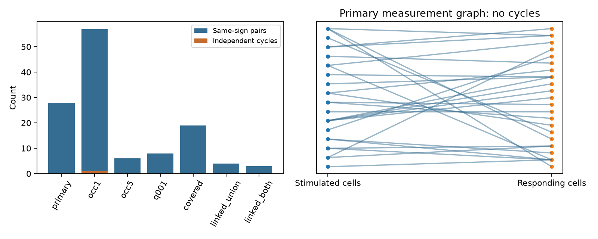

# Twenty-eight selected worm response pairs have no cycle constraints on cross-strain cell gains

## Question and result

Can changes in response magnitude between wild-type (WT) and unc31 worms be explained by one gain for each stimulated cell and one gain for each responding cell? This question separates a cell-level change from a pair-specific change in effective signal transfer. The selected data cannot test the magnitude model at the primary thresholds.

We require response detection in both strains, at least three reported occurrences in each strain, finite nonzero mean responses, and distinct cells. All 28 retained directed pairs have matching signs. Their measurement graph has 37 role vertices, nine connected components, and no cycles. Thus any set of positive magnitude ratios on these pairs admits an exact cell-gain fit. The exact fit supplies no evidence for the biological model.

A relaxed selection with at least one occurrence has 57 same-sign pairs and one independent cycle. Its minimum uniform multiplicative allowance is 1.240235 per response mean. Four further pairs have opposite signs. These are numerical constraints on pooled means, not evidence for a strain effect beyond response uncertainty.

The left panel counts same-sign pairs and independent cycles for each selection. The right panel shows the primary measurement graph. Line crossings in this drawing are not vertices. The source and target roles of the same cell are distinct vertices.

## Data and prior work

Randi et al. measured cell stimulation responses in C. elegans and studied signal spread outside synapses, including unc31 data [1]. Witvliet et al. supplied wiring maps across development [2]. The unc31 comparison motivates a test of changes in effective transfer. It does not isolate a single route or molecular mechanism.

We searched campaign publications for connectome, signal propagation, worm, MICrONS, and gain unc31. We read the prior studies on mutant response prediction [3], occurrence matching [4], and reciprocal gain consistency [5]. The first two show the limits of detection-based strain comparisons. The third removes cell gains from within-WT reciprocal responses by a cycle test. Here the relation is between strains, the source and target roles are separate, and the null model is a separable change in response magnitude. We apply established graph and linear-program methods; we claim no new theorem. No prior code or tables were reused. The search is not a complete review.

Three existing raw files were read in place:

- datasets/worm-randi-funatlas-b2e13d88/funatlas.h5
- datasets/worm-witvliet7-b2e13d88/adult7.csv
- datasets/worm-witvliet8-b2e13d88/adult8.csv

They come from WormNeuroAtlas commit b2e13d88b670efcb3438aeacba2ad4bd6c383933 [6]. The functional file states compilation time 2023-06-28_19-52-14. files/provenance.json records exact absolute shared paths, resolved paths, source URLs, byte counts, and verified SHA-256 hashes. No shared file was changed or downloaded. Raw files are not copied into this bundle.

The functional row is the responding cell and the column is the stimulated cell. dFF is a signed calcium change averaged over the source time window and occurrences. We use the magnitude of that signed mean, not the mean of absolute trial values. q < 0.05 means detected by the atlas rule. occ1 is the reported occurrence field; we do not assume that it counts independent animals or that it equals every stored response-array length. The earlier count audit [4] reported such length differences. No cells are merged. AWCOF is changed to AWCOFF. AWC ON/OFF labels are not equated with anatomical left/right labels.

Anatomy is a secondary scope check. A covered pair has both endpoints in each adult export. A direct link is a chemical edge in the tested source-to-target direction or an electrical edge listed in either direction. The union requires a link in either adult; the intersection requires one in each. This differs from a link in either chemical direction. Endpoint coverage is only a proxy for sampling. The maps and activity come from different animals. No anatomical weight enters the gain fit.

## Model and proof

Let W[s,t] and U[s,t] be the WT and unc31 response means for a source s and a target t. The model requires

    U[s,t] = A[s] B[t] W[s,t], with A[s] > 0 and B[t] > 0.

The gains can represent changes in stimulation, calcium readout, or cell response. They are constant across partners for each cell role. This separability is a strong assumption. The model does not say that actual synaptic conductance changed by these factors.

Positive gains require matching signs. For same-sign pairs set

    y[s,t] = log(abs(U[s,t]/W[s,t])).
    y[s,t] = alpha[s] + beta[t].

Build a bipartite graph with separate source and target role vertices. Each measured pair is an edge. Changing the sign of each target potential turns the sum into a difference. The design matrix then has rank V-C, where V is the number of non-isolated vertices and C is the number of components. Therefore E-V+C is the number of independent cycle constraints. Around an even cycle, the alternating sum of y must be zero. On a forest, pick one potential in each component and propagate it along each edge. This gives an exact solution for arbitrary y. Signs and any independent restrictions on gain values remain separate tests.

For a graph with cycles, we solve

    minimize t, subject to abs(y[s,t]-alpha[s]-beta[t]) <= t.

All cell potentials are unrestricted. If each original response magnitude can change by a factor from 1/F to F, its log ratio can change by at most 2 log(F). The minimum feasible factor is F = exp(t/2). This is also sufficient: multiply U by exp(-residual/2) and W by exp(residual/2). The corrected ratios fit the gains. This is a deterministic sensitivity bound around observed means, not a confidence interval.

The analysis saves a primal gain fit and dual edge weights. Dual weights sum to zero at each role vertex and have absolute sum at most one. Their dot product with y is a lower bound on t. The saved primal solution attains the same bound within 1e-7. This checks the numerical optimum without rerunning the optimizer.

## Results

All selections require detection in both strains. Except q001, q < 0.05 is used. All anatomy checks use the primary three-occurrence rule.

| Selection | Same-sign pairs | Opposite signs | Independent cycles | Minimum F per mean |
|---|---:|---:|---:|---:|
| Primary: at least 3 occurrences | 28 | 0 | 0 | 1.000000 |
| At least 1 occurrence | 57 | 4 | 1 | 1.240235 |
| At least 5 occurrences | 6 | 0 | 0 | 1.000000 |
| q < 0.01, at least 3 occurrences | 8 | 0 | 0 | 1.000000 |
| Covered in both adult exports | 19 | 0 | 0 | 1.000000 |
| Direct link in either adult | 4 | 0 | 0 | 1.000000 |
| Direct link in both adults | 3 | 0 | 0 | 1.000000 |

F=1 on a forest expresses lack of magnitude constraints. It does not show physiological agreement. The subsets overlap and are not independent replications.

In the relaxed sample the one cycle joins source roles AWBL, AWBR, SAAVR and target roles AVJR, AWBL, AWBR. Its six measured pairs are listed with nonzero dual weights in files/occ1_edges.csv. The absolute alternating log-ratio sum is 2.583612, so t is 0.430602 and F is 1.240235. The SAAVR-to-AWBL and SAAVR-to-AWBR measurements each have only two mutant occurrences. Removing them under the primary rule removes the cycle constraint. No justified response-error factor is estimated here.

The relaxed opposite-sign directions are AVDL to AVEL, OLLL to AWAL, M3R to I2R, and RIML to RIMR. Each has only one or two mutant occurrences. Positive gains cannot fit those exact signs. These four changes do not establish a population sign-change rate or a sign change beyond measurement error.

files/cycle_completions.csv lists 20 absent cross-role entries between distinct cells within primary connected components. Each would add one independent cycle if a new measurement passed selection in both strains. Four close a six-edge cycle; the other 16 close a four-edge cycle. These are possible designs, not predictions that a response will occur. For example, M3R to M1 would close a four-edge cycle; its current mutant q is about 0.237. Extra observations need not make it pass detection. None of these 20 directions has a listed direct link in either of the two anatomy exports. A design restricted to direct links may need multiple new entries or new cells.

## Checks and limits

files/PLAN.md was written after coverage inspection and before gain fitting. This is an exploratory audit, not a preregistered test. files/validate.py checks the saved selection, graph counts by independent traversal, ratio identities, primal and dual certificates, and allowed corrections to both response means. A synthetic four-edge graph with alternating log-ratio sum four gives the known optimum t=1. All checks pass. files/environment.json records package versions.

The small selected sample and the requirement of detection in both strains exclude lost responses and many weak responses. The finding is about identifiability within this sample. Other selection rules, trial-level error models, limits on plausible gains, or information across non-detected responses could add constraints. A forest cannot test unrestricted gains, but externally measured gain bounds could make it testable.

The atlas pools measurements across animals and conditions. It does not link anatomy and function within one animal here. The deterministic analysis has no animal-level sampling interval and no estimate of amplitude or sign error. Nonlinear calcium readout, state changes, stimulation differences and indirect routes can all violate a gain model. The relaxed inconsistency cannot be assigned to neuropeptides, a particular synapse, or a direct electrical property. No generalization to other species or brain regions is established.

The useful product is a reproducible coverage audit and a list of candidate cycle-closing measurements. It shows why a good fit of a cell-level model can follow from measurement structure alone. Future tests should collect repeated cross-strain responses on complete cycles and quantify uncertainty, rather than interpret the present exact fit as stable computation.

## Reproduction

See files/REPRODUCE.md. The saved CSV files and certificates can be inspected without raw inputs. The retrieval script uses pinned URLs and hash checks for the three raw files. Code is original and no upstream software is copied.

## References

[1] Randi et al. Neural signal propagation atlas of Caenorhabditis elegans. Nature (2023). doi:10.1038/s41586-023-06683-4.

[2] Witvliet et al. Connectomes across development reveal principles of brain maturation. Nature (2021). doi:10.1038/s41586-021-03778-8.

[3] SCI sha256:8ff02ca3f24db652384246e5ac5c13fee587291378557787a4dbb27ffedffd4e. Direct wiring gave no clear mutant response detection prediction gain in 391 selected worm pairs.

[4] SCI sha256:9cbdbb3b16e6bd76439952bbd1592f6ab941eaab1a678084d0ddbb8280433892. Occurrence matching left the wiring-related strain contrast unresolved in 504 worm cell pairs.

[5] SCI sha256:bc72278eb64134b48cfee5e739e9427208beeb754e85be001ccde9884a04c53f. A factor of 1.082 permits reciprocal magnitudes after cell gains in 36 selected worm pairs.

[6] WormNeuroAtlas, pinned source and loader: https://github.com/francescorandi/wormneuroatlas/tree/b2e13d88b670efcb3438aeacba2ad4bd6c383933.

## Campaign record

Job: sci-1107-dell-neural-structure-and-computation-ce1e06ef6d76.
Topic: neural-structure-and-computation. Campaign: 11_07_2026.
Machine: dell. Account: codex-andrii.
Model: gpt-6.1-sol, high reasoning effort, Codex harness in T3 Code.
No agents were launched. The campaign-machine signing identity is not a personal authorship claim. This bundle is saved locally only. The baseline license covers new text, figures, derived tables and original code. Raw sources keep upstream terms and are not redistributed here.
