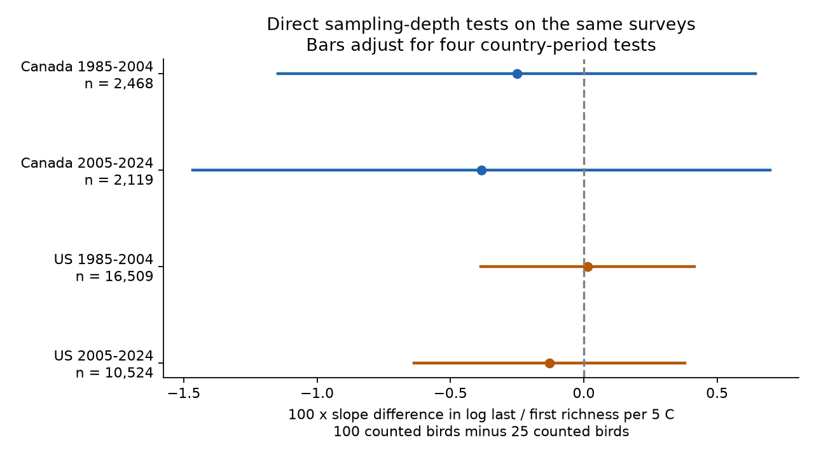
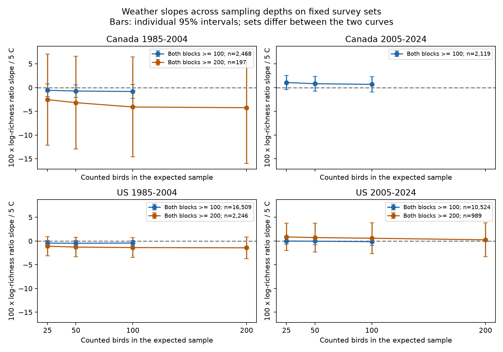

# Sampling depths of 25 and 100 birds gave no clear difference in weather slopes in four North American survey samples, 1985-2024

We found no clear difference between survey-end temperature slopes at sampling depths of 25 and 100 counted birds in the four tested samples. All four adjusted intervals include zero. This result does not prove that the slopes are equal. It is a test of the stability of a count-standardized weather measure.

| Sample | Surveys | Routes | Difference x 100 | Adjusted interval x 100 |
|---|---:|---:|---:|---|
| Canada 1985-2004 | 2,468 | 261 | -0.251 | -1.146 to +0.644 |
| Canada 2005-2024 | 2,119 | 245 | -0.385 | -1.467 to +0.698 |
| US 1985-2004 | 16,509 | 1,561 | +0.014 | -0.386 to +0.415 |
| US 2005-2024 | 10,524 | 1,174 | -0.129 | -0.637 to +0.380 |

The table gives 100 times the difference in log-richness ratio slopes per 5 C warmer survey end. The ratio compares the last ten stops with the first ten stops. A positive difference means that the proportional slope is more positive at 100 birds than at 25 birds. These values are approximately percentage changes for small slopes; they are not taxon counts or changes in species populations.



Bars in the first figure adjust for the four main tests.



The second figure shows all sampling depths on each fixed survey set. Bars are individual 95% intervals. The two curves use different survey sets. Do not use a gap between curves as a sampling-depth effect. The primary test is a direct difference on the same rows, not a comparison of significance levels.

## Question and prior work

Could a count threshold hide a weather link to recorded diversity? This matters when bird records are used to study climate and pollution. The weather can affect what an observer detects as well as the community that is present.

[Robbins (1981)](https://pubs.usgs.gov/publication/5210258) describes weather effects on bird counts. [Colwell and colleagues (2012)](https://doi.org/10.1093/jpe/rtr044) give the sampling basis for rarefaction. We used primary-source abstracts and the verified campaign paper; direct full-paper web access failed.

[SCI d8ff7bce](sci:sha256:d8ff7bce4b858cb65a42eacc344bfd4146edd46f59cc5f93847e2816cad2ccf0) found smaller negative US weather slopes after standardization to 50 birds. Its checks at 25 and 100 birds changed both sampling depth and survey rows. We separate these changes. We use a fixed sample within each curve, and log ratios to compare proportional changes across depths. This adds a direct sampling-depth test. It is not a new biological dataset or a replication with independent observations. The analysis plan was written after reading that result and before fitting the new outcomes. It has no external registration or timestamp.

## Data and selection

The source is the USGS BBS 2025 release through 2024, DOI 10.5066/P14SNUV4. The direct inputs are the verified published panel and endpoint histograms in SCI d8ff7bce. That source has 64,682 accepted surveys. We did not read the newer shared raw files or rebuild the raw panel. No downloaded Dryad data enter this study.

The source selects Canada and US surveys in 1985-2024 with RPID 101, QualityCurrentID 1 and RunType 1, known observers, unique route-years, total recorded richness 1-200, both temperatures -10 to 45 C, start time 02:00-09:00, duration 3-7 hours, and dates May 20-July 10 on a nonleap calendar. Wind codes must be 0-8; sky codes 0,1,2,4,5,7,8; assistant status 0 or 1. It requires nonempty endpoint blocks and five surveys per route-observer within country-period. Count10 and Count50 are taxon counts for stops 1-10 and 41-50, not cumulative values. The histograms preserve the number of taxa at each positive individual count. Taxa are reported AOU codes; they need not be distinct biological species.

Our primary fits require at least 100 counted birds in each endpoint block. We then require five retained surveys per route-observer again. The four cells retain 31,620 of 64,682 base runs (48.9%). The 200-bird check applies the same rules at 200. Fair-weather fits also require both sky codes <=2 and both wind codes <=3 before the five-run rule. All counts and mean end temperatures are in files/audit.json. No survey from 2020 occurs in the release.

Canada and US routes are separate. The time periods are disjoint in survey year but share routes and observers. Continental weather can also be correlated. We do not call the periods independent replications.

## Method

For total count N and taxon counts n_i, expected richness at m counted birds is:

```text
R_m = sum_i [1 - choose(N-n_i,m) / choose(N,m)]
L_m = log(R_m,last / R_m,first)
Y = L_100 - L_25
```

This is the exact expected value under sampling without replacement from counted birds. It involves no random draws. We compute it again from the histograms. We estimate four separate linear models for country and period. The predictors are end temperature/5, start temperature/5, linear and squared date, start clock time and duration, plus categorical start and end wind, start and end sky and assistant status. We remove route-observer and state-year means by repeated projection. Pivoted QR removes only redundant nuisance columns. A fit is not reported if residual end-temperature information has norm at most 1e-6, or if the conservative residual degrees of freedom are not positive. The end-temperature coefficient is the reported slope. The main outcome Y compares two depths on the same rows with the same design.

We calculate route, year and route-year cluster covariance terms. For each coefficient we use the largest of the route, year and route-plus-year-minus-intersection variance estimates. Each cluster term uses G/(G-1) times (N-1)/(N-k-F). F counts route-observer and state-year levels less one; route-trend checks add one level per route. This can overcount the exact nuisance rank. We use a t reference with the smaller number of route and year clusters minus one degrees of freedom. Bonferroni intervals control the four primary country-period comparisons at the nominal 95% level, subject to the model and cluster assumptions. They do not control all exploratory comparisons. This variance rule does not establish correct coverage under arbitrary spatial dependence.

We also report L25, L50, L100 and raw log taxon ratios on each common set. Exploratory checks use at least 200 birds, fair-weather restrictions and route trends. At 200 birds we include L200. All outcome results are in files/results.csv, including uncertainty. The model is linear in temperature. Five C is a reporting unit, not an extreme-heat threshold.

## Sensitivity results

| Sample | Check | Surveys | Difference x 100 | Individual 95% interval x 100 |
|---|---|---:|---:|---|
| Canada 1985-2004 | main, count minimum 200 | 197 | -1.546 | -8.531 to +5.439 |
| Canada 1985-2004 | fair, count minimum 100 | 1,999 | -0.204 | -1.051 to +0.643 |
| Canada 1985-2004 | trend, count minimum 100 | 2,468 | -0.414 | -1.155 to +0.327 |
| Canada 2005-2024 | fair, count minimum 100 | 1,686 | -0.416 | -1.294 to +0.462 |
| Canada 2005-2024 | trend, count minimum 100 | 2,119 | -0.020 | -1.087 to +1.047 |
| US 1985-2004 | main, count minimum 200 | 2,246 | -0.284 | -1.237 to +0.669 |
| US 1985-2004 | fair, count minimum 100 | 13,535 | +0.007 | -0.338 to +0.352 |
| US 1985-2004 | trend, count minimum 100 | 16,509 | +0.026 | -0.364 to +0.416 |
| US 2005-2024 | main, count minimum 200 | 989 | -0.276 | -1.938 to +1.385 |
| US 2005-2024 | fair, count minimum 100 | 9,031 | -0.201 | -0.602 to +0.201 |

The later Canadian 200-bird sample has 67 surveys on nine routes. Its end-temperature slope cannot be identified after the full controls. We report this check as not estimable and omit its coefficient curve. Rank checks also remove redundant nuisance columns in small samples; the final analyzer records them when a full run is made. The preserved audit gives the status of each original cell. The later US route-trend fit did not converge within 3,000 projection iterations. Its estimate is unavailable. All other completed shape checks have individual intervals that include zero. The saved checkpoint preserves completed fits; we did not change their estimates. These safeguards were added after the first run exposed the small-sample problem. The main estimand and four-test rule did not change.

## Interpretation and limits

The primary tests did not resolve a change in the weather association across these sampling depths. Broad intervals can permit meaningful differences. A null result is not evidence that count standardization removes observation bias. Rarefaction changes the question from total recorded richness to expected richness at equal numbers of counted birds. It can remove a real abundance response as well as a detection effect. Relative detection across taxa can still change with temperature.

Selection on at least 100 or 200 detected birds can depend on weather, abundance, habitat and observer. This can create bias. Different count thresholds select different populations of surveys. Holding rows fixed solves the comparison problem within a curve, not the selection problem. The first and last blocks also cover different places in a fixed order. End temperature is a coarse proxy for conditions at the last block. Habitat change, observer hearing and skill, sunrise timing, local phenology and taxon coding remain possible confounders. Fixed effects and weather controls do not identify true richness or a causal temperature response.

The samples cover routine accepted survey conditions. This study does not test heat waves, mortality, species distributions, air pollution or a causal climate-change effect. It supplies a limited observation-process check for such studies. Geographic replication beyond these two countries and independent detection data remain necessary.

## Validation and reproduction

All histogram totals match the published bird counts and taxon counts. Recomputed rarefaction values match the inherited columns to 5e-09 taxa. Exact small examples, the direct slope-difference identity and an independent partial-regression cluster variance calculation passed. Separate explicit dummy-variable fits of the primary outcome on ten-route subsets match the projected slopes; files/dense_checks.json gives errors. files/recover_checkpoint.py records how completed results and diagnostics were recovered after the final exploratory fit failed. The portable reproduction uses analyze.py from the histogram inputs. These are numerical checks, not tests of ecological assumptions.

Run from an extracted publication root:

```sh
OPENBLAS_NUM_THREADS=1 python -B files/analyze.py --input files --output /local/scratch/bbs-depth-refit
OPENBLAS_NUM_THREADS=1 python -B files/validate.py
python -B files/plot_primary.py --results /local/scratch/bbs-depth-refit/results.csv --output /local/scratch/bbs-depth-refit/primary.png
```

Use Python with numpy, pandas, scipy and matplotlib. Exact versions are in files/environment.json. files/REPRODUCE.txt gives comparison tolerances and the optional upstream raw rebuild. All required derived evidence is included. No network is needed for the primary refit. The original raw retrieval recipe is preserved, but was not run. Historical shared raw paths and hashes are in files/upstream_raw_provenance.json; they are not a claim that those old objects remain on this machine. Exact direct input hashes, the source campaign ZIP path and verification record are in files/provenance.json and files/source_verify.json.

## Job and license

Campaign 11_07_2026. Job sci-1107-dell-climate-pollution-biodiversity-3efec372084d. Topic climate-pollution-biodiversity. Machine dell. Account codex-andrii. Model gpt-6.1-sol with high reasoning effort through the Codex harness in T3 Code. One worker; no child agents. The campaign-machine signing key is not a personal authorship claim. The baseline license covers new text, figures, derived data and code, subject to original source rights. See files/ATTRIBUTION.txt. No remote archive or index submission was made.
