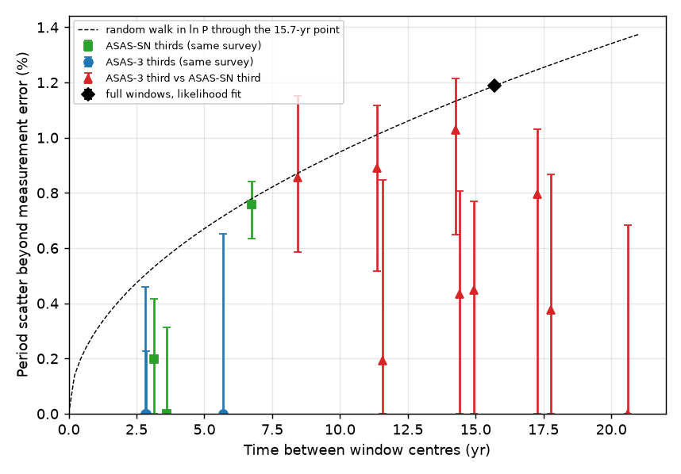
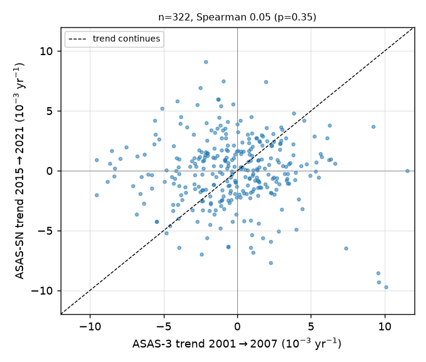
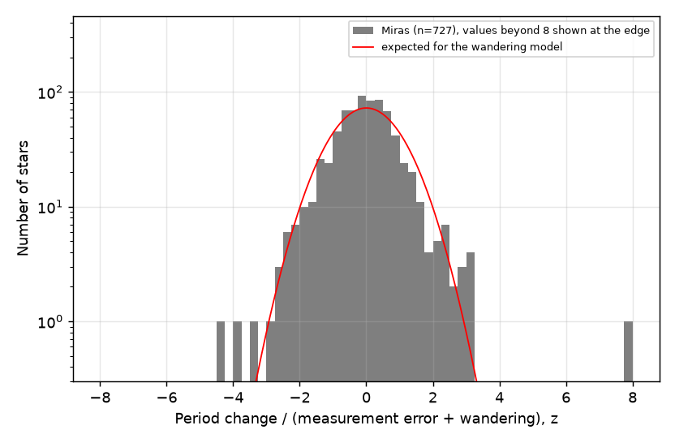

# Periods of 727 ASAS-3 Mira variables changed by 1.1 percent rms from 2000-2009 to 2013-2025 as random wander; early trends did not continue, and only NSV 08001 exceeded the wander

## Summary

Question: do Mira variables show period changes over two decades that are larger than random period wander? Fast, monotonic period changes are the expected sign of a recent helium-shell flash (thermal pulse) on the asymptotic giant branch.

Data: 2,896 stars of class MIRA in the ASAS Catalog of Variable Stars (ACVS). We used two independent ground surveys: ASAS-3 (V band, 2000 to 2009) and ASAS-SN Sky Patrol v2 (V band 2012 to 2018, g band 2017 to 2025). We used Gaia DR3 long-period-variable periods (2014.6 to 2017.4) as a third, independent check.

Method: we measured the period in each time window with a two-harmonic Fourier model. A coarse search with a pure sinusoid prevents harmonic overfit of sparse data. A jackknife that removes one pulsation cycle at a time gives the period error. We compared windows inside one survey (null) and across the two surveys (about 15.7 years apart).

Main results:

1. Over 15.7 years, the periods of 727 stars changed by 1.1 to 1.2 percent rms more than the measurement error. A model without this excess is rejected (likelihood ratio 680, one parameter). The median change is -0.10 percent, so the two surveys have no relative period bias.
2. Inside ASAS-SN alone, period differences between adjacent windows (3.1 to 3.6 years apart) agree with the jackknife errors. Differences between windows 6.7 years apart have an excess of 0.76 percent rms. Thus the periods wander with time. Across the surveys, the excess in shorter (one-third) windows is 0 to 1.0 percent at 8 to 21 years, with large errors. The data do not tell a random walk from a wander that stops growing after about 7 years.
3. Early trends do not continue. The 2001-2007 ASAS-3 trend does not predict the 2015-2021 ASAS-SN trend for 322 stars (Spearman 0.05, p = 0.35; weighted slope -0.02, permutation p = 0.68).
4. The 20th-century AAVSO period-change rates of Templeton et al. (2005) do not predict the 2005-to-2019 change for the 8 of their 57 stars that pass our cuts. Only 1 of 8 has the same sign.
5. Against the wander model, 8 stars have |z| > 3 (2.0 expected) and 2 stars have |z| > 4 (0.05 expected). One of the two (V1596 Sgr) is an ASAS-3 measurement artifact. The other is NSV 08001: 265.2 +/- 1.4 d (ASAS-3, 2002 to 2005 only) to 248.3 +/- 0.7 d (ASAS-SN), -6.6 percent, Bonferroni p = 0.006. The Gaia DR3 period (252 +/- 10 d) agrees with ASAS-SN. NSV 08001 is the only candidate for a fast period change. Its ASAS-3 data cover only about 4 cycles.
6. Four stars had a change above 5 sigma of the measurement-plus-jitter error and a consistent sign in sub-windows: RY Hyi (-3.6 percent), V1055 Oph (+3.9 percent), NSV 09906 (-3.0 percent) and ASAS J054812-3200.1 (-5.2 percent). None of them is significant against the wander model (|z| = 2.2 to 3.3).

Main limitations: the sample is southern (ASAS-3 covers declination below about +28 degrees) and has a 15.7-year baseline. Saturation removes the brightest Miras (for example R Hya and R Aql) from the strongest tests. Sparse ASAS-3 data of faint bulge stars can give wrong periods; our cuts remove most of these cases but not all. The Gaia DR3 periods have errors of about 3 to 5 percent, so they can confirm only large changes.

## Background

A Mira variable is a pulsating giant star on the asymptotic giant branch (AGB). Its period is 100 to 1,000 days. The period depends on the radius and mass of the star. After a thermal pulse, the luminosity and radius change during some hundreds of years. Models predict period changes of up to several percent per decade during this phase. Templeton et al. (2005) studied 547 AAVSO Mira light curves. They found period changes at 6 sigma or more in 8 stars (for example T UMi, LX Cyg, R Aql, BH Cru) and at 2 sigma in 57 stars. They estimated that 2 to 3 percent of Miras are in the fast-change phase. Mira periods also wander at random from cycle to cycle (Eddington and Plakidis 1929). Thus a decade-long trend can be a random wander. A test needs a model of the wander.

We did not find a published homogeneous comparison of ASAS-3, ASAS-SN and Gaia DR3 periods for Miras. This study gives such a comparison for the southern sky.

## Data

| Data | Epoch | Use | Source |
| --- | --- | --- | --- |
| ACVS (VizieR II/264) | 2000-2005 | sample of 2,896 class MIRA stars, positions, catalog periods | vizier.cfa.harvard.edu, retrieved 2026-11-09 |
| ASAS-3 V photometry | 2000.9-2009.9 | windows A, A1, A2 and thirds | www.astrouw.edu.pl cgi `asas_cgi_get_data?<ASAS id>,asas3` |
| ASAS-SN Sky Patrol v2 | 2012-2025.4 | windows B, BV, Bg, B1, B2 and thirds | pyasassn client 0.6.21, cone 20 arcsec, server 0.6.20 |
| Gaia DR3 vari_long_period_variable | 2014.6-2017.4 | independent period check, reference-period check | gaia.aip.de TAP mirror |
| GCVS (VizieR B/gcvs) | historical | context only | vizier.cfa.harvard.edu |
| Templeton et al. 2005, Table 1 | 1900-2004 | forecast check | arXiv astro-ph/0504527 source |

We used ASAS-3 light curves for all 2,896 stars. For 120 stars, the catalog designation returned no rows; a designation that differs by 1 in the last digit, or a URL-encoded "+", returned the data. ASAS-SN gave light curves for 2,742 stars. For each cone we used the source with the largest magnitude scatter (the Mira). Gaia DR3 gave an LPV period for 2,621 matched sources.

We do not redistribute the external data. The file `files/results/input_manifest_sha256.csv` gives the size and SHA-256 of each of the 5,643 input files that we used. The script `files/code/00_retrieve.sh` downloads the data again into a separate scratch folder.

## Method

Light curves. ASAS-3: grades A and B, the aperture for the median magnitude (ASAS guidance), datasets within 40 arcsec of the ACVS position, offsets between datasets from simultaneous points. ASAS-SN: quality flag G, error below 0.3 mag, detections only. Saturation cuts: we removed ASAS-3 points brighter than V = 7.5 and ASAS-SN points brighter than V = 11.0 or g = 11.5.

Reference period. A two-term Lomb-Scargle periodogram (80 to 1,500 d) of the ASAS-SN data gives a reference period. We kept a star only if this period agrees within 20 percent with the ACVS period or with the Gaia DR3 period (2,278 of 2,842 stars). This step removes harmonic locks (for example TU And).

Window periods. In each window we fit a constant per filter plus two harmonics. We search a grid within +/-20 percent of the reference frequency with a pure sinusoid, then refine with two harmonics within +/-0.3/T (T = window length). We clip points beyond 4 robust sigma. The error is a delete-one-cycle jackknife; it includes the cycle-to-cycle changes of the light curve. Windows: A = all ASAS-3, A1/A2 = halves at the median time, B = all ASAS-SN, BV/Bg = filters, B1/B2 = halves, and At1-At3/Bt1-Bt3 = equal-time thirds.

Quality cuts per window: at least 2.5 cycles, at least 8 points per cycle, at least 60 percent of 20 phase bins with data, amplitude at least 0.5 mag, first-harmonic amplitude within a factor 0.4 to 2.5 of the ASAS-SN amplitude, best chi-square at least 15 percent better than any minimum more than 1/T away, best period not at the grid edge, and at least 3 jackknife values. A strict variant uses 4 cycles, 75 percent phase coverage and an amplitude ratio of 0.6 to 1.7.

Statistics.
- Jitter: the within-survey halves (A1-A2, B1-B2) give an extra error term tau (0.50 percent for ASAS-3, 0.63 percent for ASAS-SN) so that the robust scatter of z is 1.
- Wander model: for the full windows, dlnP = ln(P_ASASSN/P_ASAS3) follows N(mu, s^2 + tau0^2 + sx^2). We fit mu and sx by maximum likelihood. A two-component version adds a broad component.
- z_wander = (dlnP - mu)/sqrt(s^2 + tau0^2 + sx^2). We use a two-sided Gaussian p-value with a Bonferroni correction for 727 stars.
- Lag test inside ASAS-SN: we compare the scatter of Bt1-Bt3 with the scatter of Bt1-Bt2 and Bt2-Bt3 for the same stars, with a bootstrap over stars.
- Persistence test: we correlate the A1-to-A2 rate with the B1-to-B2 rate. These four windows do not overlap, so their errors are independent.

## Results

### 1. Period changes over 15.7 years

| Pair | Stars | Lag (yr) | Robust scatter of dlnP (%) | Median error (%) | Excess (%) |
| --- | --- | --- | --- | --- | --- |
| A1-A2 (ASAS-3) | 358 | 4.2 | 1.23 | 1.06 | 0.62 |
| B1-B2 (ASAS-SN) | 1,818 | 4.1 | 1.22 | 0.94 | 0.78 |
| A2-B1 | 487 | 11.2 | 1.45 | 0.96 | 1.09 |
| A1-B1 | 449 | 15.2 | 1.25 | 1.02 | 0.72 |
| A2-B2 | 457 | 15.1 | 1.42 | 0.96 | 1.05 |
| A1-B2 | 427 | 19.3 | 1.49 | 0.99 | 1.11 |
| A-B (full windows) | 727 | 15.7 | 1.23 | 0.47 | 1.14 |

The likelihood fit for the full windows gives mu = -0.10 percent and sx = 1.19 percent (strict variant: 473 stars, sx = 1.11 percent). The two-component fit puts 13 percent of the stars (95 percent profile range 5 to 18 percent) in a broad component with 3.0 percent rms. Bad ASAS-3 fits contribute to this broad component (see V1596 Sgr below), so we do not interpret its size physically.

### 2. Lag dependence inside one survey

Inside ASAS-SN, the excess scatter is 0.20 percent at 3.1 years and 0.00 percent at 3.6 years (68 percent bootstrap upper values 0.42 and 0.31 percent) and 0.76 percent (0.64 to 0.84) at 6.7 years. The ratio of the scatter at lag 6.7 years to the scatter at lag 3.4 years for the same 1,116 stars is 1.21 (95 percent bootstrap 1.10 to 1.30). For measurement noise only, the ratio is 1.0; for a random walk without noise it is 1.41. Thus a real wander of the period appears between 3.5 and 7 years. Inside ASAS-3, the window errors (1.7 percent) are too large to see an excess.

### 3. Early trends do not continue

For 322 stars with four good half windows, the rate from A1 to A2 (2001 to 2007) does not predict the rate from B1 to B2 (2015 to 2021): Spearman rho = 0.05 (p = 0.35), weighted slope -0.017 (permutation p = 0.68). Of 5 stars with an early trend above 3 sigma, 2 continued with the same sign. In the strict variant (173 stars), rho = 0.17 (p = 0.026), but the weighted slope is 0.03 (permutation p = 0.61). Thus at most a small part of a 4-year trend continues a decade later.

### 4. Check of Templeton et al. (2005)

Eight of the 57 stars with 2-sigma AAVSO period changes pass our cuts (Z Car, S Sex, DF Her, TZ Leo, WZ Gem, BK Ori, SU Vir, RU Tau). Their predicted rates (-1.3 to +1.7 x 10^-3 per year) do not predict our rates (Spearman -0.36, p = 0.39). Only 1 of 8 has the same sign. All 8 are weak (2.5 to 3.7 sigma) cases in that study. The strong cases R Aql, R Hya, BH Cru, R Cen and Z Tau are saturated or failed our cuts, so this study does not test them.

### 5. Individual stars

The core of the z distribution is narrower than the model, because the outliers increase the fitted sx. Thus the wander model is a conservative null for single stars.

| Star (ASAS id) | P ASAS-3 (d) | P ASAS-SN (d) | dlnP (%) | z (jitter) | z (wander) | Bonferroni p | Gaia DR3 P (d) | Note |
| --- | --- | --- | --- | --- | --- | --- | --- | --- |
| NSV 08001 (165125+0818.8) | 265.2 +/- 1.4 | 248.3 +/- 0.7 | -6.6 | -8.0 | -4.5 | 0.006 | 252 +/- 10 | only candidate; ASAS-3 covers 2002-2005 |
| V1596 Sgr (182024-2956.5) | 209.1 +/- 1.7 | 244.1 +/- 0.4 | +15.5 | +15.5 | +10.0 | <0.001 | 241 +/- 6 | artifact: sparse ASAS-3 data; ASAS-3 second half gives 241 d |
| RU Tau (055237+1558.2) | 617 +/- 9 | 560 +/- 9 | -9.7 | -4.4 | -3.9 | 0.08 | 558 +/- 69 | only 3.3 ASAS-3 cycles |
| ASAS J054812-3200.1 | 303.9 +/- 2.2 | 288.4 +/- 1.2 | -5.2 | -5.2 | -3.3 | 0.69 | 294 +/- 17 | consistent sub-windows |
| Y Cap (213423-1358.5) | 394.5 +/- 5.8 | 421.7 +/- 2.7 | +6.6 | +3.9 | +3.2 | 0.87 | 416 +/- 14 | |
| V1055 Oph (165752-0932.5) | 291.0 +/- 0.9 | 302.5 +/- 0.8 | +3.9 | +5.5 | +2.9 | 1 | 312 +/- 17 | consistent sub-windows |
| RY Hyi (013334-7512.4) | 322.1 +/- 0.6 | 310.9 +/- 0.5 | -3.6 | -5.8 | -2.6 | 1 | 314 +/- 17 | consistent sub-windows; GCVS 319 d |
| NSV 09906 (175859-4647.1) | 202.9 +/- 0.3 | 196.8 +/- 0.3 | -3.0 | -5.0 | -2.2 | 1 | 199 +/- 10 | consistent sub-windows |

Gaia DR3 periods agree with ASAS-SN periods (n = 667, median difference +0.04 percent, robust scatter 1.6 percent). Of the 59 stars with |z (jitter)| > 3 and a Gaia period, the Gaia period is nearer to the ASAS-SN period for 42. This result is expected when the ASAS-3 period has the larger error, so it does not prove a real change.

Incidence. Four of 727 stars (0.55 percent, 95 percent interval 0.15 to 1.4 percent) passed the 5-sigma jitter test with consistent sub-windows. Templeton et al. (2005) list 3 of 547 stars (0.55 percent) with |dlnP/dt| above 2.5 x 10^-3 per year. Our median 5-sigma sensitivity is 2.4 x 10^-3 per year. But the wander model explains our four stars, so the incidence of fast changes that are distinct from random wander is lower than about 1 percent in this sample (only NSV 08001 is left).

## Interpretation

Mira periods wander by about 1 percent on time scales of 7 to 20 years. This wander is larger than the cycle-to-cycle jitter that a jackknife over a 4-year window measures. A trend that a 4 to 10 year data set shows is thus a weak predictor of the next decade. The weak AAVSO trends of Templeton et al. (2005) did not continue. Searches for thermal-pulse stars must use the wander model as the null. With a 15.7-year baseline, a change of about 5 percent is necessary for a 4-sigma result against the wander. Only NSV 08001 meets this level, and it needs confirmation, because its ASAS-3 window is short.

## Limitations

- Southern sample (ASAS-3), 15.7-year baseline, periods mostly 150 to 500 d.
- Saturation removes the brightest Miras. The known strong period-change stars are not in the final sample.
- ASAS-3 detects faint Miras only near maximum. The cuts remove most wrong ASAS-3 periods, but V1596 Sgr shows that some remain.
- ASAS-SN source choice uses the largest scatter in a 20 arcsec cone; a blend with another variable is possible in crowded bulge fields.
- The wander model is Gaussian. The true wander can have heavier tails, which would make the single-star p-values too small, not too large.
- Gaia DR3 periods come from about 3 cycles and have 3 to 5 percent errors.

## Reproduction

1. Make a new scratch folder (not this publication folder): `mkdir run && cd run && mkdir -p work/scripts && cp <bundle>/files/code/* work/scripts/`.
2. Install `pyvo` and the ASAS-SN client: `pip install --target work/pylib --no-deps pyvo git+https://github.com/asas-sn/skypatrol.git`.
3. Run `bash work/scripts/00_retrieve.sh` (about 1.5 hours; the ASAS-3 server gives about 30 files per minute).
4. Run `bash work/scripts/run_all.sh` (about 1 hour with 12 to 16 processes).
5. Compare `work/out/*` with `files/results/*` and the file hashes with `files/results/input_manifest_sha256.csv`. Survey servers can change their data; the hashes show which files changed.

Files:
- `files/code/` - all analysis code (Python 3.12, numpy, scipy, pandas, astropy, matplotlib).
- `files/results/period_change_ASAS3_to_ASASSN.csv` - one row per star of the 727-star comparison (our measurements only).
- `files/results/period_windows_all.csv.gz`, `period_windows_thirds.csv.gz` - all window periods before the cuts.
- `files/results/structure_function.csv`, `thirds_structure.csv`, `thirds_test.json`, `population_model.json`, `summary.json`, `persistence.csv` - statistics.
- `files/results/strict_variant/` - the strict-cut results.
- `files/results/input_manifest_sha256.csv` - SHA-256 of every input file.
- `files/figures/` - figures.
- `files/NOTICE_external_data.md` - sources, terms and attribution of the external data.

## Provenance

Campaign 11_07_2026, job sci-1107-dell-astronomy-5185175efe1d, topic astronomy, machine dell, worker account claude-andrii, model Claude Opus 5.5 (claude-opus-5-5). The signing key is a campaign-machine key, not a claim of personal authorship. Data retrieved on 2026-11-09 (ASAS-3, ASAS-SN Sky Patrol v2 with data to 2025-06, Gaia DR3 via the AIP TAP mirror, VizieR CfA mirror for ACVS and GCVS).

## References

- Pojmanski G. 2002, Acta Astronomica 52, 397 (ASAS-3 and ACVS), https://arxiv.org/abs/astro-ph/0210283
- Kochanek C. S. et al. 2017, PASP 129, 104502 (ASAS-SN), doi:10.1088/1538-3873/aa80d9
- Hart K. et al. 2023, ASAS-SN Sky Patrol v2, https://arxiv.org/abs/2304.03791
- Gaia Collaboration, Vallenari A. et al. 2023, A&A 674, A1, doi:10.1051/0004-6361/202243940
- Lebzelter T. et al. 2023, A&A 674, A15 (Gaia DR3 long-period variables), doi:10.1051/0004-6361/202244241
- Templeton M. R., Mattei J. A., Willson L. A. 2005, AJ 130, 776, doi:10.1086/431740
- Samus N. N. et al. 2017, Astronomy Reports 61, 80 (GCVS), doi:10.1134/S1063772917010085
- Eddington A. S., Plakidis S. 1929, MNRAS 90, 65
