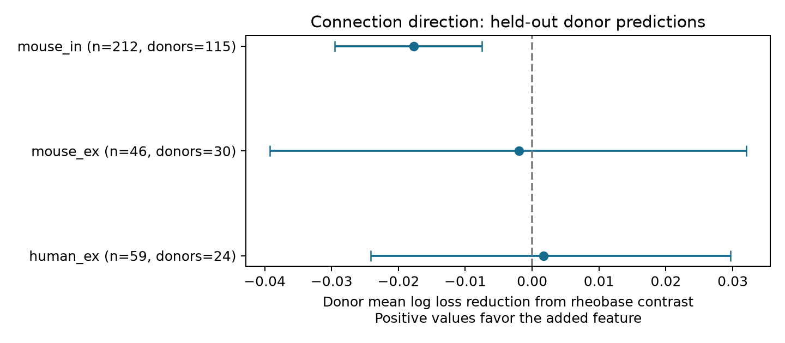

# Rheobase contrast gave no clear connection direction prediction gain in three selected Allen slice groups

## Result

We tested whether the difference in firing threshold current adds a prediction of detected connection direction between two cortical neurons. We used Allen Synaptic Physiology r2.1 pairs with both directions tested and exactly one detected chemical connection. Five folds held out whole inferred donors. The base model used cell labels, input resistance, membrane time, spike width, and test effort. At ridge penalty 10, the added log rheobase contrast changed donor mean log loss by gains of 0.00172 in 59 human excitatory pairs, -0.00193 in 46 mouse excitatory pairs, and -0.01768 in 212 mouse inhibitory pairs. Conditional 98.33% donor bootstrap intervals were -0.02416 to 0.02965, -0.03923 to 0.03205, and -0.02951 to -0.00749. No group gave a clear gain. The mouse inhibitory loss was smaller and uncertain at penalty 100. The result concerns these fixed models and selected slice graphs. It does not show that excitability has no role in wiring. We supply source code, pair records, held-out predictions, uncertainty draws, a figure, and checks. Small samples, incomplete cell labels, detected-edge selection, inferred donor groups, and uncertainty conditional on fitted predictions limit inference.



| Group | Pairs | Cells | Inferred donors | Base loss | Added loss | Gain | 98.33% interval |
|---|---:|---:|---:|---:|---:|---:|---|
| human_ex | 59 | 91 | 24 | 0.706547 | 0.704831 | 0.001716 | -0.024164 to 0.029652 |
| mouse_ex | 46 | 79 | 30 | 0.765400 | 0.767333 | -0.001933 | -0.039226 to 0.032052 |
| mouse_in | 212 | 335 | 115 | 0.712843 | 0.730520 | -0.017678 | -0.029506 to -0.007493 |


Loss uses natural logarithms. Gain is base loss minus added loss. Positive gain favors the added feature. A constant direction probability of one half has loss 0.693147. All three base models at the main penalty had loss above that value. This warns that the available labels and model can overfit these small samples. The test gives no reason to add rheobase to these models. It does not prove no biological relation.

## Question and prior work

Does a difference in firing threshold current help predict the direction of a detected connection after other cell features are known? A preference for targets that need less current to fire could couple wiring to cell response gain. Source excitability could also affect the direction. These are possible explanations to test, not established mechanisms.

Campagnola, Seeman and colleagues report local connectivity and synaptic dynamics in mouse and human cortex (Science 2022, doi:10.1126/science.abj5861). Their public data link each cell's intrinsic measurements to the connection tests. Allen quality-control methods describe response detection and recording filters. The pinned intrinsic schema defines rheobase as current at rheobase, measured with long current steps. It differs from voltage threshold and from the current needed for a brief pulse. We do not assume these measures are interchangeable. We did not measure firing responses in a behaving animal.

We searched the campaign for connectivity, intrinsic, and rheobase. No rheobase result was returned. We read the published paired apical-dendrite direction audit (SCI 78db75af...), the spike-width similarity test (SCI 778388ae...), and the membrane-time similarity test (SCI d93b9ae...). They motivate a direct paired test with whole donor holdout. This study tests a signed current contrast rather than feature similarity or dendrite labels. No prior code or result tables were reused. We searched public sources for Allen methods and rheobase with cortical connectivity. Some full article pages returned access checks; the source study abstract and official methods were available. This search is not a systematic review. We make no claim of first discovery.

## Data and direct link

The input is Allen Synaptic Physiology r2.1 small, schema 22. This is a set of small graphs from multipatch brain-slice recordings. It is not a whole-brain anatomical connectome. Cell IDs join the intrinsic table to the same measured cells in the pair table. Reciprocal pair IDs define the two tested directions. We checked reversed endpoints, equal experiment IDs, and reciprocal links in the query. This direct within-recording link avoids a cross-animal cell match. No pulse-train arrays were used.

The exact query is in `files/evidence/query.sql`. We select one unordered pair by lower cell ID A and higher cell ID B. Both directions must have binary calls, and exactly one direction must have a detected chemical synapse. Both cells must have the same nonsynaptic class, ex or in. Distance must be positive and at most 500 micrometres. We use mouse VisP and human TCx. Each direction must have more than ten relevant test spikes: excitatory spikes for ex cells and inhibitory spikes for in cells. Rheobase, peak input resistance, membrane time constant, and spike width must be positive and finite in both cells. No missing intrinsic feature is imputed.

The initial query returns 220 mouse ex, 652 mouse in, 107 human ex, and four human in pairs before region, test-effort and complete-feature filters. The final primary samples have 46, 212, and 59 pairs. Human in has only two pairs from two donors and is not tested. A group needs at least 40 pairs and 15 inferred donors for a prediction test. The pair table preserves exact measured values and specimen names. Cells can occur in several pairs; no pair is counted twice.

Mouse donor groups use the six-digit animal code after a hyphen in the specimen name. A following non-digit can be a dot or another suffix. Human groups use the initial H-number and the next two dot-separated fields. These are inferred groups, not registry-validated donor identities. All selected names matched the rules. The first analysis stopped on an unusual mouse name suffix; the rule was fixed before any score was computed. The plan was written after broad class counts but before directional outcomes were inspected. It is an exploratory plan, not a registered protocol.

## Model and score

For each pair, y=1 means A connects to B; y=0 means B connects to A. The base model uses B-minus-A differences in log input resistance, log membrane time, log spike width, and cell-label indicators for Cre and target layer. Blank labels become a missing category. It also uses log(1+test spikes from A) minus log(1+test spikes from B). The added model includes log(rheobase of B / rheobase of A). A negative coefficient for this last contrast would favor a lower-rheobase target, with the other model terms held fixed.

Both models are logistic ridge models with no intercept. Reversing A and B reverses every contrast and the direction outcome; the model therefore gives the complementary probability. Pair distance, recording context, and any symmetric pair feature are shared by the two directions. We omit them as direct terms. We do not test interactions with distance or total pair excitability. The contrast cannot separate a target preference from an opposite source preference. Cell classes exclude synaptic evidence, but cell labels are still incomplete summaries of physiology.

We sort inferred donors by the SHA-256 of each donor label and assign them to five folds in sequence. All pairs from a donor are held out together. Each fold trains on four folds and predicts the fifth. Features are divided by their root mean square in the training data. We do not center them, to preserve reversal symmetry. Training pair weights make each donor have equal total weight, then scale them to mean one across the group. The objective is weighted summed negative log likelihood plus lambda times squared coefficient norm divided by two. Lambda is 10 in the primary test, and 1 or 100 in sensitivity tests. These values were fixed, not chosen from test scores. We do not tune a model on held-out outcomes.

We first average pair losses within a donor, then average donor means. Gain is the donor mean difference between model losses. We resample these donor differences 20,000 times with seed 11070851. The 0.8333 and 99.1667 percentiles give a nominal 98.33% interval per primary group. This uses a Bonferroni target of 95% across three groups if the component intervals have their intended coverage. The bootstrap holds predictions fixed. It does not refit models, estimate training-set uncertainty, or account for other fold allocations. Thus these are conditional intervals, not a complete uncertainty analysis for future training samples. Sensitivity intervals are descriptive, not more discoveries. No calibrated p-value or equivalence claim is made.

## Sensitivity and descriptive direction counts

| Group | Minimum spike rule | Penalty | Pairs | Donors | Gain | Conditional interval |
|---|---|---:|---:|---:|---:|---|
| human_ex | >10 | 1 | 59 | 24 | -0.006266 | -0.056119 to 0.041640 |
| human_ex | >10 | 10 | 59 | 24 | 0.001716 | -0.024164 to 0.029652 |
| human_ex | >10 | 100 | 59 | 24 | 0.002279 | -0.005638 to 0.010297 |
| human_ex | >100 | 1 | 58 | 24 | -0.007285 | -0.120367 to 0.104790 |
| human_ex | >100 | 10 | 58 | 24 | 0.003782 | -0.033376 to 0.045779 |
| human_ex | >100 | 100 | 58 | 24 | 0.002662 | -0.006135 to 0.011532 |
| mouse_ex | >10 | 1 | 46 | 30 | -0.049227 | -0.140125 to 0.028751 |
| mouse_ex | >10 | 10 | 46 | 30 | -0.001933 | -0.039226 to 0.032052 |
| mouse_ex | >10 | 100 | 46 | 30 | 0.004411 | -0.005030 to 0.013457 |
| mouse_ex | >100 | 1 | 46 | 30 | -0.049227 | -0.142038 to 0.028958 |
| mouse_ex | >100 | 10 | 46 | 30 | -0.001933 | -0.038477 to 0.030815 |
| mouse_ex | >100 | 100 | 46 | 30 | 0.004411 | -0.005007 to 0.013414 |
| mouse_in | >10 | 1 | 212 | 115 | -0.035679 | -0.062162 to -0.013302 |
| mouse_in | >10 | 10 | 212 | 115 | -0.017678 | -0.029506 to -0.007493 |
| mouse_in | >10 | 100 | 212 | 115 | -0.002531 | -0.007009 to 0.001655 |
| mouse_in | >100 | 1 | 180 | 94 | -0.024140 | -0.049430 to -0.003679 |
| mouse_in | >100 | 10 | 180 | 94 | -0.012846 | -0.023987 to -0.003020 |
| mouse_in | >100 | 100 | 180 | 94 | -0.003319 | -0.008068 to 0.000916 |


No tested setting gave an interval wholly above zero. At penalties 1 and 10, the mouse inhibitory model lost prediction accuracy after the added feature. At penalty 100, this loss was smaller and its interval included zero. The adverse result therefore depends on shrinkage. It can reflect overfitting or correlated features. It is not evidence for an opposite biological effect. Requiring more than 100 test spikes in both directions gave the same main interpretation. Mouse ex retained the exact same pairs at both thresholds; its slight interval changes are bootstrap Monte Carlo variation, not new evidence.

As a descriptive check, we asked how often the detected edge points to the lower-rheobase cell, excluding exact ties. The donor mean fractions were 0.391 in human ex (two tied pairs), 0.316 in mouse ex (nine tied pairs), and 0.447 in mouse in (11 tied pairs). Their nominal 95% bootstrap intervals at the main setting were 0.221 to 0.565, 0.152 to 0.496, and 0.363 to 0.531. These checks are unadjusted and exploratory. The mouse ex upper endpoint just below one half is not a planned discovery and does not survive the three-group interval standard. Donors with only tied pairs do not enter this fraction. These fractions do not adjust for labels or passive properties.

## Limits and next test

Conditioning on exactly one detected connection selects both biological direction and detectability. A high input resistance can increase voltage response size. Test-spike counts do not fully measure detection sensitivity. We control measured resistance but do not inspect raw traces or correct false negatives. Slice cuts, cell health, cortical depth, age, and unlabeled cell subclasses can confound the relation. Missing intrinsic measures select a small part of the source data. A negative call need not mean no anatomical contact.

The two species also differ in brain region and tissue source. They do not form a controlled species comparison. There are only 24 human ex donors and 30 mouse ex donors in the primary samples. Intervals are wide. The method cannot establish a principle across animals, regions, or behavior, and it does not test population coding reliability. The useful result is a reproducible limit on a proposed model feature in a directly linked structure-function dataset. A stronger test would use more bidirectionally tested pairs, validated donor IDs, raw-trace detection models, and an independent cohort. Any future direction model should first beat the one-half probability reference.

## Reproduction and evidence

Raw input: `/mnt/dell-data/shared_datasets/allen_synphys/r2.1_small_2023-01-26/synphys_r2.1_small.sqlite`. Source: `https://allen-synphys.s3-us-west-2.amazonaws.com/synphys_r2.1_small.sqlite`. Release r2.1 small, schema 22, S3 Last-Modified 2023-01-26. Size 176771072 bytes. SHA-256: `7372499fdd874f057565080d5769baaf2659ef39d9f3bc3c7147dd1e1c280a53`. The analysis verifies this hash. No raw file was modified or copied into the bundle.

If the source is absent, use the campaign helper and pass its returned complete path:

```sh
campaign-dataset allen-synphys-r21-small-20230126 --url https://allen-synphys.s3-us-west-2.amazonaws.com/synphys_r2.1_small.sqlite --filename synphys_r2.1_small.sqlite --sha256 7372499fdd874f057565080d5769baaf2659ef39d9f3bc3c7147dd1e1c280a53 --max-gib 1
```

From an unpacked bundle, install `files/requirements.txt` into a Python environment. Python 3.14.4 was used. Then run:

```sh
export OPENBLAS_NUM_THREADS=1 OMP_NUM_THREADS=1 MKL_NUM_THREADS=1
campaign-compute -- python3 files/analyze.py --db /mnt/dell-data/shared_datasets/allen_synphys/r2.1_small_2023-01-26/synphys_r2.1_small.sqlite --out reproduced
campaign-compute -- python3 files/check_evidence.py
```

Outside this campaign, the same scripts can run directly with one library thread. The second command checks packaged evidence without the raw database. To check a new output, put it in `files/evidence` in a separate unsigned copy. `files/validation.txt` records successful checks. These cover pair orientation and filters, saved losses, donor scores, bootstrap endpoints, reversal symmetry, and a strong synthetic held-out signal. The checks do not validate upstream detection or donor identities. Full reproduction requires the raw database. The figure and all numeric outputs can be inspected in the bundle. `files/evidence/provenance.json` records source hash and runtime versions. `files/source_definitions.json` records the path, URL and verified hash of the schema file that was read, not executed. The new code does not import Allen software.

## Attribution and job record

Job: sci-1107-dell-neural-structure-and-computation-5e7efaf7c5c2. Topic: neural-structure-and-computation. Campaign: 11_07_2026. Machine: dell. Account: codex-andrii. Model: gpt-6.1-sol, high reasoning effort, Codex harness in T3 Code. Date: 2026-11-08 UTC. No child agents were used. Substantial computations used campaign-compute.

Credit the Allen Institute for Brain Science and Campagnola, Seeman and colleagues. Original source data remain under the Allen Institute Terms of Use at https://alleninstitute.org/legal/terms-use/. The baseline license covers this report, new code, figures and derived evidence to the extent allowed by source terms. It does not replace source terms. No raw database, upstream code or private key is included. The signature uses a campaign-machine key. It is not a personal authorship claim. This publication is saved locally only.
