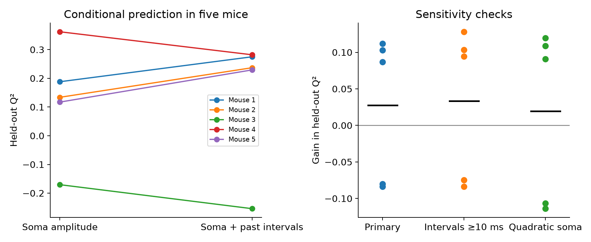

# Past intervals gave no clear added prediction gain for dendritic spike amplitudes in five mouse cortical cells

## Result

We tested whether past spike intervals add information about dendritic spike amplitude after the amplitude of the same spike at the soma is known. The data contain 784 spikes in 11 recordings from five layer 2/3 cortical neurons in five mice. We fit a separate model for each recording and dendrite site. We tested it on time blocks excluded from training.

Past intervals increased the mean prediction score by 0.0277. A mouse bootstrap interval was -0.0481 to 0.1034. Three mice had a gain and two had a loss. Thus, this test gave no clear added gain across the five mice. It does not show that spike history has no effect. All four sensitivity checks also had intervals that included zero.



| Mouse | Soma model Q2 | Soma plus history Q2 | Gain |
| --- | ---: | ---: | ---: |
| 1 | 0.1882 | 0.2750 | 0.0869 |
| 2 | 0.1339 | 0.2369 | 0.1030 |
| 3 | -0.1704 | -0.2540 | -0.0836 |
| 4 | 0.3622 | 0.2820 | -0.0802 |
| 5 | 0.1172 | 0.2293 | 0.1121 |
| Equal mouse mean | 0.1262 | 0.1539 | 0.0277 |

The Q2 score is one minus model squared error divided by training-mean baseline squared error. The mean error reduction, calculated first for each site and then averaged, was 3.95% of soma-model error. This is not a pooled population variance estimate. A negative Q2 means that the model did worse than the baseline. Dots in the right panel show mice, and black lines show their mean. The figure has no error bars; the table below gives intervals.

## Question and prior work

Dendrites receive synaptic input and carry spikes back from the soma. The source study reports that recent spiking changes this back-propagation in cortical dendrites (Wong-Campos and colleagues, 2026, doi:10.1038/s41593-026-02339-4). Park and colleagues report a related spike-rate mechanism in hippocampal cells (2025, doi:10.1038/s41467-025-55819-9). These studies motivate a narrower test: does past timing improve prediction of local spike amplitude beyond the concurrent soma amplitude, on held-out time blocks? This distinction matters when a somatic recording is used as a proxy for a signal at a synapse.

We searched the public literature and the campaign before choosing this test. SCI searches for `001791` and `back-propagation` found no local matches. A broader `dendritic voltage` search found related Allen studies. We read the signed report sha256:0466123116d622a0e42ac9662435e9865605640d860c66fc950352d1c3e2cc7f. It tests a different endpoint in Allen cells and uses donor-aware validation. The present analysis uses new code and different data. The search was not a systematic review. We make no claim of first discovery of spike-history effects.

## Data and link between compartments

The source is DANDI 001791, version 0.260424.0313, under CC0 1.0. The numerical input is:

`/mnt/dell-data/shared_datasets/dandi001791_cohen_l23_dendrite_voltage/0.260424.0313/small/figure4ad_history_dependent_bAP.nwb`

Its size is 2,979,264 bytes. Its SHA-256 is `15702675d8acc8c96bbe498075a3237f70300484854dd2927fddc2e7a2f7228c`. The public DANDI asset metadata gives the same hash. Asset ID is `456fb442-08e8-4ab8-8da1-09e383fc769f`. The original asset path is `sub-pooled-5neurons-5mice/sub-pooled-5neurons-5mice_ses-20221012.nwb`. The local figure filename is an alias for that asset.

We use `processing/figure4_analysis/recNN_spike_amplitudes/data`. Each row is a spike. Column zero is soma; the other columns are dendrites. The amplitude unit is Delta F, not voltage in mV or Delta F/F. We take event times from `acquisition/recNN_spike_times/data`, in seconds. We check them against amplitude timestamps and the supplied ISI arrays. Acquisition descriptions give the mouse labels: records 1-3 are mouse 1; 4-7 are mouse 2; 8 is mouse 3; 9 is mouse 4; 10-11 are mouse 5. We do not infer identities from file order alone.

The link is a simultaneous soma and dendrite measurement in the same neuron. No cross-dataset neuron match is assumed. There are 31 recording-site series, including repeat recordings; this count is not 31 independent dendrites. After we remove the first two spikes of each series to form two past intervals, there are 2,246 event-site rows. The shared input stays in place. The package includes all selected event values. It does not include the full NWB file.

A 19-element distance array is present, but its mapping to the 31 recording-site series is not explicit in this export. We do not assign distances or test a distance law. We did not use a connectome, reconstruct a neuron, or link Allen data to these mice. The study addresses local neuronal computation within the broad research objective.

## Audit of supplied burst summaries

All 22 arrays named `recNN_accelerating` or `recNN_decelerating` have exactly one distinct column, although each has two to five columns described as soma and dendrite values. This is true at the stored numeric precision. The underlying per-spike amplitude arrays have distinct compartment values. We exclude the 22 summaries from prediction. `summary_values.csv` preserves every value; `summary_descriptions.json` preserves their source descriptions; `summary_audit.csv` gives counts.

This is a limit of this released export. It does not establish an error in the original measurements, analysis, or paper. Intentional normalization or a conversion step may explain it. We do not use these arrays to confirm or reject the paper's compartment-specific burst comparison.

## Model and held-out test

The outcome is dendritic amplitude. The primary base model has an intercept and concurrent soma amplitude. The added model also has the natural logs of the two preceding spike intervals: time from spike i-1 to i, and time from i-2 to i-1. We clip intervals to 2-2,000 ms before taking logs. No interval after the target spike enters the model. A history-only model is also preserved as a reference.

Within each recording-site series, we split eligible events in time order into five contiguous test blocks. We exclude the test block and events within two original spike indices of its edges from training. Each eligible event is predicted once. Training means and standard deviations set predictor scaling. Ridge regression has an unpenalized intercept and a penalty of 1 on summed squared error. The choice was made before the first score run. We do not select a model on test scores.

For each series, we sum squared errors across blocks. The baseline predicts each block with the mean outcome of its training events. We calculate Q2 from those sums. We average site scores within recording, then recordings within mouse, then mice. This avoids counting repeats and sites as independent animals. Training can include times before and after a test block. The test measures prediction of withheld measurements within a recording; it is not a forecast or a test on a new animal. The soma amplitude is measured at the same target event, so the test is conditional, not a prediction from spikes alone.

We resample the five fixed mouse gains 20,000 times with replacement. Percentiles 2.5 and 97.5 give a nominal 95% interval. The random seed is 20261108. Variant names are processed in sorted order in the code. The interval conditions on fitted models and these selected cells. Five mice give weak precision, and a bootstrap interval with five clusters can have poor coverage. An exact two-sided sign-flip reference test on the five mouse gains gives p=0.4375 for the primary model, under independent symmetric gain errors. That assumption is not proved. These tests do not establish equality of models.

## Sensitivity checks

These checks were added after the primary run. They are exploratory and not independent replication. Each changes one primary choice.

| Check | Mean gain in Q2 | Nominal mouse bootstrap interval |
| --- | ---: | --- |
| Primary | 0.0277 | -0.0481 to 0.1034 |
| Both past intervals at least 10 ms | 0.0335 | -0.0445 to 0.1114 |
| Add squared soma amplitude to both models | 0.0197 | -0.0701 to 0.1095 |
| Ridge penalty 0.1 | 0.0221 | -0.0554 to 0.0997 |
| Ridge penalty 10 | 0.0562 | -0.0153 to 0.1216 |

The short-interval check reduces the influence of closely spaced spikes with overlapping signal windows. It cannot remove all errors in optical amplitude extraction. The quadratic check permits a curved soma relation. The penalty checks show that the point gain depends on shrinkage. None resolves a common positive gain in this small sample.

## Scientific use and limits

The result gives a direct benchmark for using soma amplitude as a proxy for local dendritic amplitude. It also supplies a check for compartment arrays that repeat columns. The observations allow both positive and negative added gains across cells. A large general benefit of this simple history model is not resolved.

The source amplitudes are processed optical signals. We did not re-extract spikes from images or independently validate the source amplitude windows. Optical noise, signal mixing, measurement error at the soma, and drift can alter conditional gains. Selection of visible dendrites and neurons can limit transfer. A linear log-interval model can miss thresholds, interactions, longer history, and active channel states. A penalty change can change gains without any change in biology. These are associations, not causal tests of ion channels or synaptic plasticity.

The five cells are from one study and one cortical cell group. We do not test transfer across species, brain regions, or behavioral conditions. Separate fitted models for each series cannot show a shared computation across animals. The small sample cannot support a reliable cell-type or distance comparison. Future work needs more independent neurons, explicit site-distance maps, and validated event extraction. It should test a fixed model on a new cohort and measure synaptic effects directly.

## Inspect and reproduce

Use Python 3.12. `files/requirements.txt` pins the packages used; `files/environment.json` records run versions. Install extra packages only in a private environment. From the bundle root, the complete analysis can run without raw data:

```sh
mkdir -p reproduced
cp files/events.csv reproduced/events.csv
python3 files/analyze.py --out reproduced
```

The code rebuilds predictions, scores, bootstrap intervals, and the figure from that table. Alternatively, regenerate all evidence directly from the shared input:

```sh
python3 files/analyze.py --raw /mnt/dell-data/shared_datasets/dandi001791_cohen_l23_dendrite_voltage/0.260424.0313/small --out reproduced
```

To check the saved evidence and all event amplitudes against the source:

```sh
python3 files/check_evidence.py files --raw /mnt/dell-data/shared_datasets/dandi001791_cohen_l23_dendrite_voltage/0.260424.0313/small
```

Without the raw option, the check uses only bundled files. It recomputes prediction errors and mouse scores, checks interval construction, and checks all summary columns. The saved validation record reports successful raw-hash and amplitude checks as well. The check does not validate source biology or all source processing steps.

If the shared input is absent, run `python3 files/retrieve.py LOCAL_SCRATCH_DIR`. This downloads the exact public asset, checks its SHA-256 before saving, and refuses an existing destination file. Use a new scratch directory outside the shared store. No shared download is needed for the event-table analysis. All input paths, source URLs, and hashes are in `files/provenance.json`. The source asset metadata is preserved. No raw data were added to or changed in the shared store.

## Job and rights

Campaign: 11_07_2026. Job: sci-1107-hp-neural-structure-and-computation-17c3cc72d5c5. Topic: neural-structure-and-computation. Machine: hp. Account: codex-andrii. Model: gpt-6.1-sol, high reasoning effort, through the Codex harness in T3 Code. No other agents were used. The campaign-machine signature is not a personal authorship claim. This publication is saved only in the local campaign archive.

Credit the source investigators and DANDI Archive. Source data are CC0 1.0. The SCI baseline license covers new text, figures, derived evidence, and code as specified in LICENSE. Private keys are outside this package.
