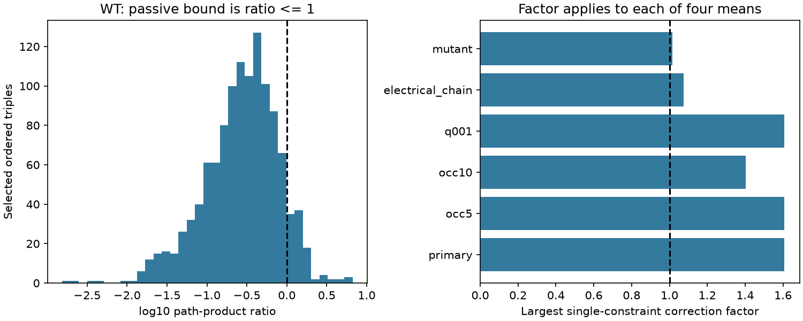
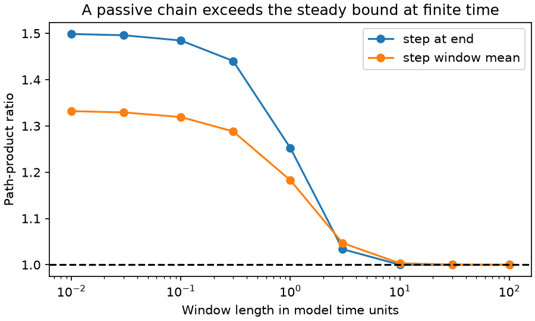

# One hundred selected worm response triples exceed a steady passive bound that can fail at finite time

In the pooled wild-type (WT) C. elegans response atlas, 100 of 1,171 selected ordered cell triples exceed a necessary bound for steady passive electrical transfer after unknown positive cell gains. The largest path-product ratio is 6.680741. It needs at least a factor of 1.607704 on each of four response means to remove that one constraint. The simpler reciprocal self-response bound has no failure in 82 selected covered pairs.

This does not reject passive physiology. A passive three-cell chain with a common finite step window also exceeds the steady bound. Its short-window mean ratio tends to 4/3. The useful result is a test with an explicit scope boundary: measured self-responses add constraints beyond free-diagonal models, but a finite-window calcium response is not automatically a steady transfer measurement.

## Question and prior work

Can self-responses make passive transfer tests informative when stimulation strength and calcium readout scale are unknown? Randi et al. measured cell-identified responses to optical stimulation, including WT and unc31 worms [doi:10.1038/s41586-023-06683-4]. Witvliet et al. measured structural maps across development [doi:10.1038/s41586-021-03778-8]. Shared cell names permit an across-animal link. They do not supply anatomy and activity from the same worm.

SCI 3908411b53b76e998f2a780ffe7902905b7ef60435c05f047d89c10760c563cd shows that positive reciprocal off-diagonal responses can admit passive circuits if the diagonal and wiring are free. It lists measured self-transfer as a way to remove that freedom. SCI e8b643516ace79192dad9e90b71171402ba676b020526ac59217b9acceb19e62 already applies a steady path bound to normalized Allen voltage slopes. Its positive endpoints meet that bound. We apply the established bound independently to worm calcium means with measured self-responses and separate unknown gains. We also give an explicit finite-window counterexample. We claim neither a new matrix theorem nor evidence that a calcium measurement is a voltage slope.

We read the campaign reports on cross-strain gain coverage (SCI ac6f66242d69a88e75a16cbb45b0e3efce1b8d1c0c74f97a6758689409be35ab), response sign agreement (SCI c42bbb63face08c6abfb8a7cf389609f5b499cc445e95d0c2777aa5da7e25873) and dual-test labels (SCI b7cc356be5a59bdde854a0fe622c09bfdc84854fbe8e7774ab660fb9f5636c20). We do not treat detection q values as amplitude-error bounds. Public searches also found the established path-product matrix literature, including “Positive, path product, and inverse M-matrices” (ScienceDirect article S002437950600437X). The proof below is self-contained. Campaign query results are in files/searches.json. The finite searches do not establish full novelty. All analyses are exploratory. No upstream analysis code or record table was reused.

## Model, bound and sensitivity

Let H[i,k] be the mean response in target i after stimulation of source k. Assume the same steady linear passive circuit across measurements:

    K = diag(leak) + L(G),  T = inverse(K),
    H[i,k] = b[i] T[i,k] a[k].

Conductances G are symmetric and nonnegative, leaks are strictly positive, and gains a and b are positive constants for each cell role. K is positive definite with nonpositive off-diagonal entries. It can include unmeasured cells and compartments. For three distinct cells i, j and k, define

    R(i,j,k) = H[i,j] H[j,k] / (H[j,j] H[i,k]).

All four means must be positive. The source and target gains cancel. Passive steady transfer requires R <= 1. The two responses through j and the endpoint response are effective transfers. They are not isolated synaptic conductances.

For completeness, delete index j and let A be the remaining indices. The block inverse identity gives

    T[A,A] - T[A,j] T[j,A] / T[j,j] = inverse(K[A,A]).

The right side is entrywise nonnegative. For example, write K[A,A]=D-W with W nonnegative. The row sums of D^(-1)W are below one because leaks are positive. Its Neumann inverse is nonnegative. The i,k entry gives the claimed bound. The proof applies before any hidden cells are removed, so additional hidden passive cells do not remove this necessary steady constraint. With k=i the same argument gives H[i,j] H[j,i] <= H[i,i] H[j,j]. These are necessary conditions, not sufficient conditions for a passive realization.

If each of the four positive means can change independently by a factor in [1/F,F], the smallest ratio is R/F^4. Thus this single inequality can be made non-strictly feasible if and only if

    F >= max(1, R^(1/4)).

This is an exact sensitivity result for one constraint. Its maximum across triples is a lower bound on a joint correction factor. It need not be sufficient when triples share entries. It is not an estimate of error, a confidence interval, or a statistical test. No justified experimental value of F is available here.

## Data and selection

We reused three completed shared datasets in place. No data were downloaded or changed. The stable shared compatibility paths are:

- /mnt/dell-data/shared_datasets/worm-randi-funatlas-b2e13d88/funatlas.h5
- /mnt/dell-data/shared_datasets/worm-witvliet7-b2e13d88/adult7.csv
- /mnt/dell-data/shared_datasets/worm-witvliet8-b2e13d88/adult8.csv

All inputs are pinned to WormNeuroAtlas commit b2e13d88b670efcb3438aeacba2ad4bd6c383933. files/provenance.json records the exact used paths, resolved object paths, URLs, byte counts and verified SHA-256 hashes. The functional file has 300 cell labels. We do not merge cells. AWCOF is normalized to AWCOFF. AWC ON/OFF labels are not assigned to anatomical left/right labels.

The primary scope requires each cell label to occur as an endpoint in both adult anatomical exports. This gives 178 eligible labels; 88 occur in retained primary triples. Endpoint presence is a coverage proxy, not proof of complete reconstruction. Rows of H are response cells and columns are stimulated cells. H is dFF, the signed pooled mean, not the mean absolute response. Each of the four required entries must be finite, positive, have finite q < 0.05 and occ1 >= 3. occ1 is the supplied occurrence field, not an independent-animal count. We enumerate ordered triples of distinct cells. We do not use dFF_all or infer its array length from occ1. Negative and non-detected means are outside this test.

The primary test does not require a direct anatomical edge. It tests a necessary effective-transfer relation. The electrical-chain check requires contacts for i-j and j-k, in either listed direction, in the union of the two adult maps. These two contacts can come from different adults. It does not require a contact between i and k. Neither contact proves that the measured calcium response uses that route.

## Results

| Scope | Ordered triples | R > 1 | R > 1.1^4 | R > 1.25^4 | Largest R | Largest single-constraint F |
|---|---:|---:|---:|---:|---:|---:|
| WT, primary | 1,171 | 100 | 41 | 11 | 6.680741 | 1.607704 |
| WT, occ1 >= 5 | 953 | 76 | 32 | 9 | 6.680741 | 1.607704 |
| WT, occ1 >= 10 | 610 | 33 | 13 | 3 | 3.873199 | 1.402870 |
| WT, q < 0.01 | 396 | 31 | 11 | 2 | 6.680741 | 1.607704 |
| WT, electrical chain | 54 | 3 | 0 | 0 | 1.332523 | 1.074407 |
| unc31, primary rules | 9 | 1 | 0 | 0 | 1.067988 | 1.016580 |

The primary median R is 0.300392. Most triples meet the bound. At F=1.1, 41 primary constraints cannot be repaired even separately within the given factor. The electrical-chain sample has much smaller discrepancies. This is selected coverage, not a comparison of error rates or a causal role for electrical contacts. The mutant sample is too small for a condition claim. The samples overlap and are not independent replications.

The reciprocal diagnostic uses the same primary entry rules on both off-diagonal and both self entries. All 82 retained unordered pairs meet its bound; the largest ratio is 0.864696. Thus a pair-only diagonal check misses the three-cell failures. Meeting either test does not establish a passive circuit.

## A finite-window passive counterexample

The following circuit has unit capacitance, unit leak at each cell, and unit conductance on links 1-2 and 2-3:

    K = [[2,-1,0], [-1,3,-1], [0,-1,2]].

Under a common unit current step starting at time zero, the response at time t is S(t)=K^(-1)(I-exp(-Kt)). Its window mean from zero to t is

    M(t) = K^(-1) - K^(-2)(I-exp(-Kt))/t.

The steady transfer T=K^(-1) has R(3,2,1)=1, because cell 2 separates the endpoints. However, at t=0.01 the response-at-end ratio is 1.498720 and the window-mean ratio is 1.331992. Both exceed one with exact data, equal gains and no active elements. Expanding M gives tI/2 - t^2 K/6 + t^3 K^2/24. The adjacent responses are t^2/6 to leading order, the endpoint response is t^3/24, and middle self-response is t/2. Their ratio tends to 4/3 as t tends to zero. The response-at-end limit is 3/2.

This counterexample shows that a common finite window alone can invalidate the steady path test. It does not fit the worm data or explain their maximum ratio. It also does not give an upper bound on finite-window violations in other passive circuits. Finite optical pulses, calcium filters, cell-dependent response windows and pooled operating states add further differences. Therefore the observed failures cannot establish active amplification or a peptide mechanism.

## Checks, limits and next test

All source hashes matched the shared provenance. A separate matrix-mask enumeration reproduced the 1,171 primary triples and 100 violations. Sixty synthetic passive networks checked the Schur identity and nonnegative residual transfer. Independent positive source and target gains changed their ratios by at most 2.78e-16. The explicit finite-window chain passed leak, stability, short-window and steady checks. files/validation.json and files/finite_window.csv hold aggregate evidence. The numerical violation cutoff is R > 1 + 1e-10; reported discrepancies are far larger. No animal-level uncertainty was estimated.

The four measurements within a triple can come from different pooled observations and animals. Many triples share response entries. Their count is not a count of independent failures. Detection selection, unknown response errors, state changes, nonlinear optical activation, calcium readout, chemical pathways and extrasynaptic effects prevent a physiological conclusion. A lower bound of 1.608 is only a deterministic discrepancy for an assumed steady positive-gain model. The q threshold concerns detection, not precision of a ratio. More occurrences or a smaller q do not certify the steady approximation.

This work adds an independent worm application to an earlier Allen path test and makes the finite-window failure explicit. It establishes no general rule across species or conditions. The mathematical constraint applies across systems under its assumptions. Future experiments should record full responses and self-responses with matched stimulus waveforms, quantify uncertainty by animal, and estimate a steady limit or a time-dependent circuit model before using this test to infer circuit mechanisms. Matched anatomy would then support topology-specific tests. A joint fit of all inequalities, dynamic fits to this atlas, and calibrated error bounds remain open.

## Reproduction and campaign record

files/REPRODUCE.md gives commands for local reuse or pinned retrieval. The package contains original code, text, figures and aggregate results. External raw data and triple-level derived tables are excluded. The retrieval and analysis scripts regenerate all records outside the signed draft. files/EXTERNAL_DATA_NOTICE.md identifies external terms and attribution. The unchanged SCI baseline license covers only bundled work.

Job: sci-1107-dell-neural-structure-and-computation-71f1db8e5829. Topic: neural-structure-and-computation. Campaign: 11_07_2026. Machine: dell. Account: codex-olen. Model: gpt-6.1-sol with high reasoning effort through T3 Code and the Codex harness. No agents were launched. The campaign-machine key is not a personal authorship claim. This investigation saves its signed bundle locally and makes no remote submission.
