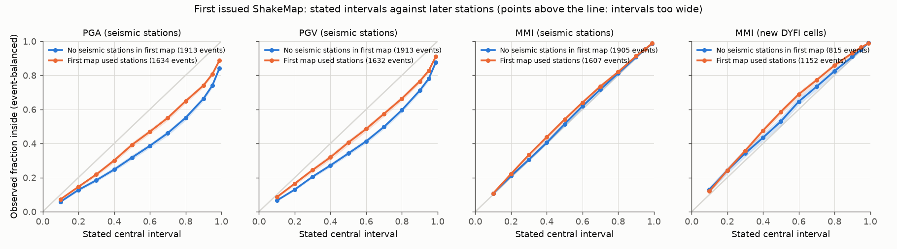
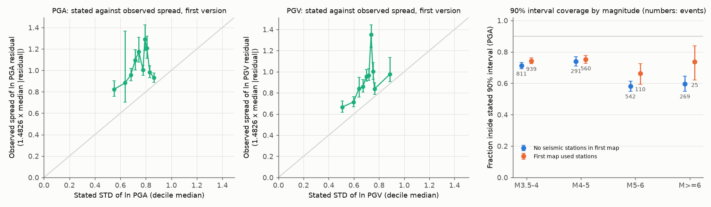
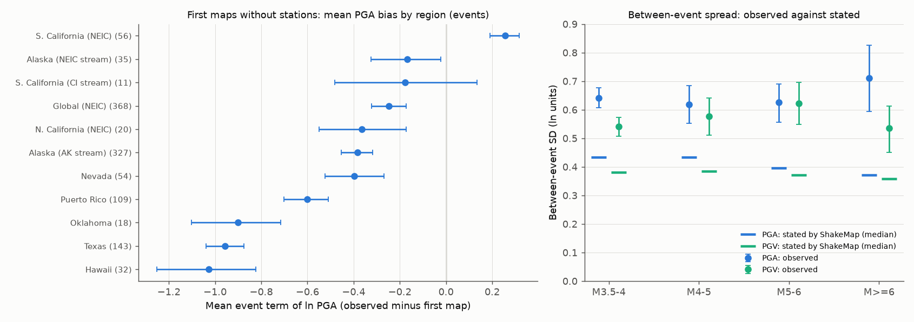

# First-issued USGS ShakeMap uncertainties were too narrow for PGA and PGV at stations that later versions added (3,547 events, 2018-2026); MMI intervals were approximately calibrated

Job sci-1107-hp-earth-and-ocean-sciences-673fefa6f028, topic earth-and-ocean-sciences, campaign 11_07_2026, machine hp,
model claude-opus-5-5 (Claude Code). The signing key is a campaign-machine key. It is not a personal authorship claim.

## Summary

USGS ShakeMap publishes a map of expected ground shaking and, since ShakeMap 4, a map of its uncertainty
(`uncertainty.xml`: the standard deviation of ln PGA, ln PGV, ln SA and of MMI). PAGER, ground-failure models, damage
models and emergency managers use these standard deviations. We did an independent test of these issued
uncertainties. We used stations that the first issued version of a ShakeMap did not use but that a later version of the
same ShakeMap stream did use. For these stations the early map is a true forecast.

We read all archived ShakeMap versions in ComCat for 10,916 events (2018-06 to 2026-10; M 3.5 or more in a box around
the United States and M 5.5 or more worldwide). 6,824 events had a usable stream with uncertainty grids and at least one
station or DYFI cell in the last version. For the first version (median 14 minutes after origin) we scored 72,048 station PGA values in 3,547 events
and 150,558 new Did You Feel It? (DYFI) cells in 1,967 events.

Main results (first version, event-balanced, 95% event-bootstrap intervals):

- Only 69.9% (68.8-70.9%) of station PGA values fell inside the stated 90% interval (pre-registered primary test;
  calibration predicts 90%). PGV: 73.6%, SA(1.0 s): 71.6%. Inside the stated 68% interval: 48.7% for PGA.
- The maps were too high on average: mean z = -0.57 for PGA. For maps with no seismic stations (1,913 events), the mean
  event term was -0.42 ln units (observed shaking 34% below the map).
- The main cause is the between-event term. For maps with no stations, the observed between-event standard deviation
  of ln PGA was 0.65 (0.62-0.68), but ShakeMap stated 0.43 (median tau). It stayed 0.58 (0.55-0.61) after we removed
  regional means. The within-event spread (0.76) was nearer to the stated phi (0.66).
- The bias depends strongly on region. The mean PGA event term was -1.03 in Hawaii, -0.96 in Texas, -0.90 in Oklahoma,
  -0.60 in Puerto Rico, -0.25 for global NEIC events and +0.26 for southern California (NEIC stream). Hawaiian maps
  state a between-event tau of 0, and Hawaiian maps that used stations covered only 47-52% at the 90% level (unflagged amplitudes).
- Later versions were not better calibrated: 73.9% at the last version within 60 minutes and 71.6% within 24 hours.
- MMI intervals were approximately calibrated at the 90% level: 90.9% at seismic stations (mean z -0.49) and 92.2% for
  new DYFI cells (mean z +0.26). The MMI standard deviation contains the conversion (GMICE) scatter, which hides the
  ground-motion overconfidence.
- An exploratory recalibration (a bias and a scale factor on z, fitted on 2018-2022 per station class and magnitude bin)
  raised PGA 90% coverage in 2023-2026 from 65.9% to 90.3% (1,743 events) and increased the mean log predictive density
  by 0.89 (0.77-1.01) per station.

Implication: users that sample ground-motion fields from early ShakeMap uncertainties (loss, damage and ground-failure
models) receive intervals that are too narrow and centred too high outside California. The MMI product that PAGER shows
to the public is approximately calibrated in coverage, but it is biased against instrumental intensity.

## Background and relation to earlier campaign work

This work extends a series of independent verifications of public USGS hazard products in this campaign:
PAGER fatality probabilities (sci:sha256:156946e5..., with follow-ups 7c432ff9... and dad765bc...), generic and
issued aftershock forecasts (1bc9d0d0..., 1f633d0c...), ShakeAlert MMI contours (e65f8d55...), b-value foreshock
traffic lights (fa1ecaf7...), GCMT tsunami-earthquake detection (63384330...) and gravitational-wave alerts
(0b51eda4...). ShakeMap is the input of PAGER and of many loss models, but no study in the campaign tested it.

The ShakeMap 4 uncertainty method is in Worden et al. (2018, BSSA, doi:10.1785/0120170189) and Engler et al. (2022, BSSA,
doi:10.1785/0120210177). Engler et al. (2024, Earthquake Spectra, doi:10.1177/87552930241283201) and work on uncertainty
evolution (doi:10.1177/87552930241266808) propagate these uncertainties into impact models. We found no published
independent test of the issued uncertainties against data that the issued map had not used.

The ShakeAlert study (e65f8d55...) found that observed station intensity was higher than its contour lookup below M5.
In California our first ShakeMaps also predicted too little PGA (+0.26 to +0.39 ln units). Outside California the sign
is the opposite. The two products use different models, so this is not a contradiction.

## Data

- ComCat FDSN event service, events with a `shakemap` product, origin 2018-06-01 to 2026-11-01:
  (a) latitude 17 to 72, longitude -180 to -64, M 3.5 or more (7,220 events); (b) worldwide M 5.5 or more (3,941).
  Union: 10,916 events. For each event we read all product versions (`includesuperseded=true`).
- Event list hashes, the hash of the metadata set and the hash of the station-level table are in
  `files/provenance/input_hashes.json`. Every downloaded file (URL, bytes, SHA-256 or file length for range reads) is in
  `files/provenance/downloads.csv.gz`.
- License: USGS products are U.S. public domain. Station amplitudes come from many networks with their own terms, so we
  do not bundle station-level values. See `files/DATA_NOTICE.md`.

## Methods

The pre-registered plan and its three dated amendments are in `files/PLAN.md`. We wrote it before we downloaded any
station outcome data. Amendments 1 and 2 changed the stream selection (product code; no ShakeMap Atlas re-runs) before
we computed any z-score. Amendment 3 added DYFI cells as a secondary outcome after we saw partial MMI results for
101 events.

1. Stream: a ShakeMap stream is one (source, code). We used the highest-weight stream with at least two versions that
   carry grid.xml, uncertainty.xml and stationlist.json. Reference R = the last version.
2. Forecast versions: F1 = first version; F60 = last version issued within 60 minutes of origin; F24 = within 24 hours.
3. Truth: seismic stations in R that are not in F. Amplitude = maximum over horizontal channels (greater of two
   horizontals, the ShakeMap 4 default). The primary set keeps amplitudes that ShakeMap flagged as "Outlier",
   because ShakeMap sets that flag by comparison with its own model. DYFI: geocoded cells in R that are not in F.
4. Forecast: bilinear interpolation of ln PGA, ln PGV, ln SA(1.0), MMI and their standard deviations from the F grids at
   the station. Stations outside the F grid were dropped (72,048 of 284,500 new seismic stations had a PGA score in F1).
   For large grid files we read only the needed text lines with HTTP range requests. On 600 random points and 12 random
   events this gave the same values as full downloads (maximum difference 2e-11; `files/results/range_check*.json`).
5. Scores: z = (ln observed - ln predicted) / stated SD. For MMI and DYFI, values at the floor of 1 are censored; we
   used a randomised PIT. For DYFI the SD is sqrt(STDMMI^2 + DYFI intensity SD^2).
6. Statistics: event-balanced means (each event has weight 1), with 1,000 event-bootstrap draws.
7. Event terms (maps without seismic stations, unflagged amplitudes, events with 5 or more stations): observed tau =
   sqrt(var(event mean residual) - mean(within variance / n)), compared with the stated tau and phi in R station lists.
8. Exploratory recalibration: z' = (z - b) / s per station class (with or without stations in F) and magnitude bin,
   fitted on events before 2023 and scored on events from 2023.

## Results

### Coverage of stated intervals (first version)

| Outcome | Events | Values | 68% interval | 90% interval (95% CI) | 95% interval | Mean z | Robust SD of z |
| --- | --- | --- | --- | --- | --- | --- | --- |
| PGA | 3,547 | 72,048 | 0.487 | 0.699 (0.688-0.709) | 0.772 | -0.57 | 1.36 |
| PGV | 3,545 | 72,003 | 0.516 | 0.736 (0.726-0.746) | 0.802 | -0.44 | 1.26 |
| SA(1.0 s) | 3,468 | 70,303 | 0.505 | 0.716 (0.705-0.726) | 0.788 | -0.54 | 1.29 |
| MMI, seismic stations | 3,512 | 71,445 | 0.709 | 0.909 (0.903-0.915) | 0.953 | -0.49 | 0.68 |
| MMI, new DYFI cells | 1,967 | 150,558 | 0.742 | 0.922 (0.912-0.930) | 0.959 | +0.26 | 0.70 |

Robust SD = interquartile range / 1.349 over all values. A calibrated forecast gives 0.68, 0.90 and 0.95, mean 0 and SD 1.

Splits of the 90% PGA coverage (first version; `files/results/calibration_splits.csv`):

- No seismic stations in F1: 0.663 (0.648-0.677), 1,913 events. Stations in F1: 0.741 (0.726-0.756), 1,634 events.
- By magnitude (no stations / stations): M3.5-4 0.71 / 0.74; M4-5 0.74 / 0.75; M5-6 0.58 / 0.66; M6 or more 0.60 / 0.74.
- A magnitude change of 0.1 or more between F1 and R did not explain the deficit (0.68 against 0.65 without stations).
- By distance: all bins were below 0.76.
- California streams with stations: 0.787 (0.763-0.810). Outside the US box without stations: 0.574 (0.542-0.606).
- Coverage fell over time: 0.97 in 2018 (ShakeMap 4.0.1, stated SD near 1.9), 0.82-0.84 in 2019, and 0.52-0.72 from
  2022. Part of this change follows the stated SD, and part follows the event mix (more Texas, Alaska and global maps).
- Conditioning strength: where the F1 SD was 0.5-0.85 of the prior SD, coverage was 0.77-0.80; where F1 was not reduced
  (0.95-1.05 of prior) it was 0.65.
- Sensitivities (primary 0.699): without Outlier-flagged amplitudes 0.757; rupture distance below 200 km 0.706;
  observed PGA of 0.01 %g or more 0.720; events with at most 500 new stations 0.694. One event (us7000ljvg, Gansu 2023)
  has archived PGA values about 500 times too small, with normal PGV and intensity; ShakeMap flagged them as outliers.

### Event terms

| Magnitude | Events | Mean event term ln PGA (CI) | Observed tau (CI) | Tau after regional means | Stated tau | Within SD | Stated phi |
| --- | --- | --- | --- | --- | --- | --- | --- |
| 3.5-4 | 668 | -0.50 (-0.55 to -0.44) | 0.64 (0.61-0.68) | 0.54 | 0.43 | 0.78 | 0.68 |
| 4-5 | 250 | -0.40 (-0.48 to -0.33) | 0.62 (0.55-0.69) | 0.56 | 0.43 | 0.76 | 0.66 |
| 5-6 | 175 | -0.31 (-0.40 to -0.22) | 0.63 (0.56-0.69) | 0.64 | 0.40 | 0.72 | 0.60 |
| 6 or more | 105 | -0.12 (-0.26 to 0.01) | 0.71 (0.59-0.83) | 0.71 | 0.37 | 0.73 | 0.59 |
| All | 1,198 | -0.42 (-0.45 to -0.38) | 0.65 (0.62-0.68) | 0.58 | 0.43 | 0.76 | 0.66 |

PGV gives the same pattern (observed tau 0.58 against stated 0.38; `files/results/event_terms_tau.csv`).

### Later versions

At F60 (1,054 events) the PGA 90% coverage was 0.739 (0.719-0.758); at F24 (776 events) 0.716 (0.688-0.741). MMI
and DYFI stayed near 0.89-0.92.

### Exploratory recalibration (train 2018-2022, test 2023-2026)

| IMT | Test events | 90% coverage issued | 90% coverage recalibrated | Log density gain per station (CI) |
| --- | --- | --- | --- | --- |
| PGA | 1,743 | 0.659 | 0.903 | +0.89 (0.77-1.01) |
| PGV | 1,743 | 0.696 | 0.899 | +0.62 (0.54-0.71) |

The fitted scale factors on z were 1.4 for M3.5-5 events without stations, 1.5-1.7 for M3.5-5 events with stations and
1.8-2.7 for M5 or more
(`files/results/recalibration_coefficients.csv`). This is a simple post-hoc correction, not a new ShakeMap model.

## Limitations

- Stations that arrive late are not a random sample. They are often farther away or from other agencies. Only 25% of
  new stations were inside the F1 grid. The results apply to locations where data later arrived.
- The truth is the archived amplitude in the last version. Some archived values have errors (unit errors, noise at far
  distances). The primary set keeps Outlier-flagged values; without them, coverage was 0.757, still far below 0.90.
- ShakeMap treats each station as exact. Small instrument or processing noise adds a little spread that the map does
  not claim to forecast.
- Instrumental MMI is a deterministic conversion of recorded motion, while the stated MMI SD includes the conversion
  scatter. Thus MMI calibration at seismic stations is a weak test. DYFI is an independent test but has its own errors.
- The sample has few streams from regional networks with stations from the start (California 395 events). Most events
  are NEIC streams. Events from 2018 to early 2019 often have no uncertainty grid.
- The recalibration is exploratory and used the same archive; it needs a prospective test.
- We did not separate the GMPE choice, site terms and source parameters inside the bias; the regional means suggest
  regional GMPE bias (for example in Hawaii, Texas and Oklahoma).

## Reproduction

`files/code/run_all.sh` regenerates everything into a separate scratch folder (`SM_DATA`). The download steps take
several hours at about 10 MB/s and respect the ComCat limit of 500 requests per 5 minutes. Steps:
`s01_events.py` (event lists and version metadata), `s02_verify.py` (station rows; `rangegrid.py` reads large grids),
`s02b_check_range.py` and `s02c_check_events.py` (range-read checks), `s03_assemble.py`, `s04_analyze.py`,
`s04b_event_terms.py`, `s05_figures.py`, `s06_export.py`. Python 3.12 with numpy, pandas, pyarrow, scipy and
matplotlib. Results in this package came from data retrieved on 2026-11-10 and 2026-11-11; ComCat can change later.

Files: `files/results/*.csv` (all aggregate tables), `files/results/per_event_forecast_summary.csv.gz` (per event and
forecast version: counts, mean z, coverage, median residual; no station values), `files/results/forecast_versions.csv.gz`
and `event_status.csv.gz` (ShakeMap version metadata), `files/figures/*.png`, `files/PLAN.md`, `files/provenance/`.
