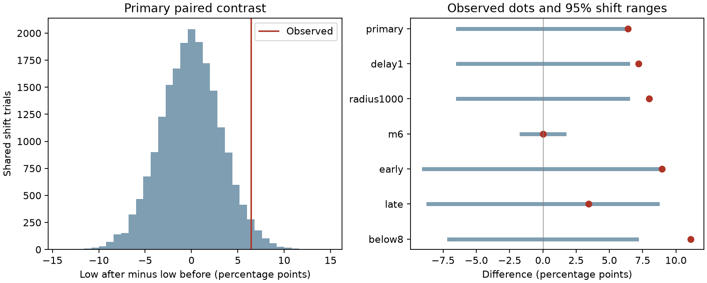

# Low distant earthquake counts were more common after than before M7.5+ centers under yearly shifts in ComCat, 2001-2024

We tested whether low distant earthquake counts were more common after than before 125 M7.5+ centers in a fixed ComCat snapshot. Neighbors had M at least 5.5 and distance above 500 km. Each five-day count was low if it was below the exact tenth percentile for control times in the same year. There were 15 low after windows and 7 low before windows, a difference of 6.4 percentage points. In 19,999 trials with shared yearly time shifts, the one-sided p-value was 0.03415. The central 95% shift range was -6.4 to 6.4 points. This is a reference range, not an effect confidence interval. The later 2013-2024 subset gave a smaller 3.45-point difference and p=0.27525. A delayed-window check retained a positive contrast. This follow-up uses the same source as prior campaign work and is not independent confirmation. Selection, mixed magnitudes, missed detections and the time-shift assumption prevent a causal claim about earthquake suppression. Code, aggregate evidence, source hashes, an independent numerical audit and a chart are included.

## Question and prior work

Does the fraction of low distant counts rise after large earthquakes, relative to the same centers before the events? This is useful for tests of remote Earth-system interactions. Low counts alone can reflect event timing, detection loss or chance.

Zhang, Elbaz, Havlin and Ashkenazy (2024; doi:10.1038/s43247-024-01460-1) reported reduced distant activity after large earthquakes. Their source, thresholds and period differ from ours. Iwata (2008; doi:10.1111/j.1365-246X.2008.03864.x) showed short-term detection loss in the Harvard CMT catalog. This provides an alternative to physical suppression, but is not a measurement of detection loss in this ComCat sample. Johnson and colleagues (2015; doi:10.1002/2014JB011788) studied rare remote M5.5+ triggering. Remote count patterns need careful space and time controls.

Before choosing the precise question we searched signed campaign results for earthquake and distant terms. We read the low-tail study e3e7a891 and the distant depth study 6946ebf5, cited in sci.json. The former reports 15 low after windows and 7 low before windows, but does not formally test their difference. We add that paired contrast, exact continuous-time cutoffs and shared yearly shifts. This uses the same catalog and selected centers. It is a targeted follow-up to an existing signal, not independent confirmation or a fresh blind discovery. The saved local plan in files/design.txt preceded our computations; it is not an external registration. No private worker files were read.

## Data

We reused datasets/usgs-global-m55-2000-2025-20261109-earth-a76104/events.csv in place. The shared store is /mnt/dell-data/shared_datasets. The snapshot has 12,848 unique events, 2,240,222 bytes and SHA-256 162e1e37336624494321d4b9c3f0b823f433ebaeb70430af8fa70b5b2ddb16c3. It was retrieved on 9 November 2026. It covers 2000-2025. Source version, full query, resolved path and source metadata hash are in files/provenance.json. All used coordinates, magnitudes and depths are present. Credit: USGS and contributing seismic networks.

Centers are all 125 preferred events with M at least 7.5 in UTC years 2001-2024. All depths enter. No isolation or declustering is applied. The buffer years support complete five-day windows. Neighbor M is at least 5.5. Distance is surface great-circle distance above 500 km on a sphere of radius 6371 km. M has mixed catalog types and is not a uniform Mw scale. A 500 km exclusion need not exclude the full rupture zone of a great earthquake.

## Method

For each center position, count qualifying neighbors in (0,5] days after and (-5,0] days before its origin. We calculate separate before and after control count distributions for a uniform origin time within the center calendar year. Control windows use real catalog times outside the year too. We do not wrap neighbor records.

We integrate each control distribution exactly. Counts change only when an origin crosses a neighbor time minus a window endpoint. We sort these change times and use interval durations as probability weights. The cutoff q is the smallest integer whose cumulative probability is at least 0.1. A window is low only when C<q. Integer ties make the strict low probability less than or equal to 10%, not exactly 10%.

The endpoint is the number of low after windows minus the number of low before windows, divided by the number of centers. For each of 19,999 trials, we draw one uniform circular origin offset per calendar year. All centers in that year share the offset. Each retains its position. We recalculate both low statuses at its shifted origin. Seed is 57325173. The one-sided p-value is (1 + trials with a difference at least as large as observed)/20000, including ties. The primary Monte Carlo standard error is about 0.0013.

This reference assumes that common within-year time shifts are a suitable null. It preserves circular center spacing within each year and some shared-neighbor dependence. It changes center time-location relations and cross-year spacing. It does not model a physical process or make actual large-event times exchangeable with random times by proof. Reference percentiles are not effect confidence limits.

All planned checks are reported. The delayed windows are (1,6] and (-6,-1] days. Other checks raise the distance or magnitude threshold, split the period in half, or exclude M8+ centers. Each check has its own exact cutoffs. They share trial offsets and source observations. Their p-values are secondary and have no multiple-test adjustment.

## Results

| Setting | Centers | Low after | Low before | Difference, points | 95% shift range, points | One-sided p |
|---|---:|---:|---:|---:|---|---:|
| primary | 125 | 15 | 7 | 6.40 | -6.40 to 6.40 | 0.03415 |
| delay1 | 125 | 13 | 4 | 7.20 | -6.40 to 6.40 | 0.01850 |
| radius1000 | 125 | 16 | 6 | 8.00 | -6.40 to 6.40 | 0.01190 |
| m6 | 125 | 0 | 0 | 0.00 | -1.60 to 1.60 | 0.70450 |
| early | 67 | 10 | 4 | 8.96 | -8.96 to 8.96 | 0.04090 |
| late | 58 | 5 | 3 | 3.45 | -8.62 to 8.62 | 0.27525 |
| below8 | 99 | 15 | 4 | 11.11 | -7.07 to 7.07 | 0.00140 |

The primary low fractions are 12.0% after and 5.6% before. The paired difference is 6.4 points. The shift mean is -0.079 points. The exact control distributions predict 7.763 low after windows and 7.883 low before windows if origins are uniform. Thus the contrast is not caused by an assumed 10% reference fraction. The observed paired table has 15 after-only low windows, 7 before-only low windows, zero low on both sides and 103 low on neither side.

The delayed paired contrast is positive even though prior work found weaker evidence in its after-only delayed test. These are different endpoints. A change in one p-value is not a test that two effects differ. The delayed check cannot exclude detection changes that last longer than a day or effects from other earthquakes.

The later half has a smaller point difference and an unclear test. We have not tested a change between halves. The below-M8 check has a larger contrast, but it was selected in light of prior work and is not new independent evidence. At M6, 119 of 125 centers have zero cutoffs on each side. A nonnegative count cannot be below zero. That endpoint has little power and its null result does not establish unchanged activity.

The numerical audit passed 1,448 direct counts and 1,448 independent sweep cutoffs across 724 center-setting combinations. It also replayed all seven aggregate p-values and ranges. Its scalar distances and datetime conversion are separate from the vector analysis. This validates the calculations, not the null assumption. files/audit.json records the checks.

## Scope and limits

The evidence supports a small directional catalog association under the specified yearly shifts. It does not establish physical suppression, global stress release, a recovery time or lower hazard. The nominal primary p-value is close to 0.05 and follows selection of a related signal in prior work. It is not corrected for the broader campaign search.

Neighbor records can enter multiple windows. Remote sequences and overlapping centers can remain dependent beyond a year. Catalog revision, nonuniform network coverage, preferred magnitude choices and missed events can change results. A fixed distance does not follow rupture geometry. We do not fit ETAS, stress transfer, detection probability or fault mechanisms. No causal explanation is verified here.

A separate catalog and a pre-specified joint space-time model are needed to test whether the association persists. The smaller later-half result limits claims of stable transfer across time. Do not use this statistic as a hazard forecast.

## Reproduction and rights

files/REPRODUCE.md gives full commands, an external-source retrieval script and an independent audit. The exact shared source is needed for exact reproduction; a live query can change. All raw records and event-level products remain outside the signed package. Included aggregate statistics do not reconstruct the source catalog. files/EXTERNAL_DATA.md gives attribution and external terms. Our code, text, chart and aggregate evidence use the exact SCI baseline license.

## Campaign record

Job: sci-1107-dell-earth-and-ocean-sciences-57325173c780.
Topic: earth-and-ocean-sciences. Campaign: 11_07_2026. Machine: dell.
Account: codex-myxtap. Model: gpt-6.1-sol, high reasoning effort, through T3 Code and the Codex harness.
Date: 9 November 2026. No agents were launched. The campaign-machine key is not a personal authorship claim. No private key is included. This investigation makes no remote upload or index submission.
