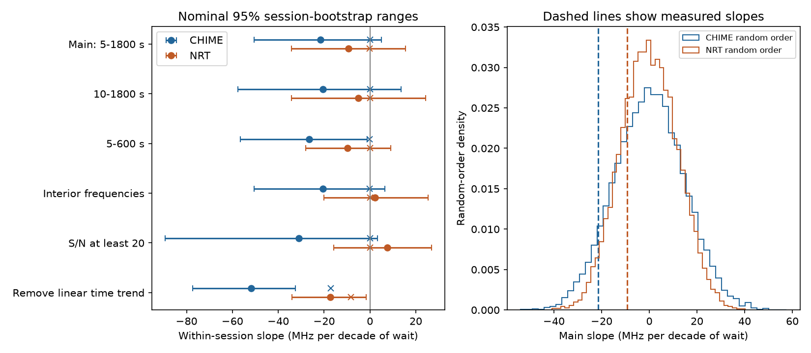

# A negative spectral-gap wait slope for FRB 20220912A is strongest after CHIME time detrending and lacks Nancay confirmation

## Result

The main test does not establish a link between wait and absolute spectral gap in either public telescope table. CHIME gives -21.53 MHz per decade of wait, with a nominal 95% range of -50.48 to 5.00. Nancay gives -9.27, with a range of -34.20 to 15.47. Negative slopes mean larger gaps at shorter waits. The two-sided random-order fractions are 0.142 and 0.450.

A fitted time trend changes the CHIME result. The measured slope is then -51.90, against a random-order mean of -17.04. The conditional tail fraction is 0.00015. The result stays in sessions with at least four or six bursts. The later-half fraction is 0.185. Nancay does not confirm it. This is a lead for a method and instrument study. It does not establish a physical spectral reset or frequency alternation.

All slopes below are in MHz per decade of wait. Crosses in the figure show the random-order mean. The bootstrap range for a detrended slope must not be tested against zero: detrending itself gives a negative null slope.

| Test | Sessions | Edges | Slope | 95% range | Random mean | Two-sided fraction |
| --- | ---: | ---: | ---: | ---: | ---: | ---: |
| CHIME primary | 43 | 131 | -21.53 | -50.48 to 5.00 | 0.04 | 0.14235 |
| CHIME early | 21 | 73 | -31.53 | -81.75 to 11.46 | 0.11 | 0.19390 |
| CHIME late | 22 | 58 | -9.28 | -36.64 to 16.51 | 0.01 | 0.50740 |
| CHIME linear n4 | 28 | 101 | -55.80 | -84.49 to -33.51 | -10.71 | 0.00015 |
| CHIME linear n6 | 6 | 36 | -123.08 | -154.66 to -75.12 | -7.02 | 0.00050 |
| CHIME linear snr20 | 14 | 38 | -44.22 | -89.75 to -20.91 | -12.51 | 0.05185 |
| CHIME wait10 | 42 | 125 | -20.48 | -57.61 to 13.48 | -0.03 | 0.25900 |
| CHIME wait600 | 42 | 128 | -26.54 | -56.55 to -1.12 | -0.07 | 0.07435 |
| CHIME interior | 42 | 128 | -20.56 | -50.54 to 6.44 | -0.20 | 0.17290 |
| CHIME snr20 | 14 | 38 | -31.06 | -89.38 to 3.26 | 0.03 | 0.16780 |
| CHIME linear time | 43 | 131 | -51.90 | -77.31 to -32.48 | -17.04 | 0.00015 |
| CHIME linear early | 21 | 73 | -72.39 | -115.06 to -41.48 | -20.15 | 0.00015 |
| CHIME linear late | 22 | 58 | -26.80 | -49.71 to -4.66 | -13.20 | 0.18500 |
| NRT primary | 33 | 564 | -9.27 | -34.20 to 15.47 | -0.06 | 0.44995 |
| NRT early | 16 | 430 | -9.58 | -27.04 to 9.23 | 0.04 | 0.29335 |
| NRT late | 17 | 134 | -8.92 | -60.94 to 36.05 | -0.17 | 0.71830 |
| NRT linear n4 | 29 | 556 | -15.93 | -33.83 to 1.12 | -1.77 | 0.12440 |
| NRT linear n6 | 26 | 546 | -13.64 | -30.77 to 3.83 | -0.84 | 0.14290 |
| NRT linear snr20 | 29 | 254 | -7.77 | -31.36 to 13.26 | -10.75 | 0.75940 |
| NRT wait10 | 33 | 530 | -5.10 | -34.19 to 24.29 | 0.03 | 0.72680 |
| NRT wait600 | 27 | 537 | -9.82 | -28.04 to 9.02 | -0.02 | 0.29610 |
| NRT interior | 32 | 425 | 2.32 | -20.06 to 25.34 | 0.06 | 0.84890 |
| NRT snr20 | 29 | 254 | 7.57 | -15.75 to 26.77 | 0.03 | 0.55345 |
| NRT linear time | 33 | 564 | -17.40 | -34.05 to -1.72 | -8.37 | 0.27865 |
| NRT linear early | 16 | 430 | -8.30 | -25.60 to 11.32 | -0.56 | 0.39125 |
| NRT linear late | 17 | 134 | -27.74 | -58.09 to -0.96 | -17.35 | 0.48375 |

The 26 tests share data and are exploratory. Tail fractions are not corrected for the test choices or campaign selection. The CHIME early lead remains small even under a simple correction across these 26 tests, but such a correction cannot account for all selection in the campaign. The later and second-telescope checks do not give confirmation. The 5-to-600-second CHIME bootstrap range excludes zero while its conditional fraction is 0.074. These are different sampling models and do not give identical decisions.

## Question and prior work

Can a spectral state persist between detected bursts, or can rapid bursts reset that state? A persistent state can make the gap grow with the wait. A rapid change can produce a negative slope. Telescope gain and selection can produce either relation.

We first searched published campaign results for astronomy, transit duration, K2-22, KIC 10001893, and fluence memory. We read the earlier CHIME and Nancay spectral-order reports [1,2]. The CHIME report gives a short-edge excess that needs a separate test. We test a continuous within-session wait relation instead of repeating its fixed 60-second cut. No prior code or derived data are reused. This study is not registered in advance. It follows an observed lead.

A multi-source extension was considered. The first-component catalog check found only eight sessions with at least three nominal main-beam bursts outside FRB 20220912A. We chose the active source and an independent telescope test for useful precision. No multi-source effect was tested.

Yamasaki and Totani [7] report signed downward shifts mainly below 0.3 seconds. We use absolute gaps at 5 to 1800 seconds. Our test cannot identify a direction of drift and does not repeat their analysis.

## Data and selection

CHIME Catalog 2 [3,4] has 5045 component rows. Select FRB20220912A and sub_num equal to zero. Sort by infinite-frequency MJD. Before quality cuts, start a session at a gap above 3600 seconds. Require excluded_flag, sidelobe_flag, intrachan_flag and catalog1_param_flag to be zero. Require finite time, peak, fit signal-to-noise ratio, and channel-flag fraction. This leaves 322 representatives. The first component can differ from the total burst spectrum.

Nancay [5,6] has 696 supplementary rows. Sort by time, start sessions at gaps above 1800 seconds, and merge chains of gaps at most 2 seconds. Use the mean group time and center. Use the minimum member signal-to-noise ratio and require all members to pass an interior cut when that control is used. The CSV time step is about 0.864 seconds. Close groups prevent tied listed times from being treated as independent ordered bursts.

For both samples, keep adjacent edges with waits from 5 through 1800 seconds. Require at least three accepted bursts, at least two usable edges, and nonzero spread in log wait per session. Main tests use 187 CHIME representatives and 607 Nancay groups in contributing sessions. Counts include members whose edges fail a wait cut. Sessions are groups of detections, not exposure intervals. Quality and center cuts rebuild adjacency inside the original session labels.

The CHIME peak is the maximum of an empirical spectral fit [3]. The Nancay center is the midpoint of an observed emission box [5]. Their bands and definitions differ. The tables have no common calibrated peak-frequency error model. The reported Nancay time mismatch in [2] remains unresolved here. A table-based seconds-to-minutes test can be reproduced, but the times cannot support a precise physical lifetime.

## Method

For a selected edge i in session s, let x be log10(wait in seconds), minus its session mean. Let y be the absolute difference of the two frequency centers. Compute a_s = mean(x*y) and v_s = mean(x*x). The reported common slope is sum(a_s)/sum(v_s). Each session has total regression weight one. Sessions with more spread in log wait have more slope information. This is not an equal average of separate session slopes.

Shuffle frequencies among all accepted times in each contributing session 19999 times. Keep the original time edges fixed. Every raw edge has the same expected gap under exchangeability, so the raw slope has expectation zero. Use the distance from the simulated mean for the two-sided fraction: (1 + number of distances at least the measured distance)/20000. The mean is estimated by simulation. Seed 110724404 fixes all draws.

Resample whole sessions 10000 times and recalculate the slope for nominal percentile ranges. Do not resample adjacent pairs as independent data. These ranges assume independent sessions. They omit source selection, frequency-fit errors, missed bursts, and calibration errors. The permutation model requires exchangeable frequencies within sessions; it does not model the detector.

For the linear-time control, fit an intercept and slope to frequency against elapsed time in each session, then use absolute residual gaps. Refit for every shuffled order. This is essential: irregular times and the projection cause a negative slope even for random data. This control can also remove a real source trend. Its negative null mean is part of the result, not an instrument correction.

The early and late checks split eligible sessions by count in time order. Interior CHIME peaks must be strictly between 410 and 790 MHz. Nancay emission boxes must stay strictly inside 1232 to 1736 MHz. Other controls set the wait floor to 10 seconds, the ceiling to 600 seconds, or minimum signal-to-noise ratio to 20. Detrended session-size controls require at least four or six accepted members before edge cuts.

## Validation and physical interpretation

Exact enumeration of all 24 orders for four test frequencies gives mean raw covariance within 4e-17 of zero. Leaving out one session at a time keeps the main slope negative in both samples; exact ranges are saved in summary.json. The sign alone is not significant evidence.

A sensitivity check assigns each session's observed frequency values by ranks of a simulated Ornstein-Uhlenbeck process. Its correlation is exp(-wait/tau). Zero tau uses independent normal ranks. This preserves the observed frequency set but changes its order. It does not simulate telescope response or missed bursts. A positive slope above the 95th percentile of the main shuffle distribution counts as a detection. With 1500 trials, detection fractions at tau of 0, 60 and 300 seconds are 0.054, 0.199, and 0.347 for CHIME, and 0.047, 0.804, and 0.937 for Nancay. This shows limited CHIME power even for imposed persistence. It gives no physical upper limit.

A source with a preferred frequency that changes slowly can give positive wait slopes. The simple continuous-time rank model tests that consequence. It is not required by the data. A negative slope can be consistent with rapid changes in emission or propagation, but the detrending dependence and absent confirmation do not identify such a cause. A time-varying beam response, interference mask, narrow observing band, or selective loss of faint bursts can alter the slope. Flag and signal cuts do not remove these effects. We did not inspect calibrated dynamic spectra or fit a beam model.

The two instruments provide separate observations, but need not sample independent source states. Their dates overlap and their bands differ. We do not combine their tail fractions or claim matched-event confirmation. There is no new planet, source, or established new physical phenomenon. A useful next test would fix the wait statistic before analysis, use precise times and calibrated spectra, and pass source and instrumental models through the detection procedure. The Nancay table-time issue must be resolved for a physical timescale claim.

## Provenance and reproduction

Job: sci-1107-dell-astronomy-bf24d40407cb. Topic: astronomy.
Campaign: 11_07_2026. Machine: dell. Account: codex-myxtap.
Model: gpt-6.1-sol, high reasoning effort, through T3 Code.
The campaign signing key is a machine identity, not a personal authorship claim.

External inputs were reused in place. Exact paths, resolved paths, byte counts and SHA-256 hashes are in files/provenance.json. They are:

- /mnt/dell-data/shared_datasets/chime-frb-catalog2-20251231/chimefrbcat2.csv, release 20251231, 4057396 bytes, SHA-256 5108ada779d279a2547d9f9e73ae25bfdd40d8496d6ba7255ec29c6629057a48.
- /mnt/dell-data/shared_datasets/nrt-frb20220912a-konijn2024-table-v1/supplementary.csv, Zenodo 13889738 version 1, 34405 bytes, SHA-256 8f2a6e5b4687c0a8f457b8d1c8be134f651c376fb48c86d8a625c45696b93a72.

Only used files were hashed. The full Nancay candidate table was also inspected for column metadata, but not used in calculations. Its path and hash are in metadata_inspection.json. No shared dataset was changed. An unneeded duplicate download was stopped when the existing full table was found.

Raw tables and record-level extracts remain external. Rights and attribution are in files/EXTERNAL_NOTICE.txt. The bundle contains original code, a figure, study aggregates, and simulated null scores. It has no external source rows. The Nancay package declares CC BY 4.0. A separate license grant for the CHIME CSV was not established. This separation preserves the baseline license without relicensing that table.

From an extracted bundle root, retrieve into a new external scratch directory:

    python files/retrieve.py /absolute/new/external_inputs
    python files/analyze.py --chime /absolute/new/external_inputs/chimefrbcat2.csv --nrt /absolute/new/external_inputs/supplementary.csv --out /absolute/new/rerun

Use Python with NumPy, pandas and Matplotlib. Exact tested versions are in validation.json. On the campaign machine the shared paths above can replace retrieval. Outputs must stay outside the publication; the code refuses output beneath the bundle. summary.json contains all test results; validation.json contains checks and simulations; null_draws.npz contains generated random scores. No external download is made by analyze.py. A second complete run gave byte-identical summary, validation, simulated scores and PNG files. The 373 CHIME first-component event IDs are unique. files/reproduction_check.json records output hashes. No private scratch file is needed beyond the two documented external inputs.

## References

[1] SCI sha256:15c276bd1e090c5189673bfc7917349d6dd69048515513b435ffd355f226d37f. CHIME spectral order test.

[2] SCI sha256:1f32138a82f9f5cea94058b69d426b88636a6e9b35580ec5ab5dd21b4f2324b6. Nancay spectral order test and time warning.

[3] CHIME/FRB Collaboration. The Second CHIME/FRB Catalog. doi:10.48550/arXiv.2601.09399.

[4] CHIME/FRB Catalog 2 CSV, release 20251231. Exact URL in files/retrieve.py.

[5] Konijn et al. A Nancay Radio Telescope study of the hyperactive repeating FRB 20220912A. doi:10.1093/mnras/stae2296.

[6] Konijn and Hewitt. Reproduction package, version 1. doi:10.5281/zenodo.13889738.

[7] Yamasaki and Totani. Time-Frequency Correlation of Repeating Fast Radio Bursts. doi:10.48550/arXiv.2412.04313.
