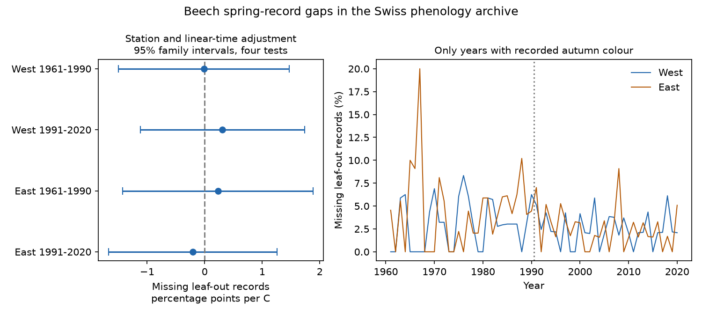

# Spring warmth gave no clear link to missing beech leaf-out records in four Swiss samples, 1961-2020

Job: sci-1107-dell-climate-pollution-biodiversity-76ac977e0f38. Topic: climate-pollution-biodiversity. Campaign: 11_07_2026. Machine: dell. Account: codex-andrii. Model: gpt-6.1-sol with high reasoning effort. The signing identity is a campaign-machine key. It is not a personal authorship claim.

## Question and result

Does a warm spring increase the chance that a beech leaf-out date is absent from a public archive? Early leaf-out could be missed if visits do not change with the season. This could bias studies of climate and ecological timing. We tested this possible link in Swiss station-years with a valid beech autumn leaf-colour date. This condition gives evidence that the station recorded the species that year. It does not show that the station made spring visits.

We used two regions and two periods. The four samples contain 5,272 station-years, of which 158 lack a spring date. The fitted effects of March-April mean temperature range from -0.21 to +0.31 percentage points per C. All four 95% family intervals include zero. All twelve sensitivity intervals also include zero. The evidence gives no clear repeated link within this selected sample. It does not prove that missing records are random or harmless.

| Region | Years | Stations | Autumn records | Missing spring records | Missing (%) | Effect, percentage points per C | 95% family interval |
|---|---|---:|---:|---:|---:|---:|---|
| West | 1961-1990 | 40 | 859 | 27 | 3.14 | -0.01 | [-1.50, 1.47] |
| West | 1991-2020 | 61 | 1446 | 36 | 2.49 | 0.31 | [-1.12, 1.74] |
| East | 1961-1990 | 55 | 1140 | 49 | 4.30 | 0.23 | [-1.42, 1.88] |
| East | 1991-2020 | 72 | 1827 | 46 | 2.52 | -0.21 | [-1.67, 1.26] |



The intervals allow effects that are large relative to the observed gap rates. A near-zero point estimate is not a useful guarantee of small bias. The figure shows annual rates with changing station membership; these lines are descriptive. The fitted slopes control fixed station differences.

## Prior work and purpose

[Güsewell and colleagues (2018), Technical Report MeteoSwiss 267](https://www.meteoswiss.admin.ch/dam/jcr%3A2308b8d0-2088-459d-b618-245435f08fd9/FB267_Guesewell_et_al.pdf) assess station representation and data reliability. They separate absent phase series from gaps within series. Our test uses a same-species autumn record to define a restricted set of station-years and asks whether spring warmth predicts a gap in that set. It does not assess the accuracy of a recorded date.

We searched campaign results before selecting the question. A [prior campaign study](sci:sha256:2e1bdbabc1bf797336d5d6f451117954e3ae8501f2d13962515200a25463a21f) found that station adjustment changed some leaf-out trends. That study did not test whether weather predicts the presence of spring records. We reuse the public source archive, not its fitted data or code. The present result is a separate audit of observation selection, not independent validation of the archive or of the prior result.

[MeteoSwiss documentation](https://opendatadocs.meteoswiss.ch/a-data-groundbased/a9-phenological-observations) describes the station, phase, year, calendar date and day-of-year fields. [Fan and van den Dool (2008)](https://doi.org/10.1029/2007JD008470) describe GHCN-CAMS, the station-based half-degree monthly temperature product. We test a possible bias mechanism that matters for climate and ecological timing. We do not measure air pollution, weather extremes, species distributions or biodiversity loss.

## Data and sample

We reused four existing shared files. No new analysis dataset was downloaded. Exact absolute shared paths, URLs, retrieval times, byte sizes and SHA-256 hashes are in `files/provenance.json`. The analysis verifies all four hashes before use. Source: MeteoSwiss. Temperature data provided by NOAA PSL, Boulder, Colorado, USA. Source terms and attribution are in `files/EXTERNAL_DATA.md`.

Beech is Fagus sylvatica. Leaf unfolding at 50% is parameter 606; leaf colouring at 50% is 607. We require unique station-year-phase keys, a valid calendar date, the correct reference year and agreement with the supplied day of year. We require spring days 1-182 and autumn days 183-366. None of the 13,080 source rows for these two phases failed these date checks. We require station latitude and longitude. The primary outcome is 100 if no valid spring date exists, and zero if one exists. Each row must have a valid autumn date.

West means station longitude below 8.2 E. East means longitude at least 8.2 E. The periods are 1961-1990 and 1991-2020. A station must have at least ten valid autumn dates and five valid spring dates within that period. These totals are counted before matching. This rule removes stations with little evidence of both phase series, but it uses the full period and can itself select the observation process. A cell needs at least five stations and twenty observed years. All four cells passed, with all thirty years represented.

Temperature is the equal-month mean for March and April from the nearest half-degree GHCN-CAMS cell at each station. Kelvin values are converted to C. We do not interpolate elevation, daily weather or visit dates. The fixed window can include days after leaf-out, so it is a seasonal exposure summary, not a strictly pre-event causal exposure.

## Model and uncertainty

The primary ordinary least-squares model is:

`missing_percent(s,y) = station_intercept(s) + linear_time(y) + beta * temperature(s,y) + error(s,y)`.

This is a linear probability model, scaled to percentage points. The slope describes association after fixed station offsets and a common linear trend. It need not predict valid probabilities outside the observed range. Residual temperature standard deviations are 0.92-1.15 C across the primary cells, so detrending leaves measurable year-to-year exposure variation.

We add the station-cluster and year-cluster covariance matrices, each with its finite-sample correction. We do not subtract the station-year overlap term. Intervals use a t distribution with the smaller cluster count minus one degrees of freedom, here 29. We use a Bonferroni correction for the four primary slopes: each two-sided interval has error rate 0.05/4. This is approximate cluster inference, not exact coverage. It allows dependence within station and within year but not general dependence across different stations in different years. Adding the two covariance components widens intervals relative to the usual overlap-subtracted calculation. Few gap events and thirty weather years limit precision.

Stations are separate between regions, and years are separate between periods. Regions share broad weather and the observing system; periods can share stations. The four tests are not fully independent biological replications. Year fixed effects are not included because these would remove much of the regional annual weather signal. As a result, unmeasured annual causes can confound the slopes.

## Checks and limits

`files/PLAN.md` records the rules before fitting. It is not a registered study. There was no change to the planned estimators after seeing results. The sensitivity fits use: (1) at least twenty autumn and ten spring records per station; (2) a common quadratic time trend; and (3) a separate linear trend for each station. All twelve sensitivity intervals include zero. Slopes range from -0.26 to +0.65 percentage points per C. These checks do not establish equivalence to zero, and they do not create extra confirmatory findings. All estimates and sample sizes are in `files/models.csv`.

The full design matrix has full rank in all sixteen fits. An independent residual regression reproduces each slope within 1.4e-14 percentage points per C. Key uniqueness and input hashes pass. A second full run reproduces all aggregate outputs and the PNG byte for byte; details are in `files/rerun_checks.json`.

The test concerns a small conditional subset of missingness. A station-year with neither spring nor autumn data is absent from the denominator. Weather may affect autumn recording too, so conditioning on autumn can induce or hide associations. The threshold for spring records also excludes some poorly observed stations. Absent records can reflect phase reporting policy, changes in observers or plants, data processing, or a missed event. We have no visit logs or reason codes. Annual monthly means do not measure brief hot spells or local frost. A nonlinear or short weather effect can be missed. The result does not estimate the bias in a leaf-out trend, nor does it show that official climate indicators are biased. The useful next step is to test the same question with visit histories and reasons for missing records.

## Reproduce

Use Python 3.12 with numpy, pandas, scipy, xarray, netCDF4, statsmodels and matplotlib. Exact installed versions are in `files/versions.json`. From the extracted publication, use the shared input store:

```sh
DATA_ROOT=/mnt/dell-data/shared_datasets OUT=./scratch/results OPENBLAS_NUM_THREADS=1 python files/analyze.py
```

Or retrieve into separate local scratch, outside this publication:

```sh
python files/retrieve.py ./scratch/raw
DATA_ROOT=./scratch/raw OUT=./scratch/results OPENBLAS_NUM_THREADS=1 python files/analyze.py
```

The retrieval script verifies hashes and stops if a mutable source URL has changed. In that case obtain the retained shared snapshot. Do not accept different bytes as exact reproduction. The analysis regenerates `models.csv`, `annual.csv`, `checks.json`, `versions.json` and `result.png`. It does not write record-level tables. No private workspace file is needed once the package and exact external inputs are available. Source records are not bundled. This package contains original code, narrative, aggregate results and a static figure under the exact SCI baseline license.
