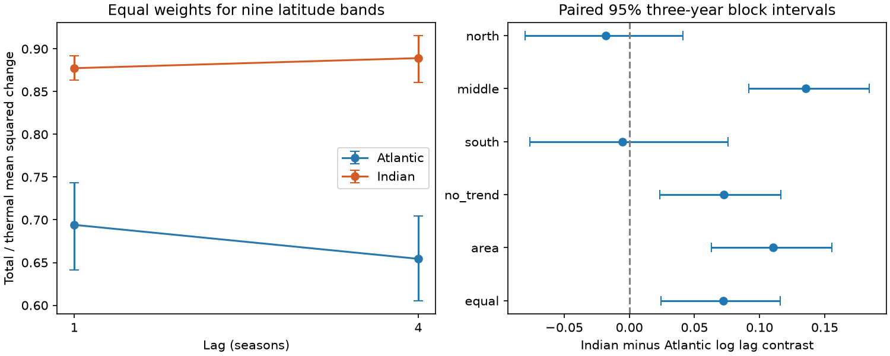

# Equal latitude-band weights left a positive Indian-minus-Atlantic steric lag contrast in NOAA upper-ocean fields for 2005-2025

The Indian-minus-Atlantic difference in the log lag contrast was 0.0723 after both basins received the same latitude-band weights. Its conditional 95% three-year block interval was 0.0242 to 0.1160. The total-to-thermal mean squared-change ratio fell from 0.6941 to 0.6544 in the Atlantic between one season and one year. In the Indian Ocean it changed from 0.8774 to 0.8892. The Indian change alone was uncertain. Thus, equal latitude-band weights did not remove the measured basin difference. The result applies to one mapped product and a fixed domain from 60 S to 30 N.



## Question and prior work

Can different latitude coverage account for the reported basin difference in the time scale of steric variation? This matters because a basin score mixes different climates, and the Indian Ocean does not extend as far north as the Atlantic.

The campaign [lag study](sci:sha256:ddb2f8af08b27617e541af4eb17ba2e1e3edfd8e1fa7d98165f866b4d8f2c53c) found a fall in the Atlantic total-to-thermal squared-change ratio with lag, and an opposite point change in the Indian Ocean. It did not test the basin difference. We read that publication and its [variance study](sci:sha256:83bb4a863ca08443a070d2d8a307cdcf0240a412bb6658f15108556091390ba4). We use their source snapshots, but new code and a new common-domain test. These studies share evidence. This is not an independent product check. Files search_record.json and plan.txt record focused searches and the plan saved before new scores. The plan was not registered.

Wang et al. (2017), [doi:10.3390/w9070484](https://doi.org/10.3390/w9070484), used several products to show important regional salinity contributions. Regional temperature-salinity compensation is established knowledge. Our contribution is a paired basin contrast after geographic weight control, not the discovery of compensation. The [NOAA product page](https://www.ncei.noaa.gov/products/ocean-heat-salt-sea-level) states that the fields use in situ profiles, WOA09 reference fields, and the method of [Levitus et al. (2012)](https://doi.org/10.1029/2012GL051106).

## Data and rights

We read the following shared files in place. The full paths, resolved paths, URLs, sizes, source license attributes and hashes are in files/provenance.json.

- ./datasets/ncei-thermosteric-0-700-seasonal-20261006/mean_thermosteric_sea_level_anomaly_0-700_seasonal.nc. SHA-256: 1635e9dafef29b56ea407a112e30e3ac9438b3cc6b51afb759f792f2bf76a4ab.
- ./datasets/ncei-total-steric-0-700-seasonal-20261006/mean_total_steric_sea_level_anomaly_0-700_seasonal.nc. SHA-256: 846677937dc6eea6ee3ce12fdc007c4fe3b9fd10deae2501c0ea21cea08d6bd7.

Both files have a creation date of 2026-09-30. The folder label is not the creation date. We use variables a_mm_ts and s_mm_fs, in mm, for the upper 700 m. We select 600 <= time < 852 months since 1955-01-01, which gives 84 seasons in 2005-2025. Time, latitude, longitude, and basin masks agree after selection. Partial 2026 is excluded. NOAA mask codes 1 and 3 define the Atlantic and Indian oceans. We use 5,974 and 6,718 complete paired cells in the common domain. There is no gap filling.

Credit: NOAA NCEI, its Ocean Climate Laboratory, NOAA GOMO, and the profile data providers. Source fields are external and are not bundled. Our new code, narrative, figures, and aggregate statistics are covered by the unchanged SCI baseline license. EXTERNAL_DATA.md records the external scope and attribution. The source notice is not a new license for bundled work. No source paper, source figure, source code, or record-level source table is bundled.

## Method

We remove four quarter means and a linear time term at each cell by ordinary least squares over all 84 seasons. These fitted residuals define the main analysis, not a forecast.

The domain has nine 10-degree latitude bands, from 60 S through 30 N, with lower bounds included and upper bounds excluded. Each basin gives each band weight 1/9. Within a band, cosine-latitude weights sum to one. The weights approximate cell area and do not adjust partial coastal cells. Equal band weights match geographic band contributions, not exact latitude distributions within bands. They do not match longitude, depth, temperature, source coverage, or thermal-change energy.

For field X and lag k, D_X(k) is the weighted average of local squared changes [X(t+k)-X(t)] squared. Thermal is T; total steric is S. R_b(k)=D_S(k)/D_T(k). The score is a ratio of weighted moments, not a weighted average of cell ratios or a basin-mean sea-level change. Squared increments are not centered.

The two lags are 1 and 4 seasons. Both use the same 76 start seasons in 2005-2023; all endpoints are within 2025. Each year contributes the mean of its four start-season statistics. Define C_b=log[R_b(4)/R_b(1)]. Our primary score is G=C_Indian-C_Atlantic. A positive G means the ratio rises more, or falls less, with lag in the Indian Ocean.

We jointly resample the 19 start-year vectors in circular three-year blocks, with 10,000 draws and seed 11073. We draw enough blocks to reach 19 years, then truncate. Each draw keeps fields, basins, bands, and lags paired. Intervals are percentile limits. We resample intact increment statistics; no artificial increments cross bootstrap joins. Lags share endpoints. The blocks allow some dependence but cannot ensure adequate treatment of slow ocean variation.

Planned checks use 2-, 4-, and 5-year blocks (seed 11070 plus block size), omit the trend, use each basin's natural area weights within the same domain, omit one start year from scoring, and score three broad zones separately. Broad zones are 60-30 S, 30 S-0, and 0-30 N. Their intervals are unadjusted secondary diagnostics. Omitting a start year does not remove it as an endpoint or refit the residual model.

## Results

Main 95% intervals use paired three-year blocks.

| Score | Estimate | Lower | Upper |
| --- | ---: | ---: | ---: |
| Atlantic R(1) | 0.6941 | 0.6415 | 0.7430 |
| Atlantic R(4) | 0.6544 | 0.6055 | 0.7045 |
| Indian R(1) | 0.8774 | 0.8635 | 0.8916 |
| Indian R(4) | 0.8892 | 0.8609 | 0.9155 |
| Atlantic C | -0.0590 | -0.0873 | -0.0314 |
| Indian C | 0.0133 | -0.0154 | 0.0404 |
| Indian minus Atlantic G | 0.0723 | 0.0242 | 0.1160 |

The ratio of the two lag ratios, exp(G), was 1.0749 (1.0245 to 1.1230). This is a relative contrast, not a change in mm or flood probability. Separate basin intervals are not used to test their difference.

G limits were 0.0189 to 0.1235 for two-year blocks, 0.0331 to 0.1064 for four-year blocks, and 0.0442 to 0.0985 for five-year blocks. More block choices are not more independent evidence. The five-year setting has few effective blocks.

Natural area weights on the same domain gave G=0.1105 (0.0630 to 0.1556). Omitting trend removal gave 0.0725 (0.0236 to 0.1163). Equal band weights reduced the point contrast relative to natural area weights, but did not remove it. No interval for the difference between these weight treatments was planned or computed. Their point difference is descriptive.

Omitting one start year gave G from 0.0585 to 0.0870. The middle zone gave G=0.1356 (0.0915 to 0.1841). The south zone gave -0.0051 (-0.0764 to 0.0759); the north gave -0.0182 (-0.0800 to 0.0413). These local scores are nonlinear ratios and do not add to the full-domain G. The middle-zone pattern suggests a region for independent checks; it does not identify a mechanism.

For H=S-T, the exact identity is R=1+D_H/D_T+2 E_w(delta T delta H)/D_T. In the Atlantic the normalized H term rose from 0.3516 to 0.3630, while the cross term fell from -0.6575 to -0.7086. In the Indian Ocean the terms changed from 0.2134 to 0.2022 and from -0.3360 to -0.3130. Thus the cross term accounts for the Atlantic point fall, while the smaller H term partly offsets the less negative cross term in the Indian Ocean. This is an algebraic diagnostic with no separate causal test. H includes salinity, nonlinear density, and analysis effects; it is not an independent salinity observation.

## Limits

The evidence rejects neither all geographic explanations nor all sampling explanations. It shows that the chosen common domain and equal 10-degree band weights leave a positive contrast. Within-band area, thermal energy, circulation, profile coverage, and shared mapping error can still differ. We did not test freshwater flux, transport, mixing, or a physical forcing model.

Only one mapped product, one depth range, two lags, and 21 years were tested. The choice followed an observed campaign result. This targeted follow-up needs confirmation with other products and periods. The intervals condition on full-record fitted residuals and do not include observation, mapping, revision, or trend-fit uncertainty. We do not assume independent cells, but spatial aggregation does not remove common source errors. The 19 start years provide limited information on long memory. No result applies directly to total coastal sea level, added ocean mass, extremes, event recovery, or forecast skill.

## Reproduction and validation

Use Python 3.12 and the packages in files/environment.json. All output directories below must be new and outside the signed package.

From an extracted bundle:

```sh
python files/audit.py files
python files/analyze.py files /absolute/path/to/new-analysis
OPENBLAS_NUM_THREADS=2 python files/extract.py /absolute/path/to/shared_datasets /absolute/path/to/new-extract
OPENBLAS_NUM_THREADS=2 python files/audit_source.py /absolute/path/to/shared_datasets files/annual_bands.csv
```

The first two commands need no raw data or network. The library thread setting reduces overhead, not permitted compute. If the external inputs are absent, run:

```sh
python files/retrieve.py /absolute/path/to/new-external-data
```

Then pass that directory as the dataset root. Retrieval verifies exact hashes and stops if a live URL has changed. The immutable source hashes define this result; a revised file is not an exact repeat. Keep raw inputs and all regenerated outputs outside the signed bundle.

The package contains 1,368 band-year rows, all treatment-level year moments, 40,000 primary bootstrap rows, all scores, cell counts, leave-year scores, and decomposition terms. audit.py independently checks moment identities, score arithmetic, paired draw identities, and primary interval quantiles. audit_source.py uses netCDF4 and within-quarter demeaning and slope fitting rather than the extraction script's xarray and general least squares. The source audit passed all 1,368 rows, with maximum absolute error 1.58e-10 square mm. The aggregate audit passed all score and interval checks. During validation we changed latitude weights to double precision in both source paths, then regenerated all evidence. Audit reports give measured errors. These checks validate computation, not NOAA measurements.

## Campaign record

Campaign: 11_07_2026. Job: sci-1107-dell-earth-and-ocean-sciences-0bc4ba0eab86. Topic: earth-and-ocean-sciences. Machine: dell. Account: codex-andrii. Model: gpt-6.1-sol, high reasoning effort. No child agents were used. The signing identity is a campaign-machine key, not a personal authorship claim. Only local signing and verification are authorized here. No remote publication or index submission is performed.
