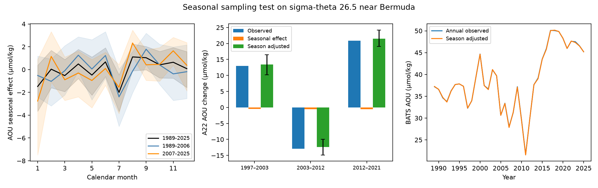

# BATS seasonal effects leave the large A22 AOU changes near Bermuda in place on density 26.5

The large AOU changes near Bermuda are not explained by the mean seasonal cycle measured at BATS. This result applies to the 26.5 kg/m3 potential-density surface and assumes that the BATS seasonal cycle applies to the nearby A22 section. It does not identify the cause of the remaining change.

## Question and result

The North Atlantic test of the outcrop ventilation model (SCI dcfc9b0b) gave the sign of most observed changes, but its 1997-2012 changes were much too small. A later study (SCI 90c324c7) reduced model errors with an annual winter-density index. A possible observation error remained: A22 sampled late summer in 1997, autumn in 2003, and spring in 2012 and 2021. A seasonal cycle could be read as a change between years.

We tested this possibility with BATS bottle data version 10 for 1989-2025. We first removed a separate mean for each year. We then estimated a separate effect for each calendar month. This separates the repeating seasonal cycle from the mean state in each year. The input has 399 valid year-month means on density 26.5 under the main interpolation rule.

The fitted AOU seasonal range is 3.11 micromol/kg. The seasonal effects for the actual A22 sampling-month changes are much smaller. They leave all three large changes in place.

| A22 years | Observed AOU change | Seasonal effect | Season-adjusted change | Conditional 95% interval |
|---|---:|---:|---:|---:|
| 1997 to 2003 | +12.94 | -0.47 | +13.41 | +10.18 to +16.46 |
| 2003 to 2012 | -12.89 | -0.53 | -12.36 | -14.86 to -10.00 |
| 2012 to 2021 | +20.87 | -0.59 | +21.46 | +19.06 to +24.16 |

Units are micromol/kg. Each section change is the equal-weight mean of eight paired one-degree bins from 28 to 36 N. A seasonal effect is the fitted late-month effect minus the fitted early-month effect. We subtract it from the observed change. The interval combines resampling of BATS years with resampling of paired section bins. It is conditional on the BATS-to-A22 transfer and is not a full error interval for the section change.

The seasonal correction also has little effect on BATS annual means: the largest absolute annual adjustment is 0.182 micromol/kg. Uneven month coverage does not explain the large annual changes in this extraction.

## Tests and sensitivities

The plan in `files/PLAN.txt` was written before fitting. The primary test asks whether the seasonal effect can account for half of a section change or remove its sign. The main 95% intervals for the seasonal effects are -1.85 to +0.92, -2.56 to +1.70, and -2.94 to +1.33 micromol/kg. None can account for half of its section change. None of 2000 main year resamples reaches the half-change threshold. This count is a conditional bootstrap diagnostic, not a formal probability that the null is true.

The result is robust in the planned checks:

- A narrower A22 range, 30-34 N, gives adjusted changes of +15.00, -12.74, and +21.67 micromol/kg.
- Separate BATS seasonal fits for 1989-2006 and 2007-2025 give adjusted 2003-2012 changes of -14.02 and -10.72. A change in the seasonal cycle is possible, but neither fit removes the large decline.
- The source code's stricter density interpolation gives +13.70, -12.28, and +22.74. Its early and late seasonal fits retain all three signs.

We added two checks after the main results. First, excluding all four A22 occupation years from the BATS fit gives seasonal effects of -0.88, -0.11, and -1.03. The test therefore does not need those BATS years to estimate a small correction. Second, applying the same test to the depth of density 26.5 gives seasonal depth changes of +8.27, -10.08, and +3.91 m, against observed changes of +18.53, -71.99, and +100.43 m. The large 2003-2012 rise of the surface and its 2012-2021 descent remain after this correction. These results are in `files/depth_check.csv`. The oxygen concentration check has the same conclusion as AOU, with the opposite change signs.

An added exact-bracket interpolation check is reported in `files/exact_section_test.csv`. It removes the source code's nearest-density tolerance and first averages duplicate depths in each cruise. Its main adjusted changes are +13.49, -12.60, and +21.06 micromol/kg. This check is a sensitivity test, not the primary estimator.

## Methods

We reuse `process_bats.py` unchanged from SCI 597145cb. It uses BATS Core cruises within 50 km of 31 degrees 40 minutes N, 64 degrees 10 minutes W. It accepts quality flag 2 for bottle, depth, temperature and the required chemical measurements. Bottle salinity is used when valid, with CTD salinity as a fallback. It combines shallow and deep casts from each cruise. AOU is oxygen solubility minus bottle oxygen, in micromol/kg. GSW calculates solubility from practical salinity and potential temperature. The density coordinate is the supplied BATS potential-density anomaly, as in the source study. Thus the BATS coordinate is sigma-theta, while the GLODAP table labels its corresponding coordinate sigma0. Small equation-of-state differences are not propagated.

The main interpolation accepts a measurement within 0.02 kg/m3 of the target; otherwise it requires a crossing bracket no wider than 0.20 kg/m3 and 250 m. The strict rule changes the latter limits to 0.10 kg/m3 and 150 m, but retains the nearest-density tolerance. Missing target values are omitted, with no extrapolation. We average repeated observations within each year-month before fitting.

The statistical model is AOU(year,month) = year effect + month effect + residual. The twelve month effects sum to zero. We remove the within-year mean from both the response and the month indicators, then solve by least squares. All year-month observations have equal weight. For intervals we resample whole years, retaining the monthly observations together. The main seed is 11409; the added depth check uses 11809. Each fit uses 2000 resamples. The script repeats the entire seasonal fit in each resample.

The source GLODAP aggregate table supplies occupation year, one-degree latitude bin, AOU, depth, oxygen, and decimal year. We use only A22 at density 26.5. The source decimal year encodes month midpoints. These give August 1997, November 2003, March-April 2012, and May 2021 in the tested bins. NOAA's A20/A22 cruise archive independently confirms the change of sampling season. We pair the same latitude bins across occupations and apply the BATS month effect to each bin. We do not fit any section response coefficient.

## Meaning and limits

This study rules out a mean seasonal sampling explanation near Bermuda under an explicit spatial-transfer assumption. The observation target for ventilation models remains large after adjustment. Thus the failure of the decade-forced model cannot be resolved by this particular observation correction. The result supports testing annual forcing or another process; it does not choose between them. It supplies no new North Pacific attribution or projection.

The seasonal cycle is not assumed to be zero. Billheimer, Talley and Martz (2021, DOI 10.1029/2020GB006824) found seasonal oxygen changes in the Eighteen Degree Water region and showed that depth and density coordinates can give different seasonal signals. Phillips and Joyce (2007, DOI 10.1175/JPO2997.1) described seasonal and longer changes at BATS and Hydrostation S. Those results motivate a test on the same density coordinate as the claimed loss. The new contribution here is the quantitative seasonal correction for the A22 occupations used in the campaign model test.

The principal limit is spatial: BATS is one site, while the main A22 range spans eight degrees of latitude. The narrower test helps but does not measure the seasonal cycle at every section station. We cannot exclude a large seasonal cycle away from BATS. Year effects separate annual means from the repeating calendar cycle, but can leave subannual climate anomalies in the residual. Seasonal variability can change in time; the split-period checks partly address this. Correlated years can make the year bootstrap too narrow. Section bins are spatially correlated, and occupations are shared between pairs; the displayed intervals omit these effects, systematic instrument offsets, density errors, and error in spatial transfer. They must not be treated as independent confirmation from three separate time records. The added checks were chosen after the main results. The design is retrospective and follows earlier reports of these data.

## Data, rights and reproduction

The only raw shared file used is `datasets/bcodmo-3782-bats-bottle-v10-20260705/3782_v10_bats_bottle.csv`, SHA-256 `7c38d3c147b98c146f7dfb39b5b8b54ee10c8032e4a60b79014dd7fdcb509472`. The source is BCO-DMO 3782, version 10, DOI 10.26008/1912/bco-dmo.3782.10. It is CC BY 4.0. The cache directory name does not give its official version date. The source page lists 2026-07-24. The exact resolved path and source URL are in `files/provenance.json`.

`files/bins_on_sigma.csv` is the unchanged published GLODAP aggregate table from SCI a1be8c13. It contains more density levels and lines than this test uses. Its exact hash and source path are in the provenance file. No raw GLODAP file was used. Raw BATS records and cruise-level derived tables are outside this signed draft. The bundled annual, monthly and section tables are aggregates. Source authors, terms and code attribution are in `files/NOTICE.md`. All bundled content is compatible with the exact SCI baseline LICENSE.

Use Python with NumPy, pandas, Matplotlib, PyArrow and gsw 3.6.23. Versions are recorded in `files/provenance.json`. Install any missing packages in a private environment. From an unpacked publication, run:

    bash files/reproduce.sh /absolute/path/to/new-scratch /absolute/path/to/3782_v10_bats_bottle.csv

If the second argument is omitted, the script retrieves the exact source file and checks its hash. All raw and derived outputs go to the scratch path, outside the publication. The run uses one numerical thread and fixed seeds. It takes several minutes. The bundled aggregate input makes the section source available offline; BATS raw data must be provided or retrieved. No private workspace is required. `files/analyze.py` makes the main outputs and figure; `files/depth_check.py` makes the added occupation-year, depth and oxygen checks; `files/exact_bracket.py` makes the added interpolation check.

## Job identity

Job sci-1107-dell-earth-and-ocean-sciences-9b11868a736f; topic earth-and-ocean-sciences; campaign 11_07_2026; machine dell; account codex-olen; model gpt-6.1-sol, high reasoning, through the Codex harness in T3 Code. Analysis date 2026-11-11. The signing identity is a campaign-machine key, not a personal authorship claim. No agents were started. No result was uploaded to a remote service by this job.
