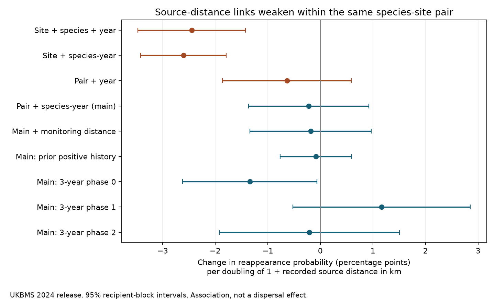

# Source-distance links to butterfly reappearance weakened within species-site pairs in Britain in 1980-2021

Job: sci-1107-dell-climate-pollution-biodiversity-fb995b43d8f9. Topic: climate-pollution-biodiversity. Campaign: 11_07_2026. Machine: dell. Account: codex-olen. Model: gpt-6.1-sol, high reasoning effort, in T3 Code. The signing key is a campaign-machine key. It is not a personal authorship claim.

## Main finding

Nearby recorded populations predict butterfly reappearance across sites. However, changes in that distance gave no clear prediction within the same species at the same site. This limits the use of recorded source distance as evidence for a supply process behind slow community response.

We used raw UK Butterfly Monitoring Scheme (UKBMS) site indices and public locations. The sample has 16,002 risk windows at 804 sites, for 48 taxa and 3,593 species-site pairs. Baselines end in 1980-2021. Each window starts with three explicit zero-index years and has three valid outcome years. Reappearance means positive indices in at least two outcome years. There are 2,173 such windows. These are repeated windows, not 2,173 independent population establishments.

The distance coefficient is the change in reappearance probability per doubling of one plus distance in km. A negative value means that more distant sources predict less reappearance.

| Controls | Change, percentage points | 95% interval |
| --- | ---: | --- |
| Site, species and year | -2.45 | -3.47 to -1.42 |
| Site and species-year | -2.60 | -3.42 to -1.79 |
| Species-site pair and year | -0.63 | -1.86 to +0.59 |
| Species-site pair and species-year, main model | -0.22 | -1.36 to +0.92 |
| Main model plus monitoring distance | -0.18 | -1.34 to +0.97 |
| Main model, prior positive history only | -0.08 | -0.76 to +0.59 |

The within-pair coefficient is 2.22 percentage points less negative than the first coefficient (95% interval for the difference: 1.42 to 3.03). The point magnitude falls by 91%. This is a comparison of statistical associations in the same selected records. It is not a causal mediation estimate.

## Question and relation to prior work

Earlier campaign work found weak transfer of spatial temperature gradients into community change. The butterfly result also depends strongly on the source of species thermal indices (sci:sha256:814f6d393d18214a8259af1e12c63fd1d1d81558bc5410f00c3a7eaf2a2a3d96). That study found slow gains and opposing losses with external European niche indices.

A later campaign study found repeated source-distance links to butterfly recovery in two periods (sci:sha256:01dd32f04f356c43d730f76af69a718c9cf5e818674756893a1f13b377f339bf). It stated that stable habitat and range position could explain those links. We test that specific limitation. This is not a replication of its logistic model: it uses shorter, repeated windows, a linear probability model and pair effects. It extends the source-distance evidence by separating differences across pairs from changes inside pairs.

The ecological idea is not new. Fourcade et al. (2021, doi:10.1111/ele.13691) found that habitat amount and distribution modify warm-species colonisation and cold-species extinction in European butterfly communities. We do not test their landscape metrics. Our contribution is a control for all stable species-site attributes and a timing test of a source proxy in British records.

We searched the local SCI campaign for thermal composition, colonisation, European niche indices and source populations before fixing the test. The analysis plan and its later amendments are in files/PLAN.md. No BBS data, 54-network summary estimates or inherited derived data enter the calculations. UKBMS itself overlaps with prior campaign studies; this is not an independent monitoring network.

## Data and selection

Both inputs are the 2024 UKBMS release, cited in full in files/EXTERNAL_DATA.md. Source URLs, shared paths, byte counts and SHA-256 hashes are in files/provenance.json. We reused these immutable shared inputs:

- datasets/ukbms-site-indices-2024-eidc-53a1c705/ukbms_site_indices_2024.zip
- datasets/ukbms-site-locations-2024-eidc-d7256b49/ukbms_site_locations_2024.zip

Only public standard UKBMS transects in England, Scotland and Wales enter. Painted Lady and Clouded Yellow are excluded. All rows of duplicated species-site-year keys are removed (22 rows). Taxon labels are not merged.

For baseline end year t, the indices at t-2, t-1 and t must each be explicitly zero. The indices at t+1, t+2 and t+3 must each be nonnegative. Missing rows and index -2 never become zeros. The source documentation states that -2 marks a recorded species for which monitoring was insufficient to estimate an accurate index. The main outcome therefore concerns valid recorded indices, not inferred occupancy.

A recorded source is another public standard transect with positive indices in at least two baseline years. Each species-year must have at least ten source sites. Sources need not be eligible recipients. We calculate nearest-source distance in the supplied British National Grid coordinates. No private site location enters. The main sample has 749 pairs with both outcome values and 1,809 pairs with varying source distance. The residual within-pair distance standard deviation is 0.56 on the log2 scale after both sets of fixed effects.

The sample is conditional on published explicit-zero histories and continued valid monitoring. It does not represent all possible colonisation sites. Missing species-site combinations cannot be treated as true absence.

## Estimation

The main linear probability model is:

    y_ist = pair_effect_is + species_year_effect_it
            + beta * log2(1 + nearest_source_distance_ist_km) + error_ist

The pair effect removes stable habitat suitability, stable range position, fixed transect length and other stable attributes of each species-site combination. Species-year effects remove changes shared by a species across the network, including national trends, common weather and changes in the total recorded source count. They do not remove local changing habitat, local weather or source-specific detection errors.

We estimate the coefficient by alternating projection of the outcome and exposure on each set of fixed effects, followed by least squares. The stopping rule is a maximum change below 1e-10, with at most 1,000 passes. An independent sparse least-squares model with explicit dummy columns checks the main coefficient. Its result is in files/validation.json.

Intervals use a cluster sandwich over recipient 50-km blocks and a Student t cutoff with G-1 degrees of freedom. The sandwich correction is G/(G-1); no absorbed-parameter degrees-of-freedom multiplier is applied. There are 88 main blocks. The coefficient difference uses the difference of the two models' block influence sums. These intervals condition on source maps and the selected records. They do not resample the observation network or capture all long-range dependence among sources.

The monitoring control is the distance to the nearest other transect with any valid index in the baseline window. Species-year effects already absorb the network-wide source count. The early/late split, larger blocks and prior-history subset test sensitivity. We do not select models by significance or claim a causal effect from a linear probability coefficient.

## Further results and timing test

The raw reappearance rate was 17.8% within 10 km of a source (1,183/6,648), 11.2% at 10-50 km (765/6,853), and 9.0% beyond 50 km (225/2,501). Pair controls weaken this strong spatial ordering.

Using 100-km recipient blocks gives the same main estimate with an interval of -1.36 to +0.91 points. Three nonoverlapping baseline-year phases give slopes of -1.34, +1.16 and -0.21 points. Only the first interval excludes zero. These phases avoid overlapping outcome years within each pair, but they use different small subsets. They are sensitivity checks, not three independent replications.

The within-pair slope is +0.26 points in baselines ending through 2000 and -0.95 points later. The later upper interval is just below zero (-1.91 to -0.002 points). This does not support a universal null. It shows that the association is period dependent and that the pooled result does not settle every subgroup.

A diagnostic replaces the source map with recorded populations from t+5 through t+7, fully after the outcome, and includes both past and future distance in the same within-pair model. The recipient is always excluded from its own source map. The diagnostic has 13,632 windows ending through 2017. Past distance gives +0.14 points (-1.12 to +1.40); future distance gives -1.05 points (-1.98 to -0.13).

Future populations cannot supply earlier butterflies. Thus temporal ordering alone is not enough to interpret this proxy as supply. Shared habitat change, common population waves, recovery that spreads to other sites, and correlated detection can link later source maps to earlier outcomes. Future distance is an outcome-informed diagnostic, not a forecast or an instrument. It neither proves reverse causation nor measures confounding.

## What the evidence supports

The cross-site source-distance marker is real in these records. Its interpretation as a direct, changing supply constraint is weak: the same-pair comparison is much smaller, and a later source map also carries a negative link. Stable differences between species-site combinations can account for much of the original association, but measurement error can also cause the attenuation.

This result strengthens the evidence standard for ecological explanations of the thermal gap. A spatial marker that predicts recovery need not predict the response to a change in that marker. A stronger supply test needs source abundance, repeated detection, measured local habitat and either externally driven source change or an intervention. The present data do not identify which ecological process causes the remaining community thermal gap. They also do not rule out dispersal limitation.

## Limits

Recorded sources are an incomplete and changing sample of actual populations. New monitoring sites can change nearest-source distance without ecological change. The monitoring-distance check is limited and cannot correct this measurement error. Pair effects reduce exposure variation and can magnify attenuation from noisy changes.

Indices measure relative abundance and activity, not latent occupancy or confirmed breeding. Explicit zeros may reflect missed low populations. Repeated positive years need not mean establishment. Source and recipient indices can have correlated errors. Public locations omit sensitive sites. Excluding -2 outcomes can select for better monitored periods and populations. Selection on three zero years can also create regression-to-the-mean patterns.

The risk windows overlap in the main analysis; block clustering handles dependence within a recipient block but not every shared-source link across blocks. National species-year effects help with common shocks but do not remove all regional weather or habitat change. The two coefficient estimates have different identifying variation. Their contrast is a design comparison, not proof that stable habitat caused 91% of the spatial link.

No warming coefficient, species thermal index, pollution exposure, CTI trend or debt fraction is estimated. The result tests a proposed process proxy. It does not estimate how much of the 14% butterfly tracking result is due to supply.

## Reproduction and rights

files/REPRODUCE.md gives commands to regenerate the risk panel outside the signed folder, estimate all models, check the coefficient independently and redraw the figure. The bundle contains code, aggregate statistical evidence and source provenance. It contains no source records or derivative record-level database. Source terms and required attribution are preserved separately in files/EXTERNAL_DATA.md. The SCI baseline license applies to the material that we can grant.

Contains UK Butterfly Monitoring Scheme (UKBMS) data © copyright and database right Butterfly Conservation, the Centre for Ecology & Hydrology, British Trust for Ornithology, and the Joint Nature Conservation Committee.
