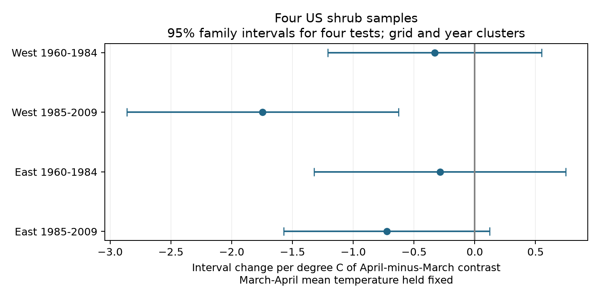
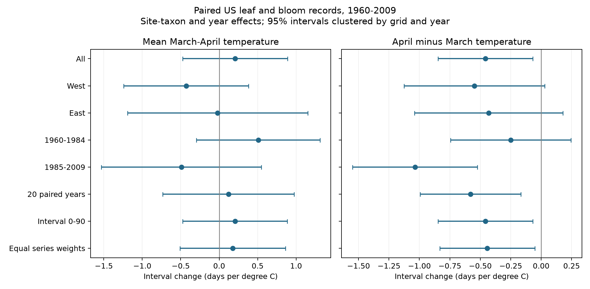

# Four US shrub samples did not show a clear common temperature-contrast link to leaf-to-bloom intervals in 1961-2009

We tested whether a warmer April relative to March was linked to a shorter time from first leaf to first bloom, at a fixed March-April mean temperature. The pooled estimate was negative. Four separate region and period models did not establish a common negative link. Only the later western sample had an interval below zero after correction for four tests. This does not prove that the other effects are zero, or that effects differ between periods.

## Question and prior evidence

The time between leaf growth and flowering can affect the sequence of plant activity. [Guo et al. (2023)](https://doi.org/10.1016/j.cub.2023.06.064) studied paired dates in China and found that most series had no clear trend in this interval. Different temperature responses of the two events can change the interval. Our study does not introduce that explanation.

We ran `sci search "lilac" --in ./campaign --json` and read two related signed results. [The Arnold Red study](sci:sha256:1739a808e783d34e979028474c6ed9d6b0f8a9b8a3c9044b0ef5f5d1b683def1) found no clear common interval response to April-minus-March temperature across four samples. [The lilac study](sci:sha256:03667c3f70456c34ae6549ff0f689c883c77a5b6aadc30edad9093736afdc255) tested the same temperature contrast for first-bloom dates. This package extends the interval test to four cultivated taxa, includes a pair-reporting audit, and supplies a separate numerical check. It uses overlapping source observations. It is not independent validation of the earlier studies. It also differs in the repeated-record rule, quality filters, periods, aggregation, covariance clusters and omission of winter temperature. Differences from earlier estimates cannot be assigned to the added taxa alone.

The initial design was a provisional candidate while the campaign search verified bundles. The final extension was selected after the search returned and before any model results were read. The internal design record lists later implementation choices. It is not an external registration. The four-test adjustment was applied after the fits and before interpretation of the four samples.

## Data and selection

We used the [USA-NPN lilac and honeysuckle archive](https://doi.org/10.1038/sdata.2015.38), v13 observations and v14 field metadata from ScienceBase. We selected legacy Dataset_ID 7 or 8, years 1960-2009, latitude 24-50 N and longitude 66-125 W. First leaf and first bloom had to be in day of year 1-200. We excluded multiple-onset flags and both early and late quality flags. A quality value of 0 or -9999 was retained; -9999 means not tested. Climate-based quality flags can remove real responses to unusual weather. The sample is not suitable for estimating extreme-weather responses.

We paired dates for the same site, taxon, reporting unit and year. If a phase had several retained records, we used its earliest date. We kept individual intervals from -30 to 120 days. Site-taxon-year date means use only complete pairs; the interval is the mean of the paired differences. The main analysis requires at least ten paired years per site-taxon series across the full period. No missing year is filled. Separate period models retain this full-period selection rule. Some units in a period provide little or no within-unit information.

There were 116,662 source rows and 42,365 valid first-leaf or first-bloom rows after the initial filters. The derived panel has 24,480 site-taxon-years with at least one valid date. The main sample has 9,596 complete site-taxon-years at 438 sites in 614 site-taxon series and 365 weather cells. Its actual years are 1961-2009. The median interval is 31 days; the middle half is 24-39 days. No main interval is negative. Taxon counts are 1,775 for Arnold Red honeysuckle (20), 2,859 for cloned lilac (35), 3,005 for common lilac (36), and 1,957 for Zabeli honeysuckle (1198).

Historic reporting units can represent groups of plants. Visit frequency, missed events, plant replacement and observer identity are not measured. A paired record is not proof of equal observation effort. Some sites contain several taxa. Our site-taxon effects do not give each site equal weight. The equal-series-weight check limits the total weight of long series.

Temperature is [NOAA PSL GHCN-CAMS](https://psl.noaa.gov/data/gridded/data.ghcncams.html), version 3.01, at the nearest 0.5-degree cell. [Fan and van den Dool (2008)](https://doi.org/10.1029/2007JD008470) describe the product. We subtract 273.15 from Kelvin. We use the exact file snapshot in provenance.json. The folder date is not a formal NOAA release version. East is at or east of 100 W; West is west of 100 W. The v14 field guide reverses the historic network labels, as the prior study explains. We use coordinates, not those labels.

## Model

`bloom day - leaf day = site-taxon effect + year effect + bM * M + bC * C + error`

`M = (March temperature + April temperature) / 2`

`C = April temperature - March temperature`

A one-degree increase in C at fixed M means April rises 0.5 C and March falls 0.5 C. It does not mean both months warm. A negative bC means a shorter interval. Site-taxon effects remove fixed differences among series. Year effects remove annual shifts common to the fitted sample. The coefficients do not estimate the effect of a common national warming trend.

We fit least squares after repeated subtraction of group means. Standard errors use grid clusters plus year clusters minus grid-year clusters. Each component uses its finite-cluster correction and degrees of freedom that count absorbed effects. The t reference uses the smaller grid or year count minus one. These are approximate intervals. Nearby grids can have common errors. A pooled check with five-degree spatial blocks gives bC = -0.457, with a marginal interval of -0.836 to -0.077. This does not validate every regional interval.

The four region-period contrast tests use Bonferroni intervals with nominal 95% family coverage. Other intervals are marginal 95% intervals and exploratory. All sensitivity fits reuse observations. Geographic samples have separate sites; period samples have separate years but share sites. Weather can correlate across regions. These are not four fully independent experiments.

## Results

| Sample | Rows | Contrast slope, days per C | Four-test interval |
| --- | ---: | ---: | --- |
| West, 1961-1984 | 4,751 | -0.331 | -1.210 to 0.549 |
| West, 1985-2009 | 1,355 | -1.745 | -2.863 to -0.626 |
| East, 1961-1984 | 2,418 | -0.286 | -1.321 to 0.749 |
| East, 1985-2008 | 1,072 | -0.724 | -1.570 to 0.123 |

Figure 1. April-minus-March slopes at fixed mean spring temperature. Bars adjust for four contrast tests. Nominal period labels in the plot start in 1960; the first observed year is 1961. Late East ends in 2008. Missing years are not filled.

All four estimates are negative, but three adjusted intervals include zero. The pooled slope is -0.457 days per C, with a marginal interval of -0.846 to -0.068. Mean spring warmth has a pooled interval slope of 0.207 (-0.473 to 0.888). Leaf and bloom dates both advance with mean warmth: -3.695 and -3.487 days per C. Their difference equals the interval slope. For contrast, the corresponding date slopes are 0.140 and -0.317; their difference is -0.457. This identity is a calculation check, not evidence for a mechanism.

Figure 2. Pooled and marginal subgroup checks. Bars are marginal 95% intervals. They do not adjust for all displayed comparisons. The interval slope remains negative under the twenty-year rule, the 0-90-day rule and equal total weight per series. Taxon-specific contrast estimates range from -0.172 to -0.732; some intervals include zero. We did not test a difference between taxa.

The valid-pair reporting model includes 11,287 site-taxon-years in the retained series. Its outcome is the fraction of source units with both valid dates among units with either valid date. At fixed contrast, a one-degree rise in mean warmth is linked to a 0.0142 lower fraction (marginal interval -0.0255 to -0.0028). The contrast slope is near zero: 0.000066 (-0.00761 to 0.00774). This audit combines reporting and quality filtering. It excludes years with no valid event report. It cannot show that the outcome sample is free of selection bias. The warmth association is a reason to be cautious about complete-pair analyses.

## Limits and next test

The study measures seasonal associations in cultivated indicator shrubs. It does not measure wild biodiversity loss, species ranges, pollinators, pollution, frost injury, daily heat extremes or causal climate-change effects. Site and year controls cannot remove changes in care, observer behavior or local exposure. We omit winter temperature, chilling and water supply. Those variables can affect both event dates and spring weather associations.

Monthly windows can follow the events. Across the four samples, 85-93% of leaf dates and 13-52% of bloom dates occur by day 120. Thus the contrast is not a defined pre-event forcing exposure. Taxon composition differs strongly by region and period; East is mainly cloned lilac. The apparent later western result does not establish a change in temperature sensitivity. A direct interaction test, a stable common-site sample and additional controls are needed for that claim.

A stronger new test should specify a daily chilling and heat model, measure visits and non-events, and use the same plant types in held-out regions and years. The present result permits effects of useful size in samples with uncertain slopes. It does not show stable intervals or absence of a climate effect.

## Provenance and reproduction

Campaign: 11_07_2026. Job: sci-1107-syam2-climate-pollution-biodiversity-ea7998bfb93a. Topic: climate-pollution-biodiversity. Machine: syam2. Account: codex-myxtap. Model: gpt-6.1-sol, high reasoning effort. Analysis date: 2026-11-08. The campaign-machine key signs the publication; it is not a personal authorship claim.

The package preserves the paired panel, code, all coefficients, uncertainty, coverage, source field definitions, source hashes, figures and environment versions. [Reproduction instructions](files/REPRODUCE.md) give raw and offline commands. The separate explicit-dummy regression agrees with the main coefficients within 9.3e-11 days per C. The paired-date identity has zero error. The endpoint coefficient identity has error below 8e-16. See validation.json.

Exact shared paths, resolved paths, URLs, source versions, file sizes and computed SHA-256 hashes are in files/provenance.json. Raw shared files were not changed. Local read caches remain outside the bundle. Source data retain their source terms. Cite USA-NPN and NOAA PSL. The SCI baseline license applies to our text, figures, code and derived evidence. This publication is saved locally; it is not sent to a remote archive or index.
