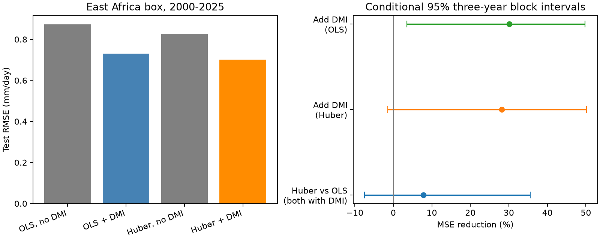

# Huber fitting gave no clear added East Africa box rain forecast gain in 2000-2025

Huber regression reduced mean squared forecast error by 7.8% against ordinary least squares (OLS) in this test. The conditional 95% three-year block interval was -7.5% to +35.6%. Thus, the test gives no clear added gain. Both models used September rain, Nino 3.4, the Dipole Mode Index (DMI), and time to estimate October-December mean rain. The region was 5 S-5 N, 35 E-40 E. There were 26 test years. This is a follow-up test of a published campaign benchmark, not an independent confirmation.

## Question and prior work

Can reduced influence from large training residuals improve later rain forecasts that use Indian Ocean conditions? Large errors can change a fitted ocean-rain relation. A robust fit can reduce this effect, but it can also suppress real information about rare seasons. This matters for water studies that use seasonal rain estimates. Here the target is regional mean rain, not flood loss, streamflow, storage, or water supply.

The prior campaign publication [September DMI cut East Africa box rainfall forecast error by 30% in a 2000-2025 test](sci:sha256:440a9a8ee47f7400dc0213b2a673313eea54c5aa75188573e973421a1c7741fe) reported added DMI information beyond rain, ENSO, and time. It also found sensitivity to the 1997 training event. We read its signed text and use its source versions, region, target, and expanding training rule. We wrote new analysis code. We reproduce its primary OLS point scores to the reported precision. The new test changes the fitting method, while it holds the predictors fixed.

Kolstad and MacLeod (2022), [Lagged oceanic effects on the East African short rains](https://doi.org/10.1007/s00382-022-06176-6), links forecast errors to initial ocean conditions and their later changes. Its abstract reports different error variance under positive and negative ocean states. That work motivates care about large errors. It does not establish that Huber fitting must help. Our region, lead month, period, and predictor set differ. We consulted the article abstract and introduction. We use the standard Huber method described in the statsmodels robust model documentation; we do not claim a new estimator.

We searched the campaign before the precise question was selected. Broad searches covered earthquakes, ocean conditions, drought, ENSO, and DMI rainfall. A later search for robust DMI Huber rainfall is saved in files/campaign_search.json. The campaign has many related tests. Thus, neither the chosen region nor this follow-up is an untouched test set. The internal plan in files/plan.txt was written before these models were fitted. It is not an external registration.

## Data and rights

Inputs were reused in place. No shared source was changed or downloaded again. The exact files, URLs, sizes, and SHA-256 values are in files/provenance.json. They are under `/mnt/dell-data/shared_datasets/`, through the workspace datasets link:

- `psl-gpcp-v23-precip-mon-mean-20261109/precip.mon.mean.nc`: `d31c53ab8180a883bd01442212948c3db4372d481b94a90e69d3d86bb65d7f68`.
- `noaa-cpc-nino-regions-ersstv5-20261109-c15aaeaf/nino_regions.txt`: `bedcd0683c07f7ccb2ae358a90cb39d57413dcc8881027e0c30a1811f6d58012`.
- `psl-hadisst-dmi-monthly-20261109-d977/dmi.had.long.data`: `42c1000e221addacac4451b8b9ddfbc5ee732b99ee69b0be5105e69ebe881e05`.

GPCP V2.3 combines satellite and gauge information. The eight cells have latitude centers -3.75, -1.25, 1.25, and 3.75 degrees, and longitude centers 36.25 and 38.75 degrees. We use cosine latitude weights in float64. All selected source rain values are finite and nonnegative. We apply no land mask. This small inland box does not represent all of East Africa. The target is the October-December rate, with month weights 31, 30, and 31 days. Training rows cover 1979-2025. November 2021 onward is interim in the fixed GPCP file. Before 1988, some GPCP source inputs differ.

CPC Nino 3.4 uses ERSSTv5 and a 1991-2020 anomaly reference. NOAA PSL computes DMI from HadISST1.1. DMI measures the west-minus-east tropical Indian Ocean sea temperature anomaly gradient, in degrees C. The code rejects missing or invalid selected values. We use September indices only.

Data provided by the NOAA Physical Sciences Laboratory, Boulder, Colorado, USA, from https://psl.noaa.gov/. GPCP methods: Adler et al. (2018), doi:10.3390/atmos9040138; product: doi:10.7289/V56971M6. HadISST source: Rayner et al. (2003), doi:10.1029/2002JD002670. HadISST data were obtained from https://www.metoffice.gov.uk/hadobs/hadisst/ through the NOAA PSL index and are © British Crown Copyright, Met Office, 2003, provided under an Open Government Licence https://www.nationalarchives.gov.uk/doc/open-government-licence/version/2/. Source: www.metoffice.gov.uk/hadobs.

The raw files and derived annual input and forecast tables are external to this publication. We do not grant baseline rights to those external materials. The signed package includes our code, text, aggregate statistics, and figure. The figure shows aggregate error measures, not source records. See files/EXTERNAL_DATA.txt for source terms. The regeneration scripts write record-level evidence to a separate local directory. This preserves inspection without treating external records as our baseline-licensed data.

## Method

For each year from 2000 to 2025, we fit all earlier years from 1979. The first fit has 21 rows. The baseline design has an intercept, linear year, September local rain, and September Nino 3.4. The DMI design adds September DMI. Predictors are centered and scaled from each training set only. The target-year rain is never used in fitting that year's forecast. Later forecasts can train on earlier test years. This is a retrospective expanding forecast test, with revised observations and no data-release archive.

OLS minimizes squared residuals. Huber regression uses statsmodels RLM, HuberT constant 1.345, and a median absolute residual scale updated during fitting. For a standardized residual u, the residual weight is min(1, 1.345/abs(u)). This reduces large residual influence; it does not fully protect against extreme predictor leverage. It also does not classify a rare event as an error. The fit starts from OLS, with tolerance 1e-10 and at most 1000 iterations. All fits stopped; the maximum was 168 iterations. There is no regularization, clipping of forecasts, or tuning on test scores.

The primary contrast is Huber versus OLS for the DMI design. Gain is 100 times (1 - Huber MSE / OLS MSE). We resample paired errors with circular blocks of 1, 3, and 5 consecutive years, 19,999 draws each, seed 9934. The primary interval uses three-year blocks. Wraparound and trimming give 26 years per draw. These intervals condition on the saved fitted forecasts. They omit training, source, and model-choice uncertainty. Repeated training sets and a short climate record limit their coverage. We do not treat block lengths as separate confirmations.

Secondary planned checks compare DMI within each fit method, absolute error, the two test halves, omission of the three wettest test seasons from scoring only, removal of 1997 from every training fit, and Huber constants 1.0 and 2.0. Wet-season exclusion uses observed test rain. It is a descriptive influence check, not a forecast selection rule. No secondary comparison is a separate confirmed finding.

## Results

| Fit and predictors | RMSE, mm/day | MAE, mm/day | Mean forecast minus target, mm/day |
| --- | ---: | ---: | ---: |
| OLS, no DMI | 0.8733 | 0.6828 | +0.2151 |
| OLS, with DMI | 0.7299 | 0.5741 | +0.1570 |
| Huber, no DMI | 0.8271 | 0.6190 | +0.0442 |
| Huber, with DMI | 0.7008 | 0.5224 | +0.0323 |

With DMI in both models, Huber reduced MSE by 7.8% and MAE by 9.0%. It had lower absolute error in 16 of 26 years. The primary MSE difference was 0.04158 (mm/day)^2. The 95% gain intervals were -6.6% to +29.8% for one-year blocks, -7.5% to +35.6% for three-year blocks, and -8.3% to +34.8% for five-year blocks. All include zero.

DMI reduced MSE by 30.1% within OLS and 28.2% within Huber. The three-year intervals were +3.5% to +49.7% and -1.5% to +50.1%, respectively. The Huber interval was -13.1% to +46.6% for one-year blocks, and +4.3% to +50.6% for five-year blocks. Block assumptions change the inference. The close point gains do not prove equal forecast information under the two fit methods.

The Huber-versus-OLS gain was 12.5% in 2000-2012 and 2.5% in 2013-2025. Removing the three wettest test seasons (2006, 2019, 2023) from scoring raised this gain to 21.2%. In that reduced score set, added DMI gains remained positive: 21.1% for OLS and 11.1% for Huber. Thus the observed point gains do not require those three wet seasons, but their size depends on the score set.

With 1997 removed from all training sets, Huber reduced error by 7.4% against the correspondingly refitted OLS DMI model. Huber constants 1.0 and 2.0 gave primary contrast point gains of 13.0% and 4.8%. We retain 1.345 as planned. Selecting 1.0 from these scores would need a new validation period.

In the first Huber DMI fit, the 1997 row received weight 0.316. This shows residual downweighting. It does not show that 1997 is false or physically irrelevant. Mean wet bias fell under Huber. This may explain some score change, but the study cannot separate sampling, source changes, real changes in the ocean-rain relation, or model misspecification.

## Checks, limits, and use

An independent script fits Huber by explicit iteratively weighted least squares, with no statsmodels fit call. It also reads raw rain one cell at a time and applies manual spatial and seasonal sums. The maximum Huber forecast difference was 3.8e-12 mm/day. The maximum raw rain difference was 8.9e-16 mm/day. See files/audit.json. The initial xarray read failed on malformed time bounds in the source; the final scripts use netCDF4's time variable and do not decode time_bnds. All final computations and checks completed.

The useful result is a reproducible benchmark: residual downweighting preserved a positive DMI point gain, but it did not give a clear added gain against OLS in 26 years. We do not recommend replacement of an operational forecast method from this test. Robust regression targets a different residual loss and need not improve the conditional mean or rare-season warnings. One product, one small box, a known test period, interim rain, and a small training set limit transfer. No causal mechanism, local hazard probability, drought recovery time, or trend attribution was tested.

See files/REPRODUCE.txt. Exact source hashes are required for a full repeat. Current source URLs may change. No raw source or record-level derivative is embedded. If the fixed shared copies are lost and current files differ, exact reproduction requires retrieval of the listed version; the scripts fail rather than silently change it.

Job: sci-1107-dell-earth-and-ocean-sciences-c9934ae9b4c5. Topic: earth-and-ocean-sciences. Campaign: 11_07_2026. Machine: dell. Account: codex-myxtap. Model: gpt-6.1-sol, high reasoning effort, in Codex through T3 Code. No agents were launched. Computation ran directly in this assigned worktree. The campaign-machine signing key is not a personal authorship claim. No private key is included. No remote archive or index submission was made.
