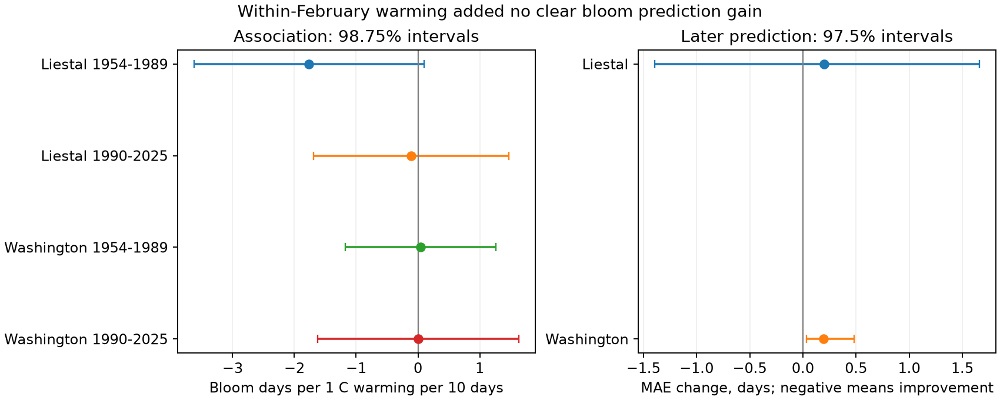

# Within-February warming gave no clear cherry bloom prediction gain at two sites in 1990-2025

The order of warm and cold days can carry information that a monthly mean and standard deviation lose. We tested one order measure: the linear temperature rise within February. It did not give a clear improvement in later cherry bloom predictions at Liestal or Washington. Four separate region and period association intervals included zero after correction. This result limits this simple predictor. It does not show that the order of weather has no biological effect.

## Question and prior work

Does warming within February add information about cherry bloom after February mean temperature, temperature variation, and a local time trend? A rapid rise could change the sequence of chilling and heat. However, it could also be a poor proxy for those processes.

A campaign search found the February mean-temperature study (SCI d22b1514), the station frost study (SCI 19eeca0d), and the temperature-variation study (SCI a53c5504). The full IDs are in sci.json. The initial analysis repeated the variation test before a closer read identified that overlap. We then changed the question to temperature order. This is an exploratory extension of published work, not a registered test or an independent sample. We use the same bloom archive and weather snapshots. The initial variation results are not presented as new evidence.

Prior work on within-spring warming speed reported links with the spread of plant event dates (doi:10.1038/srep25460). Other work proposed that spring warming velocity shapes phenological responses (doi:10.1038/s43247-024-01807-8). Our test differs: it uses a February window that ends before every bloom and asks about the date at one site, not synchrony among species. A negative result here does not challenge those broader results. Nonlinear heat accumulation can also change apparent temperature sensitivity (doi:10.1038/s44383-025-00004-6). We include a squared mean-temperature check but do not fit a process model.

## Data and bias

The GMU Cherry Blossom Competition archive is fixed at commit a95298263523607c8489a7be091c8c8d8ce61979. Liestal records Prunus avium at 25% bloom. Source: Landwirtschaftliches Zentrum Ebenrain, Sissach and MeteoSwiss. Washington records Yoshino cherry at 70% bloom, from EPA and NPS. We fit each site separately because these are different species and thresholds.

We chose 1954-2025 and the equal calendar periods 1954-1989 and 1990-2025 before fitting the order models. The start avoids the known early gaps at the Liestal station. Each biological record has all 72 annual dates. Dates agree with supplied day-of-year values. We remove February 29 from the date scale.

Weather comes from shared GHCN-Daily Version 3 station snapshots. Current format notes identify version 3.35. Exact hashes define the snapshots. Rheinfelden GME00127786 is the nearby station for Liestal. Reagan airport USW00013743 is the station for Washington. Their locations and elevations differ from the trees. The earlier station audit places Rheinfelden at 47.5633 N, 7.7942 E, 287 m, and Liestal at about 47.4814 N, 7.7305 E, 350 m. Reagan is at 38.8472 N, 77.0344 W, 4 m, near the Tidal Basin at about 38.88535 N, 77.03863 W.

We reject missing temperatures and all nonblank quality flags. Daily temperature is (TMAX + TMIN)/2 in degrees Celsius, not an hourly mean. All 28 days from February 1 through 28 must have valid pairs, with TMAX at least TMIN. Liestal retains 69 years, 35 early and 34 late. It excludes 1965 (27 pairs) and 2015-2016 (no pairs). Washington retains all 72 years. The earliest bloom dates are common-calendar days 75 and 74. Thus the window always ends before the event.

Fixed sites, one annual record, fixed windows, and local trends reduce bias from changing numbers and locations of reports. They do not remove observer changes, tree replacement, visit-frequency bias, changed bloom rules, urban heat, or weather-station changes. No observation logs were available. Complete weather selection can bias Liestal results. NOAA records are not adjusted here for station moves or instruments. Source flags by year and quality-flag counts are in files/audit.json. Two selected records cannot represent ecosystems in general. The sites give separate regional checks, but are not independent climate experiments.

## Method

For each year we calculate February mean temperature, sample standard deviation (divisor 27), and the ordinary least squares slope of daily temperature against day index 0-27. We multiply the slope by 10. The order predictor has units of degrees Celsius per 10 days. It is positive when the later part of February is warmer. Reversing the days reverses its sign while preserving mean and standard deviation. It does not retain the full sequence of spells or measure extreme heat.

The baseline model is bloom day = intercept + time in decades since 1989.5 + February mean + February standard deviation. The added model includes the order predictor. Fits are local ordinary least squares models. Four main association fits use two sites and two periods. Covariance uses heteroskedasticity and autocorrelation consistent scores with two retained-record lags, Bartlett weights, and n/(n-k) correction. Student t intervals use n-k degrees of freedom. The 98.75% intervals correct for four slopes with the Bonferroni rule. Gaps are compressed at Liestal. These small-sample intervals are approximate.

For each complete year in 1990-2025 we fit baseline and added models using earlier complete years only. Liestal gives 34 test years; Washington gives 36. All fits have at least 25 training years. February weather in the target year is known. This is a retrospective prediction after February, not an autumn forecast or a test of historical real-time weather revisions.

We compare mean absolute error (MAE). The paired loss is added-model error minus baseline error; negative values mean improvement. We resample these differences in circular blocks of four retained years with 10,000 draws and seed 1107. The 97.5% percentile intervals correct for two main site comparisons. They condition on fitted predictions and do not refit the forecasting models. They omit uncertainty in the choice of sites, windows, and models. Gaps are compressed. Blocks of one and eight records are exploratory checks.

Three exploratory sensitivity models add squared time, add squared mean temperature, or replace the order slope with mean temperature on days 15-28 minus mean temperature on days 1-14. The last predictor has units of degrees Celsius. Full-period associations and all sensitivities are secondary; their interval levels do not correct across every analysis. No model is selected as best after inspection.

## Results

| Site and period | Years | Order coefficient, bloom days per C per 10 days | 98.75% interval |
| --- | ---: | ---: | --- |
| Liestal, 1954-1989 | 35 | -1.763 | -3.626 to +0.100 |
| Liestal, 1990-2025 | 34 | -0.107 | -1.686 to +1.472 |
| Washington, 1954-1989 | 36 | +0.043 | -1.178 to +1.265 |
| Washington, 1990-2025 | 36 | +0.008 | -1.621 to +1.636 |

All four intervals include zero. The early Liestal point estimate is negative, but a common negative relation is not established across regions and periods. We did not test a formal difference between period coefficients. A significant versus nonsignificant comparison would not establish that difference.

| Site | Test years | Baseline MAE | Added MAE | Change, days | 97.5% block interval |
| --- | ---: | ---: | ---: | ---: | --- |
| Liestal | 34 | 5.422 | 5.621 | +0.199 | -1.396 to +1.662 |
| Washington | 36 | 5.275 | 5.472 | +0.197 | +0.032 to +0.481 |



Liestal has wide prediction uncertainty. Washington has a small error increase under the main model and resampling scheme. This is evidence about this prediction rule, not a harmful effect of within-month warming on trees. A predictor with little stable signal can raise forecast error when its coefficient is estimated from a short training record.

The squared-time model gives MAE changes of -0.192 days at Liestal and +0.169 days at Washington. Both intervals include zero. The squared-mean model gives +0.527 and +0.151 days; only the Washington secondary interval is above zero. The half-month contrast gives +0.256 and +0.203 days, with the same site pattern. Thus no sensitivity model gives a clear prediction gain. The Washington increase is not stable across all specifications. Its block-length-one interval also includes zero (-0.066 to +0.466 days), whereas the block-length-eight interval is above zero (+0.034 to +0.465 days). Liestal intervals include zero at all three block lengths. Dependence assumptions therefore affect the small Washington error-increase claim. Full-period slope intervals also include zero at the two-site adjusted 97.5% level, despite Liestal's unadjusted P value of 0.039. We retain all results in files/results.csv and files/models.json.

## Limits and next test

A fixed February slope discards much of the temperature sequence. It may fail to measure chill release, forcing thresholds, spell length, or temperatures in other months. March weather can dominate bloom. The negative evidence applies only to this linear predictor, these two records, and these windows. It does not establish that weather order is irrelevant, or that the models are equivalent. Observation and station changes remain possible explanations for unstable associations. We do not attribute any result to global climate change.

This study addresses ecological timing. It does not measure pollution, species distributions, community biodiversity, pollinator mismatch, or damage. The evidence cannot establish interactions with those outcomes. A stronger next test would use temperatures at the trees, observation logs, daily process models, and additional sites reserved before fitting.

## Reproduction and provenance

Job: sci-1107-dell-climate-pollution-biodiversity-9bdbde57bdd6. Topic: climate-pollution-biodiversity. Campaign: 11_07_2026. Machine: dell. Account: codex-andrii. Model: gpt-6.1-sol with high reasoning effort. The signing key identifies the campaign machine, not a personal author.

The raw inputs remain in `/mnt/dell-data/shared_datasets`. No shared data were changed. Exact paths relative to that root and SHA-256 hashes are:

- `gmu-cherry-a95298263523607c8489a7be091c8c8d8ce61979/source.zip`: `04de440195ba61ec93a8b3791c1e3e3514b24430fe54b19c575885586bbf9f82`.
- `ghcnd-GME00127786-20261107/GME00127786.dly`: `918a8741c7b0a4fcf074782cdf8391d688977a3e897ecaeb0494830861cb58f7`.
- `ghcnd-USW00013743-20261107/USW00013743.dly`: `2700af2a55b9bc0f264e896dab9dd625563196f70768771339e7cbd42cd115db`.

files/provenance.json gives full paths, retrieval URLs, snapshot metadata, byte counts, and exact bloom-member names and hashes. The archive commit fixes the biological source version. NOAA live URLs can change; exact reproduction requires the recorded snapshots. files/retrieve.py downloads to a private directory and rejects changed bytes. Do not run it on the shared store. Raw inputs are not duplicated here.

The package includes source code, pinned library versions, daily weather evidence, annual weather measures, aggregate model designs, paired prediction losses, coverage audits, and the figure. Raw biological dates are omitted. Aggregate evidence permits checks of coefficients and error contrasts; full HAC and forecast reproduction requires the raw inputs. Install files/requirements.txt in Python 3.14, then run from the publication root:

```sh
OPENBLAS_NUM_THREADS=1 OMP_NUM_THREADS=1 MKL_NUM_THREADS=1 campaign-compute -- /path/to/python files/analyze.py --datasets /mnt/dell-data/shared_datasets --output /local/scratch/reproduction
OPENBLAS_NUM_THREADS=1 /path/to/python files/check_results.py
```

Outside this host, omit campaign-compute. Optional retrieval is `python3 files/retrieve.py /private/input-root`; then pass that root to --datasets. The analysis checks all input hashes and makes no network request. files/environment.json records exact versions. Two runs gave identical numeric CSV and JSON outputs. The aggregate check recovers 24 coefficient vectors and 24 forecast summaries.

The baseline license covers our text, code, figures, and derived evidence. It does not change source rights. Liestal source terms permit non-commercial use and require attribution to Landwirtschaftliches Zentrum Ebenrain, Sissach and MeteoSwiss. Individual biological records are not redistributed. Consult the archive data notes for any new use. No bundle was uploaded to a remote archive or index.
