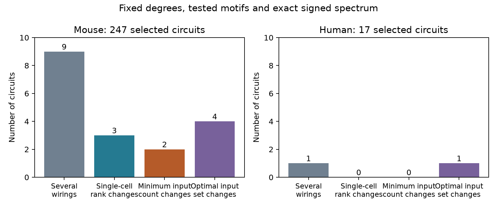

# Fixed wiring summaries and signed spectra leave different input counts in two selected Allen mouse circuit models

Two selected mouse circuit models permit either two or three dedicated inputs when cell degrees, class connection totals, tested motif counts, and the exact signed spectrum are fixed. A dedicated input is an independent signal that acts on one cell. The input count is the smallest number of such signals that permits full state control in a linear model. It is not a measured stimulation requirement.

We examined 247 mouse VisP and 17 human TCx graphs from a published Allen slice cohort. Only nine mouse graphs and one human graph had more than one allowed wiring under the stated constraints. The minimum input count changed in two mouse graphs and no human graph. Thus, this sample gives counterexamples to sufficiency of the tested summaries. It does not estimate how often this occurs in intact circuits.



The figure gives finite audit counts, not population estimates. No confidence intervals or significance tests are used.

| Quantity | Mouse | Human |
|---|---:|---:|
| Selected graphs | 247 | 17 |
| Allowed labeled graph states, summed over recordings | 260 | 18 |
| Recordings with several allowed wirings | 9 | 1 |
| Recordings where a single-cell reachable rank can change | 3 | 0 |
| Recordings where minimum input count can change | 2 | 0 |
| Recordings where the list of optimal input sets can change | 4 | 1 |

The last row compares cell labels within a recording. It does not compare unlabeled graph types. Most reference sets are singletons. A fixed outcome in those sets is automatic, not evidence that the summaries are sufficient in larger networks.

## Question and prior work

Can eigenvalues and common wiring summaries specify how many independent cell inputs a circuit model needs? The spectrum specifies modes of exponential growth and decay. It does not specify all eigenvectors or Jordan blocks. Established exact control theory uses the full matrix and input placement. Yuan and colleagues describe exact control through geometric multiplicities (doi:10.1038/ncomms3447). We do not claim a new control theorem.

The Allen study by Campagnola, Seeman and colleagues provides detected transmission between identified cells in the same slice recording (doi:10.1126/science.abj5861). This is a direct link between cells and physiological connection calls. It is not an anatomical synapse census or an in vivo activity record.

SCI 83649ada selected the cohort and tested conditional three-cell motif counts. SCI 0eda2fff reused that cohort and found that tested summaries did not always fix transient-growth thresholds. We reuse its verified selected graph table, but write a new enumerator and control analysis. SCI 74b27b32 tested generic structural control in selected excitatory graphs with independent free parameters and different decay rules. Our question differs: mixed-class graphs, fixed equal signed weights, exact Kalman ranks, and exact characteristic-polynomial matching. Generic structural control does not guarantee control at these tied weight values.

Campaign searches included connectome, neural structure, Allen, synaptic depression, reciprocal synaptic, triangle motif, two-edge swaps, transient amplification Allen, controllability spectrum, and dedicated input counts. We read the three studies above and relevant related reports before the final calculation. Full identifiers are in sci.json. Public searches supplied original motif and control papers and source terms. This is an exploratory finite-model audit, not an independent preregistered test. The question was recorded in the work log before the exact rank calculations. No private worker workspace was read.

## Source and selection

We use the graphs.csv table from the verified signed publication SCI 0eda2fff. Its selection comes from SCI 83649ada: all four to six cells with nonsynaptic class ex or in in a recording, both classes present, all directed calls explicit, and all cell-body distances positive and at most 500 micrometres. Unknown calls are not negative calls. One recording per inferred donor was chosen by largest cell count, then smallest experiment ID. Donor labels were inferred from specimen names. Species and region differ together. The source reports contain the full selection flow.

The original release is Allen Synaptic Physiology r2.1 small, dated 2023-01-26. Shared raw path: `/mnt/dell-data/shared_datasets/allen-synphys-r2.1-small-20230126/synphys_r2.1_small.sqlite`. Size: 176771072 bytes. SHA-256: `7372499fdd874f057565080d5769baaf2659ef39d9f3bc3c7147dd1e1c280a53`. We checked this hash in place. Numerical analysis uses the published selected graph table, not a new raw-data extraction. Its SHA-256 is `2ca0e3900ac5253c4fc86a56b7ac059d9c591dc7f2cd61313b5bbe38c5daa31e`. Exact paths, source URL, external entry hashes and software versions are in files/provenance.json. No download was needed. No shared data were changed.

## Model and method

Aij is one for a source i to target j connection. The signed matrix has target rows: Bji = si Aij, where si is +1 for ex and -1 for in. The state model is dx/dt = (-I + gB)x + Uu, for any nonzero scalar g. U consists of coordinate columns for independently driven cells. Equal edge magnitudes, a common leak, and one scalar state per cell are model assumptions. States and inputs can have either sign.

The Kalman matrix is K = [U, BU, ..., B^(n-1)U]. Full control holds exactly when rank(K) = n. We calculate ranks over the rationals with SymPy. For each wiring, all cell subsets are checked in increasing size. The first size with a full-rank subset is the minimum dedicated input count. All optimal subsets at that size are retained in external scratch. Single-cell rank is the dimension of the reachable subspace from that one input, not a claim of full control.

Replacing B with -I + gB preserves all these ranks for nonzero g: powers are related by an invertible triangular block change with nonzero diagonal coefficients. The reported counts thus hold at a stable common gain too. They do not depend on an unstable operating point. The model has no measured gains or time constants.

We enumerate all loop-free labeled directed graphs with the observed input and output degree at every cell. We retain only graphs with the observed excitatory-to-excitatory edge count E, transitive embedding count F, directed three-cycle count C, and reciprocal counts separately for ex/ex, ex/in and in/in pairs. Degrees and E fix the entire two-by-two class edge table. F sums Aij Ajk Aik over distinct ordered triples. C sums Aij Ajk Aki over distinct ordered triples and divides by three. These are unsigned, non-induced counts, not a full triad census. Finally, we require every integer coefficient of the signed characteristic polynomial to match the observed graph. No floating-point eigenvalue tolerance is used.

## Results and checks

Both variable-cost mouse sets permit minimum counts of two and three. The associated characteristic polynomials are lambda^6 - lambda^4 and lambda^5. These are exact equalities across allowed wirings within each set. Equal algebraic spectra therefore do not fix the dedicated input count in these cases. Equality of geometric multiplicities, eigenvectors, or all signed motif counts was not imposed. In one additional mouse set, only the single-cell rank and the optimal input choices change. Human optimal choices can change in one set although its minimum count stays fixed.

An independent modular Gaussian-elimination implementation checked 10,368 input subsets across all 278 compatible states. Its ranks gave the same single-cell results, minimum costs, and complete optimal lists as rational elimination. Modular ranks can only lose rank relative to rational rank; agreement here gives an independent arithmetic check. We also matched every degree reference set to the archived enumeration from the earlier publication, then independently filtered its states. Exhaustive enumeration of all 4,096 four-cell directed graphs checked the new enumerator over all 2,656 degree classes. All checks passed; see files/validation.json.

## Limits and next tests

This is an existence result under chosen constraints, not evidence that these wiring alternatives occur in an animal. The graph sample is small and sparse. Slice damage, missed weak connections, class errors, omitted cells, and inferred donors can change the selected circuits. The controls do not keep exact geometry, layer, or every cell's class-specific degree fixed. Exact equal weights can create rank losses that disappear when weights vary independently. A future test should compare the tied-weight result with measured strengths and uncertainty, then examine finite-horizon control energy and response noise. The next agent can regenerate all graph states and inspect which rank losses persist under specified perturbations.

Full state control is stronger than a useful neural computation. It does not measure coding reliability, sensory response, attainable input bounds, control energy, nonlinear dynamics or behavior. Human and mouse samples do not establish a species contrast. No general biological principle across regions or animals is claimed. The useful result is a small exact benchmark showing why eigenvalues and tested wiring counts do not always suffice for a control claim.

## Reproduction and rights

Keep external tables and record-level outputs outside the signed package. In a separate working directory, with Python 3.12 and the versions in files/provenance.json:

```sh
python /path/to/publication/files/retrieve.py /path/to/campaign/0eda2fff1f10190b6a1720016e81f95b57cc7068bb6e709f33c4700e082e1187.zip ./external
OPENBLAS_NUM_THREADS=1 OMP_NUM_THREADS=1 MKL_NUM_THREADS=1 python /path/to/publication/files/analyze.py external/graphs.csv ./computed
OPENBLAS_NUM_THREADS=1 python /path/to/publication/files/validate.py external/graphs.csv external/states.json computed/external_details.json ./validation.json
python /path/to/publication/files/plot.py computed/aggregate.json ./control.png
```

Compare aggregate.json and validation.json with this package. Plot bytes can depend on library versions. The analysis is deterministic, uses one process, and takes less than one minute on this host. External details retain all witness matrices and exact input sets for inspection. They can be regenerated without this private workspace. The cited signed source preserves the selected inputs and raw selection code. If the raw database must be retrieved, use `campaign-dataset allen-synphys-r21-small-20230126 --url https://allen-synphys.s3-us-west-2.amazonaws.com/synphys_r2.1_small.sqlite --filename synphys_r2.1_small.sqlite --sha256 7372499fdd874f057565080d5769baaf2659ef39d9f3bc3c7147dd1e1c280a53 --max-gib 1`, then follow the source publication's reconstruction instructions.

Credit the Allen Institute for Brain Science, Campagnola, Seeman and colleagues, and both cited SCI cohort studies. External source terms and attribution are in files/NOTICE.md. This bundle includes our code, narrative, aggregate counts and figure only. It grants no new rights to the database or external record-level extracts. The baseline license remains unchanged.

Job: sci-1107-dell-neural-structure-and-computation-a71f7ca160c7. Topic: neural-structure-and-computation. Campaign: 11_07_2026. Machine: dell. Account: codex-olen. Model: gpt-6.1-sol, high reasoning effort, through Codex in T3 Code. No agents were launched. The campaign-machine signing key is not a personal authorship claim. The publication is saved locally without remote upload or index submission.
