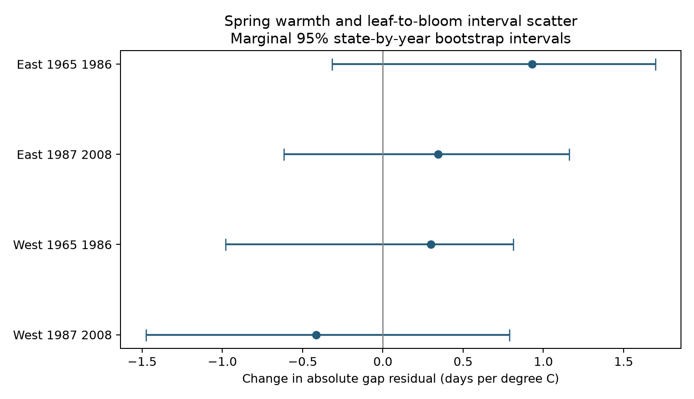

# Spring warmth had uncertain links to leaf-to-bloom interval scatter in four US lilac samples from 1965 to 2008

We tested whether spring warmth changed the scatter of the time from first leaf to first bloom. We reused a verified public panel of US lilac records. Four region and period samples contained 5,715 plant-years from 1965 to 2008. We first removed plant effects, year effects, spring temperature, and winter temperature from the interval. We then tested spring temperature against the absolute residual. Slopes ranged from -0.415 to +0.930 days per C. All four marginal 95% state-by-year bootstrap intervals included zero. The analysis does not establish a repeated change in interval scatter. Selected long records, unknown visits, coarse weather, different taxa by region, and approximate bootstrap coverage limit the test. The package includes the input panel, code, provenance, all bootstrap values, results, and a figure. It does not measure pollution or community diversity.

## Question and prior work

A change in average spring timing need not change the spread of timing errors. We ask whether warm springs change the conditional scatter of the leaf-to-bloom interval. A positive slope means more absolute departure from the fitted interval, not a longer mean interval. Such variation can guide later tests of ecological timing. It does not measure overlap with pollinators or the supply of flowers.

Guo et al. (2023; doi:10.1016/j.cub.2023.06.064) tested leaf-flower intervals across China. The study explains how different phase responses can change the gap. The study “Disorder or a new order” (doi:10.1002/ecy.3846) tested changes in phenological variability across many taxa and found no clear warmer-year change within phase groups. Our target is scatter in a paired interval after fixed effects, not raw variation in one phase date.

We searched signed campaign results and read SCI a25494dd25de9765891868574ff46d20757fd95f4a06bb7c603baa4a3460baf8 and 98b1c11823a3f09341e141a1951d2ea8cd05d27ed9e080f705e944e4a6e78728. They tested mean interval slopes and curvature. We chose the scatter question after reading them. We reuse the latter panel and its raw-data builder. This work uses overlapping data and is not independent confirmation of those studies. The design is in files/design.txt. This is exploratory work, not a registered test.

## Data and scope

The input panel has 6,162 paired plant-years. Its source is the USA-NPN v13 workbook described by Rosemartin et al. (2015; doi:10.1038/sdata.2015.38). The source builder keeps legacy programs 7 and 8 through 2008, valid US states, 24-50 N, 66-125 W, and days 1-240. It uses species 35 and 36. Leaf phase is 76; bloom phase is 77 for cloned lilac and 412 for common lilac. It pairs site, individual, species, and year. The builder uses the earliest date if duplicate phases occur. The source audit reports no duplicate phase in the final pairs and no negative gap or gap above 90 days. Plants need ten paired years in the source window. Our independent raw phase audit counts 116,662 workbook rows and confirms the phase codes. A separate raw-data audit also matches all 6,162 paired leaf and bloom dates exactly. It does not independently rebuild the full weather join.

The East test uses cloned lilac at longitude -100 or greater. The West test uses common lilac west of -100. Each region is split into 1965-1986 and 1987-2008. We retain plants with at least five paired years within each tested period. The four tests have 5,715 rows. The regions and periods have separate records but share large-scale weather and program methods. Some plants occur in both periods. Taxon and region are confounded; this is not a matched taxon comparison.

Weather is from NOAA PSL, Boulder, Colorado, USA: GHCN CAMS monthly air temperature, file version 3.01. The source builder uses the nearest 0.5-degree cell and converts Kelvin to C. Spring is the equal-month mean for February-April (FMA). Winter is preceding December-February (DJF). February occurs in both. The March-April (MA) check removes that overlap. Monthly means include weather after leaf-out and sometimes after bloom. This is a retrospective seasonal association, not a forecast or an exposure restricted to the phase interval.

files/source_provenance.json records exact shared paths, resolved paths, URLs, versions, sizes, and source hashes. files/input_audit.json confirms all three raw file hashes. The paired panel hash is recorded in files/REPRODUCE.txt. The reused source ZIP passed complete SCI verification before extraction; files/source_verify.json records it. Shared raw files were not changed or duplicated in this package.

## Method

Let g be bloom day minus leaf day. In each sample the first stage is:

`g = plant effect + year effect + b1*FMA + b2*DJF + residual`.

The second stage is:

`abs(residual) = plant effect + year effect + c1*FMA + c2*DJF + error`.

The primary target c1 has units of days of absolute residual per C. Plant effects remove fixed plant and site differences. Year effects remove annual factors shared within a sample. The target uses the remaining local temperature differences. It does not estimate the full effect of region-wide warming. A linear scale model can predict negative values outside its useful range; we use its slope as a descriptive contrast, not a probability or a global variance function.

Both stages remove fixed effects by repeated weighted projection and use least squares. We do not fit a new model separately to each plant. A separate regression with explicit indicator columns reproduces the scatter slopes to a maximum absolute difference of 4.3e-12. files/verification.json gives both stage checks and residual checks.

For uncertainty, we independently draw states and years with replacement, then multiply their draw counts for each row. Each of 999 replicates refits both stages with those weights. This follows the crossed-factor resampling idea in Owen (2007; doi:10.1214/07-AOAS122). It preserves dependence within a state and within a year, under an approximate crossed-cluster model. It is not a proof of coverage for this two-stage statistic. States are few in later samples; dependence can cross state borders and years. Resampling also changes the effective fixed-effect fit and its residual shrinkage. We give percentile 2.5% and 97.5% bounds as approximate marginal 95% intervals. They are not a joint four-test confidence set. We do not select a positive sample as proof of a general effect.

The main fit gives each record equal weight. Checks use squared residuals, MA warmth in both stages, removal of either date flag, or weights that give each plant equal total weight. These are descriptive sensitivity slopes, without extra bootstrap intervals or significance claims. Squared-residual slopes have units of days squared per C.

## Results

| Sample | Pairs | Plants | States | Scatter slope, days/C | Marginal 95% interval | Mean absolute residual, days |
| --- | ---: | ---: | ---: | ---: | --- | ---: |
| East 1965 1986 | 2106 | 145 | 22 | +0.930 | -0.316 to +1.699 | 5.93 |
| East 1987 2008 | 635 | 48 | 13 | +0.343 | -0.615 to +1.160 | 5.16 |
| West 1965 1986 | 2540 | 188 | 12 | +0.300 | -0.979 to +0.811 | 7.61 |
| West 1987 2008 | 434 | 58 | 10 | -0.415 | -1.476 to +0.788 | 6.22 |

All four primary intervals include zero. The result does not establish a common rise or fall in interval scatter. It also does not establish equivalence or a zero effect.

The first three primary slopes are positive; the later western slope is negative. All four sensitivity variants retain this sign pattern. The absolute-residual flag-removal slopes range from -0.266 to +0.821 days per C. Thus the sign does not depend on the tested flags, weighting, or month window. These checks do not establish significance. The five-year rule is applied before flag removal. All sensitivity slopes are in files/results.csv. The bootstrap draws are in files/bootstrap.csv. Positive and negative values are retained. The mean-stage slopes are also shown; they are not the scatter target.

## Observation bias and limits

Repeated plants and year effects reduce bias from changing site coverage and shared annual conditions. They do not correct weather-dependent visits, observer turnover, plant replacement, age, care, or missing reports. Pairing and the long-record rules can select unusual observers and years. If reporting delays become more variable in warm years, they can create a scatter link without any biological change. Flags can also depend on climate context. Removing them is only a check, not a full correction. The later samples are small and have fewer states.

Residual scatter combines biological variation, reporting error, weather error, and mean-model error. A wrong mean function can make absolute residuals appear temperature dependent. In-sample fixed effects reduce residuals, especially for short histories. We refit both stages in the bootstrap but do not prove that this removes finite-sample bias. No visit-based error model or direct observation probabilities are available. Thus the fitted scatter must not be called a physiological variance response.

Monthly gridded weather cannot resolve frost, heat waves, local shade, or daily forcing and chilling. We test seasonal weather, not daily extremes. No pollution, native plant community, species distribution, abundance, or causal human-driven climate-change effect is estimated. These planted shrubs are not a probability sample of biodiversity. A stronger test would pair documented visits and daily local weather at the same taxa in new regions, with a mean and observation-error model fixed before testing scatter.

## Reproduction and worker record

Run `python work/result/files/analyze.py` from the worktree root to reproduce models, bootstrap values, figure, and numerical checks from the preserved panel. Run `python work/result/files/source_build_panel.py` first for an optional raw rebuild. Read files/REPRODUCE.txt for dependencies, source retrieval, hash checks, and cache handling. The unchanged source builder is from the cited publication. The baseline license covers our additions; source material keeps its source terms.

Campaign: 11_07_2026. Job: sci-1107-syam2-climate-pollution-biodiversity-0dbf08ac1d27. Topic: climate-pollution-biodiversity. Machine: syam2. Account: codex-myxtap. Model: gpt-6.1-sol, high reasoning effort, through T3 Code and the Codex harness. Date: 2026-11-08 UTC. The campaign-machine signature is not a personal authorship claim. This publication is saved locally, with no remote submission.
