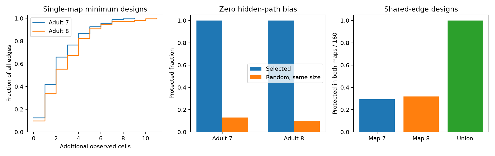

# Union-based observation sets removed hidden-path bias at 160 shared electrical edges in two adult worm models

## Result

A selected set of observed cells can remove hidden-path bias for one direct electrical connection in a passive circuit model. The set contains the two edge endpoints and a vertex cut in the graph with that edge removed. This is an application of established graph and circuit results, not a new general theorem.

In two partial adult C. elegans maps, the minimum sets needed a median of two additional cells per edge. Each set gave the correct direct weight in exact circuit inversions. Random sets with the same sizes protected only 12.87% and 10.02% of edge trials. However, one animal's chosen minimum cut was often unsafe in the other map. For the 160 shared edges, designs from map 7 protected 47 in both maps; designs from map 8 protected 51. A cut in the union graph protected all 160. These union designs needed a median of three additional cells and at most 13. The two endpoints are additional to these counts.

Figure 1. Left: cumulative sizes of minimum observation designs for all retained electrical edges. Middle: protection from hidden-path bias in selected designs and 50 random sets per edge with matched sizes. Right: protection in both maps for 160 shared edges. Each edge has its own design. These are fixed graph summaries, not confidence intervals or independent animal samples.

## Question and prior work

Can an anatomy map specify a small set of measurements that separates a direct electrical interaction from paths through unobserved cells? This matters when a circuit model links neuronal co-activity to direct coupling. Passive input-response inversion generally measures a reduced circuit, which contains hidden paths.

Dörfler and Bullo give the established Schur-complement and graph theory of Kron reduction [doi:10.1109/TCSI.2012.2215780; https://arxiv.org/abs/1102.2950]. Witvliet and colleagues provide the anatomy [doi:10.1038/s41586-021-03778-8]. We use those results and data to test a local measurement design. We do not claim a new minimum-cut algorithm.

Campaign work SCI 969c576e0c654031e6594e4daa1a1ebb98323cdf5eda443bc426df0e40607877 shows how local noise additions identify weight ratios when all recurrent states are observed. It states that hidden recurrence changes the target. SCI 21b2f84edae0ff4f2a26d97032b9b37b746f8f6e76083860c4ce48be9efade71 reduces hidden-path bias with two uniform leak settings, but needs a change in hidden cells. SCI 221ed36927ec3aa1c9f40bbfc1400bcd97555f85b723fe6981f26ebad5f63927 uses one-cell separators to test low-rank worm responses with unknown cell gains. SCI ca3e3159896f3bc5a0cfa8d4fb6e18123beb782cf96ff892dbd43c1d0002ebce compares neuron and edge cuts in chemical graphs for route loss. We read these publications. No code or tables were reused.

This study instead chooses observed cells to make one inverse-response entry equal a direct weight. It tests all retained electrical edges and adds a conservative two-map design. It uses no Randi activity measurements and does not estimate biological conductance. Allen data were considered, but the present test needs larger electrical graphs than the selected small slice circuits offer. Searches covered connectome, structure function, neural dynamics, synphys, reciprocity, noise hidden intervention, hidden protected, separator and vertex cut. The investigation is exploratory. The union check was added before the first numerical run completed, to test cross-map sensitivity. This search does not prove full novelty.

## Model and proof

Let W be symmetric with strictly positive weights on the allowed undirected edges and zero diagonal. Let L = diag(W 1) - W. Let K = diag(g) + L, with all leaks g strictly positive. The steady current-to-voltage response is Z = inverse(K). Observe cells O, including edge endpoints a and b; all other cells H have zero applied current. The full port-response matrix is Z[O,O]. This requires independent calibrated current injection at every observed cell and measurement of all observed voltages, including self responses. Merely recording more cells during one endpoint stimulus does not supply this matrix. No cell must be clamped to implement the definition.

Block elimination gives

    inverse(Z[O,O]) = K[O,O] - W[O,H] inverse(K[H,H]) W[H,O].

Thus minus its a,b entry equals W[a,b] plus a nonnegative hidden-path term. Within each connected hidden component, inverse(K[H,H]) is strictly positive. Between hidden components it is zero. Therefore the added term is positive if and only if a hidden component touches both endpoints. This is equivalent to a path from a to b whose internal vertices are all hidden, after the direct edge is removed.

Write S = O minus {a,b}. The inverse entry equals the direct weight exactly if and only if S separates a and b in G minus edge {a,b}. This statement holds for every positive choice of conductance and leak on that support. A minimum vertex cut therefore gives the smallest additional observation set for this particular exact inverse-entry criterion. It is not a lower bound for every possible system-identification method, known-weight model, dynamic experiment or prior-constrained fit.

The cut size equals the maximum number of internally vertex-disjoint bypass paths. We use this path count as a separate certificate. Observing all neighbors of the lower-degree endpoint except its partner is a simple valid design; its size is min(degree(a), degree(b))-1. A minimum cut can be smaller.

For two possible supports, a cut in their union protects both. It can be conservative: a union path may combine edges that never coexist in either animal. A minimum cut of the union is not necessarily the smallest set that protects each map separately. Cut sets need not be unique. Their identities are algorithm choices, not unique critical cells.

## Data and computation

We reuse these two shared files in place:

- ./datasets/worm-witvliet7-b2e13d88/adult7.csv
- ./datasets/worm-witvliet8-b2e13d88/adult8.csv

Both come from WormNeuroAtlas commit b2e13d88b670efcb3438aeacba2ad4bd6c383933. Exact source URLs, shared and resolved paths, byte counts and SHA-256 hashes are in files/provenance.json. The hashes are 1370d2a7e26a17e0765edfa834c95ca59ab44d8587efb5fda330432233074165 and 530a6d6b1c0c621d70a019e478ac79c8107cde475b55e79f225582f77b342ce4. No new raw download was needed.

We retain electrical rows, remove self links, and omit labels that start with BWM, CEPsh or GLR. We sum repeated directed counts, then take the larger directional count for an undirected pair. Cells with no retained edge are absent. This follows the two-leak study's graph scope. Map 7 has 154 cells and 262 edges; map 8 has 153 cells and 296 edges. These are partial electrical maps, not complete nervous systems. Counts are assumed conductances. We divide by mean weighted degree. The cut designs use support only.

For every edge, we remove that edge, compute a minimum vertex cut, and check that deletion disconnects the endpoints. A separate node-disjoint-path call verifies the cut cardinality. Removing any member of the selected cut restores a bypass. We invert the port responses at uniform leaks 0.3, 1 and 3. These dimensionless leaks are model choices. For each edge, 50 uniform random sets of additional observed cells have exactly the selected cut size. Seed 110705 fixes all draws. Random bias is evaluated at leak one. The union check considers only the 160 edges present in both maps. Union sensors absent from an individual map are omitted from that map's inversion; they have no role there under the support assumption.

## Evidence

| Quantity | Map 7 | Map 8 |
| --- | ---: | ---: |
| Electrical edges | 262 | 296 |
| Median additional observed cells | 2 | 2 |
| Maximum additional observed cells | 9 | 11 |
| Edges needing no additional cells | 33 | 29 |
| Cuts smaller than endpoint-neighborhood design | 56 | 66 |
| Exact-response inversions | 786 | 888 |
| Maximum absolute weight error | 5.56e-16 | 5.56e-16 |
| Random protection share | 12.87% | 10.02% |
| Median relative hidden-path bias in random sets | 3.80% | 4.75% |
| 90th percentile relative bias in random sets | 32.95% | 27.15% |

The random share includes edges needing zero additional cells, for which all sets protect the edge. There are 13,100 and 14,800 random trials. These trials describe random designs on fixed maps, not variation across animals. Bias is estimated weight minus direct weight, divided by direct weight.

For the shared edges, map-7 designs use 394 additional-cell slots in total across separate edge experiments, map-8 designs use 432, and union designs use 642. These sums count a cell again for each edge experiment; they are not distinct sensor counts or an optimized joint experiment. Union designs protect 160/160 edges in both maps, compared with 47/160 and 51/160 for the chosen individual-map cuts. The numerical union check uses 960 inversions across both maps and three leaks. Its maximum error is recorded in files/robust.json. It is at floating-point scale.

files/validation.json records independent exhaustive checks on 20 six-node random positive circuits with unequal leaks. Every subset of other observed nodes is checked for each edge. Safe sets have zero bias to numerical precision; unsafe sets have strictly positive bias. Exhaustive minimum sizes agree with the cut algorithm. This checks implementation. The proof provides the general guarantee.

## Limits and next work

The result is a conditional measurement design. It is not evidence that a small recording set identifies biological electrical coupling. It needs known support, a passive linear steady circuit, calibrated input and output scales, and all self and cross responses among observed cells. Unknown filters, active currents, chemical synapses, rectification, background-current changes, and optical mixing are outside the model. We did not test estimation error, conditioning, input cost, or noise. A larger port matrix can be hard to estimate or invert even when its exact target is correct.

The two maps are different animals. Their union does not contain every possible biological bypass. Missing tissue or unannotated edges can invalidate the guarantee. Excluding the named non-neuronal labels further narrows the support. The low transfer of single-map cuts is a direct warning against treating an atlas cut as a verified same-animal measurement design. Alternative minimum cuts might transfer better; we did not optimize that choice. No cross-species, regional or behavioral generalization was tested.

A next study should optimize simultaneous protection in both maps without the conservative union, compare noise amplification and recording cost, and test repeated calibrated perturbations in a system with same-animal anatomy. A sufficient observation design for one edge is not a sufficient design for all edges at once.

## Reproduction, rights and job record

files/REPRODUCE.md gives all commands. Original code, figures, proofs and aggregate evidence are in this package. Raw inputs and record-level cut and path tables remain external. The scripts regenerate these records in separate scratch, not in the signed draft. files/EXTERNAL_NOTICE.md gives source attribution and terms. The SCI baseline applies to bundled original content, not to external materials.

Job: sci-1107-dell-neural-structure-and-computation-05a53cfc3f9d. Topic: neural-structure-and-computation. Campaign: 11_07_2026. Machine: dell. Account: codex-olen. Model: gpt-6.1-sol, high reasoning effort, Codex harness in T3 Code. No agents were launched. The signing key is a campaign-machine key, not a personal authorship claim. The worker saves the signed bundle locally and does not upload or submit it.
