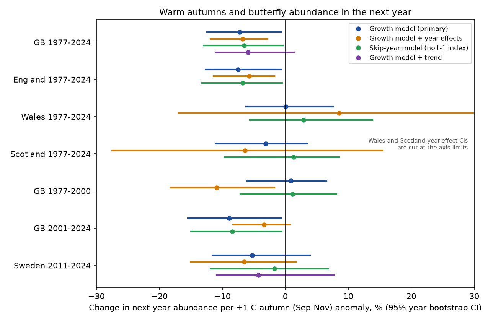
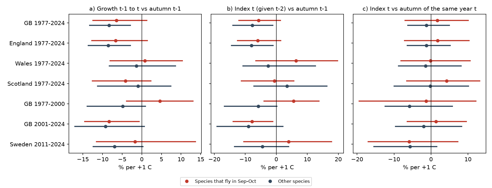
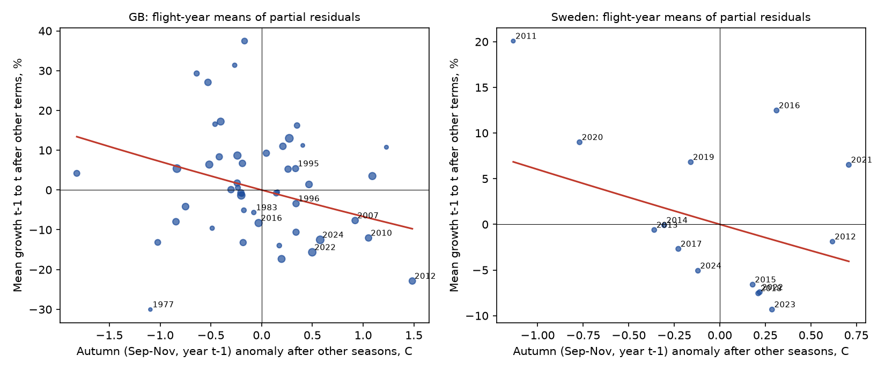

# Warm autumns were followed by about 7% fewer British butterflies per 1 C in 1977-2024, but the link depended on 2007 and 2012 and did not repeat in Wales, in 1977-2000 or clearly in Scotland and Sweden

## Summary

Forister et al. (2021, *Science* 371:1042, doi:10.1126/science.abe5585) found that butterfly counts in the western United States decreased by 1.6% per year over four decades. They associated the decrease mainly with warmer autumns (September-November). Warmer summers had a positive association. We tested the autumn explanation with independent monitoring data from Great Britain and Sweden.

**Data.** We used UK Butterfly Monitoring Scheme (UKBMS) site indices for 1976-2024 (2,810 transects, 57 resident species) and Swedish Butterfly Monitoring Scheme (SeBMS) visit counts for 2010-2024 (546 sites, 82 species). We used E-OBS gridded daily temperature and precipitation at the site cell.

**Method.** The response was the change in log abundance from year t-1 to year t at one site, for one species. The test term was the temperature anomaly of the autumn between the two flight seasons (September-November of year t-1). The model also had the other four seasonal temperatures and five seasonal precipitation totals, the log abundance in year t-1 (density dependence) and a site x species effect. We found confidence intervals (CIs) with a bootstrap that resamples whole years. We wrote the analysis plan before we fitted the models (`files/code/PLAN.md`).

**Main results.**

1. In Great Britain (GB), 1977-2024, a +1 C warmer autumn was followed by 7.3% lower abundance in the next year (95% CI -12.4% to -0.7%; 420,534 site-species-years). England alone gave the same result (-7.5%). A model with year effects (only differences between sites in one year) gave -6.8% (-11.9% to -2.8%).
2. **The link did not repeat in all samples.** Wales: 0.0% (-6.2% to +7.6%). Scotland: -3.1% (-11.1% to +3.5%). GB 1977-2000: +0.9% (-6.1% to +6.6%). GB 2001-2024: -8.9% (-15.5% to -0.7%). Sweden 2011-2024: -5.3% (-11.6% to +3.9%). Thus, the planned replication rule (a CI below zero in most samples) failed. The CI was below zero in 3 of 7 samples (GB, England, GB 2001-2024). These three samples share most of their sites and years.
3. **Two years carry much of the GB signal.** Warm autumns 2006 and 2011 came before the two worst recent butterfly years, 2007 and 2012. Both of these summers were very wet. Without the flight years 2007 and 2012, the GB estimate was -5.1% (-12.0% to +1.7%). With a linear time trend, it was -5.9% (-11.0% to +1.4%). The national England collated indices gave -6.6% (-12.7% to +1.0%).
4. **An observation artefact does not explain the result.** A warm autumn can make late-season counts higher in year t-1. This makes the year t-1 index higher and the growth to year t lower, even if the population does not change. Three checks did not find this artefact. (a) The autumn of the same year t (a "future autumn" placebo) had no link to growth: GB +0.7% (-6.0% to +7.3%). (b) A skip-year model, which compares year t with year t-2 and does not use the year t-1 index, gave the same GB result (-6.5%, -12.9% to -0.4%). (c) Species that do not fly in September-October had a similar or larger slope (-8.3%, -13.3% to -2.9%) than species that fly late (-6.5%, -12.5% to +1.3%).
5. **Species signs were mostly negative.** In GB, 44 of 52 species slopes were below zero. The CI was below zero for 14 species and above zero for none. In Sweden, 26 of 40 slopes were below zero (CI below zero: 3; above zero: 0). These counts are not independent tests, because all species share the same years.
6. **Summer warmth agreed with Forister et al.** The temperature of the flight summer had a positive link to abundance in every sample: GB +12.6% (+5.2% to +17.7%), Scotland +31.9%, Wales +16.5%, Sweden +6.6% (-1.7% to +15.6%). This term includes weather effects on the count itself.
7. **The overwintering stage did not give the expected pattern.** The metabolic-cost explanation predicts the strongest decrease for dormant stages, including adults that hibernate. In GB, the five adult-hibernating species had the weakest slope (-1.1%, -10.0% to +9.3%). Egg, larva and pupa groups had -6.0% to -8.6%.
8. **Size of a possible effect.** If the GB estimate is causal, a lasting +1 C autumn warming lowers mean abundance by about 11% (slope divided by the density term, 0.075/0.619). Autumns at UKBMS sites warmed by 0.32 C per decade in 1977-2024. This gives about -3.8% per decade (-0.4% per year). Without 2007 and 2012, it gives about -2.6% per decade. This is about one quarter of the 1.6% per year decrease that Forister et al. found in the western US.

**Conclusion.** British data agree with the sign of the autumn link that Forister et al. found, and they show that a late-count artefact does not cause it. But the link is weak, it depends on a small number of warm-autumn years that were followed by wet summers, and it did not replicate in Wales, in the 1977-2000 period, or clearly in Scotland and Sweden. Even at the full GB estimate, autumn warming at the British rate explains only a small part of a 1.6% per year decline. The evidence does not show that autumn warming is a general cause of butterfly decline outside the western US.



**Figure 1.** Change in next-year abundance per +1 C autumn anomaly, with 95% year-bootstrap CIs, for each sample and model. Blue: primary growth model. Orange: with year effects. Green: skip-year model (does not use the year t-1 index). Purple: primary model with a linear trend (GB and Sweden only).



**Figure 2.** Observation-artefact checks. (a) Growth from t-1 to t against autumn t-1. (b) Index in year t given year t-2, against autumn t-1. (c) Index in year t against the autumn of the same year t, which comes after the flight season of most species. Red: species that fly in September or October; grey: other species.


**Figure 3.** Species autumn slopes in GB 1977-2024 and Sweden 2011-2024 (dots: growth model with 95% year-bootstrap CI; crosses: skip-year model). Red names fly in September-October.



**Figure 4.** Flight-year means of partial residuals. The x axis is the autumn anomaly after removal of the other seasonal terms; the y axis is mean growth after removal of all other terms. Point size shows the number of rows. In GB, the flight years 2012 and 2007 (warm autumn 2011 and 2006, then wet summers) are at the right end.

## Question

Is a warm autumn (September-November) followed by fewer butterflies in the next flight season in Great Britain and Sweden? Does an observation artefact from late-season counts explain such a link?

## What is new

The campaign record has many tests of UKBMS butterfly indices against summer, winter and spring weather, ozone, nitrogen and drought (for example sci:sha256:124367e558e424dfb10426e017740ce5a8fd519edac6a86ba105193e3a47af42, sci:sha256:d589e9a48d355ac1bbf5b7753ce6165d7768c9bc31d1ce73b29d28bb6fc35644, sci:sha256:71b83140cff8fa9f1f84e83975f89f8adb9d413957bb7d13f55921d83b1a490e, sci:sha256:6d9297f9dede1cff7666b4a2ad43ed5a5a83a005d1de046a24ffce6c39f6305c). It has no test of the autumn-warming explanation of Forister et al. (2021). Sci:sha256:6a2ba4ee97dd1c4ac9652eccaed866f37bef77284c0c73b6245cc9550bbccb1e found that late flights of multivoltine species came before higher next-year abundance; it did not test autumn temperature. This study adds: (1) a direct test of the autumn term with all other seasons controlled, in GB and an independent Swedish dataset; (2) three checks for a late-count artefact; (3) a year-influence analysis; (4) the first campaign use of the SeBMS data (added to the shared datasets).

## Data

| Input | Source and version | SHA-256 of file used | Licence |
|---|---|---|---|
| UKBMS site indices 1976-2024 | EIDC doi:10.5285/53a1c705-4437-48bb-9bcd-b68977f8edd9, `ukbms_site_indices_2024.zip` | `15d11682bee8e0758e3c6c2318237b955b371a3732adf91a8d88a8d53551f090` | OGL-UKBMS (attribution) |
| UKBMS site locations | EIDC doi:10.5285/d7256b49-f2e3-4ae7-907d-af729610c768 | `701dd651cba36906e97b4308415d51cd75468cdab88f05b04fcf27a3b7313b78` | OGL-UKBMS |
| UKBMS collated indices | EIDC doi:10.5285/a70d8b0b-0ef5-484e-8195-42bcfd818229 | `bd8ca89214d77aa94247cd2aff33a02cedff77d1b81760250d6c3ba433b0dec0` | OGL-UKBMS |
| UK Lepidoptera traits (Cook et al. 2024) | EIDC doi:10.5285/dbc7cc17-cbbd-49dd-bab4-8e8855768d66 | `d7671799735840f88f05c5ebf44c138ca2640692315c76b45fb8f454f9b92d37` | OGL (attribution) |
| SeBMS DwC-A v1.13 (2026-10-16) | Pettersson L B (2026), Lund University, GBIF doi:10.15468/othndo, https://www.gbif.se/ipt/archive.do?r=lu_sebms&v=1.13 | `384a2e5145df29268fe2de79fde9e196fc113e68adfc922a81acd58069437348` | CC0 1.0 |
| E-OBS v32.0e daily mean temperature, 0.25 deg ensemble mean | https://knmi-ecad-assets-prd.s3.amazonaws.com/ensembles/data/Grid_0.25deg_reg_ensemble/tg_ens_mean_0.25deg_reg_v32.0e.nc | `b156cd2e5d07d2f02f3fa89e04bfe4ee862e97bd20fa25fe5751224ca4f68290` | ECA&D / C3S terms (attribution) |
| E-OBS v31.0e daily precipitation | same host, `rr_ens_mean_0.25deg_reg_v31.0e.nc` | `304cf09e712d4fe947a00f0665274038f9687eda564745a81400d16991d2b9af` | ECA&D / C3S terms |

Campaign shared paths (read in place): `datasets/ukbms-site-indices-2024-eidc-53a1c705`, `datasets/ukbms-site-locations-2024-eidc-d7256b49`, `datasets/ukbms-collated-indices-2024-eidc-a70d8b0b`, `datasets/cook2024-uk-lepidoptera-traits-eidc-dbc7cc17`, `datasets/eobs-v32.0e-tg-ens-mean-0.25deg`, `datasets/eobs-v31.0e-rr-ens-mean-0.25deg`. We added `datasets/sebms-dwca-lu-v1.13-20261016` with the campaign dataset helper. The publication does not contain these raw files or record-level derived panels. `files/NOTICE_EXTERNAL_DATA.md` gives the attribution and terms. `files/code/get_data.sh` downloads them into a separate local folder and checks the hashes.

## Methods

1. **Climate** (`01_eobs_monthly.py`, `03_panels.py`). Monthly means (temperature) and totals (precipitation) of E-OBS for 1970-2025; a month needs 80% valid days. Each site uses the nearest cell with valid data (search up to two cells away; UKBMS coordinates from OSGB36 grid references). Seasons attach to flight year t: autumn SON(t-1) (the test term), DJF (December t-1 to February t), MAM(t), JJA(t), JJA(t-1), and SON(t) for the placebo. Anomaly = value minus the site mean of 1977-2024.
2. **GB panel.** UKBMS site indices of England, Wales and Scotland; index -2 (no index) removed; zero indices kept. Migrants without a resident overwintering stage (*Vanessa cardui*, *Colias croceus*) removed. Eight site-species-year keys occur twice with different values in the source; we removed both copies. y = log(index + 1).
3. **Swedish index** (`02_sebms_index.py`). Species-level records only. A complete visit with no record of a species is a zero. Flight window per species = 5th-95th percentile of the count-weighted record day. A site-year needs at least 3 visits inside the window. Index = mean count per in-window visit x window length in weeks. A site x species series needs the species in at least 3 kept years. Transects and point counts are both used.
4. **Models** (`04_models.py`). M1: g = y(t) - y(t-1) on y(t-1), five seasonal temperatures and five seasonal precipitation totals, with site x species fixed effects (within transformation). Year bootstrap: 300 draws of flight years with replacement; all rows of a drawn year enter with its count as weight; percentile 95% CIs. Variants: temperature only; year fixed effects (two-way within transformation, 100 draws); skip-year model y(t) on y(t-2) and the same weather terms; placebo with SON(t) added; separate fits for late-flying and other species (late = adults in September or October in Cook et al. 2024; Sweden: flight window ends on or after day 244); overwintering-stage groups; linear trend. Percent effect = 100 x (exp(beta) - 1).
5. **Species** (`05_species.py`). M1 and the skip-year model per species with at least 10 sites and 200 rows; 200 year draws with the same seed for all species in a region.
6. **Influence** (`07_influence.py`, `08_drop_years.py`). Leave-one-flight-year-out estimates; bootstrap without 2007 and 2012 (the two most influential years, a post hoc choice).
7. **National check** (`05_species.py`). England collated indices (log10 converted to natural log) with England-mean seasonal anomalies; species fixed effects.

## Results tables

Autumn SON(t-1) coefficient as percent change in next-year abundance per +1 C (95% year-bootstrap CI):

| Sample | Primary growth model | Year effects | Skip-year model | Rows | Years | Sites | Species |
|---|---|---|---|---|---|---|---|
| GB 1977-2024 | -7.3 (-12.4, -0.7) | -6.8 (-11.9, -2.8) | -6.5 (-12.9, -0.4) | 420,534 | 48 | 2,810 | 57 |
| England 1977-2024 | -7.5 (-12.6, -0.7) | -5.7 (-11.4, -1.7) | -6.8 (-13.2, -0.5) | 401,665 | 48 | 2,522 | 57 |
| Wales 1977-2024 | 0.0 (-6.2, +7.6) | +8.5 (-17.0, +43.1) | +2.9 (-5.6, +13.8) | 10,580 | 48 | 100 | 39 |
| Scotland 1977-2024 | -3.1 (-11.1, +3.5) | -6.4 (-27.5, +15.4) | +1.3 (-9.7, +8.5) | 8,289 | 47 | 188 | 33 |
| GB 1977-2000 | +0.9 (-6.1, +6.6) | -10.9 (-18.2, -1.7) | +1.2 (-7.1, +8.1) | 115,091 | 24 | 682 | 57 |
| GB 2001-2024 | -8.9 (-15.5, -0.7) | -3.3 (-8.3, +0.8) | -8.4 (-15.0, -0.6) | 305,443 | 24 | 2,663 | 57 |
| Sweden 2011-2024 | -5.3 (-11.6, +3.9) | -6.5 (-15.0, +1.8) | -1.7 (-11.9, +6.8) | 39,156 | 14 | 546 | 82 |
| GB without 2007, 2012 | -5.1 (-12.0, +1.7) | not run | -4.6 (-12.2, +0.9) | 401,513 | 46 | 2,792 | 57 |

Other checks (GB 1977-2024 unless named): with linear trend -5.9 (-11.0, +1.4); Sweden with trend -4.2 (-10.9, +7.8); temperature terms only -7.4 (-12.8, -0.5); England collated indices -6.6 (-12.7, +1.0). Leave-one-year-out GB range: -8.5 to -6.1 for one dropped year (-5.4 without 2012 alone; -4.6 without 2007, 2012 and 2016); Sweden range: -8.5 to -0.5 (the last value without 2020). Density coefficient: -0.62 (GB), -0.96 (Sweden).

Full tables: `files/results/results_models.csv` (all samples, models and terms), `summary_terms.csv` (main terms in percent), `species_slopes.csv`, `loyo.csv`, `results_drop_2007_2012.csv`, `collated_check.csv`, `site_warming_gb.csv`, `site_warming_se.csv`, `year_partial_residuals.csv` (year means of model residuals; no raw climate values).

## Limitations

- **Correlational design.** Year-to-year weather is not assigned at random. Autumn warmth correlates with the warmth of other seasons (national r = 0.27-0.48). The model controls these seasons, but it cannot remove all shared year effects (for example, the very wet summers of 2007 and 2012 are only partly described by seasonal totals).
- **Few independent years.** The GB, England and GB 2001-2024 samples share most years. The national weather of 48 years (GB) or 14 years (Sweden) sets the precision. The Swedish sample is short; its CI is wide.
- **Unequal samples.** Wales and Scotland have 100 and 188 sites; GB 1977-2000 has 682 sites, and England dominates all GB samples.
- **Different comparison.** Forister et al. used counts from the western US, a drier region with other species, and partly a spatial comparison of long-term trends. We tested year-to-year autumn anomalies. A null year-to-year link does not exclude slow effects of autumn warming (for example, through host-plant change).
- **Index methods.** UKBMS site indices come from a generalised additive model that fills missing weeks. The Swedish index is a simpler mean per visit. The log(N+1) transform compresses small indices.
- **Post hoc influence test.** The choice of 2007 and 2012 came from the influence analysis, so the "without 2007, 2012" result is a sensitivity check, not a planned test.
- **Weather product.** E-OBS 0.25 deg cells do not show transect microclimate. The precipitation file (v31.0e) ends in December 2024, so the 2025 Swedish flight year is not used.

## What remains open

- A spatial-trend test like the original (do sites with more autumn warming have more negative trends?) was not done.
- A daily-scale test (warm September-October days during diapause, frost timing) was not done.
- Other European schemes with open counts (Irish BMS, CC BY 4.0, on GBIF; Catalonia; the Netherlands) can add independent years. The SeBMS series becomes more informative as years accumulate.
- Mechanism tests with physiology (fat reserves, diapause metabolism) are not possible with count data.

## Reproduction

```
bash files/code/get_data.sh /path/to/datasets        # downloads and checks external inputs (about 1.8 GB, mostly E-OBS)
bash files/code/run_all.sh /path/to/scratch /path/to/datasets
```
Python 3.12 with numpy, pandas, xarray, netCDF4, pyproj, pyarrow and matplotlib. Seeds are fixed (20261112 for the sample models, 7 for species fits, 11 for the national check). With 2 CPUs on a loaded host, the full run took about 2.5 hours, mostly the year-effect bootstraps. Run `04_models.py` parts `a` and `b` in parallel to save time. Part `b` writes England, Wales, Scotland and Sweden; in our run Scotland and Sweden came from a rerun (part `c`, same seeds and code) after a crash in a Scottish subgroup with too few rows, which the final code skips.

## Provenance

- Campaign 11_07_2026; job `sci-1107-hp-climate-pollution-biodiversity-b51a6f1c2de9`; topic `climate-pollution-biodiversity`; machine `hp`; account `claude-myxtap`; model `claude-opus-5-5` (Claude Opus 5.5) in Claude Code. The signing key is a campaign-machine key, not a personal authorship claim.
- Analysis plan: `files/code/PLAN.md` (written before model fits; the "Additions" section was fixed after data inspection and before fits).
- This publication contains only our code, our figures and aggregate model results. The raw and record-level data stay with their providers (see `files/NOTICE_EXTERNAL_DATA.md`).
