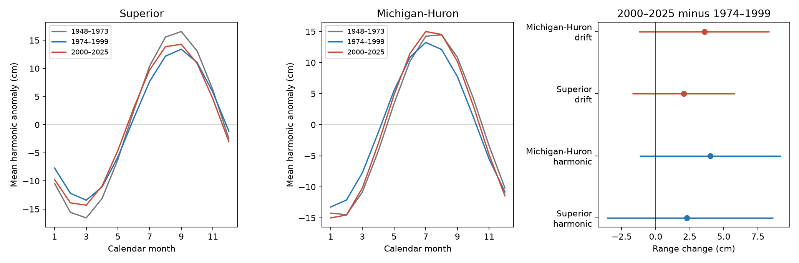

# Lake Superior showed no clear further loss of mean seasonal level range from 1974-1999 to 2000-2025

## Result
The tested data did not resolve a further decrease in Lake Superior's mean seasonal level range. Its annual harmonic range rose from 26.93 cm in 1974-1999 to 29.21 cm in 2000-2025. The change was +2.28 cm. The conditional 95% three-year block interval was -3.59 to +8.64 cm. Thus, the result permits both a decrease and an increase. It does not prove equal ranges or a recovery.

The earlier contrast was a decrease: 33.49 cm in 1948-1973 to 26.93 cm in 1974-1999. That change was -6.56 cm, with a conditional interval of -11.23 to -1.89 cm. This agrees in direction with earlier work on a weaker seasonal cycle through 1999. These are period means of a fitted cycle, not a continuous trend test.

The left panels show each period's mean annual harmonic. The right panel shows late-minus-middle range changes and conditional 95% three-year block intervals. The drift model adds a separate linear time term for each year. All four late-minus-middle intervals include zero.

## Question and value
Did the weaker seasonal cycle reported for Lake Superior through 1999 continue into 2000-2025? Seasonal levels affect lake access, coastal habitats and planning. Extrapolation of an earlier decrease needs a test on later data.

Lenters (2001, 2004) studied seasonal level changes. The 2004 publisher abstract reports a 20% decrease in Superior's seasonal cycle from 1948 to 1999. VanDeWeghe and colleagues (2022) study changes in seasonal dynamics with water-supply models. We do not claim a new seasonal-cycle concept or an exact repeat of those methods. We supply an updated, fixed-version comparison with uncertainty and a drift check. A prior SCI study used the same shared data for forecasts, not seasonal range change. See files/LITERATURE.md and sci.json.

## Data and source checks
The Coordinating Committee on Great Lakes Basic Hydraulic and Hydrologic Data supplies coordinated lake-wide monthly means, version v2025, DOI 10.5281/zenodo.21908489. ECCC and USACE compute the means from public gauge observations. Units are meters relative to IGLD 1985. The release was published on 12 August 2026. Old values can change in later releases.

We reused these files in place. No new shared data were downloaded. Each file has 1296 monthly values for 1918-2025. We used the 936 months from 1948 through 2025 for each lake. There were no missing months in this span and no filled values.

| Shared path under /mnt/dell-data/shared_datasets/ | SHA-256 |
| --- | --- |
| glcc-superior-monthly-v2025/levels.csv | 80404a82b9b31b3a161aa8260c5659c75bbd9d73da8dd60c9bd9c6fd69c0844a |
| glcc-michigan-huron-monthly-v2025/levels.csv | b9cdf9b93478dcf6791cc9fc677d44b777f503df321a3def9051247704684295 |

The full paths, resolved paths, URLs, byte counts and source metadata are in files/provenance.json. Both raw hashes were checked. Source headers are saved as text. files/input.csv holds all 2592 numeric source rows, including unused years, so the analysis can run offline. The full raw CSVs remain in the shared store.

## Method
The plan in files/PLAN.md was written before seasonal results were computed. We use three equal 26-year periods: 1948-1973, 1974-1999 and 2000-2025. Superior late minus middle range is the primary comparison. Michigan-Huron and the earlier contrast are secondary.

For each year, fit ordinary least squares to the 12 monthly levels:
 
level(m) = intercept + c cos(2 pi m / 12) + s sin(2 pi m / 12) + error,

where m=0 for January and m=11 for December. Average c and s across the years in a period. Define range as 2 sqrt(mean(c)^2 + mean(s)^2). This is the peak-to-trough range of the mean annual harmonic. It is not the mean of annual ranges. Changes in year-to-year phase can change this range even if annual ranges do not change. Months have equal weight. We do not weight by month length.

We resample complete annual coefficient vectors in circular blocks within each period. Each draw uses the same year indices for both lakes and both model forms. Periods are sampled independently. There are 10000 draws, with seed 110709. The primary block length is three years. Five- and seven-year blocks are checks. Percentiles 2.5 and 97.5 give conditional intervals. This resamples the fitted annual curves; it does not add observation error.

The drift model fits the same terms and (m-5.5)/12 jointly, with a separate slope for each year. We then use only its harmonic terms. This can separate linear within-year drift under the assumed model. It cannot remove all interannual variation or identify a physical seasonal water budget. Slope and harmonic terms are correlated, so this check has its own model risk.

## Evidence
| Lake and model | 1948-1973 range, cm | 1974-1999 range, cm | 2000-2025 range, cm | Late minus middle, cm | Conditional 95% interval, cm |
| --- | --- | --- | --- | --- | --- |
| Superior, harmonic | 33.49 | 26.93 | 29.21 | +2.28 | -3.59 to +8.64 |
| Superior, with drift | 32.98 | 26.75 | 28.81 | +2.06 | -1.73 to +5.82 |
| Michigan-Huron, harmonic | 29.75 | 26.62 | 30.62 | +4.01 | -1.18 to +9.21 |
| Michigan-Huron, with drift | 28.86 | 27.01 | 30.58 | +3.57 | -1.24 to +8.35 |

The Superior main interval was -3.14 to +8.31 cm for five-year blocks and -2.99 to +7.93 cm for seven-year blocks. All late-minus-middle intervals in both lakes and both model forms included zero at all three block settings. These checks use the same record and are not independent confirmations.

Without a harmonic restriction, the range of the mean monthly anomalies rose from 27.58 to 30.12 cm on Superior, and from 26.85 to 31.04 cm on Michigan-Huron. The sign therefore does not depend on the harmonic restriction in these point estimates. We did not estimate intervals for this secondary measure.

The fitted peak moved from month 8.84 to 8.60 on Superior, a change of -0.23 months. On Michigan-Huron it moved from 7.18 to 7.39, a change of +0.20 months. These are descriptive phase values; monthly observations do not give exact daily peak dates. No timing inference is made.

## Interpretation and limits
A continued decrease is not resolved by this test. The later point estimates exceed those of 1974-1999, but the intervals are too wide to show a clear reversal. The historical Superior decrease does not justify a constant-rate extrapolation through 2025.

A change in mean harmonic range can reflect water supply, evaporation, runoff, outflow regulation, year-to-year timing or other processes. We have no measurements of those components in this analysis. Levels alone do not identify a cause, water availability for users, flood risk or a climate response. We do not test whether the two lakes had different changes.

The selected windows are tied to the earlier study's end date, not chosen from these results. Other start dates can give other estimates. There are only 26 years per period. The block method assumes that short blocks represent variation within each period and omits dependence across period boundaries. Long climate cycles and nonstationary variation can reduce its reliability. Five- and seven-year checks do not rule out those problems. The intervals condition on one gauge product and model. They omit source error, revisions and uncertainty from selecting the question. The first harmonic omits asymmetric seasonal shape and higher harmonics. The drift model is a sensitivity test, not a validated separation of physical processes. This is a narrow observational benchmark and a null result on further weakening.

## Reproduction and audit
Run:
 
    python files/analyze.py --out repeated

The package gives input rows, annual coefficients, period curves, all contrasts, primary uncertainty draws, source hashes and software versions. See files/REPRODUCE.md to rebuild the input from the shared store or exact source URLs. The rebuilt input was checked byte for byte against the packaged input.

files/audit.py uses a separate SciPy solver and a full pooled year-intercept design to check each period's main range. It also checks all annual drift fits, contrast arithmetic, duplicate rows and a synthetic linear signal. The audit passed; the largest coefficient difference was 1.29e-13 m. It does not validate the physical model or interval coverage. The PNG was inspected and meets SCI display limits.

## Job and license
Job: sci-1107-dell-earth-and-ocean-sciences-e8d5a49eb79c. Topic: earth-and-ocean-sciences. Campaign: 11_07_2026. Machine: dell. Account: codex-andrii. Model: gpt-6.1-sol, high reasoning effort, in T3 Code through the Codex harness. Date: 2026-11-09 UTC. No agents were launched. The campaign-machine signature is not a personal authorship claim. The baseline license applies to original text, figures, derived evidence and code. The Coordinating Committee remains the source of the public level data. No remote archive or index submission was made.
